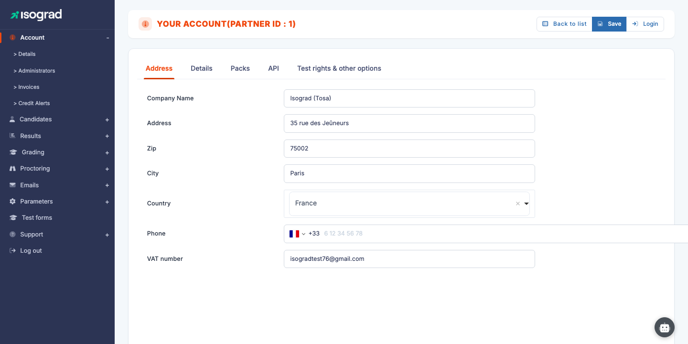
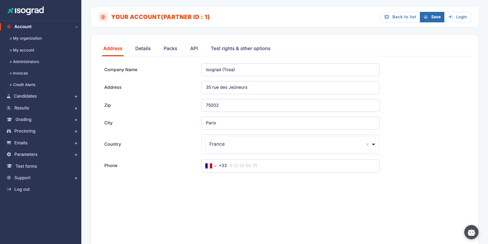
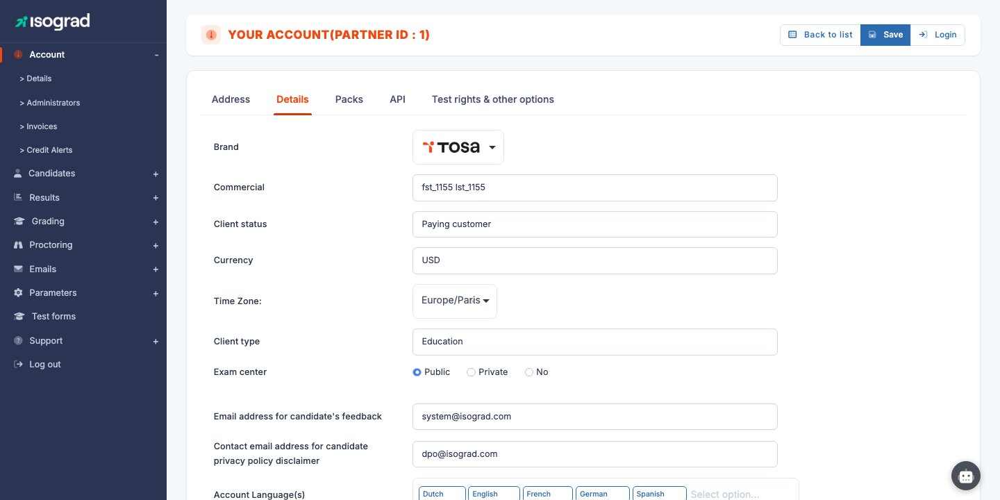
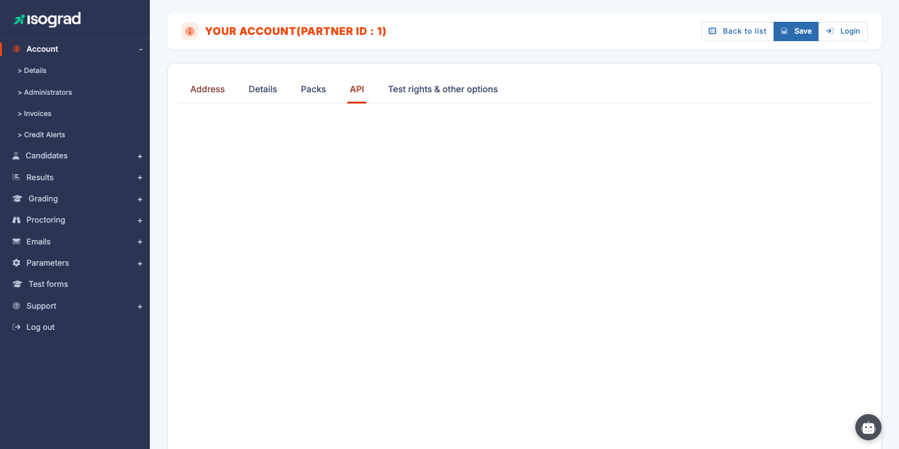
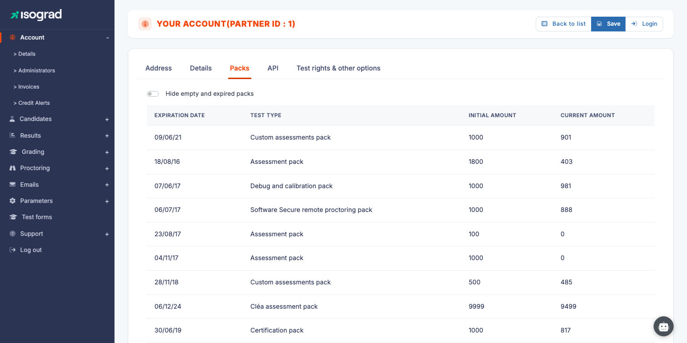
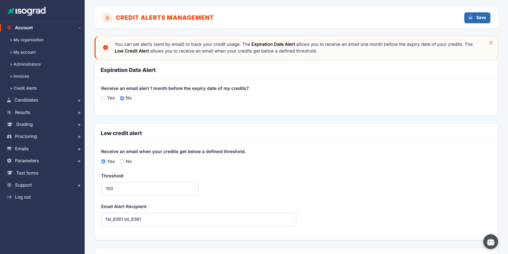

# Account management

The **Account** menu gathers the pages related to your **organization** (legal name, address, logo), to the **management of your Tosa credits** (pack overview, expiration and threshold alerts), and to your **administrator profile** (password, credentials, language).

This chapter covers the **My organization**, **My account** and **Credit alerts** pages. Administrator management is covered in its own chapter — see [Administrator management](/ai/en/admins/).

## My organization {#account-details}

Access this page via **Account → My organization** from the navigation menu.

The **Your account** page is organized into several **tabs**:

- **Address** — postal and tax details of your organization (legal name, address, phone, VAT number).
- **Details** — additional settings: **logo** displayed on reports, GDPR and feedback email addresses, languages, security options, and depending on your profile, brand, sales contact, currency and customer type. This tab is reserved for administrators allowed to edit the account.
- **Packs** — list of credit packs in progress, their quantity and their expiration date.
- **API** — access to the platform API: authentication parameters, your tests' identifiers and technical documentation. This tab only appears on **your own account**.
- **Delete your account** — for the main administrator, when the account has several administrators.

Your personal administrator details (name, email address, language, password) are not on this page: they are managed in [My account](#my-account).

> 💡 **Tabs visible according to your profile** — Some tabs or fields only appear depending on the account type (for example, a **CPF** tab appears for French training centers registered on Mon Compte Formation). Don't worry if you don't have exactly the same tabs as in the screenshot above.

### Edit account details

1. Open the **Address** tab (selected by default).

    

2. Edit the desired fields:

    - **Company Name** — legal name of your organization.
    - **Address**, **Zip**, **City**, **Country** — main postal address.
    - **Phone** — contact phone number. The field is preceded by a country selector (flag and dial code), preselected from the account's country; the number is checked against the selected country and saved in international format.
    - **VAT number** — used for billing European accounts. It is only displayed if it is filled in on your account, and cannot be edited: contact your Isograd representative to correct it.

3. Click **Save** at the top right. Changes are saved immediately.

### Edit the logo and notification settings

The **Details** tab lets you customize several elements visible in your communications with candidates.

- **Logo** — image (JPG or PNG) that will appear on the **test reports** sent to candidates. Scroll down to the **Logo upload (jpg or png)** button, click to open the upload window, select your file and confirm.
- **Email address for candidate's feedback** — contact address used when a candidate fills in the feedback form on the platform.
- **Contact email address for candidate privacy policy disclaimer** — address at which your candidates can request rectification or deletion of their personal data. It appears in the GDPR legal notice at the foot of your emails.

The same tab gathers several account settings:

- **Account Language(s)** — the languages used on your account (multiple selection).
- **Use external ID** — enables the candidates' external ID, which then appears in the result header and in the Excel export of the results.
- **Enable two-factor authentication** — turns on two-factor authentication for the account's administrators.
- **Force admin password reset every 6 months**.
- **Propose to notify candidate by email if test is cancelled**.
- **Data Retention Period (Years)** — how long your account's data is kept, to pick from the list.
- **Compilatio token (optional)** — to fill in if you hold a Compilatio subscription for plagiarism detection.

> 💡 **Distributor fields** — If you see fields like **Brand**, **Sales contact**, **Currency**, **Contract type**, **Customer type** or **Approved center**, or an additional **Tests used & other options** tab on this tab, it means your account is of distributor or approved-center type. These fields **cannot be modified by you**; they are managed by your Isograd contact.

> 💡 **The logo does not appear in emails** — The logo configured here is used **only in the PDF reports** sent to candidates. To customize the header of your emails, use the dedicated **banner** — see [Add a custom banner](/ai/en/mail-templates/#add-a-custom-banner).

### API settings

The **API** tab gathers what you need to connect your information system (LMS, HR software, recruiting tool) to the platform:

- **Show API Credentials** — opens the **API Credentials** window with your **Client ID** and **Client Secret**, to copy into your integration. The secret is masked by default; the eye icon reveals it and the copy icon puts it in the clipboard. The credentials are generated the first time the window is opened. This button is reserved for administrators allowed to edit the account.
- **Display Identifiers** — opens the list of your account's tests with the identifier to use in registration calls.
- **View API technical documentation** — opens the developer documentation in a new tab.

> ⚠️ **Client Secret** — The secret gives access to your candidates' data: only share it with the technical team doing the integration and never paste it into a shared document.

> 💡 **API not included** — If your subscription does not include API access, the tab only shows a message saying so; contact your Isograd representative to enable it.

> 💡 **Personal access token** — An administrator holding the *Generate a personal API access token* privilege can also call the API with their own rights (privileges and groups), without using the account credentials — see [Generate an API access token](#api-token).

## My account {#my-account}

The **My account** page (menu **Account → My account**) gathers what concerns you personally as an administrator: your details, your interface language, your password and, if you are allowed to, your API access tokens. It is available to every administrator and only deals with **your own** account; other administrators are managed from [Administrator management](/ai/en/admins/).

### Edit your details

1. Edit the desired fields:

    - **Title**, **Last Name**, **First Name**.
    - **Email Address** — serves both as login identifier and as notification address. It must be unique on the platform.
    - **Language** — interface language. System emails (password reset, etc.) are also sent to you in this language.
    - **Comment** — free note, optional.

2. Click **Save** at the top right. The page reloads with your changes.

> 💡 **Immediate language change** — If you chose another language, the interface switches to it as soon as you save: there is no need to log in again.

> 💡 **Read-only form** — If you are not allowed to edit your administrator record, the fields are greyed out and the **Save** button does not appear. Changing your password remains available.

### Change your password {#change-password}

1. Click **Change password** at the top right of the page. A window opens.
2. Enter the new password in **Password**, then again in **Confirm Password**. The **Click to generate a random password** link suggests a random password, and the eye icon shows what you typed.
3. Click **Save**. The password is changed immediately and you stay logged in.

The password must contain at least 6 characters. If your account enforces strong passwords, it must contain at least 8 characters including a number, an uppercase letter, a lowercase letter and a special character, and cannot be identical to the previous one. The window reports any non-compliant entry, as well as a confirmation that differs from the password.

### Generate an API access token {#api-token}

An administrator holding the *Generate a personal API access token* privilege can create a **personal token** themselves to call the platform API with their own rights (privileges and groups). Each administrator only manages their own tokens. Without this privilege, the section does not appear on the page.

1. Below the form of the **My account** page, the **API access token** section shows the number of **Active tokens** and, if there are any, the **Next expiry** date.
2. Click **Generate a token**. The token is displayed in a read-only field, with its expiry date; the **Copy** button puts it on the clipboard. There is no need to save the form: the token is active as soon as it is generated.

> ⚠️ **Displayed only once** — Copy the token immediately: it is not stored anywhere and can never be displayed again. If it is lost, generate a new one.

A token is valid for **one year**. It is checked on every call and refused if you lose the privilege, if your account is disabled or if you revoke your tokens. You can generate several tokens; they all stay active until they expire or are revoked.

To invalidate your tokens, click **Revoke all my tokens** then confirm: all your tokens are refused immediately. The button is greyed out as long as you have no active token.

## Packs and credits {#packs-and-credits}

The **Packs** tab lists all your **Tosa credit packs** in progress, their initial quantity, their remaining quantity, and their expiration date.

The table shows, in order, the following columns:

| Column | Content |
|---|---|
| **Expiration date** | Date beyond which the credits will be lost. |
| **Test type** | Nature of the pack (Evaluation pack, Certification pack, Remote proctoring pack, etc.). |
| **Initial amount** | Number of credits originally purchased. |
| **Current amount** | Credits still available to date. |

The **Hide empty and expired packs** toggle at the top of the table lets you filter the view to only see the packs that are still usable — convenient once your account history starts to grow long.

### Purchase additional credits

To order new credits, use the **Buy additional test credits** button below the table (visible depending on your contract type; it is labelled **Subscribe** for subscription accounts) or contact your Isograd representative directly. Purchased packs appear automatically in the table as soon as they are set up on your account.

> 💡 **Account with no packs** — If you don't have any pack yet, the platform simply displays *"No valid pack."*

### View consumption details

Beyond the list of packs, the **Account → Usage report** page shows detailed consumption per **group** and per **administrator**, over a chosen period. This view is useful for periodic reviews ("how much did promotion A consume over the last quarter?") and can be exported to Excel.

## Credit alerts {#credit-alerts}

The **Credit alerts** page (menu **Account → Credit Alerts**) lets you configure **three independent email alerts** to track your credit consumption without having to come back and check the account manually.

The three alerts are:

- **Expiration Date Alert** — an email **one month before** the expiration date of your credits.
- **Low credit alert** — an email when your credit quantity drops **below a threshold** that you set.
- **Monthly Credit Consumption Alert** — an email **every month** summarizing your consumption for the past month.

Each alert can be enabled independently via its dedicated **toggle**. For each one, you specify the **recipient** of the alert (who is not necessarily you — for example, the recipient of financial alerts could be your accounting manager).

### Configure an alert

1. For the alert that interests you, **enable its toggle** (*"Receive an email alert…"*). The configuration fields become editable.

2. Fill in:

    - The **recipient** (email address) who will receive the alert.
    - For the **Low credit alert** only: the **threshold** in number of credits. You will receive the alert as soon as your stock drops below this value.

3. Click **Save**. The configuration is in place; no further action is required — the platform will trigger sending automatically when the conditions are met.

> 💡 **Recommended** — Enable **at least the expiration alert** and **the threshold alert** to avoid unpleasant surprises (expired unused credits, or being unable to register a new candidate because the counter has dropped to zero). The monthly alert is useful for high-volume accounts.

> ⚠️ **Only one expiration alert per month** — The expiration alert is triggered **once** per pack reaching its expiration. You will not receive daily reminders; remember to archive the email so you don't forget it.
