# Candidate management

This chapter covers the entire life cycle of a candidate on the Tosa platform: adding candidates individually or in bulk, registering them to tests, sending them invitations and organizing your population into groups.

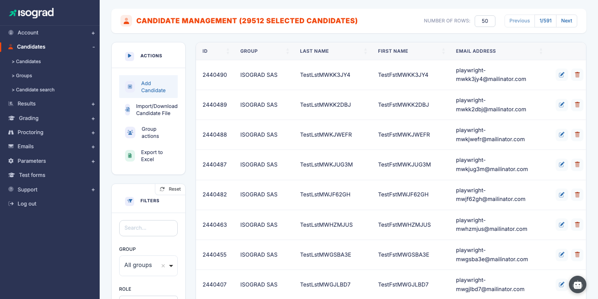

The **Candidate management** page is presented as a table listing all your candidates. The filters at the top of the page let you narrow the display (free-text search, membership in a group or sub-group, candidates having a test to take, display of the connection status, inclusion of archived candidates). The main actions — add a candidate, import a file, apply a group action, export to Excel — are located in the action bar at the top of the table.

## Add a candidate {#add-a-candidate}

This procedure allows you to create a candidate individually. To add several candidates in a single operation, refer to the [Import candidates](#import-candidates) section.

### Procedure

1. From the **Candidate management** page, locate the **Add Candidate** button in the action bar at the top of the table.

    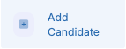

2. Click **Add Candidate**. The entry form opens.

    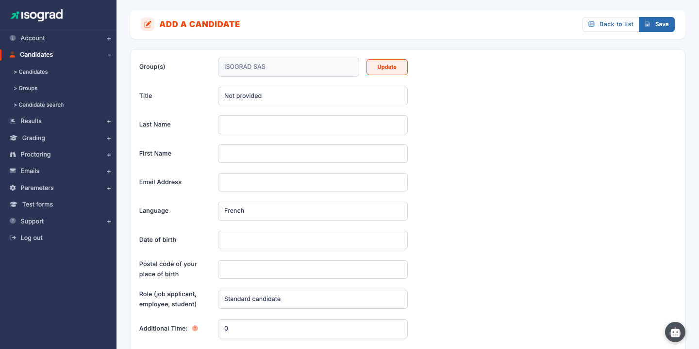

3. Fill in the fields:

    - **Group(s)** — the candidate must belong to at least one group; the **Update** button opens the group selection.
    - **Title**.
    - **Last Name** and **First Name** — as they will appear on the certificates.
    - **Email Address** — address at which the candidate will receive their invitations and access their workspace.
    - **Language** — the candidate's language, later preselected when registering them to tests.

    Depending on your account options, the form also offers other fields, for example **Additional Time** or **External ID**.

4. Click **Save**. The candidate is created and you are automatically redirected to their test registration page.

    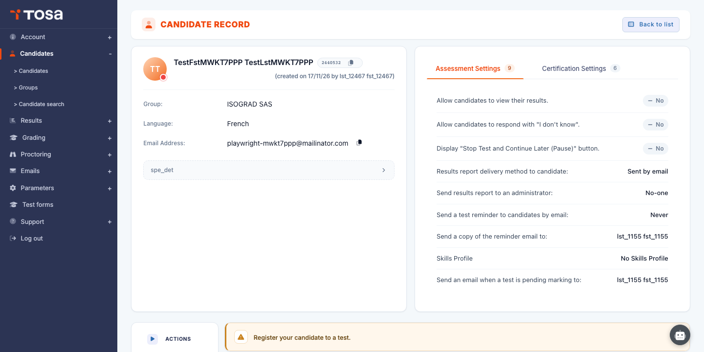

From this page, you can immediately [register the candidate to a test](#register-a-candidate-to-a-test) or [send them an invitation](#send-invitations).

> 💡 **Subsequent modification** — To modify the contact details of an existing candidate, go back to the candidate list, click the **Edit** icon at the end of the row, then the **Edit candidate details** button of their record.

## Import candidates {#import-candidates}

The candidate import allows you to create several candidates — or even pre-register them to tests — in a single operation, from an Excel file. It takes place in **two stages**: the platform first displays a **preview** of the file, without saving anything, then imports the valid rows once you have confirmed.

### Procedure

1. From the **Candidate management** page, locate the **Import/Download Candidate File** button in the action bar.

    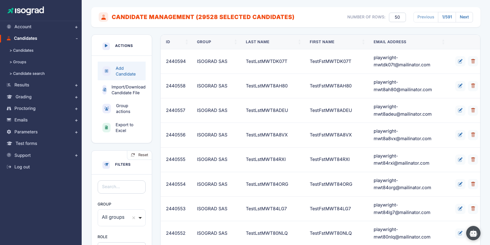

2. Click **Import/Download Candidate File**. A window opens.

    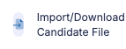

    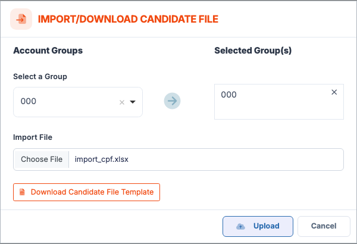

3. In this window, click **Download Candidate File Template** if you do not have a file yet, then fill in the template with your candidates. The columns of the template:

    | Column | Required | Description |
    |---|---|---|
    | Identifier (optional) | No | External identifier of the candidate. |
    | Last name | Yes | Candidate's last name. |
    | First name | Yes | Candidate's first name. |
    | Title | Yes | To be chosen from the drop-down list. |
    | Language | Yes | To be chosen from the drop-down list. |
    | Email address | Yes | A valid email address, present only once in the file. |
    | Password (optional) | No | If left empty, a password is generated automatically. |
    | Person with disabilities (optional) | No | Yes or No. |
    | Extra time in % (optional) | No | Extra time granted to the candidate. |

    On accounts that handle CPF files, the template has three more columns: **Test identifier** (to register the candidate to a test at import time), **With e-proctoring** and **CPF file number** (digits only, 13 at most; it requires a test identifier).

4. Still in the window, select the **group(s)** to attach the candidates to (at least one group is required), choose your file in **Import File**, then click **Upload**.

5. The **Candidate import preview** page is displayed. Nothing is saved at this stage. It indicates the number of rows read, recalls the groups the candidates will be added to, then lists each row of the file (row, email address, last name, first name) with its status:

    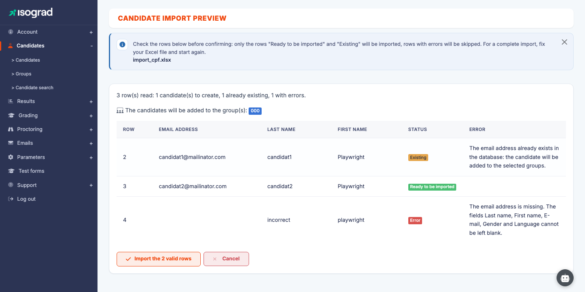

    - **Ready to be imported** — the candidate will be created.
    - **Existing** — a candidate already has this email address: they will not be recreated, but added to the selected groups.
    - **Error** — the row will be skipped; the **Error** column gives the reason (email address missing, invalid or duplicated in the file, empty required field, unknown test, Excel formula error…).

6. Click **Import the N valid rows** to confirm, or **Cancel** to go back to the candidate list without importing anything. If no row can be imported, the confirmation button is disabled: fix your file and start again.

7. After confirmation, the result page indicates the number of candidates imported and, where applicable, the number of existing candidates added to the groups. If some rows could not be saved, they are listed with the reason. The **Back to candidates list** button takes you back to the table.

> ⚠️ **Duplicate emails** — If a candidate already exists with the same email address, they are **not recreated** and their information is not modified: they are only added to the selected groups (and registered to the test indicated on their row, where applicable).

> 💡 **Incomplete or oversized file** — Only the **Ready to be imported** and **Existing** rows are imported; for a complete import, fix your Excel file and start again. A file is limited to 1000 candidates: beyond that, only the first 1000 rows are read. If the platform tells you at confirmation that the preview has expired, start the import again from the candidate list.

> 💡 **Import and invitations** — The import does **not** automatically trigger the sending of invitations. To send the login emails after import, refer to the [Send invitations](#send-invitations) section.

## Anonymous candidates {#anonymous-candidates}

When exam scripts are marked **anonymously**, each script only carries an **identifier** (anonymity number, candidate number…) and not the name of its author. The **Anonymous candidates** menu of the **Candidate management** page lets you prepare and then lift this anonymity with two Excel files:

- **Import an identifier file** — before the scripts are imported, creates an anonymous candidate for each expected identifier;
- **Associate candidates with their identifiers** — once the scripts are marked, gives each anonymous candidate their last name, first name and, if you wish, their email address.

As with the candidate import, each import takes place in **two stages**: a **preview** that saves nothing, then the confirmation.

> 💡 **Availability** — The **Anonymous candidates** menu only appears on platforms that have the scanned-script marking module. The scripts themselves are imported from that module — see [Scan paper copies](/ai/en/grading/#exam-scanning).

### Import an identifier file {#import-identifiers}

This import declares in advance the identifiers expected in one or more groups. When the scripts are imported, the platform can then detect the **missing scripts** and the scripts whose identifier matches **no expected identifier**.

1. In the **Anonymous candidates** menu, click **Import an identifier file**. A window opens.

2. Click **Download Candidate File Template** and enter one identifier per row in the `ext_id` column. The column is formatted as text to keep the leading zeros of the identifiers. An identifier cannot exceed 40 characters.

3. Select the **group(s)** the anonymous candidates will join (at least one group is required), choose your file in **Import File** (Excel or CSV), then click **Upload**.

4. The preview page is displayed. Nothing is saved at this stage. It shows the number of rows read, recalls the selected groups, then lists each row with its status:

    - **Ready to be imported** — no candidate of your account carries this identifier: an anonymous candidate will be created.
    - **Existing** — a candidate already carries this identifier: it will not be created again, but added to the selected groups.
    - **Error** — the row will be skipped; the **Comment** column gives the reason (identifier missing, too long, duplicated in the file, or carried by several candidates of your account).

5. Click **Import the N valid rows** to confirm, or **Cancel** to go back to the candidates list without importing anything.

6. The result page shows the number of anonymous candidates created and, where applicable, the number of existing candidates added to the groups. The **Back to candidates list** button takes you back to the table.

In the candidates table, an anonymous candidate can be recognised by their last name and first name, both "anonymous", and by their identifier.

### Associate candidates with their identifiers {#associate-identifiers}

Once the scripts are marked, this import replaces the anonymous identity of the candidates with their real identity. The results and scripts already attached to each candidate are kept.

1. In the **Anonymous candidates** menu, click **Associate candidates with their identifiers**. A window opens.

2. Click **Download Candidate File Template** and enter, for each identifier (`ext_id`), the first name (`fst_nam`) and the last name (`lst_nam`), both required. The `ema` column (email address) is optional.

3. Choose your file in **Import File**, then click **Upload**. No group is requested: the candidates stay in their groups.

4. The preview page lists each row (identifier, last name, first name, and email address if the file has it) with its status:

    - **To be named** — the identifier is that of an anonymous candidate: it will receive the last name, the first name and, when provided, the email address of the file.
    - **Already named** — the candidate carrying this identifier already has a first and last name: it will not be modified.
    - **Error** — the row will be skipped; the **Comment** column gives the reason (no candidate carries this identifier, empty first or last name, email address invalid, duplicated in the file or already used by another candidate of your account…).

5. Click **Import the N valid rows** to confirm, or **Cancel**. The result page shows the number of candidates named.

> 💡 **Files and limits** — Both imports read the sheet named **Import** of the file (the one of the template) or, failing that, its first sheet, down to the first empty row. A file is limited to 1000 rows: beyond that, only the first 1000 are read. If no row can be imported, the confirmation button is disabled: fix your file and start again.

> ⚠️ **Duplicate identifiers** — A given identifier must be carried by only one candidate of your account: otherwise the row is in error in both imports.

## Register a candidate to a test {#register-a-candidate-to-a-test}

Once the candidate is created, you must register them to one or more tests so they can take them. Everything happens from the **candidate's record**, which gathers their registrations and the actions that concern them.

### The candidate's record

From the candidate list, click the **Edit** icon of the corresponding row. You are also redirected there automatically after saving a new candidate.

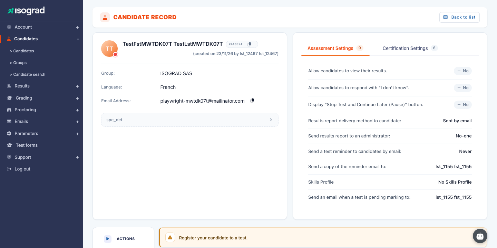

The button bar at the top of the record gathers the actions available for this candidate. Some buttons only appear depending on your privileges and your account options:

- **Register to a test** — opens the registration window described below.
- **Edit candidate details** — goes back to the contact details form (identity, email, language, groups).
- **Test parameters** — options specific to this candidate: **Assessment Settings**, **Certification Settings** (display of results, sending of reports and certificates, recipients, reminder frequency and the administrator receiving a copy of the reminder email) and, where applicable, **Configuration test parameters**. These values override, for this candidate only, the account's [default options](../default-options/).
- **Send a test invitation e-mail to candidate** — sends the invitation email (see [Send invitations](#send-invitations)).
- **Assign a temporary password** — the candidate will have to change it at their next login.
- **Anonymize** — permanently replaces the candidate's personal data.
- **Transfer** — moves the candidate to another account of your organization, when this option is enabled.

> 💡 **Tests per job** — On Isograd Testing Services accounts, the **Tests per job** button suggests, from a job title or description, a selection of recommended tests with a link to each test's description.

Below the button bar, the **planned tests table** lists all the candidate's registrations (see [below](#the-planned-tests-table)).

### Register a candidate from their record

1. Click **Register to a test**.

    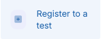

2. The **Register candidate for a test** window opens.

    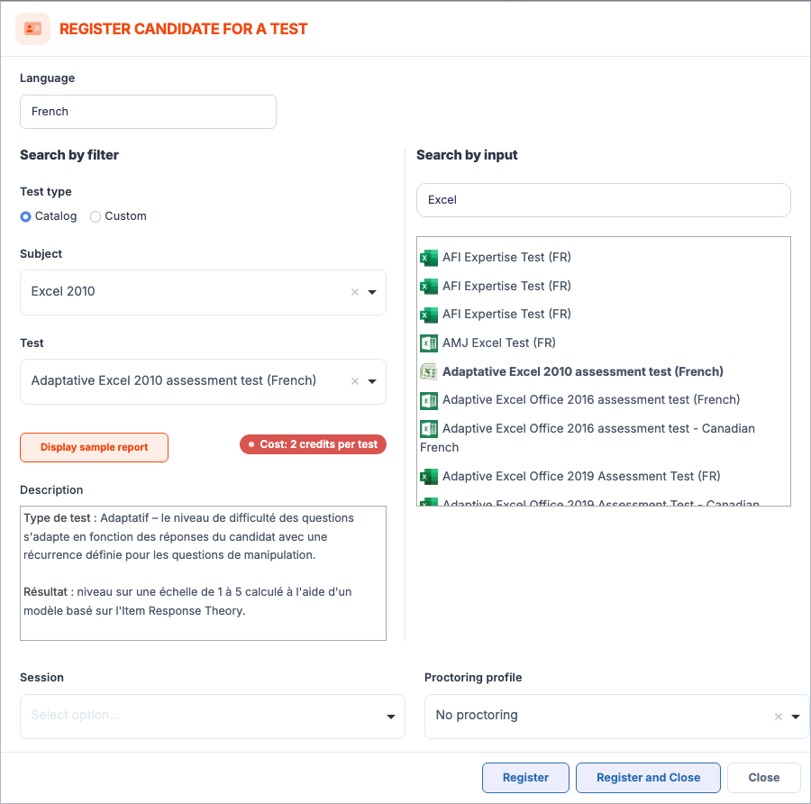

    First choose the **Language** of the test: it is preselected on the candidate's language, and the list of subjects is refreshed on every change. Then select the test in one of two ways:

    - **Search by filter** (left column) — if your account has custom tests, the **Test type** lets you switch between **Catalog** and **Custom**; then choose the **Subject**, then the **Test**.
    - **Search by input** (right column) — type at least three characters of the test name and click the desired result; the selectors on the left are set automatically.

    Once the test is chosen, its **Description** is displayed with the number of questions and, if the test is time-limited, its maximum duration in minutes, together with the number of credits consumed where relevant, and the **Display sample report** button offers a sample report in PDF format when one exists for this test.

3. Complete, depending on your account options:

    - **Session** — attaches the registration to an existing test session (**No associated session** by default). The **Create a new session...** entry takes you directly to the session creation page; on some accounts, the session is mandatory.
    - **Proctoring profile** — **No proctoring** or one of your [proctoring profiles](../proctoring/) (full screen, remote proctoring…). For a **certification**, your account's default profile is preselected; if remote proctoring is mandatory on your account, it is applied automatically and a message says so. If the chosen session is **proctored live**, the proctoring profile is **imposed by the session**: the selector is locked and the message *"Proctoring profile imposed by the live-proctored session"* is displayed.

4. Click **Register** to chain another registration in the same window, or **Register and Close**. The test appears immediately in the planned tests table.

> 💡 **Credit type** — If your account holds several packs valid for this test (for example a "one test per credit" pack and a "several tests per credit" pack), a **Select a credit type** window asks which one to use before registering.

> 💡 **Certification already taken** — Depending on your account configuration, if the chosen test is a **certification** the candidate has already been registered to, you are asked to confirm before registering them again. Assessments do not trigger this confirmation.

### The planned tests table {#the-planned-tests-table}

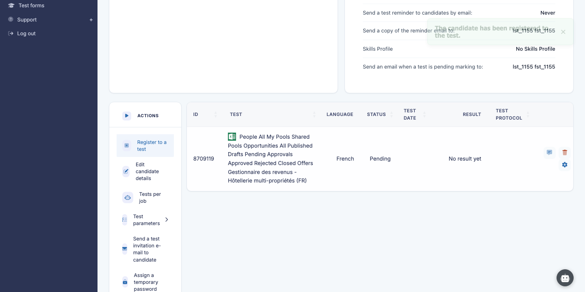

Each row is a registration: test, status (pending, started, complete, waiting for marking), session and test date where applicable. A **full screen** or **camera** icon next to the test name indicates the associated proctoring profile. A red **Stopped by an administrator** badge in the status column flags a started test that you have interrupted (see below).

The action buttons appear when hovering over the row:

- **Delete** — removes the registration of a test that has not started; the credit is refunded. Depending on your account, the platform offers to notify the candidate of the cancellation by email.
- **Parameters** (pending test) — changes the **Session**, the **Proctoring profile** and the **Disable in-application** option without deleting the registration. Here too, a live-proctored session imposes its proctoring profile.

    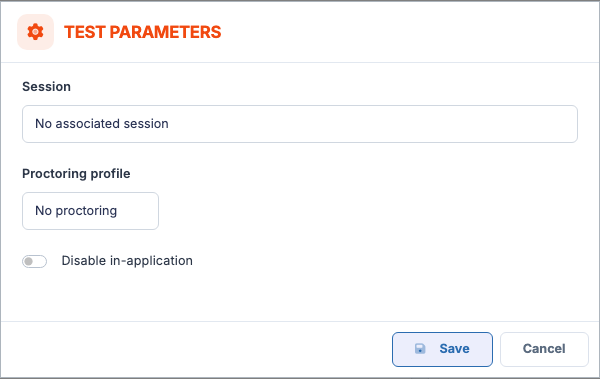

- **Administrator's comment** — an internal note attached to this registration, invisible to the candidate.
- **Change test details** (started or completed test) — depending on your privileges: adjust the end time, reset the test with or without an email to the candidate, restart or disable the in-application part.
- **Stop the test** (started test) — interrupts the attempt immediately: the candidate is sent back to their test list with the message *"Your test has been interrupted by an administrator or a proctor"* and cannot continue until the test is resumed. The **Stopped by an administrator** badge appears on the row and the button becomes **Resume the test**.
- **Resume the test** (stopped test) — lifts the interruption; for a timed test whose clock does not stop during an interruption, the stopped time is **given back to the candidate**. Resetting the test also lifts the stop.
- **Details** (completed test) — opens the detailed analysis of the test (see [Results management](../results/)); **Assign grade** appears instead for a test waiting for marking.
- **Send diploma** (completed certification) — sends the certificate to the recipients defined in the certification settings; **Add a confirmation test** is offered for a completed assessment when your account has this option.

### Register several candidates at the same time

To register several candidates to the same test, use a group action from the **Candidate management** page:

1. Filter the table on a **group** (and, if relevant, a sub-group) and leave the search field empty. The **Group actions** button then becomes a menu; without a selected group, it simply reminds you that a group must be chosen first.
2. If all the candidates of the group fit on a single page, a check box appears at the start of each row, ticked by default: untick the candidates to exclude (the header check box ticks or unticks everything). If the group spans several pages, the action applies to the whole group.
3. In the **Group actions** menu, choose **Register test(s) to all candidates in group**.
4. Fill in the test parameters (subject, language, session, proctoring profile); they apply to the entire selection. Click **Register** to chain another registration, or **Register and Close**.

> 💡 **Candidates already registered** — If some candidates of the selection are already registered to this test, the platform tells you so and offers either to register all of them again, or to register only those who are not registered yet.

> 💡 **Credits** — Each registration consumes one credit from the corresponding pack (or a fraction of a credit with a "several tests per credit" pack). The balance of your packs can be checked in [Account management](../account/). To buy back credits, contact your Isograd representative.

## Send invitations {#send-invitations}

Sending the email invitation transmits the candidate's personalized login link. This is the step that makes the test accessible on the candidate's side.

### Send an invitation to a single candidate

1. Open the candidate's record (from the list, click the **Edit** icon).

    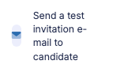

2. Click **Send a test invitation e-mail to candidate**. The **Message details** window opens.

    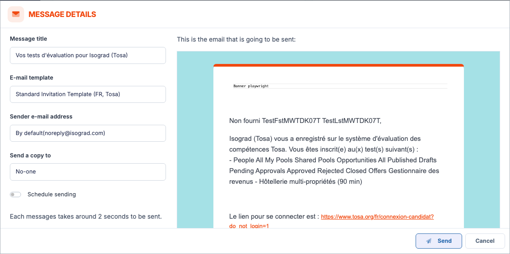

3. Fill in the left column:

    - **E-mail template** — choose among the registration templates configured for your account in the candidate's language; the title and the preview are refreshed on every change.
    - **Message title** — the subject of the email, pre-filled from the template and editable.
    - **Sender e-mail address** — visible if verified senders are configured (see [Email management](../mail-templates/)); otherwise the platform's default address is used.
    - **Send a copy to** — an administrator of your account receives a copy of the message.
    - **Schedule sending** — turn on the switch and set the **Send date** to defer the sending.

    The right column shows the exact preview of the email as it will be received. The body of the message comes from the template: to change it, edit the template in **Email management**.

4. Click **Send**. The candidate receives their email with their personal login link, and the record reloads.

> ⚠️ **Tests already sent** — If a test has already been the subject of an invitation email, the window says so with the sending date. You can still send an invitation again, for example after correcting an address.

### Send invitations in bulk

From the **Candidate management** page:

1. Filter the table on the desired group and, if the check boxes are displayed, leave only the candidates to invite ticked (see [Register several candidates at the same time](#register-a-candidate-to-a-test)).
2. In the **Group actions** menu, choose **Send registration email to all candidates in group**.
3. Choose the email template, check the subject and the message preview, then click **Send**. A confirmation recalls the number of emails about to be sent and the group concerned.

Each candidate receives the invitation with their personal link. When the action targets the whole group, only the candidates who still have a test to take are recipients.

> ⚠️ **Invalid addresses** — If a candidate's email address is invalid or refused by the destination server, you will see it in the send report. Correct the address on the candidate's record then resend.

> 💡 **Customize email templates** — Email templates are managed in the [Email management](../mail-templates/) chapter. You can create variants there by language, by brand, or by test type.

## Manage groups {#manage-groups}

Groups let you organize your candidate population (by class, department, client, training course, etc.) to make bulk actions easier: registrations, invitations, result tracking.

### Access the groups

From the navigation menu, click **Groups**.

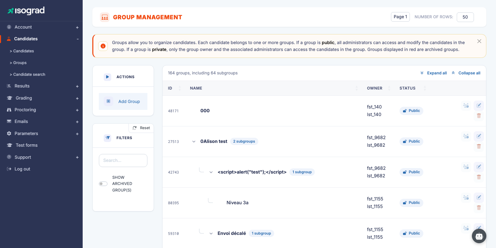

The **Group management** page displays all your groups in a hierarchical form. A group can contain sub-groups — useful for example to structure "Promotion 2026 → Section A → Evening class".

### Create a group

1. Click **Add Group** in the action bar.

    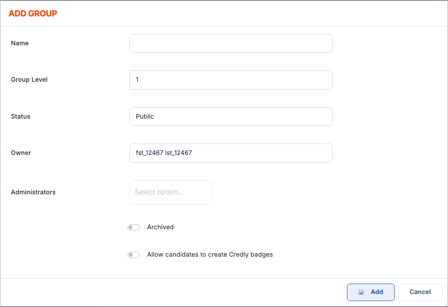
2. Fill in:

    - **Name** of the group.
    - **Group Level** — for a level 2 or level 3 group, also choose the group it is attached to, which creates the hierarchy.
    - **Status** — a public group is accessible to all administrators; a private group only to its owner and the associated administrators.
    - **Owner** and **Administrators** of the group.
    - **Allow retake of failed certifications** — this switch only appears on accounts where retake is enabled. Candidates who later join the group inherit it, unless they already have a setting of their own.

3. Click **Add**.

### Add a candidate to a group

Two methods:

- **From the candidate's record**: click **Edit candidate details**, then the **Update** button of the **Group(s)** field, and add the candidate to the desired groups.
- **Group action** on the candidate list: filter on the original group, select the candidates, then **Add selected candidates to a group**. The candidates join the chosen group(s) without leaving their current group.

### Group actions

Once your candidates are organized into groups, the **Group** filter on the **Candidate management** page lets you isolate a population and apply a bulk action to it through the **Group actions** menu (how the selection works is described in [Register several candidates at the same time](#register-a-candidate-to-a-test)):

- **Set a temporary password** — the same password for the whole selection; each candidate will have to change it at their next login.
- **Register to a test**.
- **Send registration emails**.
- **Delete pending tests** — choose the test concerned among those still pending in the selection.
- **Delete candidates**.
- **Add the candidates to a group** — without removing them from their current group.
- **Assign a session or a proctoring profile to a test** — for a pending test, choose the session and, if needed, the proctoring profile. A live-proctored session imposes its own profile on every test attached to it.
- **Set assessment options** and **Set certification options** — display of results to the candidate, report delivery, diploma sending and recipients, applied to the whole selection. Each entry only appears if your account has the corresponding pack type.
- **No retake** — offered only on accounts where the retake of failed certifications is enabled. The checked candidates (or every candidate of the group when none is checked) will no longer be allowed to retake their failed certifications; the other candidates are left unchanged. You are asked to confirm before the action is applied.
- **Generate badges** — issuing of Credly digital badges for the eligible certifications of the selection.

> 💡 **Archiving vs deletion** — **Archiving** a group is done from the **Group management** page and is non-destructive: it hides the group and its candidates from the lists by default, but preserves the history of past tests. **Deleting** candidates is final — use it only for candidates created in error.
