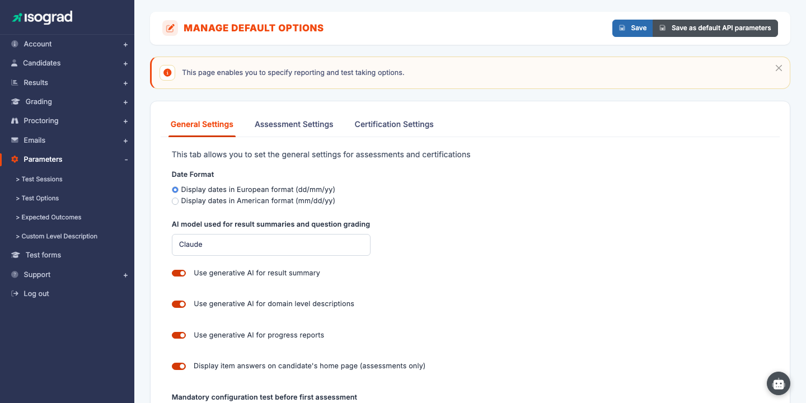
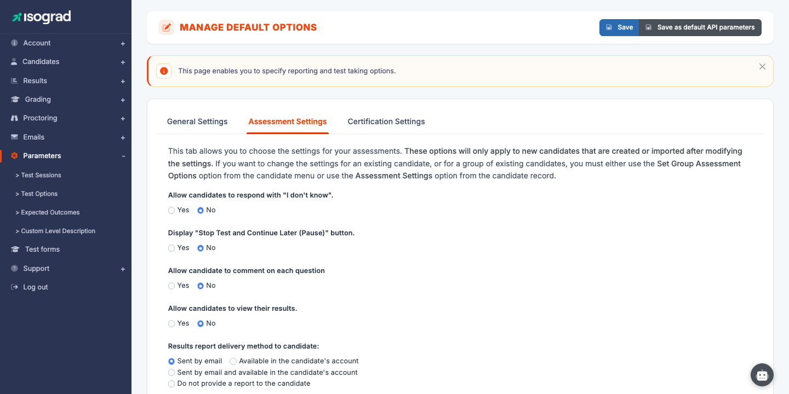
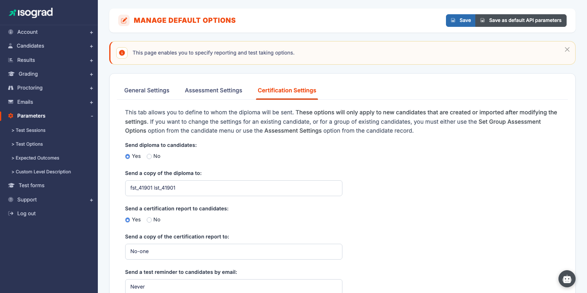

# Default options

The **Default options** page centralises the **sitting parameters** applied to every test registered on your account. The values defined here are **pre-filled** in the registration window when registering a candidate to a test — you can still change them on a case-by-case basis, but setting them here saves time and ensures consistency across your entire activity.

Open this page through the **Parameters → Test Options** menu.

The page is organised into several **tabs**:

- **General Settings** — settings shared between assessments **and** certifications.
- **Assessment Settings** — specific to assessment tests.
- **Certification Settings** — specific to certifying sittings (only if your account offers certifications).

> ⚠️ **Save** — The **Save** button, at the top right, saves **only the tab currently displayed**. If you change several tabs, click **Save** in each of them before moving on to the next one.

> 💡 **Default API parameters** — The **Save as default API parameters** button saves the values of the displayed tab as the default values of registrations created through the API, and not as your own default values. To apply the same settings to both, click both buttons.

## General Settings {#general-settings}

This tab groups the parameters that apply **regardless of the test type**:

### Date format

Under **Date Format**, choose between:

- **Display dates in European format (dd/mm/yy)** — default for accounts based in Europe.
- **Display dates in American format (mm/dd/yy)** — default for accounts based in the United States.

The chosen format applies to every date displayed in the reports and in the candidate interface.

### Generative AI options

These settings relate to the use of generative AI to enrich the reports:

- **AI model used for result summaries and question grading** — drop-down list of the model family used (Claude, Mistral, Open AI or Gemini).
- **Use generative AI for result summary** — the platform generates a summary of the result in a few sentences.
- **Use generative AI for domain level descriptions** — explains, per skill domain, what the score means.
- **Use generative AI for progress reports** — for comparative reports between several sessions of the same candidate.

### Answer key for assessments

- **Display item answers on candidate's home page (assessments only)** — gives the candidate access to the answer key for their responses in their candidate area after an **assessment**. On accounts without certification, the option is simply named **Display item answers on candidate's home page**.

### Configuration test

**Mandatory configuration test before first assessment** requires the candidate to check their workstation before being able to start a test. Three choices:

- **Yes** — the candidate must take the configuration test once, before their first test. This setting can then be adjusted candidate by candidate.
- **No** — no configuration test is required by default.
- **Always** — the configuration test is required for every candidate who has not taken it yet, including those whose own setting does not ask for it.

### Additional time

**Additional time for candidates with exceptionality (in %)** — percentage of extra time added to the test duration for candidates entitled to additional time.

## Assessment Settings {#evaluation-settings}

This tab groups the **sitting options** for assessment tests.

> ⚠️ **Scope of application** — As the help banner at the top of the tab indicates, *"these options will only apply to new candidates that are created or imported after modifying the settings"*. To change the options of an **already existing** candidate or group, use the **Set Group Assessment Options** option of the candidate menu, or the **Assessment Settings** option on the candidate's record.

### Sitting options

For each option below, choose **Yes** or **No**:

- **Allow candidates to respond with "I don't know".** — adds a dedicated button on every question. The answer is counted as incorrect but distinguished from a wrong answer in the report — useful to measure the candidate's confidence.
- **Display "Stop Test and Continue Later (Pause)" button.** — allows the candidate to pause their test. Choose **No** to force a sitting in one session.
- **Allow candidate to comment on each question** — displays a comment field on every question. The comments can be reviewed afterwards in the report — useful to gather feedback during the rollout phase.
- **Allow candidates to view their results.** — choose **No** if you wish to **restrict access to the results to the administrator** (for example, for a proctored exam where the result must be officially communicated).

### Results report delivery method to candidate

Four mutually exclusive choices:

- **Sent by email** — the report is emailed as soon as the test is complete.
- **Available in the candidate's account** — the report is only accessible from the logged-in candidate area.
- **Sent by email and available in the candidate's account** — combination of both: email + permanent access in the candidate area.
- **Do not provide a report to the candidate** — the candidate receives no report.

### Reminders and notifications

Four drop-down lists complete the tab:

- **Send a test reminder to candidates by email:** — frequency of the automatic reminders sent to candidates registered to an assessment.
- **Send a copy of the reminder email to:** — administrator who receives a copy of every reminder email (**No-one** to send no copy).
- **Send results report to an administrator:** — administrator who receives the report at the end of the test.
- **Send an email when a test is pending marking to:** — administrator notified when a test is waiting for manual marking.

The administrator lists offer **No-one** as well as the administrators of your account who are allowed to view results.

## Certification Settings {#certification-settings}

This tab is only visible if your account offers **certifications** (typically Tosa accounts).

> ⚠️ **Scope of application** — As for the Assessment Settings tab, these options *only apply to new candidates that are created or imported after modifying the settings*.

### Certificate sending

- **Send diploma to candidates:** (Yes/No) — enables automatic sending of the PDF diploma to the candidate as soon as the certification is validated.
- **Send a copy of the diploma to:** — administrator who will receive a copy of every issued diploma (**No-one** to send no copy).

> ⚠️ **At least one recipient** — The certificate must have at least one recipient: if you choose **No** for sending to the candidate and **No-one** for the copy, the save is refused with the message *"Diploma must have at least one recipient"*.

### Certification report sending

- **Send a certification report to candidates:** (Yes/No) — distinct from the certificate: the certification report is more detailed (skills, comparison to expected levels).
- **Send a copy of the certification report to:** — administrator who receives a copy of the report.

### Automatic reminders

- **Send a test reminder to candidates by email:** — drop-down list of the frequency of the automatic reminders sent to candidates registered to a certification.
- **Send a copy of the reminder email to:** — administrator who receives a copy of every reminder email (**No-one** to send no copy). This recipient is shared between assessments and certifications: the value chosen here replaces the one of the **Assessment Settings** tab, and vice versa.
