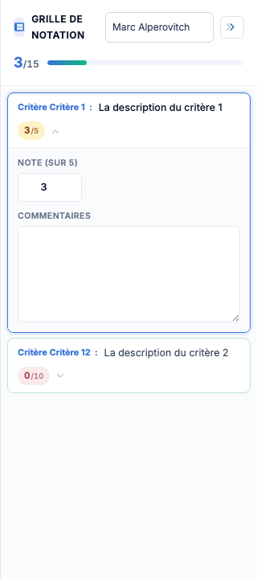
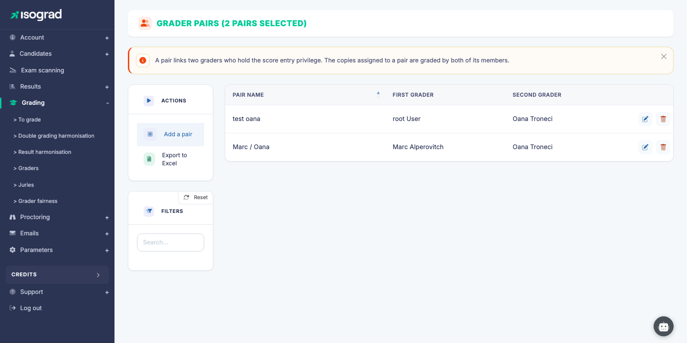
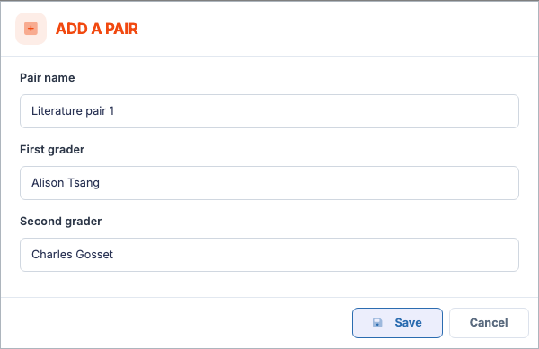
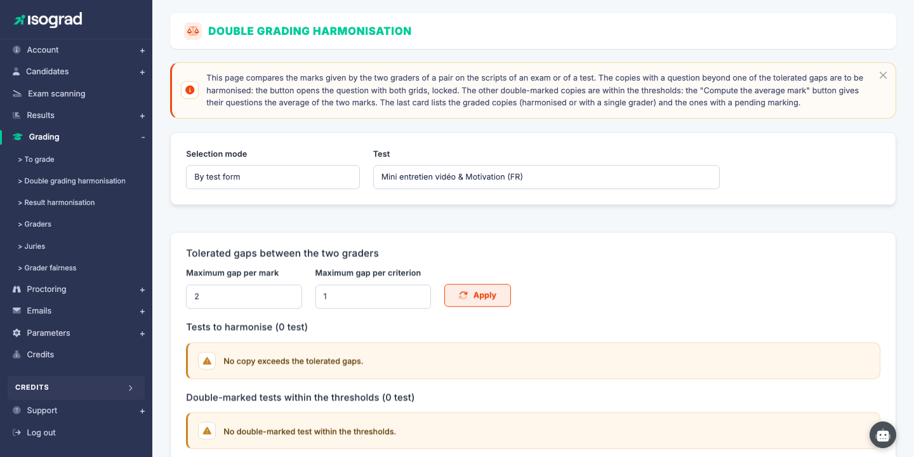
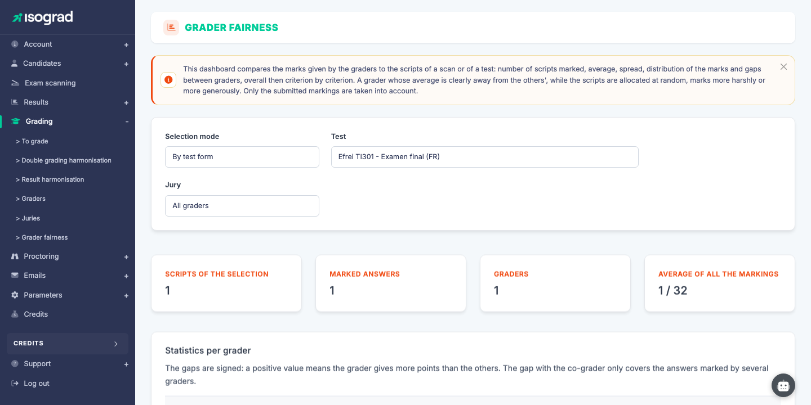
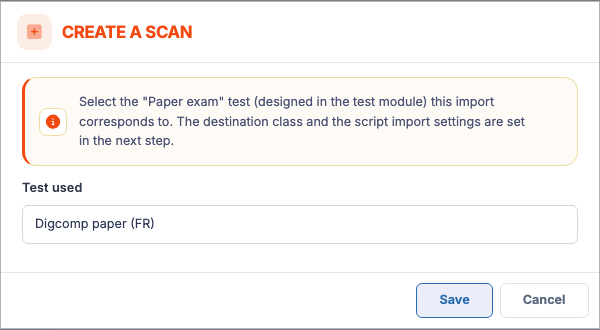

# Grading copies

Tests that contain **manually graded questions** — essay, uploaded document, recording, scanned paper copy — get no result when the candidate finishes: they stay **waiting for marking** until a grader has marked every answer. This chapter describes the whole grading workflow: assigning copies, marking with the grid, **annotating PDF copies**, double grading and harmonisation, **grading campaigns**, juries, equalisation of the marks and importing scanned paper copies.

These pages are grouped in the **Grading** menu. The entries shown depend on your privileges.

| Menu entry | Purpose | For whom |
|---|---|---|
| **Grading** | The copies to grade, graded or to harmonise: assignment to graders and access to marking. | Graders and supervisors |
| **Graders** | Build the grader pairs. | Supervisors |
| **Grading campaigns** | Organise the grading of an exam: copies, distribution, deadlines, harmonisation, jury, equalisation. | Campaign managers |
| **Juries** | Compose the juries of an exam. | Administrators holding a jury privilege |

The **Double grading harmonisation**, **Grader fairness** and **Equalisation** pages are not menu entries: they open from the [dashboard of a campaign](#dashboard).

The **Exam scanning** menu, when offered on your platform, is used to import the copies of a paper exam (see [Scan paper copies](#exam-scanning)). The **Juries** entry is only offered on those same platforms.

## Roles {#roles}

Several privilege levels are involved throughout the chapter (see [Administrator management](/ai/en/admins/) to grant them):

- The **grader** holds the right to enter scores. They only see the copies assigned to them and mark them, alone or within a pair.
- An administrator holding the right to **view the scores of the other graders** sees every marking, without being able to edit them.
- The **supervisor** holds the right to grade other graders' copies. They assign copies, build pairs, can open any copy and settle the score of double gradings in disagreement.
- The **campaign manager** is a supervisor who additionally holds the right to manage grading campaigns: they create them, distribute their copies, follow their progress, change their phase and close them.

## Copies to grade {#to-grade}

Open this page through the menu **Grading → Grading**. Its title recalls the number of tests matching the chosen grading status.

The table lists the tests with the candidate's **group**, **last name** and **first name**, the **test**, the **grader** and the date. The **Grader** column shows the name of the assigned grader or pair; it shows **AI** while an AI marking is still in progress on the test.

### Grading campaigns in progress

Above the table, the **Grading campaigns in progress** banner recalls the open campaigns that concern you, with their marking and harmonisation deadlines:

- a **grader** reads what they still have to do in each campaign — copies to mark, including copies started — or the mention that all their copies are marked;
- a **supervisor** reads the number of graders who are not done;
- a **campaign manager** additionally finds the link to the **dashboard** of the campaign.

A marking deadline that has passed while copies remain to be marked is flagged with the mention **deadline passed**.

### Select the copies

The filter panel offers a **search** and three filters.

**Grading status** — what the page lists:

- **To grade** (default) — the tests with at least one answer left to mark;
- **Graded** — the tests that have a grader and on which nothing is left to mark. For a grader, a copy is graded as soon as they have saved their own marking;
- **To harmonise** — the double-graded copies whose two markings are saved and that are waiting for their score (see [Harmonise double gradings](#harmonisation));
- **All grading statuses**.

A test marked by a supervisor without having been assigned keeps that supervisor as its grader: it is therefore listed among the graded tests.

**Grader** — reserved for supervisors: limits the list to the copies of one grader, whether they are assigned to them directly or through a pair.

**Selection mode** — narrows the list:

- **None** — every copy of the chosen status.
- **By scan** — the copies of one paper-copy import; pick it in the **Scan** selector.
- **By test** — the takes of one test; pick it in the **Test** selector.
- **By group** — the candidates of a group or sub-group.
- **By campaign** — the copies of a [grading campaign](#campaigns); a grader is only offered the campaigns in which a copy is assigned to them.

The **Scan** and **Test** selectors only list those with at least one copy of the chosen grading status. Each change reloads the list, and your filters are kept when you come back to the page.

### Mark columns

With a status other than **To grade**, the table shows the marks:

- a **grader** sees **My mark** (with the mention *draft* as long as it is not saved for good), the **Mark of the other grader** of their pair once their batch is finished (see [Mark as a pair](#pair-marking)), and the **Final mark**;
- a **supervisor**, or an administrator allowed to view the scores of the others, sees the **Mark of the 1st grader**, the **Mark of the 2nd grader**, their **Average** and the **Final mark**.

The **Export to Excel** button exports the filtered list with these same columns, the name of each grader in a separate column, and the candidate's **external identifier** — the anonymity number for an anonymous copy.

### Assign copies to graders {#assign}

Assignment is reserved for supervisors. It is done with the **To grade** grading status.

**To assign in bulk**, filter the list first, then:

1. Click **Assign the copies to one or more graders** in the action bar.

    
2. Select one or more **graders**, or one or more **grader pairs** — the two lists are mutually exclusive.
3. Click **Assign**.

> ⚠️ **Every copy of the filter is assigned** — There are no checkboxes: assignment applies to **all the copies matching the current filters**, and replaces any earlier assignment. Check your selection before confirming.

If you select several graders or pairs, the copies are distributed evenly between them. Only copies with at least one manually marked question are assigned, and a single operation cannot cover more than 1 000 copies.

**To assign a single copy**, click the **Assign the copy to a grader** icon at the end of the row and pick a grader or a pair. The **None** option removes the assignment. The icon remains offered as long as the result of the test is not established.

> 💡 **Copies of a campaign** — The copies of a grading campaign are assigned **from that campaign**, by a campaign manager: open the page in **By campaign** mode on the campaign concerned (or click **Spread and follow the copies** in its dashboard). This is also the only place where **pairs** are offered: a pair only grades copies that belong to a campaign. Elsewhere, bulk assignment leaves the copies of campaigns aside and tells you how many were not assigned. The assignment of the copies of a closed campaign can no longer be changed.

### Open a copy

The **Assign grade** icon at the end of the row opens the marking screen on the first question to grade. It is offered to the assigned grader, to the members of the assigned pair and to supervisors. In double grading, once all your markings are saved, it becomes **View the scoring** (eye icon). On a graded test whose result is established, the icon becomes **Analysis** and opens the detail of the answers.

## Mark a copy {#mark}

The marking screen shows the question and the **candidate's answer** in the centre, a **toolbar** at the top and the **scoring grid** in a panel on the right.

### Toolbar

- **Back to list** — returns to the page you came from.
- **Previous / next question** — moves from one question to another within the copy.
- **Previous / next candidate** — moves to the next copy of the list **while staying on the same question**, to grade one question in series. The counter shows your position in the list.
- **View the candidate's copy** — for a paper exam, opens the scanned copy in a new tab.
- **Analyze** — asks the AI for a marking proposal (see [AI assistance](#analyze)).
- **Plagiarism Check** — runs a similarity search on the answer (see [Plagiarism check](#plagiarism-check)).
- **Save as draft** — keeps your grid without validating the score: the answer remains to be graded and you can come back to it.
- **Save** — validates the marking of the question.

### Scoring grid

The **Scoring grid** panel shows the criteria defined by the question's author (see [Manual submission](/ai/en/question-module/question-editor/#manual-marking)). For each criterion:

- enter the **score**, between 0 and the criterion's maximum;
- add a **comment** if needed.

The total updates as you type. A coloured pill on each criterion gives a visual cue of the level reached.

When the question's author has made **marking every criterion mandatory**, saving is refused as long as a criterion is not marked: the message lists the missing criteria. Saving as a draft remains possible.

### Save the score

Each question is saved **separately**: there is no global save of the copy. When you click **Save**, the question's score becomes the sum of the grid's points. As soon as no answer of the test is pending, the result is computed and the test moves to the **Completed** status.

A question already marked shows its grid read-only, with the grader's name and the score. The **Edit the scoring** button lets you correct it; the new score replaces the old one.

Automatically scored questions have no grid: the panel says so.

### AI assistance {#analyze}

The **Analyze** button submits the answer and the grid to the AI, which **pre-fills** the score and the comment of each criterion. Nothing is saved until you click **Save** or **Save as draft**: review and adjust the proposal. For a copy uploaded as a document, the analysis requires a PDF file. The button is not offered for video answers.

### Plagiarism check {#plagiarism-check}

The **Plagiarism Check** button can be used when the similarity-detection service is configured on your account. The analysis takes up to two minutes and displays a **similarity rate** and, where relevant, an **AI-generated text rate**. A typed answer must contain at least 80 characters to be analysed.

### Paper copies read automatically

For a paper exam whose answers are read automatically, a question has no grid: the **Edit the scoring** button lets you correct the score by entering the new value and a comment. The history of changes (author, date, old and new score) is kept.

## Annotate a PDF copy {#pdf-annotation}

When the candidate handed in their answer as a **PDF file** — a document uploaded during the test or a scanned paper copy —, the marking screen shows the copy in a **viewer** instead of the download link. The grader can annotate it, as on a paper copy.

### Annotate

The viewer's toolbar lets you:

- **highlight**, **underline** or **strike out** a passage;
- **draw** freehand and trace **shapes**;
- add **text** and **comments**;
- **undo** or **redo** an action, and **search** the document.

The chosen tool stays active from one annotation to the next. An enlarge button extends the viewer to the full width of the page, the scoring grid remaining visible on the right.

### Save the annotations

There is no dedicated save button for annotations: they are **saved with the marking**, when you click **Save as draft** or **Save**. If saving the annotated copy fails, the score is not saved either and a message warns you.

> ⚠️ **Save before switching copies** — If you leave the page with unsaved annotations, the browser asks for confirmation. However, displaying another grader's copy discards your current annotations without warning.

### What is kept

- The candidate's **original document** is never modified: each grader has their own annotated copy.
- You edit your own annotated copy. A supervisor can edit another grader's, except in double grading where a saved marking locks the copy, and except in a closed campaign.
- Outside the marking screen, the annotated copy is displayed read-only; a selector switches from one grader to another when several have annotated.

### What the candidate sees

When the candidate has access to the detail of their answers, the result page of the question offers them, in addition to their original document, the download of the **copy annotated by the evaluator**.

### PDF report of a scanned copy

For a paper exam of the **scanned copies graded with a grid** type, the PDF report of the test shows, after the result header, the **scoring grid of each grader** (two in double grading), then the **copy as each grader annotated it**, page by page, followed by their comments. A copy that nobody annotated appears as the candidate handed it in. For the other tests, annotated copies are not included in PDF reports.

### Limits

Annotation applies only to **PDF files** handed in as the answer to a manual submission question. It is not offered for other file formats, nor for typed, audio or video answers. So ask for a PDF in the questions whose copies you want to annotate.

## Double grading {#double-grading}

A copy is graded **twice** when it is assigned to a **grader pair** rather than to a single grader. Double grading is always run within a [grading campaign](#campaigns): the campaign carries the copies of the pair and the tolerated gaps between the two marks.

### Build the pairs {#pairs}

Open the page through the menu **Grading → Graders** (reserved for supervisors). A pair associates two administrators holding the right to enter scores.

1. Click **Add a pair**.
2. Enter the **pair name** and choose the **first** and the **second grader**.

    
3. Save.

The two graders must be different, and the same two graders can only form one pair, whatever their order. If your account has fewer than two graders, a message invites you to create some first. A pair used by a jury cannot be deleted. The search covers the pair name and the graders' names, and the list can be exported to Excel.

**To create several pairs at once**, click **Import pairs**. The Excel file has one row per pair and two columns, `fst_ema` and `sec_ema`: the email addresses of the two graders, who must be administrators of your account holding the right to enter scores. A template file can be downloaded from the window, and a **preview** is shown before anything is saved.

### Mark as a pair {#pair-marking}

Each member of the pair marks the copy with their own grid, as in single grading, but:

- their marking, once **saved**, is **locked**: it can no longer be edited, even by a supervisor;
- the question does not get a score yet: it waits for the second marking, then for the average or the harmonisation.

**What a grader sees of the other.** The two members of a pair see **nothing** of each other's work until their **batch** is finished, that is, until every copy of the campaign assigned to the pair has been marked by both. Once the batch is finished, what they see depends on the test's **What the grader sees of the other grader** setting (see [Paper exams](/ai/en/question-module/test-forms/#paper-exams)):

- **Their mark only** (default) — the other grader's total, without the detail of their grid;
- **Their mark and their whole grading** — their grid, their comments and their annotated copy;
- **Nothing**.

A campaign can in addition leave the graders only the **final mark** once it is set (see [Create a campaign](#create-campaign)); this rule wins over the test's setting. A supervisor, like an administrator allowed to view the scores of the others, always sees both markings.

When several graders have marked and you have access to them, the **Grader** selector of the scoring panel displays each one's grid.

### Harmonise double gradings {#harmonisation}

A double-marked copy gets its score in one of the following three ways.

**The average** — when the two markings stay within the tolerated gaps of the campaign, the score can be the average of the two scores (**Compute the average mark** button of the harmonisation page, below).

**The agreement of the pair** — when the two markings exceed one of the tolerated gaps, the two graders come to an agreement, once their batch is finished. These copies are found under the **To harmonise** grading status of the [Grading](#to-grade) page:

1. One of the two graders opens the copy, clicks **Propose the harmonised score** and enters the score agreed with the other grader.
2. The other grader opens the copy: they tick **I validate this harmonised score** and click **Validate the harmonised score** — the proposed score becomes the question's score — or click **Refuse the proposed score**, which puts the copy back in wait for a new proposal.

As long as a proposal is waiting for validation, only its author can replace it. Both grids are kept.

**The supervisor's arbitration** — a supervisor can at any time open the question, click **Harmonise**, enter the **overall score of the question** and confirm. This score prevails, the two graders' grids remaining available.

The marking screen shows the **History of the decisions** taken on the score — average of the two scores, score proposed, validated or refused, score set by the supervisor — with their author and date. It is visible to supervisors and, once their batch is finished, to the members of the pair.

#### Harmonisation page

The **Double grading harmonisation** page is reserved for supervisors. Open it from the dashboard of a campaign, **Harmonise the double gradings** button: it opens directly on the copies of the campaign.

1. The **selection mode** — by scan, by test form or by campaign — and the matching selector designate the copies compared.
2. The **tolerated gaps between the two graders** are displayed:
    - for a campaign, they are **those of the campaign**, read-only: they are set by editing the campaign. The gap per criterion carries the mention **Not applied** when the campaign does not define one;
    - for a scan or a test, you enter them — **Maximum gap per mark** (2 points by default) and **Maximum gap per criterion** (1 point by default) — then click **Apply**.
3. If the tests contain several manually graded questions, choose the **question** to review.

The page then sorts the copies into four tables:

| Table | Content | Action |
|---|---|---|
| **Tests to harmonise** | The two markings exceed one of the tolerated gaps. | **Open the question** to settle the score. |
| **Double-marked tests within the thresholds** | The two markings are close enough. | **Compute the average mark**. |
| **Harmonised tests** | The score is settled (single grading or harmonisation done). | **View the script**. |
| **Tests not or partially marked** | At least one grading is pending. | **View the script**. |

The first two tables detail, for each copy, the pair, the two scores of each question and the gaps observed.

**Compute the average mark** assigns, after confirmation, the average of the two scores to every question of the tests within thresholds. Both markings are kept.

**Open the question** displays the marking screen with both grids read-only, the **graders' scores** and their **gap**, from which the supervisor settles the score with **Harmonise**.

In every case, the test moves to the **Completed** status as soon as no answer is pending.

## Grading campaigns {#campaigns}

A **grading campaign** organises the grading of an exam: it gathers the copies coming from scans, sessions or groups, then is used to distribute them between the graders and the pairs, to follow the deadlines, to harmonise the marks and to convene the jury. A copy that belongs to no campaign is simply graded from the [Grading](#to-grade) page, by a single grader.

Open the page through the menu **Grading → Grading campaigns** (reserved for campaign managers). The table shows, for each campaign, its **name**, its **exam**, the number of **copies**, the **jury**, the two **deadlines** and the **phase**. The icons at the end of the row open the **dashboard**, editing and deletion. The list can be exported to Excel.

### Create a campaign {#create-campaign}

Click **Add a campaign** and fill in:

- **Campaign name** — required.
- **Exam** — the test whose copies the campaign grades. The list offers the tests that have a copy scan or takes waiting for marking; if none qualifies yet, a message invites you to create a scan first or to wait for a test to be waiting for marking.
- **Sources** — the copies the campaign takes charge of. Once the exam is chosen, select **copy scans** for paper copies, **sessions** or **groups** for tests taken online; you can combine them, and at least one source is required.
- **Jury** — optional, among the [juries](#juries) of your account.
- **Marking deadline** and **Harmonisation deadline** — optional; the given day is included, and harmonisation cannot come before marking.
- **Maximum gap per mark** and **Maximum gap per criterion** — the gaps, in points, tolerated between the two gradings of a copy marked by a pair. Up to the given gap, that value included, the score can be the average of the two scores; beyond it, the copy must be harmonised. Leave the gap per criterion empty to keep only the gap on the mark.
- **Once the mark is set, only show the final mark to the graders** — as soon as a copy has its final mark (average, harmonised score or arbitration), the graders no longer see the score nor the grading of the other member of their pair: they are left with their own marking and the final mark. Supervisors keep seeing everything.

> ⚠️ **Exam and sources cannot be undone** — The exam can no longer be changed once the campaign is created, and a source that has been added can no longer be removed. You can however add sources later.

Every copy of the exam coming from the sources joins the campaign, **including those uploaded or registered later**; the sub-groups of a group are included. A scan, a session or a group feeds only **one campaign** for a given exam, and a copy belongs to only one campaign.

A campaign with copies already assigned to a grader or to a pair can no longer be deleted. Deleting a campaign does not delete its copies.

### Dashboard {#dashboard}

The **Dashboard** icon of a row opens the dashboard of the campaign. The navigation bar lets you go back to the list and move to the previous or next campaign.

- **Campaign** — the exam, the jury, the phase, the sources (number of scans, sessions and groups), the tolerated gaps and the deadlines. The marking deadline carries the mention **deadline passed** when its day has passed and copies remain to be marked.
- **Phase of the campaign** — see [Phases and closing](#phases).
- **Copies** — the key figures: **copies of the campaign**, **unassigned**, **not marked**, **partially marked**, **marked**.
- **Run the campaign** — the pages the campaign is run from, opened directly on its copies:
    - **Spread and follow the copies** — the [Grading](#to-grade) page in **By campaign** mode, all grading statuses together; this is where you [assign](#assign) the copies to graders and pairs;
    - **Harmonise the double gradings** — the [harmonisation page](#harmonisation);
    - **Grader fairness** — see [Grader fairness](#fairness);
    - **Equalisation** — see [Equalisation](#equalisation).

    Each button is only offered to the administrators allowed to open the matching page.
- **Progress per grader** — for each grader, the number of copies assigned, **not started**, **started** (a draft grid) and **marked**. Each member of a pair has their own row: a copy is marked for them as soon as they have saved their marking, whatever the other one did.

### Email reminders

When a marking deadline is set, the graders who are not done receive an **email reminder** 3 days before the deadline, the day before, then the day after. The email states, for each campaign, the number of copies to mark and of copies started. Once the date has passed, the campaign managers in turn receive an email listing the late graders. Changing the deadline restarts the reminders.

### Phases and closing {#phases}

The **phase** tells where the campaign stands: **Marking** of the copies, **Harmonisation** of the double gradings, then **Jury**. You move it forward yourself from the **Phase of the campaign** card of the dashboard: choose the phase then click **Change phase**. The three phases can be set in any order; the **Jury** phase is the one during which an [equalisation](#equalisation) can be applied.

The **Close the campaign** button makes, after confirmation, the marks **final**:

- no mark nor assignment can be changed any more, even by a supervisor;
- the graders no longer have access to the copies of the campaign;
- the campaign can no longer be edited.

> ⚠️ **Closing cannot be undone** — A closed campaign cannot be reopened. The dashboard then shows who closed it and on what date.

### Equalisation {#equalisation}

The **equalisation** adjusts the final marks of the copies already marked of a scope. Nothing is adjusted automatically: each adjustment is first **simulated**, then applied on your decision. Open the page from the dashboard, **Equalisation** button.

The **Marks of the campaign** card recalls the number of marked copies, their average, their standard deviation and the number of copies without final mark.

**To prepare an adjustment**, in the **New adjustment** card:

1. Choose the **scope**: **The whole campaign**, **One or several candidates**, **A grader pair** or **A grader**.
2. Choose the **adjustment**:
    - **Add or take off points** — a number of points, positive or negative;
    - **Apply a coefficient** — a coefficient greater than or equal to zero;
    - **Align the average of the scope on the one of the campaign** — no value to enter; it requires a scope narrower than the whole campaign.
3. Click **Simulate**.

The **simulation** compares the average and the standard deviation of the scope and of the campaign before and after, then lists the copies with their **mark before** and **after**, their **rank before** and **after** and a possible **flag**: *mark capped* (brought back to 0 or to the question's maximum), *copy already adjusted* by an earlier adjustment, or copy left unchanged — gap between the two marks beyond the threshold, or mark harmonised and not averaged. A summary gives the number of copies changed, capped, already adjusted, unchanged and changing rank. Copies without final mark are not concerned.

**To apply the adjustment**, click **Apply the adjustment** and confirm. This button is only offered during the **Jury** phase: you can simulate at any time, but the campaign must be moved to the **Jury** phase from its dashboard to apply an adjustment or to cancel one.

The **Journal of the adjustments** keeps every adjustment applied with its date, author, scope, rule, number of copies changed and state. **Marks before and after** displays its detail. Only the **last adjustment applied** can be cancelled (**Cancel the adjustment**): the marks of the copies concerned then go back to their previous value.

> 💡 **Exams concerned** — Equalisation is only available for the exams whose copies each hold a single manually marked question. The marks of a closed campaign can no longer be adjusted.

## Juries {#juries}

Open the page through the menu **Grading → Juries**, on the platforms that offer exam scanning. A jury gathers the graders of an exam: a **president**, **arbiters** who settle the disagreements, and graders working alone or in pairs. Depending on your privilege, you can view juries or also create, edit and delete them.

To create a jury, click **Add a jury** and fill in:

- **Jury name** — required.
- **President** — required, chosen among supervisors.
- **Arbiters** — one or more supervisors. The president cannot also be an arbiter.
- **Individual graders** — the graders who mark alone.
- **Grader pairs** — the pairs attached to the jury.

The table recalls, for each jury, its president, arbiters and graders. It can be exported to Excel.

The jury is attached to a [grading campaign](#create-campaign), which carries the tolerated gaps between the two gradings of a copy. It is also used as a filter on the [Grader fairness](#fairness) page, where it shows each person's role.

## Grader fairness {#fairness}

The **Grader fairness** page compares how graders mark the same set of copies, to spot a grader who is clearly more severe or more generous than the others. Open it from the dashboard of a campaign, **Grader fairness** button; it is offered to administrators holding a jury privilege and it is read-only.

Choose the **selection mode** (by scan, by test form or by campaign), the scan, the test or the campaign, optionally a **jury** and, if the tests contain several manually graded questions, the **question**: statistics are computed question by question.

- **Key figures** — copies of the selection, answers marked, number of graders, average of all markings.
- **Statistics per grader** — number of answers marked, average, standard deviation, minimum and maximum, distribution of scores by quarter of the maximum score, **gap with the average of all** and **average gap with the co-grader** in double grading. The gaps are signed: a positive value means the grader gives more points than the others. With a jury selected, a column shows each person's role.
- **Averages per criterion** — the average of each criterion, across all graders then per grader, with the gap between the two.
- **Final marks by origin** — the final mark of the answers, depending on whether it comes from a **single grader** or from a **double grading** (average of the two markings or arbitrated mark): number of marks, average, standard deviation, minimum, maximum, **gap with the overall average**, and number of arbitrated marks. The **Significant gap** column tells whether the gap is unlikely to be due to chance; it is only filled in from 5 marks on each side.

Only **saved** markings are taken into account; drafts are ignored. These comparisons assume that the copies were distributed at random between the graders.

## Scan paper copies {#exam-scanning}

The **Exam scanning** menu, when offered on your platform, lets you import the copies of a **paper exam** to grade them online. The paper exam itself is prepared in the Question Module (see [Paper exams](/ai/en/question-module/test-forms/#paper-exams)).

### Create a scan

1. On the **Scanning management** page, click **Create a scan**.

    
2. Choose the **test used** among your paper exams. The scan's edit page opens.

    

### Set how copies are matched to candidates

In the **Details** tab:

- **Script attribution mode** — how each copy is attached to a candidate:
    - **Use the name displayed in the script** — the first and last name are read automatically from the document;
    - **Use the identifier displayed in the script** — the identifier written on the copy (anonymity number, candidate number) is read from the document, and the copy is attached to the candidate, anonymous or not, who carries this identifier;
    - **Use the file name as identifier** — the file name, without its extension, is the candidate's identifier.
- **Create candidates which are not present in the target group** — accepts the copies of candidates, or of identifiers, that are not known yet, by creating them. If the option is disabled, these copies are placed in the unattributed copies of the **Reconciliation** tab.
- **Target group** — the group in which candidates are looked up and tests are created.

Save: importing is only possible once the target group is saved, and the **Reconciliation** tab only appears at that point.

### Prepare anonymous copies {#anonymous-copies}

To grade anonymous copies, declare the expected identifiers in advance, then lift the anonymity once grading is finished. Both imports are done from the **Anonymous candidates** menu of the **Candidate Management** page — see [Anonymous candidates](/ai/en/candidates/#anonymous-candidates):

1. **Import an identifier file**, before importing the copies: an anonymous candidate is created for each expected identifier. When the copies are imported, this list lets you spot the missing copies and those whose identifier is not expected.
2. **Associate candidates with their identifiers**, after grading: each anonymous candidate receives their real identity.

On the scan, then choose the attribution mode by **identifier displayed in the script** or by **file name**.

### Import the copies

In the **Import** tab, drag and drop the copies into the drop zone. Accepted formats are **PDF**, **PNG**, **JPG** and **ZIP** (for a batch of copies). A file with the same name as a copy already imported is refused, as are two files with the same name in a single upload; a file exceeding the maximum allowed size is refused with a message.

Copies are processed in the background: the **View scripts being imported** button tracks progress. A **ZIP** archive is also extracted in the background: it first appears as "archive being extracted", then its copies join the copies being imported. If an archive is refused, cannot be extracted or contains skipped files, the **Imported ZIP archives: points to check** box tells you so.

The **Scripts already imported** table lists the copies attached to a candidate, with a search, pagination and a link to display each copy. When the scan attributes copies by identifier, the first column shows the identifier read on the copy. A message recalls the number of copies that could not be attributed and sends you to the **Reconciliation** tab.

### Reconcile copies and candidates {#reconciliation}

The **Reconciliation** tab gathers what remains to be handled by hand after the import.

- **Scripts whose identity matches no candidate** — a name or an identifier was read on the copy (or given by the file name), but it was not enough to attribute it. The **Reason** column tells why: **No matching candidate** (and the option creating missing candidates is disabled) or **Identifier shared by several candidates**. The identity read on the copy is recalled.
- **Scripts without a readable identity** — no name or identifier could be read. These copies are never attributed automatically, even when the creation of missing candidates is enabled.
- **Candidates without a script** — the candidates of the target group to whom no copy is attributed. This list is useful when you have populated the group in advance, with candidates who are anonymous or not.

For the first two lists, click **Display the script** to check it, then **Attribute**: look up the candidate — by identifier or by name when the scan attributes copies by identifier, by name or by email address otherwise — and confirm.

### After the import

For each copy, a test is created for the candidate. Automatically graded questions are scored right away; manually graded questions wait for a grader. The tests concerned appear on the [Grading](#to-grade) page: use the **By scan** selection mode to find the copies of an import, or attach the scan to a [grading campaign](#campaigns) to distribute its copies, including between pairs.

For an exam of the **scanned copies graded with a grid** type, the scanned copy becomes the document handed in by the candidate: the grader marks it with the grid and can [annotate](#pdf-annotation) it when it is a PDF.
