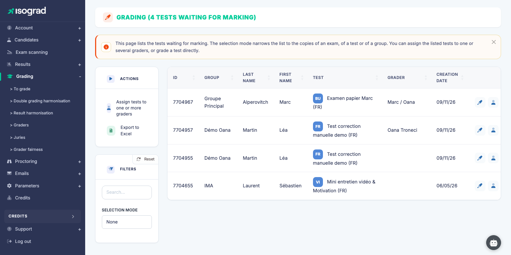
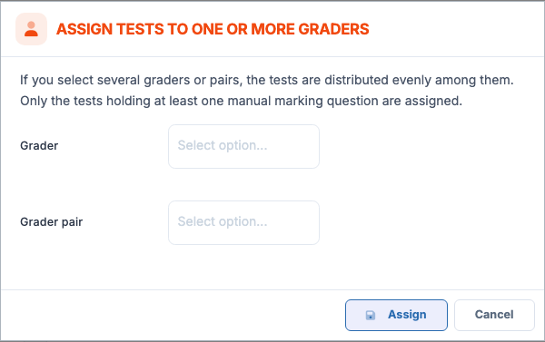
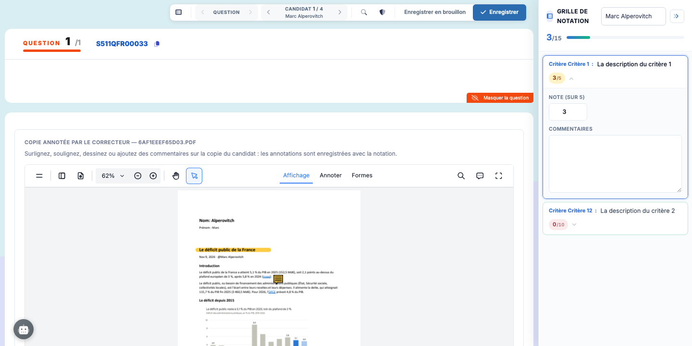
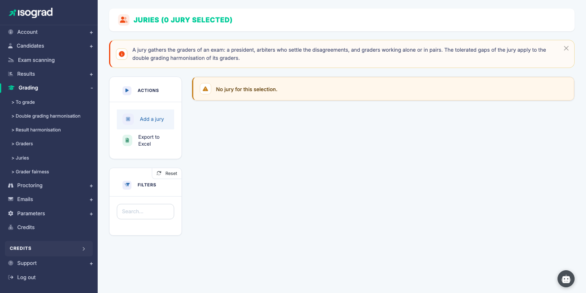
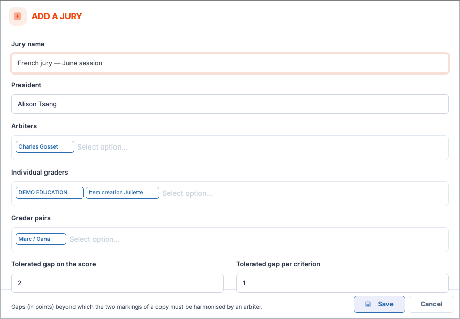
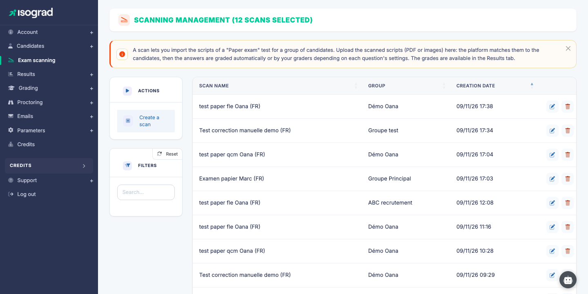
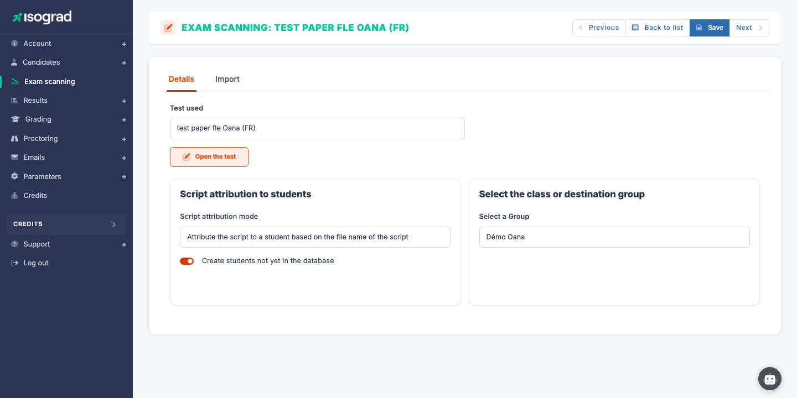
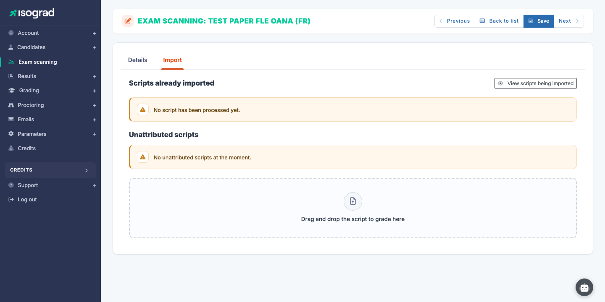

# Grading copies

Tests that contain **manually graded questions** — essay, uploaded document, recording, scanned paper copy — get no result when the candidate finishes: they stay **waiting for marking** until a grader has marked every answer. This chapter describes the whole grading workflow: assigning copies, marking with the grid, **annotating PDF copies**, double grading and harmonisation, juries, grader fairness monitoring and importing scanned paper copies.

These pages are grouped in the **Grading** menu. The entries shown depend on your privileges.

| Menu entry | Purpose | For whom |
|---|---|---|
| **To grade** | The tests waiting for marking: assignment to graders and access to marking. | Graders and supervisors |
| **Double grading harmonisation** | Compare the two markings of the same copy and settle the score. | Supervisors |
| **Graders** | Build the grader pairs. | Supervisors |
| **Juries** | Compose the juries of an exam. | Administrators holding a jury privilege |
| **Grader fairness** | Marking statistics per grader. | Administrators holding a jury privilege |

The **Exam scanning** menu, when offered on your platform, is used to import the copies of a paper exam (see [Scan paper copies](#exam-scanning)).

## Roles {#roles}

Two privilege levels are involved throughout the chapter (see [Administrator management](/ai/en/admins/) to grant them):

- The **grader** holds the right to enter scores. They mark the copies assigned to them, alone or within a pair.
- The **supervisor** additionally holds the right to grade other graders' copies. They assign copies, build pairs, can open any copy and harmonise double gradings.

## Copies to grade {#to-grade}

Open this page through the menu **Grading → To grade**. Its title recalls the number of tests waiting for marking.

The table lists the tests with at least one answer left to mark, with the candidate's **group**, **last name** and **first name**, the **test**, the **grader** and the date. The **Grader** column shows the name of the assigned grader or pair; it shows **AI** while an AI marking is still in progress on the test.

> 💡 **Double grading** — A test whose answers have all received both markings leaves this list: it then waits on the [Double grading harmonisation](#harmonisation) page.

### Select the copies

The filter panel offers a **search** and a **Selection mode** that narrows the list:

- **None** — every waiting test.
- **By scan** — the copies of one paper-copy import; pick it in the **Scan** selector.
- **By test** — the takes of one test; pick it in the **Test** selector.
- **By group** — the candidates of a group or sub-group.

The **Scan** and **Test** selectors only list those with at least one waiting copy. Each change reloads the list, and your filters are kept when you come back to the page.

### Assign copies to graders {#assign}

Assignment is reserved for supervisors.

**To assign in bulk**, filter the list first, then:

1. Click **Assign tests to one or more graders** in the action bar.

    
2. Select one or more **graders**, or one or more **grader pairs** — the two lists are mutually exclusive.
3. Click **Assign**.

> ⚠️ **Every test of the filter is assigned** — There are no checkboxes: assignment applies to **all the tests matching the current filters**, and replaces any earlier assignment. Check your selection before confirming.

If you select several graders or pairs, the tests are distributed evenly between them. Only tests with at least one manually marked question are assigned, and a single operation cannot cover more than 1 000 tests.

**To assign a single copy**, click the **Assign test to grader** icon at the end of the row and pick a grader or a pair. The **None** option removes the assignment.

### Open a copy

The **Assign grade** icon at the end of the row opens the marking screen on the first question to grade. It is offered to the assigned grader, to the members of the assigned pair and to supervisors. In double grading, once all your markings are saved, it becomes **View the scoring** (eye icon).

The **Export to Excel** button exports the filtered list.

## Mark a copy {#mark}

The marking screen shows the question and the **candidate's answer** in the centre, a **toolbar** at the top and the **scoring grid** in a panel on the right.

### Toolbar

- **Back to list** — returns to the page you came from.
- **Previous / next question** — moves from one question to another within the copy.
- **Previous / next candidate** — moves to the next copy of the list **while staying on the same question**, to grade one question in series. The counter shows your position in the list.
- **View the candidate's copy** — for a paper exam, opens the scanned copy in a new tab.
- **Analyze** — asks the AI for a marking proposal (see [AI assistance](#analyze)).
- **Plagiarism Check** — runs a similarity search on the answer (see [Plagiarism check](#plagiarism-check)).
- **Save as draft** — keeps your grid without validating the score: the answer remains to be graded and you can come back to it.
- **Save** — validates the marking of the question.

### Scoring grid

The **Scoring grid** panel shows the criteria defined by the question's author (see [Manual submission](/ai/en/question-module/question-editor/#manual-marking)). For each criterion:

- enter the **score**, between 0 and the criterion's maximum;
- add a **comment** if needed.

The total updates as you type. A coloured pill on each criterion gives a visual cue of the level reached.

### Save the score

Each question is saved **separately**: there is no global save of the copy. When you click **Save**, the question's score becomes the sum of the grid's points. As soon as no answer of the test is pending, the result is computed and the test moves to the **Completed** status.

A question already marked shows its grid read-only, with the grader's name and the score. The **Edit the scoring** button lets you correct it; the new score replaces the old one.

Automatically scored questions have no grid: the panel says so.

### AI assistance {#analyze}

The **Analyze** button submits the answer and the grid to the AI, which **pre-fills** the score and the comment of each criterion. Nothing is saved until you click **Save** or **Save as draft**: review and adjust the proposal. For a copy uploaded as a document, the analysis requires a PDF file. The button is not offered for video answers.

### Plagiarism check {#plagiarism-check}

The **Plagiarism Check** button can be used when the similarity-detection service is configured on your account. The analysis takes up to two minutes and displays a **similarity rate** and, where relevant, an **AI-generated text rate**. A typed answer must contain at least 80 characters to be analysed.

### Paper copies read automatically

For a paper exam whose answers are read automatically, a question has no grid: the **Edit the scoring** button lets you correct the score by entering the new value and a comment. The history of changes (author, date, old and new score) is kept.

## Annotate a PDF copy {#pdf-annotation}

When the candidate handed in their answer as a **PDF file** — a document uploaded during the test or a scanned paper copy —, the marking screen shows the copy in a **viewer** instead of the download link. The grader can annotate it, as on a paper copy.

### Annotate

The viewer's toolbar lets you:

- **highlight**, **underline** or **strike out** a passage;
- **draw** freehand and trace **shapes**;
- add **text** and **comments**;
- **undo** or **redo** an action, and **search** the document.

The chosen tool stays active from one annotation to the next. An enlarge button extends the viewer to the full width of the page, the scoring grid remaining visible on the right.

### Save the annotations

There is no dedicated save button for annotations: they are **saved with the marking**, when you click **Save as draft** or **Save**. If saving the annotated copy fails, the score is not saved either and a message warns you.

> ⚠️ **Save before switching copies** — If you leave the page with unsaved annotations, the browser asks for confirmation. However, displaying another grader's copy discards your current annotations without warning.

### What is kept

- The candidate's **original document** is never modified: each grader has their own annotated copy.
- You edit your own annotated copy. A supervisor can edit another grader's, except in double grading where a saved marking locks the copy.
- Outside the marking screen, the annotated copy is displayed read-only; a selector switches from one grader to another when several have annotated.

### What the candidate sees

When the candidate has access to the detail of their answers, the result page of the question offers them, in addition to their original document, the download of the **copy annotated by the evaluator**. Annotated copies are not included in PDF reports.

### Limits

Annotation applies only to **PDF files** handed in as the answer to a manual submission question. It is not offered for other file formats, nor for typed, audio or video answers. So ask for a PDF in the questions whose copies you want to annotate.

## Double grading {#double-grading}

A copy is graded **twice** when it is assigned to a **grader pair** rather than to a single grader.

### Build the pairs {#pairs}

Open the page through the menu **Grading → Graders** (reserved for supervisors). A pair associates two administrators holding the right to enter scores.

1. Click **Add a pair**.
2. Enter the **pair name** and choose the **first** and the **second grader**.

    
3. Save.

The two graders must be different, and the same two graders can only form one pair, whatever their order. If your account has fewer than two graders, a message invites you to create some first. A pair used by a jury cannot be deleted. The search covers the pair name and the graders' names, and the list can be exported to Excel.

### Mark as a pair

Each member of the pair marks the copy with their own grid, as in single grading, but:

- their marking, once **saved**, is **locked**: it can no longer be edited, even by a supervisor;
- the question does not get a score yet: it waits for the second marking, then for harmonisation;
- by default, a grader does not see the other's grid until the question is scored. The test option **Allow the grader to see the grading done by the other grader** lifts this restriction (see [Paper exams](/ai/en/question-module/test-forms/#paper-exams)). A supervisor always sees both grids.

When several graders have marked, the **Grader** selector of the scoring panel displays each one's grid.

### Harmonise double gradings {#harmonisation}

Open the page through the menu **Grading → Double grading harmonisation** (reserved for supervisors).

1. Choose the **selection mode** — by scan or by test — then the scan or test you want.
2. Set the **tolerated gaps between the two graders** and click **Apply**:
    - **Maximum gap per mark** — accepted difference between the two total scores (2 points by default);
    - **Maximum gap per criterion** — largest accepted difference on a single criterion (1 point by default).
3. If the tests contain several manually graded questions, choose the **question** to review.

The page then sorts the copies into four tables:

| Table | Content | Action |
|---|---|---|
| **Tests to harmonise** | The two markings exceed one of the tolerated gaps. | **Open the question** to settle the score. |
| **Double-marked tests within the thresholds** | The two markings are close enough. | **Compute the average mark**. |
| **Harmonised tests** | The score is settled (single grading or harmonisation done). | **View the script**. |
| **Tests not or partially marked** | At least one grading is pending. | **View the script**. |

The first two tables detail, for each copy, the pair, the two scores of each question and the gaps observed.

**Compute the average mark** assigns, after confirmation, the average of the two scores to every question of the tests within thresholds. Both markings are kept.

**Open the question** displays the marking screen with both grids read-only, the **graders' scores** and their **gap**. Click **Harmonise**, enter the **overall score of the question** and confirm: this score becomes the question's score, the two graders' grids remaining available.

In both cases, the test moves to the **Completed** status as soon as no answer is pending.

## Juries {#juries}

Open the page through the menu **Grading → Juries**. A jury gathers the graders of an exam: a **president**, **arbiters** and graders working alone or in pairs. Depending on your privilege, you can view juries or also create, edit and delete them.

To create a jury, click **Add a jury** and fill in:

- **Jury name** — required.
- **President** — required, chosen among supervisors.
- **Arbiters** — one or more supervisors. The president cannot also be an arbiter.
- **Individual graders** — the graders who mark alone.
- **Grader pairs** — the pairs attached to the jury.
- **Tolerated gap on the score** and **Tolerated gap per criterion** — the gaps, in points, the jury retains to decide that a double grading must be harmonised (2 and 1 by default).

The table recalls, for each jury, its president, arbiters and graders. It can be exported to Excel.

The jury is used as a filter on the [Grader fairness](#fairness) page, where it shows each person's role. On the harmonisation page, the gaps applied are those you enter there.

## Grader fairness {#fairness}

Open the page through the menu **Grading → Grader fairness**. It compares how graders mark the same set of copies, to spot a grader who is clearly more severe or more generous than the others. The page is read-only.

Choose the **selection mode** (by scan or by test), the scan or the test, optionally a **jury** and, if the tests contain several manually graded questions, the **question**: statistics are computed question by question.

- **Key figures** — copies of the selection, answers marked, number of graders, average of all markings.
- **Statistics per grader** — number of answers marked, average, standard deviation, minimum and maximum, distribution of scores by quarter of the maximum score, **gap with the average of all** and **average gap with the co-grader** in double grading. With a jury selected, a column shows each person's role.
- **Averages per criterion** — the average of each criterion, across all graders then per grader, with the gap between the two.

Only **saved** markings are taken into account; drafts are ignored.

## Scan paper copies {#exam-scanning}

The **Exam scanning** menu, when offered on your platform, lets you import the copies of a **paper exam** to grade them online. The paper exam itself is prepared in the Question Module (see [Paper exams](/ai/en/question-module/test-forms/#paper-exams)).

### Create a scan

1. On the **Scanning management** page, click **Create a scan**.

    
2. Choose the **test used** among your paper exams. The scan's edit page opens.

    

### Set how copies are matched to students

In the **Details** tab:

- **Script attribution mode** — how each copy is attached to a student:
    - from the **name written on the copy**, read automatically;
    - from the **file name**, of the form `firstname_lastname.pdf`;
    - by creating **anonymous students**.
- **Create students not yet in the database** — automatically creates the student when none matches.
- **Destination class or group** — the group in which students are looked up and tests are created.

Save: importing is only possible once the destination group is saved.

### Import the copies

In the **Import** tab, drag and drop the copies into the drop zone. Accepted formats are **PDF**, **PNG**, **JPG** and **ZIP** (for a batch of copies). A file with the same name as a copy already imported is refused.

Copies are processed in the background: the **View scripts being imported** button tracks progress, and the **Scripts already imported** table lists the copies attached to a student, with a link to display them.

A copy that could not be attached to any student appears in the **Unattributed scripts** list: click **Attribute** and look up the student to attach it by hand.

### After the import

For each copy, a test is created for the student. Automatically graded questions are scored right away; manually graded questions wait for a grader. The tests concerned appear on the [To grade](#to-grade) page: use the **By scan** selection mode to find the copies of an import.

For an exam of the **scanned copies graded with a grid** type, the scanned copy becomes the document handed in by the student: the grader marks it with the grid and can [annotate](#pdf-annotation) it when it is a PDF.
