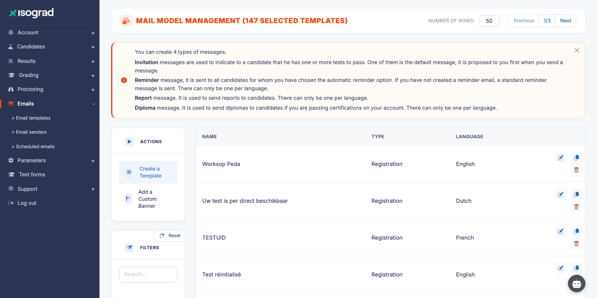
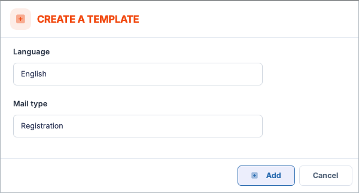
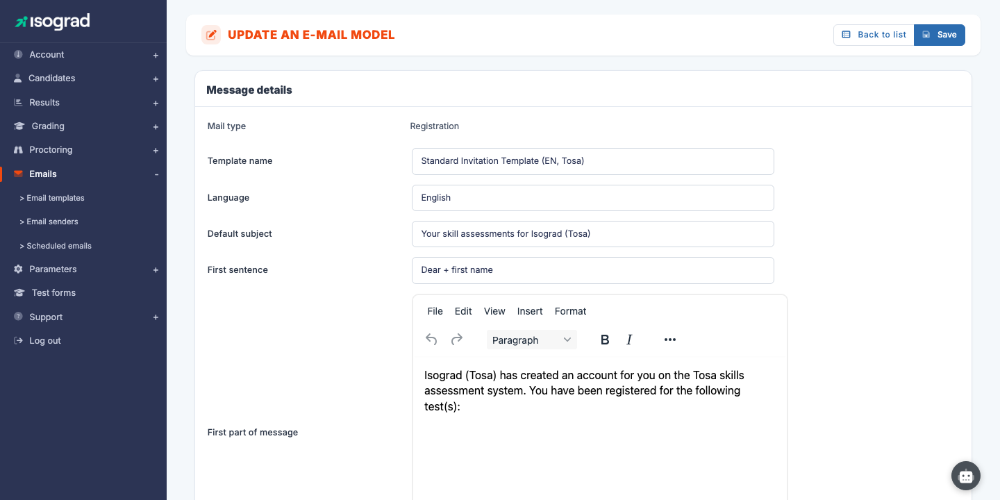
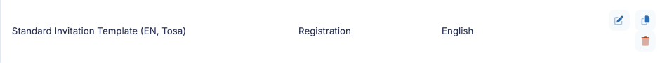
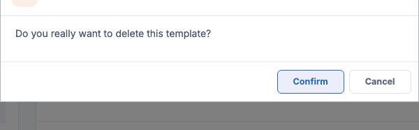
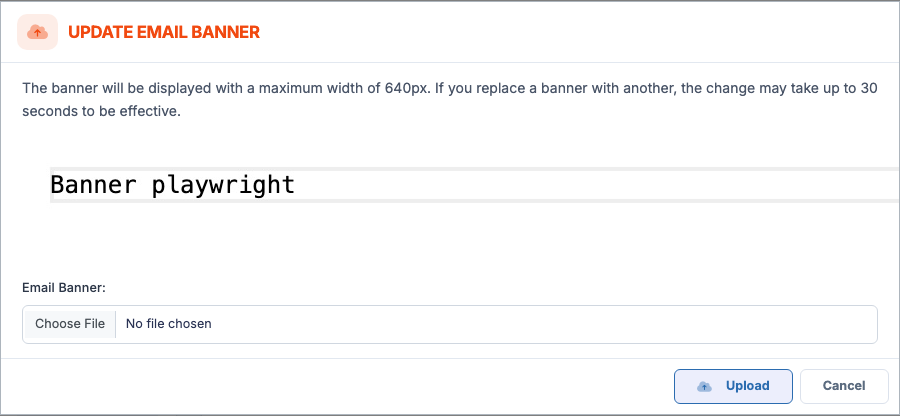
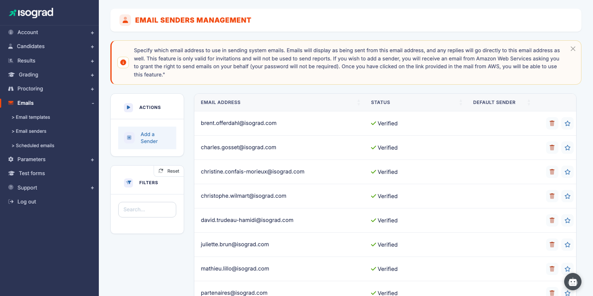
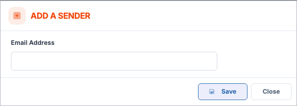
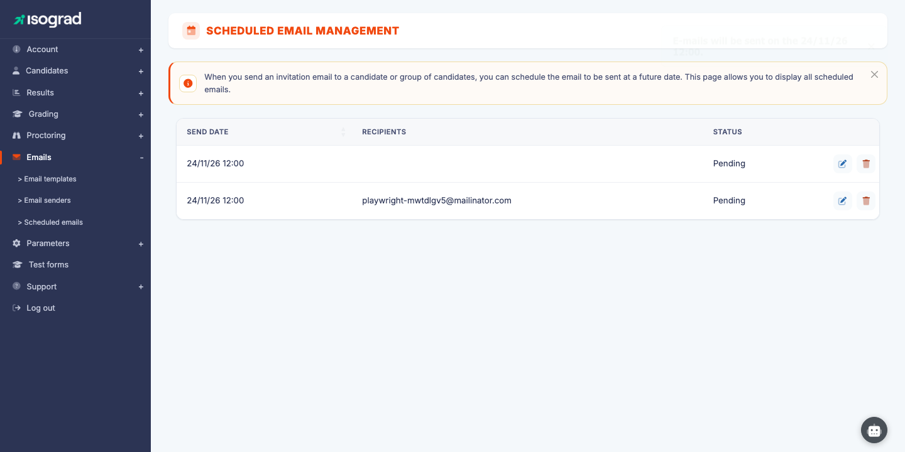
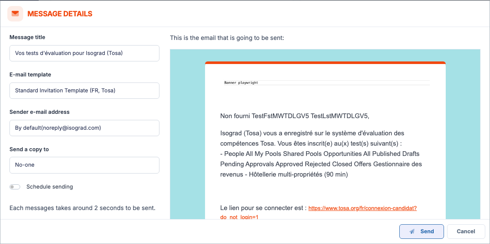

# Email management

This chapter covers everything related to emails sent from your account to candidates: the **mail templates** you customize, the **senders** (verified sending addresses), the **scheduled sendings** and the **custom banner** displayed at the top of your emails.

Open these pages through the **Emails** menu: **Email templates**, **Email senders** and **Scheduled emails**. The last two entries, as well as the creation buttons, depend on your administrator privileges.

The **Mail model management** page lists your email templates. Each row shows the template's **name**, its **type** (Invitation, Reminder, Report sending, Diploma sending) and its **language**; clicking a column header sorts the list, and the **search** field of the filter panel finds a template by its name or by a word of its content. The main action buttons — **Create a Template** and **Add a Custom Banner** — are at the top of the table.

## The four template types {#the-four-template-types}

The platform recognizes four types of messages, each with a different trigger:

- **Invitation** — sent when you (or an import) register a candidate to a test. This is the message that conveys their credentials or login link to the candidate. You can create **several invitation templates per language** (by brand, by campaign, by client). One of them is designated as the **default template** and is offered first in the sending window.
- **Reminder** — sent automatically to candidates who have not completed their test, if the automatic reminder option is enabled for their registration. Only one reminder template per language.
- **Report sending** — used to deliver result reports to candidates. Only one template per language.
- **Diploma sending** — used to send diplomas to candidates when you run certifications. Only one template per language.

> 💡 **Standard templates** — If you have not created any template for a given type, the platform sends a built-in standard message. You are therefore never blocked: creating templates lets you **customize** the content, not **authorize** it.

## Create an email template {#create-an-email-template}

### Procedure

1. From the **Mail model management** page, click on **Create a Template** in the action bar.

    

2. Choose the **Language** of the template, then its **Mail type** from the dropdown list. Only the types **still available for the chosen language** are offered, and the list is updated when you change the language: for example, if you have already created a Reminder template in French, the "Reminder" type will no longer appear for French.

3. Click on **Add**. The platform creates the template, pre-filled with the content of the corresponding standard message, and takes you directly to its edit page.

    

### Template fields

The edit page is organized in two stacked cards: **Message details** (the form, captured above) followed by **Message preview** (a preview of the email as it will be received) below. The **Save** button is in the bar at the top of the page, with **Back to list** and, when you come from the list, the **Previous** and **Next** buttons to move to the neighbouring template.

The main fields, common to all types:

- **Mail type** — reminder of the template type, not editable.
- **Template name** — internal label so you can find it in the list. Does not appear in the sent email.
- **Language** — sending language. Also determines the list of templates available in the sending window (a French template is only offered for French candidates). The language of a Reminder, Report sending or Diploma sending template cannot be changed: create a new template in the desired language.
- **Default subject** — the email subject. Can still be modified at the time of each sending.
- **First sentence** — introductory phrase (for example *"Dear Mr. Smith"*) automatically added at the top of the message. The available content depends on the language.
- **First part of message** — main body of the email, edited in a rich-text editor.

**Invitation** and **Reminder** templates have three additional switches:

- **Include the list of scheduled tests** — if enabled, the platform automatically inserts the list of registered tests in the email.
- **Include login ID and password** — if enabled, the email contains the candidate's login and password.
- **Include a time-limited login link (48h by default, instead of credentials)** — if enabled, replaces login/password with a **time-limited login link**. These last two options are mutually exclusive: enabling one disables the other.

For **Invitation** templates only, two more fields are displayed:

- **Second part of message** — optional text added **after** the credentials or login link.
- **Share this model with other administrators** (Yes/No) — see [Private and public templates](#private-and-public-templates) below.

> 💡 **Preview** — The **Message preview** card displays the email as it will be received, with placeholder data (a fictitious candidate). The preview is not recomputed on every keystroke: it is updated when you click on **Save**, or on the **Refresh sample e-mail** button (refresh icon in the card header), which saves nothing.

> ⚠️ **Read-only template** — If you open a template that you are not allowed to edit, the form is replaced by the message *"You are not the owner of this template. You can not modify it."*; only the preview remains displayed.

### Merge tags

For the **Diploma sending** template, **tags** ("merge tags"), recalled on the edit page above the message text, are available to dynamically insert the test name, subject, date, score, as well as a LinkedIn sharing button:

| Tag | Inserted value |
|---|---|
| `[tst_des]` | The test name |
| `[sbj_des]` | The subject name |
| `[com_dat]` | The test date |
| `[hst_sco]` | The score obtained |
| `[linkedin]` | LinkedIn button |
| `[social_url]` | Social media sharing link |

In Invitation and Reminder templates, the list of tests, the credentials and the login link are inserted by the corresponding switches — you do not need to insert anything manually.

## Private and public templates {#private-and-public-templates}

This distinction concerns **Invitation** templates only. The **Share this model with other administrators** setting (Yes/No) determines who can see and use your template:

- **Private template** (No) — only you and administrators with the *Read/write all templates* privilege see it in the list. Other administrators of your account can neither select it in the sending window nor edit it.
- **Public template** (Yes) — visible and usable by every administrator of your account. Only you (or an administrator with the *Read/write all templates* privilege) can **edit** it.

> 💡 **What is the point?** — This distinction allows, for example, a training manager to prepare their own invitation template for a campaign, without seeing it diverted or modified by other administrators.

**Reminder**, **Report sending** and **Diploma sending** templates are always shared at the account level — they have no public/private setting.

## Duplicate a template {#duplicate-a-template}

Duplication is useful to create a variant of an existing template (different language, different tone, different brand) without starting from scratch.

1. On the **Mail model management** page, find the template to duplicate in the table. Duplication is only available for **Invitation** templates.

    

2. Click on the **Duplicate** icon at the end of the row.

3. The platform immediately creates a copy with the **same name, the same language, the same subject, the same content and the same inclusion options**, and takes you to its edit page.

4. Edit the name (and the language if needed) to distinguish the copy from the original, then save.

The duplicated template belongs to the administrator who clicked. The sharing setting is not carried over from the original: check **Share this model with other administrators** before saving.

## Delete a template {#delete-a-template}

1. In the list, click on the **Delete** icon at the end of the row. The built-in **default Invitation** template has no delete button: it is protected.

2. A confirmation window appears (*"Do you really want to delete this template?"*).

    

3. Confirm. The template is deleted. You can only delete your own templates, unless you have the *Read/write all templates* privilege; otherwise, the deletion is refused with the message *"You can only delete your own mail template."* Already sent emails are **not** affected; only future sendings will no longer be able to use this template.

## Add a custom banner {#add-a-custom-banner}

The banner is an image (logo, brand header) displayed **at the top of every email** sent from your account, regardless of the template.

### Procedure

1. On the **Mail model management** page, click on **Add a Custom Banner** in the action bar. This button is only offered to administrators allowed to modify the account settings.

    

2. The **Update Email Banner** window displays the current banner. In the **Email Banner** field, select an image file (JPG, PNG or GIF). **Maximum size: 2 MB.**

3. Click on **Upload**. The banner is applied to every template of the account.

> ⚠️ **Subscription-dependent feature** — If the custom banner is not included in your subscription, the window displays instead *"Access to this feature is not included in your subscription. Please contact your account manager for more information."* The same message appears in the sender add window when that feature is not included.

> ⚠️ **Refresh delay** — If you replace an existing banner with another, the change may take **up to 30 seconds** to become effective (because of the CDN cache).

> 💡 **Display width** — The banner is displayed at a **maximum width of 640 pixels**. Prepare your file to this template for a sharp rendering.

The banner applies to **every type** of message (Invitation, Reminder, Report sending, Diploma sending): it is not set per template.

## Email senders {#email-senders}

A **sender** is the email address from which the platform sends your invitation messages. Your candidates will see this address as the sender; if they reply to the email, their reply will arrive directly at this address.

> 💡 **Scope** — Senders are **only** used for **invitations**. Report and diploma sendings are dispatched from a system address and are not affected by this setting.

### Why verify a sender?

To send emails to dozens of candidates in the name of your address, the platform relies on Amazon Web Services (AWS SES). AWS requires an **explicit authorization from the owner** of the address — it is an anti-spam mechanism: you cannot send emails pretending to be someone else.

### Add a sender

1. Open the **Email Senders Management** page through the **Emails → Email senders** menu.

    

2. Click on **Add a Sender**.

3. Enter the email address to use as sender in the **Email Address** field, then click on **Save**. An address with an invalid format, or already registered as a sender (on your account or on another one), is refused.

    

4. **You (or the owner of this address) will receive an email from AWS** requesting permission to send messages on behalf of this address. **No password will be requested.**

5. Click on the activation link contained in this email. You have **24 hours** to do so — beyond that, the request will have to be renewed.

6. As long as the link has not been activated, the sender appears in the list with the **Pending** status. Once the confirmation is done, it moves to **Verified** status: it is then ready to be used and can be chosen in the sending window.

### Default sender

You can have several verified senders (for example, one per brand or per department). One of them can be designated as the **default sender** — this is the one preselected in the sending window and used when no other is specified.

- To designate a sender as the default, click on the **star** at the end of the row, then confirm. The star is only offered for verified senders.
- The star becomes filled and a check mark appears in the **Default Sender** column. Only one sender can be the default: designating another one replaces the previous one.
- To have no default sender any more, click the filled star of the sender concerned (**Remove as Default Sender**), then confirm.

### Delete a sender

1. Click on the **Delete** icon at the end of the sender's row.
2. Confirm. The sender is removed; the platform will no longer send emails from this address.

> ⚠️ **Address already in use** — A given address can be the sender of only one account: if it is already registered, the addition is refused with the message *"This email is used as sender by another account"*.

## Scheduled sendings {#scheduled-sendings}

When you send an invitation email to a candidate or a group, the sending window offers the **Schedule sending** option for a future date. All these deferred sendings accumulate in the **scheduled sendings queue**, where you can review them, edit their date or cancel them before they go out.

### Review the queue

Open the **Scheduled Email Management** page through the **Emails → Scheduled emails** menu. It shows the sendings scheduled by the administrators of your account, ordered by send date, the furthest first.

Each row shows:

- The scheduled **sending date**.
- The **recipients** — at most five addresses are displayed in clear text, followed by *"+ X other(s)"* if the sending concerns more candidates.
- The **status**: **Pending** (the sending has not yet occurred) or **Sent** (the sending has gone out).

### Edit the date of a sending

Click on the **pencil** icon at the end of a pending sending's row. The **Change send date** window lets you enter a new date and time. Click on **Save**: the sending remains scheduled for the new date.

### Cancel a sending

Click on the **Delete** icon at the end of the row. The sending is removed from the queue and **will not be sent**. Already sent emails (**Sent** status) cannot be recalled.

> ⚠️ **No confirmation** — Deleting a scheduled sending is immediate: no confirmation window is displayed.

> 💡 **Sending duration** — Allow approximately **2 seconds per message**. A sending to a group of 500 candidates therefore takes about 17 minutes to dispatch. This is why scheduling is useful: you can, for example, schedule a bulk sending outside business hours.

## Send an email to a candidate {#send-an-email-to-a-candidate}

Once your templates are configured, sending to a candidate is done from the page of their tests:

1. Open the candidate's tests page from the **Candidate Management** list.
2. Click on the **Send a test invitation e-mail to candidate** button.
3. In the **Message details** window that opens, the settings are on the left and the preview of the email about to be sent on the right:

    

    - Choose the **E-mail template** among those available for the candidate's language; the preview is updated.
    - The **Message title** (the email subject) is pre-filled from the template; you can edit it for this sending only.
    - If your account has at least one verified sender, choose the **Sender e-mail address**: the platform's default address or one of your [senders](#email-senders).
    - Optionally, choose in **Send a copy to** the administrator of your account who will receive a copy.
    - To defer the sending, enable **Schedule sending** and enter the desired **Send date**. The sending will join the [scheduled sendings queue](#scheduled-sendings).

    If tests have already been sent by email to the candidate, the window recalls them with their sending date.

4. Click on **Send**. If the sending is immediate, the candidate receives their email within seconds.

To send in bulk, select the candidates (or a group) in the **Candidate Management** list, then use in the group actions menu the **Send registration email to all candidates in group** entry — the same window opens, with an additional **Language** choice, and a confirmation stating the number of messages is requested before sending.
