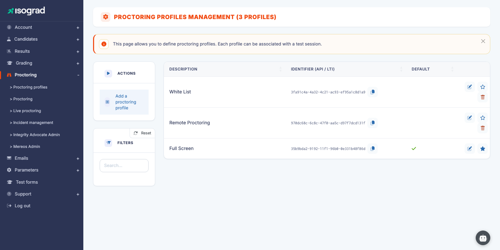
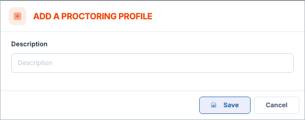
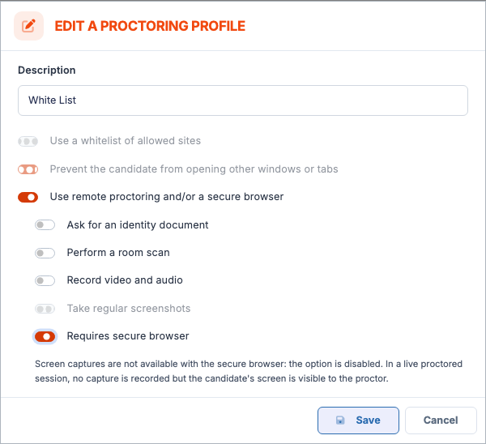
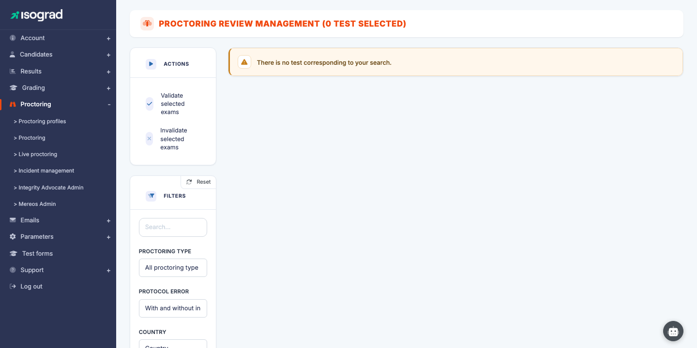
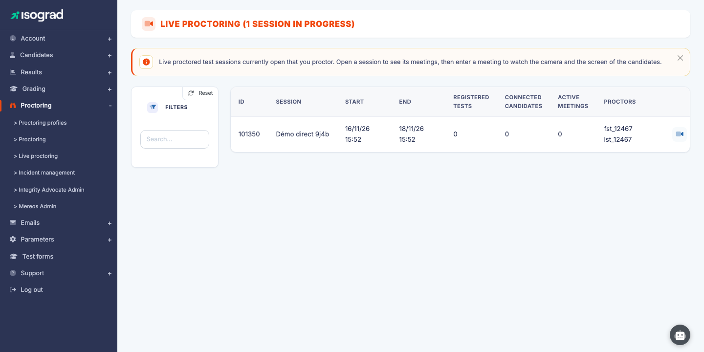
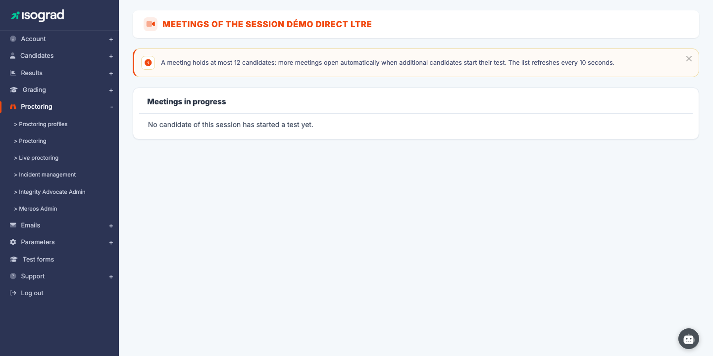

# Test proctoring

**Remote proctoring** guarantees the integrity of a test taken remotely, without an in-person invigilator. The platform offers several levels of proctoring — from mandatory full screen up to video and audio recording — together with *post-hoc* review of the detected incidents.

This chapter covers three complementary pages:

- **[Proctoring profiles](#proctoring-profiles)** — configure **how** your tests are proctored (which checks, which recordings).
- **[Proctored tests management](#proctored-tests-management)** — review **the sittings** already completed and validate or invalidate each test based on the collected evidence.
- **[Live proctoring](#live-proctoring)** — watch the camera and screen of the candidates of a test session **in real time**.

> 💡 **Availability** — Remote proctoring is an account option. If you do not see the pages described here in the menu, contact your Isograd representative to enable the feature.

## Proctoring profiles {#proctoring-profiles}

A **proctoring profile** is a set of settings that determines what the platform checks and records during the test. You can create several profiles (for example, *"Light exam"* vs *"Strict certification"*) to apply the right level of control to the right context: the profile is chosen **when registering** a candidate to a test, or is **imposed by a live-proctored [test session](/ai/en/sessions/)**.

Open this page through the **Proctoring → Proctoring profiles** menu.

The page lists your existing profiles. If your account is new and has no profile defined yet, you will simply see *"You have not created any proctoring profiles yet."*. Each row shows the **name** of the profile and a **Default** marker for the profile used when none is explicitly chosen. Each row also shows the profile's **Identifier (API / LTI)**, used to designate the profile from an integration, and a search field filters the list.

### Create a proctoring profile

Creation happens in **two steps**: name the profile, then configure its options in the edit window that opens automatically.

#### Step 1 — Name the profile

1. Click on **Add a proctoring profile** in the action bar.

    

2. Fill in the profile's **Description** — this is the label that will appear in the list and in the test registration windows. Choose a meaningful name such as "Strict certification" or "Light internal exam".

3. Click on **Save**. The platform creates the profile and immediately opens the edit window with its options.

#### Step 2 — Configure the proctoring options

In the profile's edit window, turn on the **proctoring options** you want. Two main options:

| Option | Effect |
|---|---|
| **Prevent the candidate from opening other windows or tabs** | The test must be taken in full screen, with no other window or tab. Leaving it triggers an incident. |
| **Use remote proctoring and/or a secure browser** | Enables remote proctoring and reveals the options below. |

The remote proctoring options only appear when the second option is on:

| Option | Effect |
|---|---|
| **Ask for an identity document** | The candidate must photograph their ID before starting. The photo can be reviewed afterwards. |
| **Perform a room scan** | Before the test, the candidate does a 360° sweep of their room with their webcam to show they are alone and their workstation is compliant. |
| **Record video and audio** | The candidate's webcam and microphone are recorded throughout the test (webcam and microphone are therefore mandatory). The video, with sound, can be reviewed afterwards. This option is required for [live proctoring](#live-proctoring). |
| **Take regular screenshots** | Periodic captures of the screen and webcam during the test. |
| **Requires secure browser** | The test can only be taken in **Safe Exam Browser**, an exam browser that locks down the candidate's workstation. See [the dedicated section](#secure-browser) below. |

Click on **Save** to persist the configuration. The profile can then be chosen when [registering a candidate to a test](#enable-proctoring) or imposed by a [live-proctored session](#live-proctoring).

### The secure browser (Safe Exam Browser) {#secure-browser}

The **Requires secure browser** option forces the test to be taken in **Safe Exam Browser (SEB)**, a free exam browser (Windows and macOS) that locks down the computer for the whole duration of the test: the candidate cannot switch applications, open other websites, or copy-paste to the outside.

On the candidate's side, the journey is:

1. They install **Safe Exam Browser** once on their machine (the download link is offered when launching the test).
2. When starting a test that requires the secure browser, the platform has them download a **personal exam file** (`.seb`). Opening it launches SEB directly on their test, already logged into their account.
3. The platform verifies **on every page** that the test is really running inside SEB — it is impossible to start in SEB and then continue in a regular browser.
4. At the end of the test, SEB closes automatically.

Depending on the test's content, SEB automatically allows what is needed — and only that: the applications required by file-submission questions (for example **Excel** for a workbook question), or navigation to the exercise site for **WordPress** tests. No other application or website is reachable.

Interaction rules with the other profile options:

- Enabling the secure browser **ticks and locks "Prevent the candidate from opening other windows or tabs"** (the lockdown is guaranteed by SEB itself) and **disables the website whitelist** (site filtering is built into the secure browser).
- **Screenshots** — regular screen captures are **not available** with the secure browser, whatever the system: the **Take regular screenshots** option is unticked and greyed out, and a note under the options explains it. **Audio and video** recording works normally. In a live-proctored session, no capture is recorded but the candidate's screen remains visible to the proctor.

    

- Turning off **Use remote proctoring and/or a secure browser** resets all of its options, including the secure browser.

> ⚠️ **Video content on Windows** — Safe Exam Browser for Windows cannot play MP4/H.264 videos. If your test contains videos in that format, contact your Isograd representative before enabling the secure browser.

### Set a default profile

The **default** profile is applied automatically to every proctored test for which no profile is explicitly chosen at registration.

1. On the profile's row, click on **Set as default proctoring profile**.
2. Confirm. The **Default** label moves to this profile; the previous default profile remains active but is no longer applied automatically.

### Edit a profile

1. On the profile's row, click on the **Edit** icon (pencil).
2. Adjust the options.
3. **Save**.

> ⚠️ **Effect on tests in progress** — Editing a profile **does not affect** tests already started or completed: only **future** tests using this profile will get the new options. Existing recordings remain those of the profile at the time of start.

### Delete a profile

1. On the profile's row, click on the **Delete** icon.
2. Confirm.

> ⚠️ **Profile in use** — If the profile is attached to tests, a **second confirmation** tells you how many: after the deletion, those tests are considered **unproctored** (pending tests get their proctoring credit back). The deletion is **refused** in two cases: if your account has no proctoring credit pack allowing this refund, or if the profile is used by a [live-proctored session](#live-proctoring) that is not over.

## Proctored tests management {#proctored-tests-management}

Once your tests have been taken under proctoring, this page lets you **review the detected incidents** and **validate or invalidate** each sitting based on the observed compliance.

Open this page through the menu **Proctoring → Proctoring**.

Each row in the table represents **one test taken under proctoring**:

| Column | Content |
|---|---|
| **ID** | Internal identifier of the registration. |
| **Full name** | Candidate identity. |
| **Test** | Name of the subject taken. |
| **Sitting date** | Date and time of the sitting. |
| **Proctoring type** | Proctoring profile used (video, full screen, etc.). |
| **Validation status** | Current state — **Pending**, **Validated**, **Invalid**. |
| **Incident** | Number and nature of automatically detected incidents. |

### Filters

The filter panel lets you target:

- **Search** — free text on the candidate.
- **Period** — start and end dates of the take; by default, the page shows the tests of yesterday and today. Widen the period to find older takes.
- **Proctoring type** — restrict by proctoring type, when the column is displayed.
- **Validation status** — for example show only tests **Pending** review.
- **Incident** — show only tests with or without an incident.

### Review a proctored test

The action buttons at the end of each row depend on the proctoring type and status:

- **Display proctoring pictures** (camera icon) — opens the test's review, whose title recalls the candidate's name, organised in tabs: **Pictures taken during the test**, **Video of the test**, **Screen captures**, **Test interruptions** and **ID document**. If the proctoring profile of the test did not ask for screen captures or for an ID document, the corresponding tab is greyed out: it remains clickable and then says that no screen recording, or no ID document, was required by the profile. In the image tabs, the **Display only suspicious images** toggle filters the captures where AI has detected an anomaly; the **Reasons flagged by the AI** block then lists the detected reasons, most frequent first, with their number of occurrences (face barely visible, second device or screen, document within reach, conversation with a third party, earphones, another person present, another tab visible, screen-sharing or remote-control software…). Click a reason to show only the images flagged for that reason; click again to show them all.

    <!-- Capture to regenerate (requires a proctored test with photos on the environment):
     -->

- **Display ID document** (silhouette icon) — displays the photo of the ID document provided by the candidate at start.
- **Exam protocol review comment** (magnifier icon), depending on the proctoring type — for tests with an **incident**, this window details each incident, its nature, and offers a field to record the proctor's explanation or to ask the candidate for further information.
- **Chat log** (speech-bubbles icon) — on tests taken in a [live-proctored](#live-proctoring) session: displays the thread of messages exchanged between the candidate and the proctors, with audio listenings and conversations. The proctors' reports (*Reported by*) and these exchanges also appear in the **Test interruptions** tab of the review.

> ⚠️ **AI analysis not available** — In the **Validation status** column, a warning icon next to the status signals that the AI analysis of the recordings has not been performed yet, is in progress or failed; a struck-out camera signals that no video recording was found for the test. The same message is shown at the top of the test's review; after a failure, the **Relaunch the analysis** button is offered there to administrators allowed to validate tests. In all these cases, no image has been flagged automatically: the absence of suspicious images proves nothing, review the recordings yourself.

### Validate or invalidate a test

Once the review is done, you make the call:

- **Validate** (green ✓ icon) — the test is compliant. The candidate's result is finalised and the diplomas/reports are issued.
- **Invalidate** (red ✗ icon) — the test is not compliant (cheating detected, condition not met). The result is marked invalid; no diploma is issued.

For a **bulk action**, select several tests using the checkboxes at the start of the row, then use the **Validate selected exams** or **Invalidate selected exams** buttons in the action bar.

### Validation statuses

| Status | Meaning |
|---|---|
| **Awaiting details** | An incident has been detected (for example, exit from full screen) but no explanation has been provided yet. You must detail the reasons, or ask the candidate to do so. |
| **Detail under review** | An explanation has been entered and is awaiting review by the Isograd team (for certifications). |
| **Explanation validated** | The Isograd team has validated the explanation; the test is compliant. |
| **Validated** | The test has been validated by an account administrator. |
| **Invalid** | The test has been invalidated by an account administrator. |

### Request explanations from the candidate

For certifications with an incident, you can ask the candidate to **justify the incident**:

1. On the row, click on the **Send an ID request** icon (or the equivalent for an incident).
2. The candidate receives an email inviting them to provide the explanation in their candidate area.
3. Once their response is submitted, the status moves to **Detail under review** and you can consult it in the **Exam protocol review comment** window.

> 💡 **Validation best practices** — For official certifications, be strict about incidents (exit from full screen > 60 seconds, presence of a second person in the captures). For internal corporate evaluations, you can be more lenient — proctoring remains a deterrent as much as a punitive tool.

## Live proctoring {#live-proctoring}

**Live proctoring** complements recorded remote proctoring: during a live-proctored **test session**, **proctors** of your account watch each candidate's **camera** and **screen** in real time, can write to them, talk to them, warn them, report an incident or stop their test — as in an exam room.

### Prerequisites

- Your account uses **Isograd remote proctoring** (otherwise the feature does not appear).
- An Isograd remote **proctoring profile** with **Record video and audio** ticked: it is the only compatible profile type.
- The proctors hold the **Proctor test sessions live** privilege (see [Edit privileges](/ai/en/admins/#edit-privileges)). A proctor only sees the sessions they proctor, unless they also hold the **See every live proctored session** privilege.
- A [test session](/ai/en/sessions/#create-a-session) created with the **Live proctoring** switch on, its proctoring profile and its proctors. The session's profile is **imposed on every test** attached to it.

### Sessions in progress

Access this page via the **Proctoring → Live proctoring** menu.

The page lists the live-proctored sessions **currently open** (between their start and end dates) that you proctor, each with its number of **registered tests**, **connected candidates**, **active meetings** and its list of **proctors**. The **Search** field filters the list on the session name or ID. Click **See the meetings** (camera icon) at the end of the row to open the session.

### The meetings of a session

The candidates of a session are automatically split into **meetings** of at most twelve candidates: a new meeting opens by itself when additional candidates start their test. Each card shows the number of connected candidates, the number of proctors present and the opening time; the list refreshes every ten seconds. As long as no candidate has started a test, the page simply says that no meeting is in progress. Click **Enter the meeting** to join a meeting.

### Inside the meeting

The meeting page carries the session name and the meeting number. Each connected candidate appears in a **card** bearing their name, with their **screen** and **camera**. Click a card, or its **Enlarge** button, to display it larger and in better quality; **Shrink** brings it back to its normal size. As long as no candidate is connected, the page says so. The candidate list refreshes every ten seconds.

No sound is transmitted by default: the candidate's microphone is required, but you only hear it while you listen to or talk with them.

The bar at the top of the page shows the state of your **connection** to the meeting, the **Switch meeting** selector (with the number of candidates connected in each meeting of the session), the **proctors present** and the **Leave the meeting** button. During a listening or a conversation, it also shows the name of the candidate concerned, the elapsed time and the **Stop audio** button.

For each candidate, the following actions are available:

| Action | Effect |
|---|---|
| **Messages** | Opens a written conversation panel with the candidate. It shows the message history, including messages from other proctors, identified by name. A red badge on the button counts the candidate's messages you have not read yet. Messages are kept with the test. |
| **Listen** | Opens a listening: you hear the candidate, they do not hear you. |
| **Talk** | Opens a two-way audio conversation; your browser asks for access to your microphone. |
| **Warn** | Displays a message of your choice on the candidate's screen for twenty seconds. |
| **Report** | Records an **incident** with your description; it then appears, with your name, in the test's review and in the [session minutes](/ai/en/sessions/#session-minutes). |
| **Stop** / **Resume** | After confirmation, interrupts the candidate's test; the candidate is sent back to their test list. Their card stays displayed with the mention *Test stopped by a proctor* and the button becomes **Resume**: resuming gives back the time elapsed while stopped. This is the same action as from the candidate's record. |

> 💡 **One audio conversation at a time** — A meeting allows only one listening or audio conversation at a time, across all proctors: while a proctor has one open, the audio buttons of the other cards are disabled and the card concerned shows their name. Audio stops automatically after ten minutes; click the active button again, or **Stop audio**, to stop it earlier. If the candidate does not answer the request or their microphone is not available, a message tells you.

To interrupt **all** candidates at once, use [session pause](/ai/en/sessions/#pause-and-resume-a-session) from the sessions page.

> 💡 **Secure browser** — With a profile that requires the secure browser, no screen capture is recorded, but the candidate's screen remains visible to the proctor during live proctoring.

> 💡 **Trace in the review** — What happens live is kept with the test: on the **Proctored tests management** page, the proctors' reports, the exchanged messages and the audio listenings and conversations (with their duration) appear in the test's review, **Test interruptions** tab, and the **Chat log** button displays the thread of exchanges. The warnings displayed on the candidate's screen are not kept: to keep a trace, use **Report** or **Messages**.

## Enable proctoring on a test {#enable-proctoring}

Proctoring is **not** enabled item-by-item on this page: it is decided **at the time of registration** of a candidate to a test. To enable proctoring on a test:

1. Register the candidate to the test (see [Register a candidate to a test](/ai/en/candidates/#register-a-candidate-to-a-test)).
2. In the registration window, enable the **Remote proctoring** option.
3. Choose the **proctoring profile** to apply from the list; otherwise, the **default profile** is applied automatically.

If the candidate is registered on a [live-proctored session](#live-proctoring), the session's profile is imposed: the selector is locked and a message says so.
