# Question editor

The **question editor** is the most heavily used tool in the Question Module — this is where you write statements, define answer options, add illustrations and visual aids, and tag each question on the skills map. Any administrator producing content for the platform spends the majority of their time on this page.

Open the editor through the **Edit** icon (pencil) on a question's row in the **[Questions](/ai/en/question-module/questions/)** page, or by clicking **Add an item** on that page.

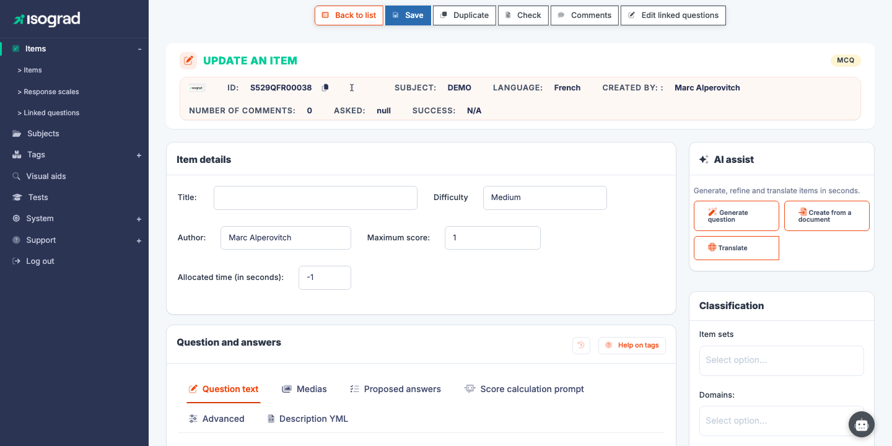

> 💡 **Answer type and interface** — The editor **adapts its interface** to the question's **answer type**. An MCQ question shows an answer-option input area; a Drag-and-drop question gets an editor for draggable items; a Manual submission question gets a grading grid. This chapter covers the common organisation **and** the per-type specifics.

## Overview {#overview}

The edit page (titled **Update an item**) is organised into several zones, with a badge at the top showing the **answer type** of the current question (MCQ, Click in area, etc.):

1. **Toolbar** (above the header):
    - **Previous** / **Next** — move to the previous or next question of the current list without going back through it.
    - **Back to list** — return to the Questions page, which comes back with its filters, sort and page preserved.
    - **Save** — saves all modifications.
    - **Duplicate** — creates a copy of the question.
    - **Check** — runs the editorial diagnostic on this question (empty title, missing statement, options not marked correct, etc.).
    - **Comments** — opens the list of comments left by candidates on this question during tests; the **Delete** (trash) icon at the end of a row removes a comment.
    - **Preview** — opens the question as a candidate will see it.
    - **Unlock** — shown on a question in *Production* status to administrators holding the appropriate privilege; puts the question back to *Draft* in one click (see [Save, preview, delete](#final-actions)).

2. **Identity banner**:
    - Subject icon + **ID** (for example `S12Q0042`) with a **Copy** button.
    - **Subject**, **Language**, **Created by** (the administrator who created the question).
    - **Number of comments**, **Asked** (number of takes), **Success** (success rate).

3. **"Item details" section**:
    - **Title**.
    - **Difficulty** — *Easy*, *Medium* or *Hard*, set by the author. Shown in the question list and used when composing tests.
    - **Author** (the person credited for the question, distinct from the creator shown in the banner).
    - **Maximum score** (defaults to 1).
    - **Allocated time** (in seconds; `-1` means "no limit").

4. **"Question and answers" section** — the heart of editing, organised into tabs (see [Editing tabs](#editing-tabs)).

5. **"Correct answer explanation" section** — the tutorial and the hint attached to the question (see [Tutorial and hint](#tutorial)).

6. **"Review Data" block** — the question's **Status** and **Responsible person**, plus a file and comments for proofreading exchanges between authors. Comments are split into two tabs: **Comments** (current) and **Archived comments**.

7. **"AI assist" sidebar** on the right, if AI features are enabled on your account — AI generation buttons (see [AI generation](#ai-generation)).

8. **"Classification" sidebar** on the right — question sets and domains the question is attached to.

> 💡 **Everything on a single page** — Unlike other platform entities, the editor does not navigate between several pages. All edits are made here and saved in one click via the **Save** button at the top.

## Editing tabs {#editing-tabs}

The **Question and answers** section is organised into tabs specific to the question's content:

| Tab | Content |
|---|---|
| **Question text** | The text shown to the candidate (rich text editor). |
| **Medias** | Illustration, reference documents, media files and audio generation attached to the statement. To generate an audio file, type the text to read and pick a **voice** among those available for the question's language. |
| **Type-specific tabs** | Answer options or type-specific settings — for example *Submission details* and *Grading grid* for a manual submission, *Input areas* and *Answer area* for auto-graded text areas. See per-type sections. |
| **Score calculation prompt** | For MCQs, psychometric questions and texts with dropdown lists only: describe a specific scoring rule in natural language, and the AI generates the matching computation. |
| **Advanced** | Advanced options: **Mandatory answer in tests with navigation** and, for questions where the candidate types text, **Lock copy/paste and text selection**. |

Two help buttons at the top right of this section:

- **Previous version(s)** (clock icon) — lists the previous versions of the question's content; pick one, then click **Load this version** to reload it into the editor.
- **Help on tags** — reference for the formatting tags available in the editor.

> 💡 **YML description tab** — A raw YAML view of the question exists for a few answer types (for example Sortable). For the other types it is not shown: use **Export to YML** on the Questions page to obtain the YAML of your questions.

## Common fields (title, text, illustration, tutorial) {#common-fields}

### Metadata

- **Subject** — subject the question is attached to. Set at creation.
- **Domains** — assessed skill domain(s), in the **Classification** panel. Used for the candidate report's skill map.
- **Item sets** — the question sets the question belongs to (see [Question sets](/ai/en/question-module/question-sets/)), in the **Classification** panel.
- **Status** — *Draft*, *Production*, etc., in the review block. Controls whether candidates can be served the question.
- **Responsible person** — administrator in charge of the question, in the review block.
- **Language** — set at creation, not editable. One question = one language.

### Title

The **Title** is a short label that appears in the *Title* column of the list and in skill reports: it represents the skill tested by the question. **Not shown to the candidate.** Choose a **descriptive and unique** title: *"Compute a sum"* is better than *"Excel - question 17"*.

### Question text

The **Text** is the statement shown to the candidate. You enter it in a rich editor that supports:

- **Markdown** — bold, italic, lists, links, code blocks. Rendering is immediate in the preview.
- **HTML formatting** for advanced cases (tables, specific CSS classes).
- **Visual aid insertion** via the dedicated search box (see [Visual aids](#visual-aids-section)).
- **Direct illustration insertion** (image on the question — see [Illustration](#illustration)).

> 💡 **Markdown vs HTML** — Prefer Markdown for everyday writing. Reserve HTML for cases where Markdown is not enough (complex tables, specific formatting).

### Illustration {#illustration}

An **illustration** is a media file attached **directly to the question** (as opposed to a visual aid, which can be shared between several questions). It is the image, sound or video that accompanies the statement.

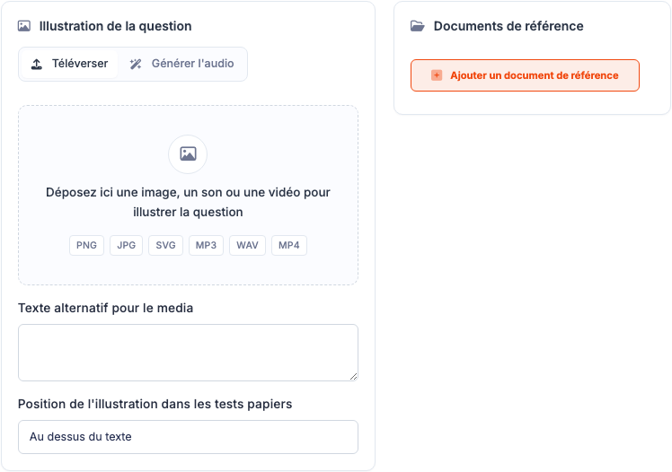

- To **add** an illustration, drop an image, a sound or a video into the drop zone, or click the upload button to pick your file.
- To **edit** the alt text, type it into the dedicated field — important for accessibility and screen readers.
- **Play media only once** — for a sound or a video, prevents the candidate from replaying it.
- **Position of the illustration in paper exams** — *above*, *to the right of* or *below* the text. Offered for the question types usable in a [paper exam](/ai/en/question-module/test-forms/#paper-exams).
- To **delete** the illustration, click the **Delete media** button.

> 💡 **Illustration or visual aid?** — An **illustration** belongs to the question, ideal for an image that is never reused. A **[visual aid](/ai/en/question-module/visual-aids/)** is shared between several questions, ideal for an Excel table or a source code shared by 10 questions of the same module.

### Tutorial and hint {#tutorial}

The **Correct answer explanation** section has two tabs:

- **Tutorial** — the explanation shown to the candidate **after** answering, in review mode. This is the teaching moment: explain why the right answer is right, how to identify it, which common mistake to avoid.
- **Hint** — a clue displayed in the question frame, to help the candidate while answering.

The format is the same as the question text.

### Visual aids {#visual-aids-section}

You can insert one or more **visual aids** into the text or the answers. See the [Visual aids](/ai/en/question-module/visual-aids/) chapter for creation and management. In the question editor:

- Type at least three characters of the visual aid's name in the **visual aid search** box on the right.
- Pick the visual aid from the results, filtered by the question's subject and language.
- The reference tag is inserted in the text. The candidate-side rendering will show the full image or document.

Three variants exist:

- **Reference document** — a document embedded in the question, or offered as a link (enable **Display PDF reference documents as a link**).
- **Visual aid shown on click** — an image that opens under a magnifying glass (in the statement or in the answers).
- **Visual aid shown in the text** — an image presented as an inset, generally smaller, typically for keyboard or interface questions.

## AI generation {#ai-generation}

The editor offers an **AI assist** sidebar on the right of the page, when AI features are enabled on your account. On a newly created question it holds:

- **Generate question** — proposes a full statement (text, answer options, correct answer) from the question's metadata (subject, domain, title). Offered for the answer types that support generation. Generation also fills in the **Difficulty** field with the level suggested by the AI; you can change it before saving.
- **Create from a document** — for the question types usable in a paper exam. Paste or pick an image or a PDF (PNG, JPEG, WEBP, GIF or PDF, 5 MB at most) containing **a single question**, optionally add instructions: the AI derives the statement and the answers from it.
- **Translate** — translates the question's content into another language, useful to quickly produce several linguistic versions of a subject.

Once the question has been saved a first time, more buttons appear:

- **Improve question** — rephrases and tightens the existing statement and options.
- **Generate a title** — proposes a title from the statement.
- **Obsolescence** — assesses whether the question's content is likely to be outdated.
- **Generate tutorial** — drafts the explanation shown to the candidate after answering.

For [automatic document grading](#upload-auto-grading) questions checked by a script, the **Generate code** and **Improve check code** buttons draft or rework that script from the statement.

> ⚠️ **AI proposes, you decide** — Generated content is a **starting point**, not a final deliverable. Always proofread and correct before saving: the AI output replaces the fields on screen but is not saved until you click **Save**. Quality depends on the AI model chosen in the **System → Select an AI** menu.

## Answer types — overview {#answer-types}

The platform offers a range of answer types, grouped into families. The exact list offered when you create a question depends on your platform configuration.

| Family | Types | Use case |
|---|---|---|
| **Multiple choice** | Text MCQ, Answer scale | Classic knowledge assessment. |
| **Answer selection** | Fill in the blanks with dropdown lists | When free text would be ambiguous to grade. |
| **Interactive questions** | Drag-and-drop, Sortable, Link, Click in area | Interactive and engaging tests. |
| **Typed answers** | Auto-graded text areas (expected answer or AI), Dictation, Manual submission | Knowledge checks and case studies. |
| **Document or audio grading** | Upload with automatic grading | File submission graded by AI. |
| **Specific** | Transition page | Edge cases (a page between two parts of a test). |

The following sections detail the **most common** types.

## Multiple-choice (MCQ) {#mcq}

The **Text MCQ** type is the most used type on the platform. The candidate sees a question and several answer options, of which **one or more** are correct.

### Editing the options

The MCQ editor exposes a list of options, each with:

- Its **number** and, right next to it, a **checkbox**: tick it if the option is a right answer.
- A **Text** / **Image** selector: an option is either a text or an image. In *Image* mode an upload button appears to choose the file (an image less than 1200 px wide), whose preview is shown on the row.
- The **option text** field.
- A **bin** icon that deletes the option.

An **Add an answer** button at the bottom of the list extends the number of options (5 is the recommended standard).

The **MCQ type** selector sets the answering rule: **single choice** (the candidate can select only one answer), **multiple choice** (several can be selected, and all must be found for the question to be right) or **one of n** (several answers are correct, but choosing one of them is enough).

### Display options

Three switches at the top of the answers tab:

- **Do not mix responses** — by default, options are presented to the candidate in a **random order** on each take. Turn the option on to force a fixed order (for example for a logic question where the order of choices carries meaning).
- **Display answers in matrix** — presents the options as a grid rather than a list.
- **No notion of correct answer (form, personality test...)** — for questions with no right or wrong answer.

## Scale (Likert, T/F) {#scale-question}

The **Scale** type presents the candidate with a question paired with a reusable **answer scale** — for example a Likert scale *"Strongly disagree / Somewhat disagree / Somewhat agree / Strongly agree"*, or a simple True/False scale.

### Editing

- **Select the scale** in the **Response scale** dropdown, shown when the **MCQ type** is the scale type (see [Answer scales](/ai/en/question-module/answer-scales/) to manage available scales).
- Each answer row is a statement put to the candidate, who answers it with the values of the scale. Instead of the MCQ checkbox, each row carries a dropdown of the scale's values: pick the **expected value** for that row there. To add a new scale, go to the menu **Items → Response scales**, then **Add a response scale**.

> 💡 For questions where there is no right or wrong answer, tick the option **No notion of correct answer (form, personality test...)**: the expected-value dropdowns are then hidden.

## Auto-graded text areas {#fill-in-the-blanks}

This type presents the candidate with one or more **input areas** — inserted in a fill-in-the-blanks text or displayed on their own — whose answer is **graded automatically**, either by comparison with an expected answer or by the AI.

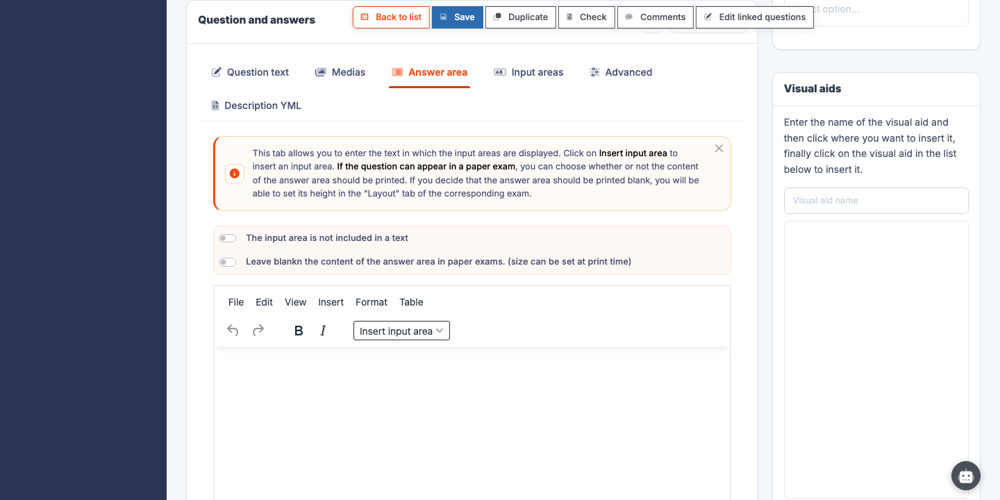

Editing is done in two steps: you create the input areas in the **Input areas** tab, then place them in the text of the **Answer area** tab.

### "Input areas" tab

- **Enable the points per input option** — by default, the candidate gets the question's **maximum score** if every area is right, and 0 otherwise. With this option, each area yields its own points: the question score is the sum of the points obtained, and the **Maximum score** — no longer editable — becomes the sum of the areas' points.
- **Use a rich text editor for input text areas** — the candidate gets a formatting toolbar in text areas.
- **List of input areas** — **Add field** creates an area. Its **name** (letters, digits, `_` and `-` only, unique within the question) is used to place it in the text. The **Edit** icon opens the area's details, the bin icon deletes it.

### Details of an input area

The **Details of the answer area** window sets how the area is presented and graded.

**Grading method**:

| Method | Grading |
|---|---|
| **Expected answer(s)** | The candidate's answer is compared with the **Expected answer**. If several answers are accepted, separate them with `##`. |
| **Graded by AI** | The AI grades the answer following the **Prompt for AI** you write: what is expected, what must be accepted or refused. |
| **Foreign language graded by AI** | The AI assesses a text written in a foreign language against the expected **CEFR level** (A1 to C2). The area is then a text area. |

**Input field type**: **Input field** (single line), **Text area** (several lines) or **Mathematical equation** — the candidate types a formula, rendered as they type, which is always graded by the AI. The **Border type** (full or bottom) sets the look of the field.

For an **expected answer**, the **Grading options** refine the comparison, which by default ignores case, punctuation and spaces:

- **Case sensitive** — upper and lower case must match.
- **Punctuation sensitive** — punctuation must match; the **Space sensitive** option then appears.
- **Tolerance** — for a *Number* value, the accepted gap around the expected answer. Both the comma and the dot are accepted as decimal separator.

With the **points per input** option:

- **Maximum number of points** — the points yielded by the area (1 by default).
- **The score for this area can only be 0 or the maximum number of points** — turn this option off on an AI-graded area to allow an intermediate score. An expected-answer area is always graded all or nothing.

The **Content constraints** frame what the candidate types: **Allowed value type** (text, number or email), **Tooltip**, **Example text**, **Maximum length**, **Pattern** and, for a text area, **Minimum** and **Maximum number of words** — recalled to the candidate below the area. An empty answer, or one clearly shorter than the minimum word count, scores 0 without being submitted to the AI.

### "Answer area" tab

- The text editor holds the text in which the areas appear. Place the cursor where you want and use the insert-input-area menu of the toolbar to place an area by its name.
- **The input area is not included in a text** — when the question has a single area, displays it directly below the statement, with no surrounding text.
- **Leave blank the content of the answer area in paper exams** — leaves an empty space when printing; its size is set in the [paper exam](/ai/en/question-module/test-forms/#paper-exams).

The **Check** button reports a question with no input area, or whose answer area is empty.

> 💡 **AI grading** — When an area is graded by the AI, the candidate sees a progress bar while the answer is being submitted. Write a precise prompt (expected elements, tolerances) and test the question through the **Preview** with right and wrong answers before moving it to Production.

### Usage context: paper exam {#usage-context}

The **Usage context** card, above the tabs, holds the switch **This question will only be used in paper exams**. When it is on, specify **how the candidate will answer**:

- **On the printed paper**, which carries the answer areas.
- **On a sheet separate** from the paper — the answer area is then generated automatically, with one line per input area.

### Fill in the blanks with dropdown lists

Another answer type offers the candidate a **dropdown list** instead of a free-text field. For each blank, you define the list of options and the correct one.

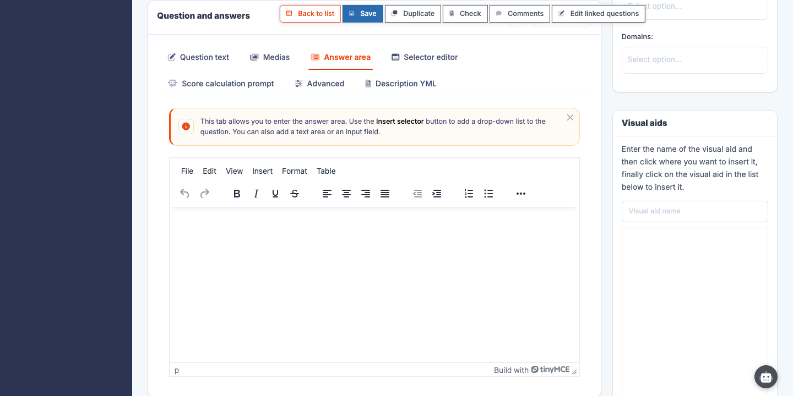

## Drag-and-drop {#drag-and-drop}

The **Drag-and-drop** type presents the candidate with **items** to drag and drop into **target zones**.

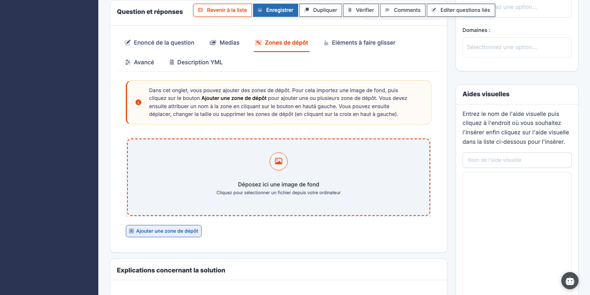

### Editing

- Define the list of **items** (text, image, or both).
- Define the **target zones** in the background illustration (typically an image with numbered slots).
- For each item, specify the **correct target zone**.

## Sortable {#sortable}

The **Sortable** type presents the candidate with a list of items to **reorder** into the correct sequence.

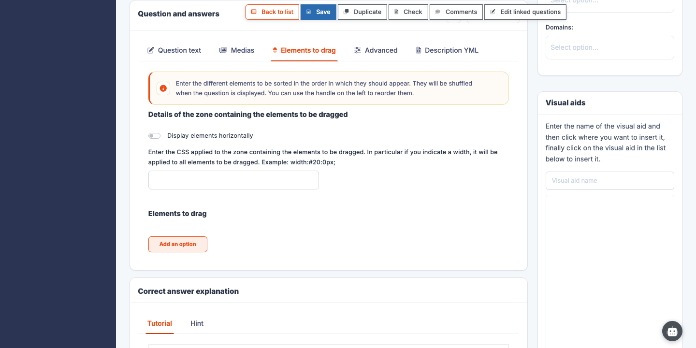

### Editing

- Define the list of items in the **correct** order.
- On presentation to the candidate, they will be automatically shuffled.
- The candidate must put them back into the right order.

## Link (pairing) {#link}

The **Link** type offers the candidate two columns of items they must **pair**.

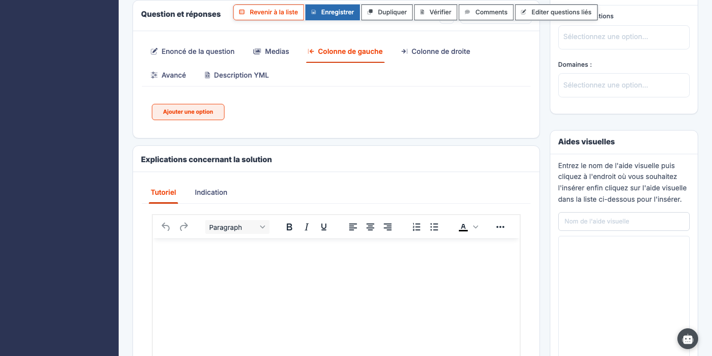

### Editing

- Define two lists: **column A** and **column B**.
- Indicate which pairs are the correct associations.
- You can have 1-to-1 or 1-to-many correspondences depending on your configuration.

## Click in area {#click-in-area}

The **Click in area** type presents the candidate with an **image** on which they must click at a precise spot (a button in a screenshot, an area of a diagram, etc.).

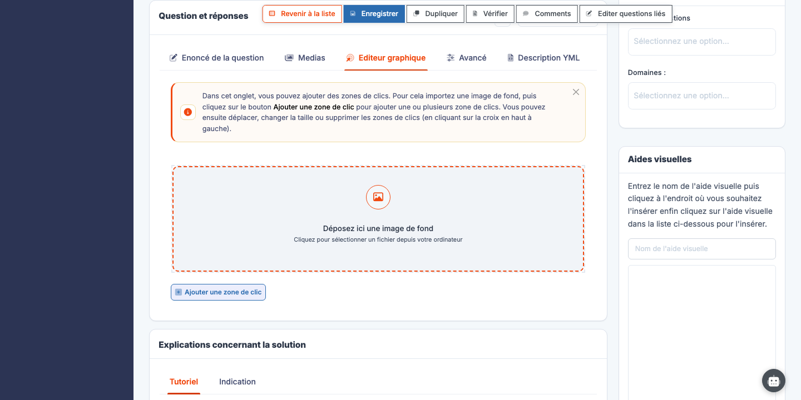

### Editing

- Upload the target image.
- Define the **correct zone(s)** by rectangular coordinates.
- The candidate clicks: the click is considered correct if it falls within a correct zone.

## Manual submission {#manual-marking}

The **Manual submission** type presents the candidate with a **free-answer** question (essay, document, recording) that will be **graded by a grader** after the test, using a **grading grid**.

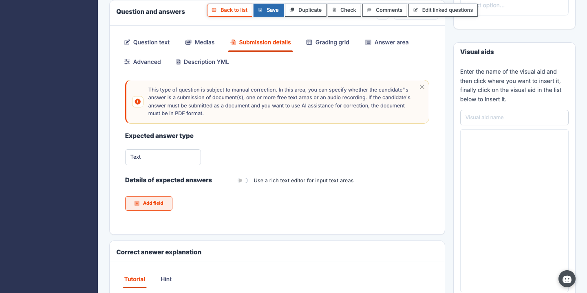

Besides the statement and the media, the editor has the **Submission details**, **Grading grid** and **Answer area** tabs.

### "Submission details" tab

The **Expected answer type** selector sets what the candidate hands in:

| Expected answer type | What the candidate does | Settings |
|---|---|---|
| **Text** (default) | Answers in one or more input areas. | **Add field** creates an area: its name, its type (**Single-line field** or **Multi-line text area**), an example text and, if needed, an additional CSS style. **Use a rich text editor for input text areas** gives the candidate a formatting toolbar. |
| **Submit one or multiple files** | Uploads one file per expected slot. | **Add a file to submit** creates a slot, with a **description** (shown to the candidate when several files are expected) and the **allowed extensions**, separated by commas. Both fields are required. |
| **Record an audio** | Records themselves from the question page. | **Allow multiple recordings of the audio** and the optional **Maximum duration (in seconds)** of the recording. |
| **Record a video** | Films themselves from the question page. | The optional **Maximum duration (in seconds)** of the recording. |

> 💡 **Prefer PDF** — For a file submission, ask for a **PDF**: the grader will be able to annotate the copy and rely on AI assistance when grading.

When several files are requested, the candidate's answer is only complete once every slot is filled.

### "Grading grid" tab

The grid lists the **criteria** on which the grader marks the answer. **Add a criterion** creates a row with:

- **Criterion name** and **Criterion description** — what the grader must assess.
- **Maximum score for criterion** — the points that can be awarded.

Drag the criteria to reorder them. The question's **Maximum score** is no longer editable: it equals the sum of the criteria scores.

> ⚠️ **At least one criterion** — The **Check** button reports a manual submission with no grading criterion: define the grid before moving the question to Production.

### "Answer area" tab

For a **text** answer, this tab holds the text displayed around the input areas. With a single area, it is filled in automatically. It is not shown for file submissions.

The **Advanced** tab offers, for text answers, **Lock copy/paste and text selection**.

### Usage context: paper exam

The **Usage context** card, above the tabs, holds the switch **This question will only be used in paper exams**. When it is on, the question expects **a single PDF file** — the candidate's scanned copy —, the *Submission details* tab disappears and the statement becomes optional. This is the setting of the marking grids created from a [paper exam](/ai/en/question-module/test-forms/#paper-exams).

### Grading

No score is computed during the test: the result stays pending grading. The grader then awards points and a comment for each criterion of the grid. See the [Grading copies](/ai/en/grading/) chapter of the administrator manual for the grading workflow.

## Typing test {#typing}

The **Typing test** and **Typing test with correction** types evaluate the candidate's typing **speed and accuracy**.

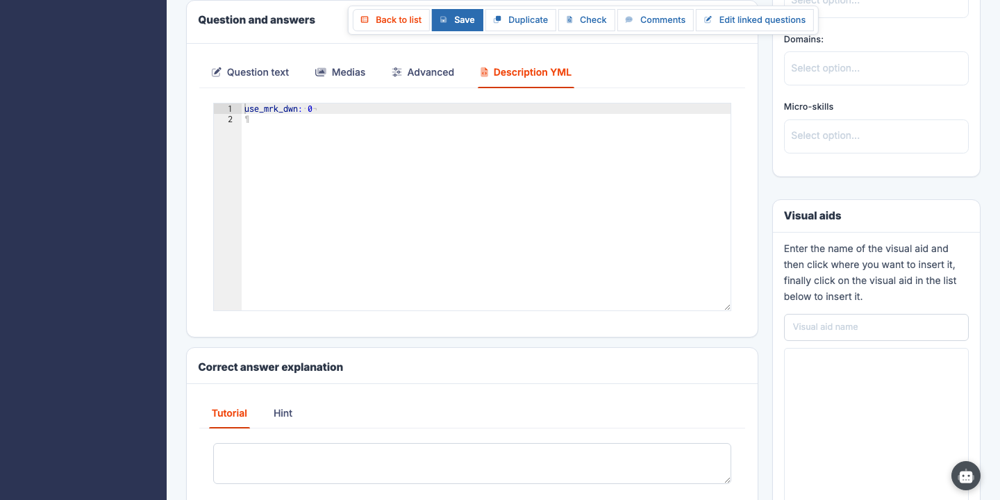

### Editing

- The **Question text** tab holds the **instructions** shown to the candidate above the text to retype.
- The **test duration** is the question's **Allocated time** (in seconds), in the **Item details** section.
- The score combines **accuracy** (share of characters typed correctly) and **speed** (characters typed per minute): typing 275 characters per minute with 97% accuracy earns the maximum score.

The **with correction** variant lets the candidate **go back and correct** their errors; without correction, every keystroke is final.

## Upload with AI grading {#upload-auto-grading}

The **Upload with automatic grading** type lets the candidate **upload a file** (typically a Word/Excel document, a screenshot or an audio recording) which is then **analysed by AI** to automatically produce a score.

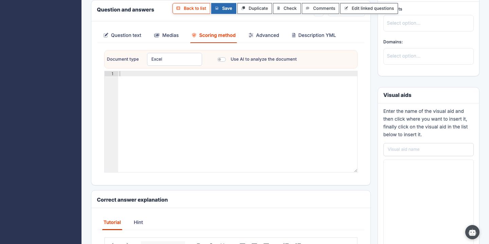

### Editing

- **Document type** — the expected file: Audio, Excel, Image, Illustrator, PDF, Photoshop, PowerBI or Word.
- In the **Scoring method** tab, three switches, offered depending on the document type:
    - **Use AI to analyze the document** — when on, you describe in natural language what the AI must check in the candidate's document: *"Check that the document contains a table with at least 5 rows, that the first column is named 'Name', and that the formatting is consistent"*. When off, the document is checked by a **script**: the **Generate code** and **Improve check code** buttons of the AI assist sidebar draft it from the statement. An image is always analysed by the AI; Photoshop, Illustrator and PowerBI documents are always checked by a script.
    - **Use a grading grid** — replaces the free instruction with a grid of criteria, as for a [manual submission](#manual-marking); the **Maximum score** becomes the sum of the criteria scores.
    - **Extract text from document** — for a PDF or an image, reads the text of the document (handwritten or scanned) before the analysis.
- For an **audio**, a dedicated editor replaces these settings: the assessment instruction, all-or-nothing grading and, for a foreign-language test, the type of test and the expected CEFR level.
- In the **Medias** tab, the **Document provided to the candidate** card lets you attach the starting file the candidate works on.

> ⚠️ **Non-deterministic AI grading** — AI scores can vary slightly from one take to another. Reserve this type for **formative assessments**, not high-stakes certifications. For rigorous grading, use a **[Manual submission](#manual-marking)** with a human grader.

## Save, preview, delete {#final-actions}

### Save

The **Save** button at the top of the editor stores all modifications. Saving is done without reloading the page: a success notification appears at the top right.

> ⚠️ **Production questions are read-only** — Once a question's **Status** is set to *Production* and saved, the content of the editor becomes read-only: the question is being served to candidates and must stay stable. Only the **review block** stays editable. To modify the question, set its **Status** back to *Draft* there and click **Save**: the page reloads unlocked, and the question stops being served until it is put back into *Production*. Administrators holding the appropriate privilege can also click **Unlock** in the toolbar, which does the same and assigns the question to them.

### Check

The **Check** button runs the editorial diagnostic on the question: empty title or statement, no option marked correct, missing media, and so on. Run it before switching the status to *Production*.

### Preview

The **Preview** button opens the question as it will appear to a candidate (rendered statement, displayed options, loaded illustrations). It is the mandatory step before any production rollout: a statement that looks clear in the editor can be ambiguous once rendered on the candidate side.

On the preview page, the **review block** is shown in a panel docked on the right, open by default. The **Review** button in the toolbar hides or shows it again, and its state is remembered from one preview to the next.

### Navigate between questions

The **Previous** and **Next** buttons at the top of the page let you move to the neighbouring questions of the current list **without going back through the list**. Handy for bulk editorial reviews.

### Delete

The **Delete** icon on the question's row in the list deletes the question after confirmation. If deletion is refused (for example because the question is part of the fixed question list of a **test**), an error notification is shown and you stay on the page; otherwise you are taken back to the list, with its filters preserved, and a success message is shown.

> 💡 **Prefer the "To delete" status to deletion** — To withdraw a question from circulation without losing its history, **change its status** to *To delete* instead of deleting it. The question leaves the default list (a filter lets you show these questions again), its historical takes remain analysable, and it is no longer served to new candidates.

## Best practices {#best-practices}

- **A short and clean statement** — aim for 3 sentences at most for the question. If the statement becomes long, check whether a **visual aid** would be clearer.
- **Five options for MCQs** — this is the number that maximises discriminating difficulty without cognitively overloading the candidate.
- **Avoid artificial traps** — no double negatives, no subtle spelling differences between options. A candidate should fail because they do not know the answer, not because they misread.
- **Document the tutorial** — the tutorial is the **pedagogical value** of the question. It is what distinguishes a simple assessment from a learning tool.
- **Test before publishing** — pass the question through a colleague (or yourself via the preview) before switching it to *Production* status. Broken questions in production degrade the perceived quality.
