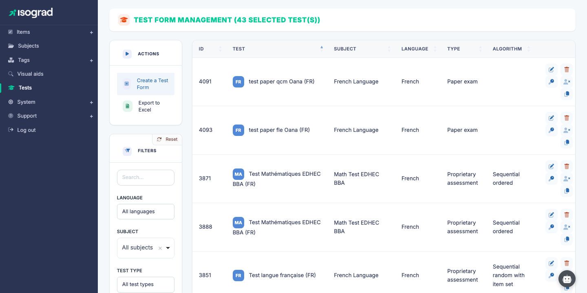
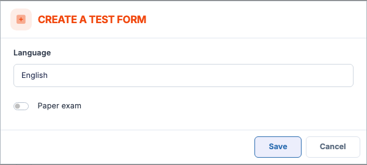
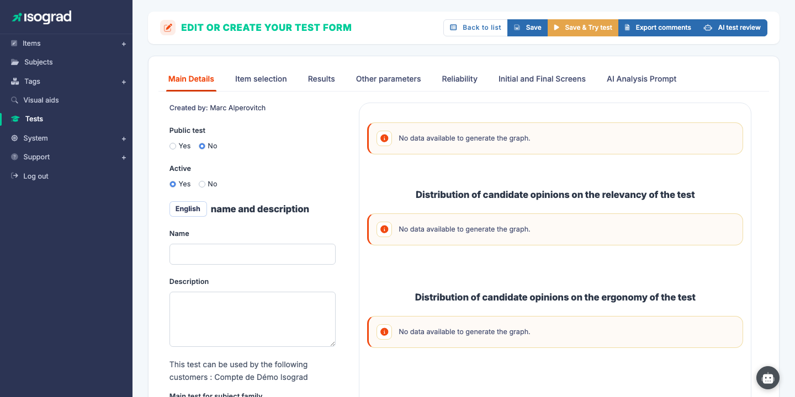

# Tests

A **test** is the final assembly that becomes passable by a candidate. It is the junction point where you take a **selection of questions** from your question bank, choose the **question order**, set **parameters** (duration, navigation, etc.), and obtain a deliverable that your account administrators can book for candidates.

Every test booked for a candidate on the platform is defined by one of these tests.

Open the page through the menu **Tests**. It is shown to administrators holding the test-reading privilege.

The table (titled **Test Form Management**) lists every test, with its **ID**, **name**, **subject**, **language**, **type** and **algorithm**. When a usage period is set in the filters, an extra column shows the **number of takes** over that period.

Only the tests whose type is enabled on the account are listed; inactive tests only appear when the **Include inactive tests** filter is turned on (see [Filters](#filters)). Administrators of the **main account** see all of these tests. Administrators of a **sub-account** (or logged in as an alias on an account) only see the tests linked to their own account — see [Authorise a test / Remove access](#authorise-a-test).

## Concepts {#concepts}

### Question order

A test either fixes the exact list of questions, or draws them at random at the start of each session. This is the **Question order** setting of the test:

- **Ordered** — you pick the questions one by one; every candidate gets the same questions in the same order.
- **Randomized** — you select a list of questions and set the **number of questions** to serve; each candidate gets that number of questions, drawn at random from the list.

### Only Production questions are served

Whatever the order, a test can only serve questions whose status is **Production**: the question picker only lists those, and random draws ignore the others. Put your questions into Production before building the test (see the [Question editor](/ai/en/question-module/question-editor/#final-actions)).

## Create a test {#create-a-test}

Creation goes through a minimal dialog, followed by the edit page.

1. From the **Test Form Management** page, click **Create a Test Form** in the action bar.

    

2. Choose the **language** presented to the candidate.

3. Leave the **Paper exam** switch off for a test taken on screen. Turn it on to create an exam meant to be printed, or scanned copies to grade — see [Paper exams](#paper-exams).

4. Click **Save**. The platform creates the test and takes you to its edit page.

## Tabs of the edit page {#tabs-advanced-mode}

The edit page offers five tabs. A help message at the top reminds you that the test is built from the questions of **your** bank.

| Tab | Content |
|---|---|
| **Main Details** | Everything that defines the test: status, name and description, question order, question selection, candidate-side options. |
| **Time Management** | The allotted time. |
| **Initial and Final Screens** | The intro and feedback texts shown to the candidate. |
| **AI Analysis Prompt** | The instructions for the AI analysis of a candidate's result. |
| **Statistics** | Usage and candidate-opinion charts, reliability computation. |

### "Main Details" tab

- **Created by** — the administrator who created the test.
- **Active** (Yes / No) — an inactive test can no longer be booked for new candidates but stays available for the results already recorded. This is how you retire a test.
- **Name and description** — required at least in the language of the test. The description is shown to administrators when they book the test.
- **Question order** — *Ordered* or *Randomized* (see [Concepts](#concepts)).
- **Needs proctoring** — whether the test must be taken under remote proctoring.
- **Has improved accessibility** — variant of the interface designed for visually impaired candidates.
- **Items selection** — the list of questions of the test, see [Select the questions](#question-selection).
- **Number of items** — for a *randomized* test only: how many questions each candidate receives, drawn at random from the selected list (1 000 at most).
- **Result type** — required; how the score is computed and presented (for example number of correct answers or a percentage).
- **Navigate between items** — for an *ordered* test only: lets the candidate move back and forth between questions instead of answering them in sequence. This option is incompatible with in-application questions: it cannot be turned on if the test contains some, and the picker refuses to add any while it is on.
- **Show item list** — for an *ordered* test only: displays the titles of the questions to the candidate after the introduction screen.
- **Display the "Give up" button** — lets the candidate skip a question. On by default.
- **Display the button to listen to the question** — text-to-speech of the statement. On by default.

### Select the questions {#question-selection}

In the **Items selection** block, the button that opens the picker displays a two-column window:

- **Available items** (left) — the Production questions of your bank. Filter them by **subject**, then by **domain** (the filter appears once a subject is chosen), **difficulty**, **item set** or free text.
- **Selected items** (right) — the questions of the test.

Drag a question from the left column to the right one to add it to the test. In the right column, drag the questions to set their order; on each question, the eye icon shows a preview and the bin icon removes it from the test. **Close** applies the selection to the form, **Cancel** discards it. Up to 1 000 questions can be selected.

Back on the form, the question table summarises the selection; the eye icon of each row opens the question preview. The selection is only kept once the form is **saved**, and an ordered test must contain at least one question to be saved.

### "Time Management" tab

- **Allotted time** — in minutes. Leave empty to impose no time limit.

### "Initial and Final Screens" tab

- **Intro screen text** — message shown before the first question.
- **Feedback text** — message shown when the test is over. A default text is proposed when the test is created.

### "AI Analysis Prompt" tab

- **Instructions for the AI analysis of the test result** — optional guidance used when an administrator requests an AI analysis of a candidate's result.

### "Statistics" tab

- **Number of tests taken per month**, with the total.
- Two charts showing the **distribution of candidate opinions** over the last twelve months: relevance of the content and ergonomics of the test.
- **Reliability** — the **Compute reliability** button computes a reliability coefficient from the tests completed over the last twelve months, with a rating (*Excellent*, *Good*, *Acceptable*, *Low*). The test must contain at least two questions; if no complete take exists over the period, a message says so.

### Header buttons

- **Save** — saves the whole form.
- **Save & Try test** — saves, then displays an address, with a button to copy it, to open in a **private browsing window**: you then take the test as a candidate would see it, without losing your administrator session. Each new trial replaces the previous one.
- **Export comments** — downloads the comments left by candidates on the questions of this test.
- **AI test review** — if AI features are enabled on your account. Describe the **test objective** (1 000 characters at most) then click **Analyze**: the AI gives an opinion on the relevance of the selected questions and of their number for that objective, taking into account the type and difficulty of the questions, the question order and the scoring mode.
- **Display sample report** — depending on the result type, a link shows an example of the report given to the candidate.

## Paper exams {#paper-exams}

A **paper exam** is a test created with the **Paper exam** switch turned on (see [Create a test](#create-a-test)). It is used either to **print an exam** made of questions from your bank, or to **grade scanned copies** with a marking grid. Its result is always a sum of points and its questions are always ordered.

Its edit page differs from that of an on-screen test.

### "Main Details" tab

- **Created by**, **Name and description** — as for an on-screen test.
- **Maximum score** — required, a whole number greater than 0.
- **Allow the grader to see the grading done by the other grader, if any** — off by default: in double grading, each grader marks without seeing the other's work.
- **Exam type** — two tiles:
    - **Build an exam from one or more questions of the question base** (automatically or manually marked) — the default choice.
    - **Only use a marking grid on scanned copies**.

### Exam made of questions from the bank

Question selection uses the same picker as for an on-screen test, limited to printable question types: MCQ, manual marking, text answer, click in area, click in text, psychometric and matching.

In the question table, the **Printed label** column lets you change the heading printed above each question ("Question 1", "Question 2"… by default, 100 characters at most).

The **Layout** tab sets the answer space:

- If the exam only contains MCQs, a switch lets you report the answers on a separate **answer sheet**: the check boxes are then replaced by letters in the statement.
- Otherwise, answers are printed automatically, except for manual marking and text answer questions. For each of these, tick **Answer area** to leave a space below the question, and optionally set its **Height (cm)** (from 0 to 25; empty: natural size).

The **Additional content to print** tab contains:

- **Content displayed at the beginning of the document** — pre-filled with a candidate identity table (last name, first name, class or group, date).
- **Content displayed at the end of the document**.
- **Content above the answer grid** — for an MCQ-only exam: identity fields, instructions… LaTeX formulas are written between `$$`.

The **AI Analysis Prompt** tab is the same as for an on-screen test.

Two header buttons replace those of an on-screen test:

- **Print the exam** — generates the document to print.
- **Print the answer grid** — offered when every question is an MCQ.

### Scanned copies graded with a grid

With the **marking grid on scanned copies** tile, the exam is linked to **a single manual marking question** of your bank, whose grid is used to grade each copy. The *Layout* and *Additional content to print* tabs disappear, and the **Marking grid selection** block offers two tiles:

- **Use the marking grid of an existing exam** — choose a subject, then click the manual marking question you want. Only manual marking questions are listed.
- **Create a marking grid** — choose the subject, enter a **title** (required), optionally the **statement** printed at the top of the copy, then define the **marking criteria** (at least one). The maximum score shown is the sum of the criteria weights. **Create the grid** creates a manual marking question (PDF copy upload) in your bank and links it to the exam.

Once the question is chosen, a summary shows its ID, title and maximum score, with an **Edit the question** link that opens it in the [question editor](/ai/en/question-module/question-editor/). The **Maximum score** of the exam then takes the question's value and can no longer be edited.

> ⚠️ **Save the exam** — The link between the exam and its grid is only kept after clicking **Save**. Saving is refused unless the exam is linked to exactly one manual marking question with a single file upload.

## Edit a test {#edit-a-test}

1. On the test's row, click the **Edit** icon (pencil).
2. Navigate between the tabs and adjust the desired values.
3. Click **Save** at the top right.

> ⚠️ **Tests in use** — Editing a test **already booked** for candidates can affect their experience. For deep changes (question list, order), prefer creating a **new test** or **duplicating** the existing one, and set the old one to inactive.

## Duplicate a test {#duplicate-a-test}

Duplication is the fastest tool for creating a variant of an existing test (another language, a local adjustment, a shorter version).

1. On the row of the test to duplicate, click the **Duplicate** icon.
2. The platform creates a copy and takes you to its edit page.
3. **Rename** the copy to avoid confusion: it carries the same name as the original.

> 💡 **Duplication preserves** — the question list, the question order, the parameters, the descriptions, the intro and feedback messages. The questions themselves are shared, not copied.

## Authorise a test / Remove access {#authorise-a-test}

Administrators of the **main account** decide which accounts can use each test: a sub-account administrator only sees, and can only book, the tests linked to their account. The two icons below only appear for administrators of the main account.

To authorise a test for one or more accounts:

1. On the test's row, click the **Authorize for an account** icon (key).
2. In the **Authorize this test for an account** window, look up the account(s) in the **Account identifier** field: type at least three characters of the account name, of its identifier or of the email of one of its administrators, then select the account. You can select several.
3. Click **Save**. A message confirms that the test has been added to the selected accounts.

To remove the test from the account you are logged in to, click the **Remove access** icon on the test's row. Removal is immediate, with no confirmation prompt.

> 💡 **Who can use this test?** — Hover over the name of a non-public test: a tooltip lists the accounts authorised to use it.

## Delete a test {#delete-a-test}

1. On the test's row, click the **Delete** icon.
2. Confirm on the page that opens.

> ⚠️ **Prefer deactivation** — Deleting a test removes its definition for good. For a test that has already been taken, set **Active** to *No* on the Main Details tab instead: the test can no longer be booked but the historical results stay readable.

## Filters {#filters}

The **Filters** panel offers:

- **Search** — free text on the name or the ID.
- **Test type** — by test type, for example to isolate paper exams.
- **Language** — by test language.
- **Subject** — by associated subject.
- **Include inactive tests** — switch; off by default.
- **Display usage from / to** — a period; when set, the table shows the number of takes of each test over that period.

Column sorting is available by clicking the headers. On a sub-account, the filters apply to the tests linked to the account only.

## Export the list {#export-the-list}

The **Export to Excel** button in the action bar generates an `.xlsx` file listing every test currently filtered. Valuable for periodic test catalogue reviews.
