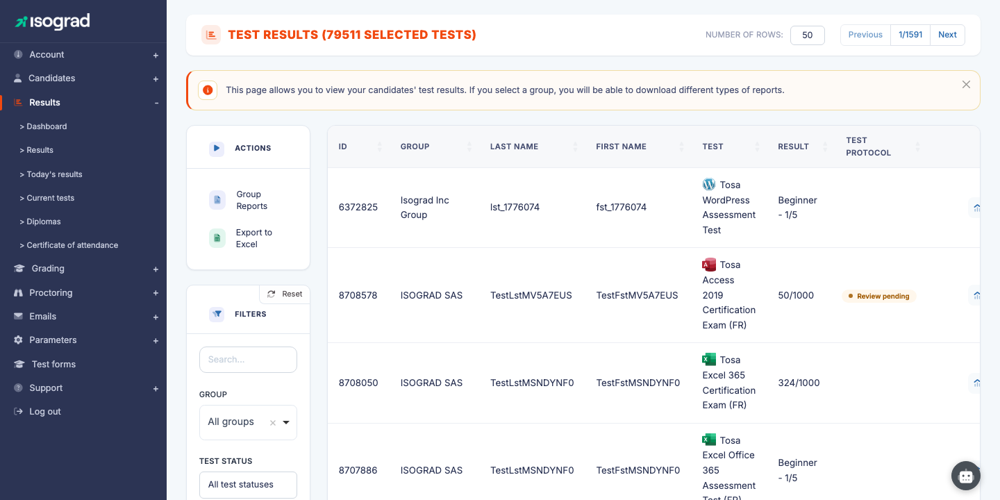
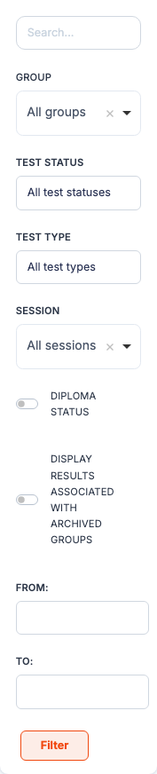
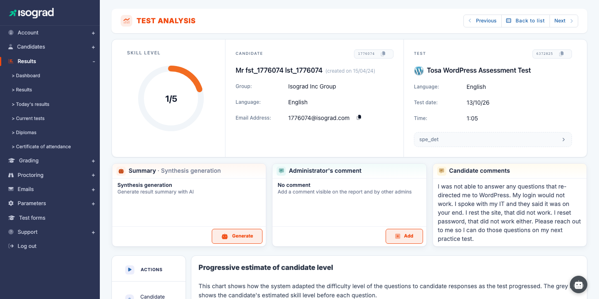
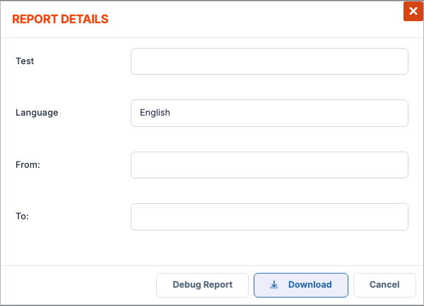

# Results management

The **Test Results** page is the dashboard for your account's activity: every test **completed**, **in progress** or **to be taken** by your candidates is listed here, along with their scores and access to the detailed reports. It is also the page from which you **download reports** and **certificates**, individually or in bulk, and from which you trigger automatic sending to candidates.

Open this page through the **Results** menu.

Each row in the table represents **one test registration for a candidate**. The default columns are:

| Column | Content |
|---|---|
| **Group** | The group the candidate belongs to. |
| **Last name** / **First name** | Candidate identity. |
| **Test** | Subject name and test type (evaluation, certification, positioning). |
| **Result** | Score obtained (depending on status). If the test is not finished, displays *"No result yet"*. For tests pending manual grading, this column becomes **Grader**. |
| **Test protocol** | For a proctored test that is completed or pending grading, the review status of the proctoring protocol (review pending, validated, not valid). Empty for a non-proctored test. |

The table adapts to the **Test Status** filter: a **Test Date** column is added for completed tests, a **Creation date** column for tests to be taken or in progress. The **Diploma Status** toggle adds the column of the same name.

The **action buttons at the end of each row** depend on the test status (see [Row actions](#row-actions) below).

> 💡 **Related sub-pages** — The **Results** menu in the sidebar also offers:
> - **[Dashboard](/ai/en/dashboard/)** — aggregated metrics (number of completed tests, average duration, score distribution) for a group or a session.
> - **Certificate of attendance** — generation of official test sitting attestations. This entry is only offered to testing centers and Education accounts.

## Filters and search {#filters-and-search}

The **Filters** panel to the left of the table lets you target a sub-population of tests:

- **Search** — free text: candidate's last name, first name, email address, test name, identifier.
- **Group** — one group at a time; if the group has sub-groups, a **sub-group** selector appears to narrow the selection. Selecting a group **enables the group report actions** (bulk report downloads) — see [Group reports](#group-reports).
- **Test Status** — restricts the display to a specific status (see [Test statuses](#test-statuses)).
- **Test type** — evaluation, certification, free, positioning, etc.
- **Session** — restricts to tests attached to a given test session. This filter only appears if your account uses sessions.
- **Remote Proctored** (toggle, depending on your account options) — keeps only the tests taken under remote proctoring.
- **Diploma Status** (toggle, Tosa platform) — adds a column to the table showing where the diploma of each certification stands.
- **Display results associated with archived groups** (toggle) — by default, the results of archived groups are hidden. Enable to see them.
- **From / To** — restricts the display to a date interval; fill in both dates for the filter to apply.

The **Reset** button at the top of the panel returns all filters to their default values.

## Test statuses {#test-statuses}

The **Test Status** filter offers several values that correspond to the stages of a test's life:

- **To be taken** — the candidate has been registered but has not yet started the test.
- **In progress** — the candidate has started the test and has not finished it. The test remains startable as long as it is not marked as completed. A test stopped by an administrator still shows as *In progress* here; the **Stopped by an administrator** badge only appears on the candidate's record (see [The planned tests table](/ai/en/candidates/#the-planned-tests-table)).
- **Completed** — the candidate has submitted their answers. The score is calculated and the report is available.
- **Pending grading** — for tests containing manually graded questions (essay, uploaded document, scanned copy), the test is submitted but requires a grader's intervention.
- **Cancelled** — the registration was cancelled before the candidate took the test. The credit is refunded to the account.

> 💡 **"Pending grading"** — When you filter on this status, the **Score** column is replaced by **Grader**: this is the administrator or the pair in charge of the grading (or **AI** while an AI marking is in progress). See [Grade a test](#grade-a-test) below.

## Row actions {#row-actions}

The action buttons visible at the end of each row depend on the test status and on your account privileges:

- **Analysis** — on a completed test, opens the candidate's result page (see [View result detail](#view-result-detail)).
- **Assign grade** (grading icon) — for tests pending grading, opens the marking screen (see [Grading copies](/ai/en/grading/#mark)).
- **View the scoring** (eye icon) — replaces **Assign grade** in double grading, once you have submitted your marking of every pending question: the test then only opens read-only for you.
- **Assign test to grader** (silhouette icon) — for tests pending grading, assigns the test to a grader or a grader pair of your account.
- **Download bundle diploma** (diploma icon) — on a completed certification bundle, instead of the **Analysis** button: opens the PDF diploma of the bundle.

## Group reports {#group-reports}

Once a **group is selected** in the filter, several bulk actions become available in the **Group reports** dropdown menu at the top of the table:

- **Download the group report** — a single PDF summarizing the results of every candidate in the group for a given test (comparison, ranking, overall statistics).
- **Download the group progression report** — for groups who have taken **two** tests on the same subject (initial test + final test), generates a report comparing the evolution.
- **Download all individual reports** — a ZIP containing one PDF per candidate.
- **Download all individual progression reports** — a ZIP with one progression report per candidate.
- **Download all certificates** — a ZIP with one diploma per certified candidate in the group.
- **Send each candidate their report** — triggers sending each candidate's report by email to their address.
- **Send each candidate their certificate** — same for validated certifications.
- **Download the skills file** — a detailed Excel export of skill levels per candidate (useful for HR analyses).

### Selecting the test and the period

When you click on one of the actions above, a window opens letting you specify:

- The **test** concerned (if the group has taken several different subjects).
- The **language** of the report.
- The **period** (start / end date) — restricts to tests taken within this interval.

Confirm, and the report is generated. For long operations (bulk reports), the platform displays a message *"Your request has been registered. You will receive an email within 24 hours."* and the file is sent to you as soon as it is ready.

> ⚠️ **Group required** — As long as no group is selected, the **Group Reports** button displays a warning prompting you to pick a group and clear the search field. Bulk reports cannot be generated for your entire account in one go.

## View result detail {#view-result-detail}

The **Analysis** button on the row of a completed test opens the candidate's **result page** for that test.

### The result header

The top of the page gathers up to three blocks:

- **The level** — a circular gauge showing the result obtained. For a test with navigation between questions, it is followed by the number of **answered**, **abandoned**, **not displayed** and **correct** questions. While the test is waiting for its grading, a message says so in place of the gauge. This block does not exist for forms or psychometric profiles.
- **The candidate** — their name (with their creation date), then their group(s), language, email address (with a copy button), job and external ID when they are filled in. This block is reserved for administrators allowed to view candidates.
- **The test** — the test name, the **language**, the **test date** and the **time** spent. For a proctored test, the **exam protocol check** and, where applicable, the **proctor comment** are added; for a certification, the mention *diploma sent on…* or *diploma not sent yet*.

The numbers shown at the top of the candidate and test blocks are their identifiers; a button lets you copy them.

### Summary and comments

Below the header, panels placed side by side complete the result:

- **Summary** — the summary text of the result. If generative AI summaries are enabled on your account, the **Generate** button has the AI write it; you can then adjust it with **Edit** or regenerate it. This panel does not appear for forms or psychometric profiles.
- **Administrator's comment** — a free comment that you add with **Add** and then change with **Edit**. It is visible on the report and by the other administrators; its author's name and the date are shown.
- **Candidate comments** — the comment left by the candidate on their test, read-only. This panel only appears if the candidate entered one.

### The action bar

The buttons offered depend on the test type, its status and your privileges:

- **Candidate details** — opens the candidate's record and the list of their tests.
- **Test details** (completed test) — a menu giving access to the different views of the result, depending on the test type: **General Analysis**, **View answers** (the list of questions with the candidate's answer), **Skill levels**, **Skill analysis**, **Ranking**.
- **PDF Reports** — labelled **Reports & Diploma** on the Tosa platform (completed test) — a menu containing **Get PDF report** (a window asks for the report language when several are available), **Progress report** (comparison with another test taken by the candidate on the same subject) and, for a certification whose diploma has been sent, **Download diploma** — or **Download certificate of completion** if the minimum certification score is not reached.
- **Linkedin Learning training recommendations** — for the subjects concerned.
- **Clear AI Analysis** — present as soon as an AI analysis is stored on the test.
- **Analyze proctoring** (test remotely proctored with Isograd proctoring) and **Display protocol breaches** (test taken in full screen or with a whitelist) — if you hold the proctoring read privilege (see [Test proctoring](/ai/en/proctoring/)).

For adaptive tests (where difficulty adjusts to answers), the **General Analysis** view displays two charts: the **progressive estimate of candidate level**, question after question, and the **questions ordered by difficulty level**.

## Grade a test {#grade-a-test}

Tests that contain **manually graded questions** (essay, uploaded document, scanned copy, etc.) land in the **Pending grading** status once submitted: a grader must mark every answer before the final result is calculated.

From the results page, you can:

- **Grade** a pending test — the **Assign grade** icon at the end of the row opens the marking screen. It is offered to the grader assigned to the test, to both members of the grader pair assigned to the test and to administrators entitled to grade other graders' copies.
- **Assign a test to a grader** — the matching icon opens a window with two lists, **Grader** and **Grader pair**: a test is entrusted to one or the other, choosing in one list clears the other. The **Assign** button confirms. The lists are filled when the table is filtered on the **Pending grading** status; the pair list only appears if your account has defined pairs. This icon is reserved for administrators entitled to grade other graders' copies.

Bulk assignment, marking with the grid, PDF copy annotation, double grading and its harmonisation are done from the **Grading** menu: see the [Grading copies](/ai/en/grading/) chapter.

## Export to Excel {#export-to-excel}

The **Export to Excel** button in the action bar generates an `.xlsx` file listing every result **currently filtered** on screen. In addition to the visible columns, the export includes extra information such as the **external identifier** (if configured), the candidate's **email address** and the **administration comments**.

Useful for:

- Producing a quarterly review in flat Excel format.
- Cross-referencing results with other HR or training data.
- Archiving results outside the platform.

> 💡 **Data volume** — If your filter covers more than a few hundred rows, the export may take several seconds to generate. The platform triggers the download as soon as the file is ready.

## Remote proctoring {#remote-proctoring}

The **Test protocol** column flags the tests taken **under proctoring** and the state of their review. To review the recordings (captures, video, ID document) and validate or invalidate each sitting, refer to the chapter [Test proctoring](/ai/en/proctoring/).
