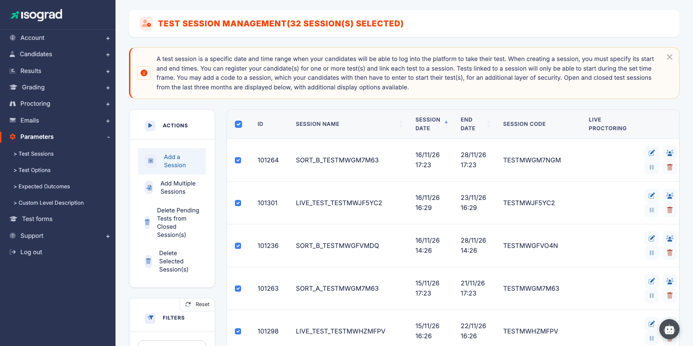
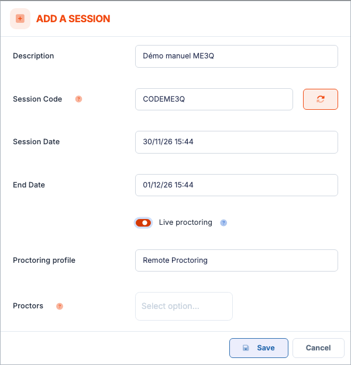
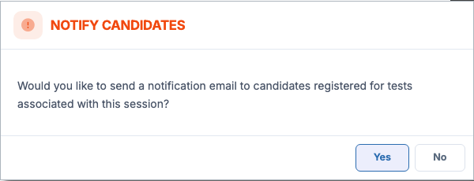
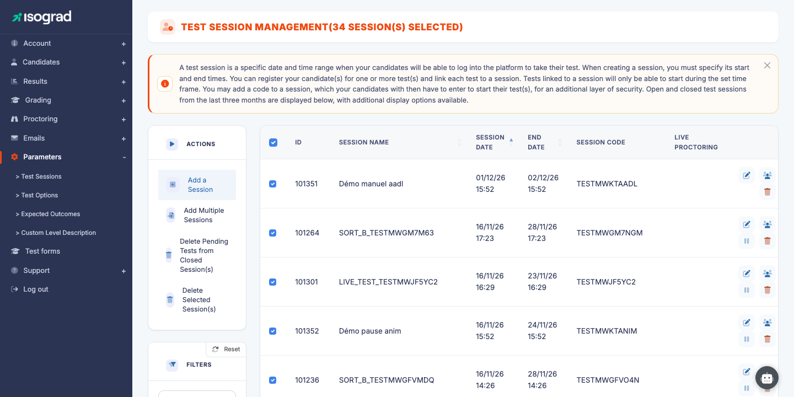
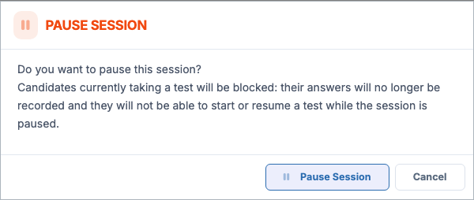
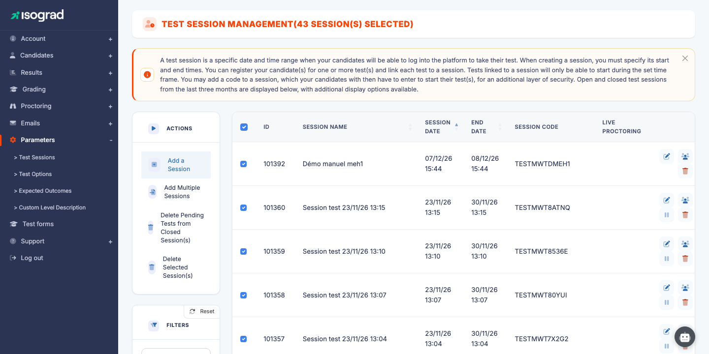
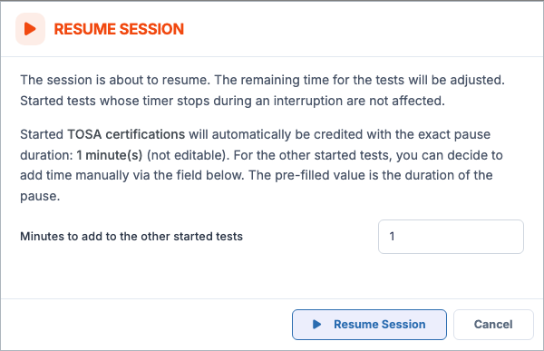
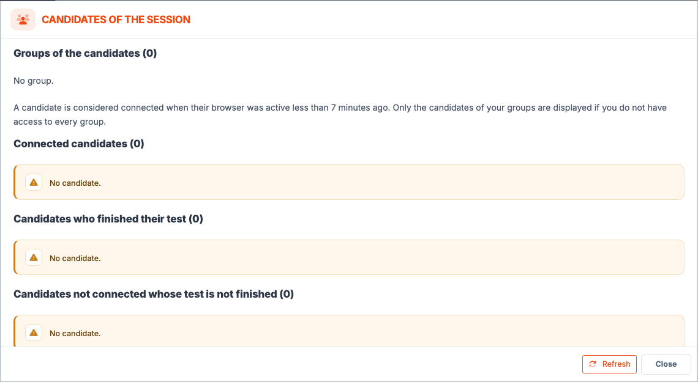
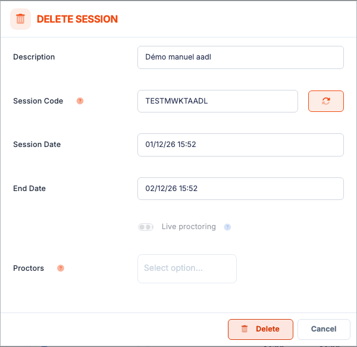
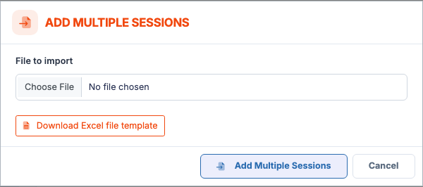

# Test session management

A **test session** is a time window (start date and time, end date and time) during which your candidates may start their test. It is the main tool to **frame** a test: proctored in person, scheduled on a precise slot, or simply protected by a code shared on the day.

The **Test session management** page lists all the sessions defined on your account. Each row shows the **ID**, the **name**, the **start date**, the **end date** and the **session code** (if any). If live proctoring is available on your account, a **Live proctoring** column flags live-proctored sessions with a camera icon. A **Paused** pill next to the name indicates a [paused](#pause-and-resume-a-session) session. At the end of the row, buttons let you edit the session, [display its candidates](#session-candidates), pause it, draw up its [minutes](#session-minutes) and delete it, depending on the state of the session and your privileges.

> 💡 **Default display** — The platform displays by default the **current** sessions and those **ended less than 3 months ago**. Older sessions remain in the database but are hidden from the list. The display options at the bottom of the filter panel let you include older sessions or hide past sessions.

## What is a session for {#what-is-a-session-for}

When you register a candidate to a test, you can **associate them with a session**. The consequences:

- The candidate can **start** the test only within the session's time window. Before the start date, the test appears but remains locked; after the end date, it is no longer accessible.
- If the session has a **code**, the candidate must enter it to start their test — the examiner communicates it at the appropriate moment, which adds a layer of security against premature starts.

You can also **assign an entire group** to a session in a single action from the **Candidate management** page (see [Group actions](/ai/en/candidates/#manage-groups)). This is the usual way to organize an examination day for a class or a training session.

> 💡 **Without a session** — A registration **without a session** means the candidate can start their test at any time once they have received their invitation. Sessions are therefore only useful if you want to **frame** the attempt in time.

## Create a session {#create-a-session}

### Procedure

1. From the **Test session management** page, click **Add a Session** in the action bar.

    

2. Fill in the fields:

    - **Description** — label that will appear in the list (column *Session Name*) and in the candidate registration form. Choose a meaningful name ("Promotion 2026 — session of 03/14").
    - **Session Code** (optional) — password that the candidates will have to enter to start their test. To be communicated **only on the day of the session**. The regeneration button to the right of the field suggests a random code.
    - **Session Date** (start of the session) and **End Date** — window during which the tests attached to this session can be started. Enter using the `DD/MM/YY HH:MM` format.
    - **Live proctoring** (switch, optional) — only shown if your account uses Isograd remote proctoring. Turn it on so that the proctors can follow the candidates' camera and screen **in real time** during the session (see [Live proctoring](/ai/en/proctoring/#live-proctoring)). The **Proctoring profile** field (mandatory) then appears: choose an Isograd remote proctoring profile **with video recording**. This profile is **imposed on every test** registered on the session.
    - **Proctors** (optional) — the administrators of the account holding the *Proctor test sessions live* privilege who supervise the session. Once the session is over, they generate and sign its [minutes](#session-minutes); when the session is proctored live, they also watch the candidates in real time. This field is offered for every session, proctored live or not.

3. Click **Save**. The session appears immediately in the table.

> 💡 **Proctoring profile of a session** — Outside live proctoring, a session does not impose a proctoring profile: the profile is chosen **when registering** the candidate to the test (or through the *Assign a session or a proctoring profile* group action). If the **Live proctoring** switch is greyed out, a message in the form says that no compatible profile exists yet: first create an Isograd remote proctoring profile with video recording (menu **Proctoring → Proctoring profiles**).

> ⚠️ **Required fields and consistent dates** — The description and both dates are required, and the start date must be before the end date: otherwise a message is displayed and the session is not created.

> 💡 **Time zone** — If your account's time zone has not been set yet, the page asks you to choose it (**Configure your time zone** window) before creating your first session: session dates are expressed in that time zone.

## Edit a session {#edit-a-session}

1. On the session's row, click the **Edit** icon (pencil) at the end of the row. The edit window opens, pre-filled with the current values.

2. Adjust the desired fields (name, code, dates, proctors, live proctoring). Turning **Live proctoring** off removes the profile imposed by the session; the proctors are kept.

3. Click **Save**.

### Notification of registered candidates

After each saved change, the platform offers to send a notification email to the candidates of the session:

- **Yes** — sends an email to the candidates who have a test attached to this session that has **not been started yet**, informing them of the slot.
- **No** — the session is modified silently, with no email.

> 💡 **When to notify?** — Answer **No** if you changed neither the dates nor the code. Always notify if you **bring forward** the date or if you **shorten** the window — the candidates must be informed. For a simple **postponement** of a few minutes or a minor adjustment, you can choose not to send an email to avoid flooding inboxes.

## Pause and resume a session {#pause-and-resume-a-session}

An unexpected event during an exam (network outage, evacuation, incident in the room) may force you to **temporarily interrupt** all the candidates of a session. Rather than changing the dates or resetting each test, you can **pause the session**, then **resume** it while giving the lost time back to the candidates.

The **Pause Session** button (pause icon) only appears at the end of the row for a session **in progress**, that is between its start date and its end date, and only if you have the write privilege on sessions.

### Pause

1. On the row of the session in progress, click **Pause Session**.

    

2. Confirm. From that moment, candidates taking a test of this session are **blocked**: their answers are no longer taken into account and they see a *"Session paused"* message. No candidate of the session can start or resume a test while the pause lasts.

    

The **Paused** pill is displayed next to the session name and the button becomes **Resume Session** (play icon).

### Resume

1. On the row of the paused session, click **Resume Session**.

    

2. The resume window sums up what will happen to the **started** tests:

    - On a Tosa account, started **TOSA certifications** are automatically **credited with the exact duration of the pause**; this value cannot be changed.
    - For the **other started tests**, the **Minutes to add to the other started tests** field is pre-filled with the duration of the pause; adjust it if needed (for example to grant a few minutes to settle back in).
    - Tests whose timer stops by itself during an interruption are not affected.

3. Confirm. The session resumes, candidates can go on and a message shows how many started tests were given extra time.

> ⚠️ **Session expired during the pause** — If the session's end date passed during the pause, resuming is refused: **first change the end date** of the session, then resume it.

> 💡 **Pause or stop a single test?** — The pause applies to **all** the candidates of the session. To interrupt a single candidate, use the **Stop the test** button on their registration record (see [The planned tests table](/ai/en/candidates/#the-planned-tests-table)).

## Follow the candidates of a session {#session-candidates}

The **Display candidates** button at the end of the row shows, at any time, where the candidates registered on the session stand — handy on exam day to spot at a glance who is not connected yet. It is offered to administrators allowed to view candidates.

The **Candidates of the session** window shows:

- **Groups of the candidates** — one pill per group, with the number of candidates concerned.
- **Connected candidates** — the candidates whose test is started and who are connected: last name, first name, email, test and start time. A candidate is considered connected when their browser was active less than 7 minutes ago.
- **Candidates who finished their test** — with start and end times.
- **Candidates not connected whose test is not finished** — with their status: *Test not started*, *Test started* or *Test started, last activity on…*.

The **Refresh** button reloads the lists without closing the window.

> 💡 **Your groups only** — If you do not have access to every group of the account, only the candidates of your groups are displayed.

## Session minutes {#session-minutes}

Once the session is **over** (end date passed), a proctor can draw up its **minutes**: a PDF document that summarises how the session went and that they **sign electronically** with a code received by email.

The minutes button appears at the end of the row of a finished session for the **proctors of the session** (the *Proctors* field of the form) and for administrators entitled to draw up the minutes of every session. Its look reflects the state of the minutes:

- **Generate the session minutes** — no minutes have been generated yet.
- **View the session minutes (to be signed)** — the minutes are generated, awaiting signature.
- **View the session minutes (signed)** — green icon: the minutes are signed and final.

### Generate the minutes

1. On the row of the finished session, click **Generate the session minutes**.
2. Enter your **observations** if needed: conduct of the session, incidents observed.
3. Click **Generate the minutes**. The minutes are drawn up from the session data at that moment, and a **6-digit signature code** is sent to you by email; a message recalls the address it was sent to.

### Content of the minutes

- **Identification of the session** — account, session number and period, live proctoring or not, proctors, exams, number of registered, present and absent candidates.
- **Attendance sheet** — for each candidate: presence, start and end times, accommodations (extra time, accessibility interface, suspended timer).
- **Conduct of the session** — session pauses, test stops, time readjustments.
- **Observed incidents** — including the incidents reported by proctors during live proctoring.
- **Proctor's observations** and **signature**.

### Sign the minutes

1. Click **View the session minutes (to be signed)**. The window recalls the generation date and its author.
2. Enter the **signature code** received by email and click **Sign the minutes**.

As long as the minutes are not signed, the window also offers:

- **Download the PDF** — the document then carries the mention *Draft, not signed*.
- **Get a new code** — sends a new code to the logged-in administrator; another proctor of the session can thus sign instead of the one who generated the minutes.
- **Edit and generate again** — reopens the generation window with your observations, to draw up the minutes again from the current data. The codes already sent are no longer valid.

> ⚠️ **Signed minutes are final** — Once signed, the minutes can no longer be modified or generated again: only the PDF download remains. The signature records the signer's name and email, the date and a fingerprint of the document.

The signature code is valid for **30 minutes**. After five wrong entries, it is blocked: request a new one with **Get a new code**. Signing is not possible while logged in as an alias on the account.

## Delete a session {#delete-a-session}

### Delete a single session

1. On the session's row, click the **Delete** icon (trash can).

    

2. Confirm. The session is deleted immediately.

The tests that were associated with this session remain registered to the candidates — they simply become **without a session**, and therefore startable at any time. If you also want to delete these tests, see [Delete tests from past sessions](#delete-tests-past-sessions) below.

### Delete multiple sessions at once

1. Check the boxes at the start of the row to select the sessions to delete.
2. Click **Delete Selected Session(s)** in the action bar.
3. Confirm. All the checked sessions are deleted in one operation.

> ⚠️ **Permanent deletion** — As everywhere on the platform, deletion is irreversible. To keep the history of a past session without seeing it in the list, simply let it age: beyond 3 months after the end date, it automatically disappears from the default display.

## Import multiple sessions {#import-sessions}

The import allows you to create several sessions in a single operation from an Excel file — useful at the start of the year to enter the entire exam calendar.

### Procedure

1. From the action bar, click **Add Multiple Sessions**.

    

2. Click the **Download Excel file template** link to retrieve the expected Excel file. The template contains an `Import` sheet with the columns:

    | Column | Description |
    |---|---|
    | `des` | Session name |
    | `psw` | Session code (optional) |
    | `dat_sta_day`, `dat_sta_month`, `dat_sta_year`, `dat_sta_hour`, `dat_sta_min` | Start date, split into columns |
    | `dat_end_day`, `dat_end_month`, `dat_end_year`, `dat_end_hour`, `dat_end_min` | End date, split into columns |

3. Fill in the template, one session per row. The session name and the day, month and year of both dates are required; hour and minutes default to 0 when omitted. Do not rename the `Import` sheet or the columns, and do not add any: a file with an unknown column is rejected as a whole. A file can contain up to 1 000 sessions.

4. Come back to the platform, select your filled-in Excel in the **File to import** field, then click **Add Multiple Sessions**.

5. The platform displays the number of sessions imported and, where relevant, the list of rejected rows with their reason.

> ⚠️ **Import always creates new sessions** — Re-importing a file does not update existing sessions: each row creates a new session, even if a session with the same name already exists. After an error, fix the sessions concerned on screen or delete them before re-importing.

> 💡 **Proctors and live proctoring** — They cannot be set through the import: edit the sessions concerned afterwards.

## Delete tests from past sessions {#delete-tests-past-sessions}

Over time, your account may accumulate **untaken tests** attached to sessions whose end date has passed. The platform exposes a bulk action to clean them up at once.

1. Click **Delete Pending Tests from Closed Session(s)** in the action bar.
2. Confirm. All **pending** tests (never started) whose session has ended are unregistered from the affected candidates.

> ⚠️ **Scope** — This action does **not** touch tests that have been **started**, **completed** or **cancelled**. Nor does it touch the sessions themselves — only the pending test registrations that were attached to them. The credits consumed at registration are returned to the account.

## Filters and display {#filters-and-display}

The **Filters** panel to the left of the list offers several settings to target which sessions to display:

- **Search** — free text. Filters the list on the session name or ID.
- **Hide Closed Sessions** — hides all sessions whose end date is before now. Useful during the year to only see upcoming sessions.
- **Display Sessions Closed for 90+ Days** — disabled by default. Enable it to reveal the older history (for example to find a session from 6 months ago).

The table is **sortable** on the name and the start and end dates: click the column header to switch between ascending and descending sort. By default, sessions are sorted by **start date**.
