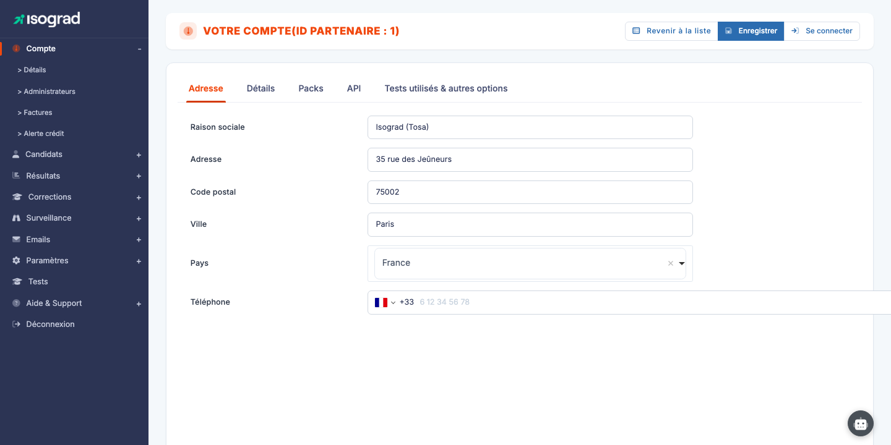
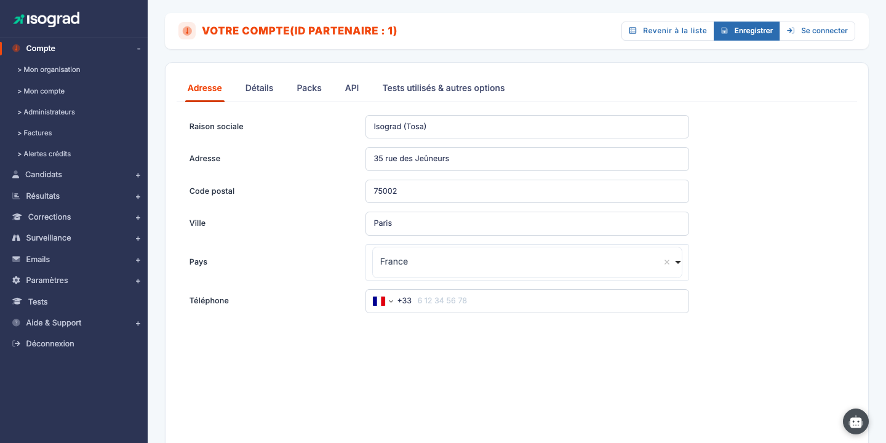
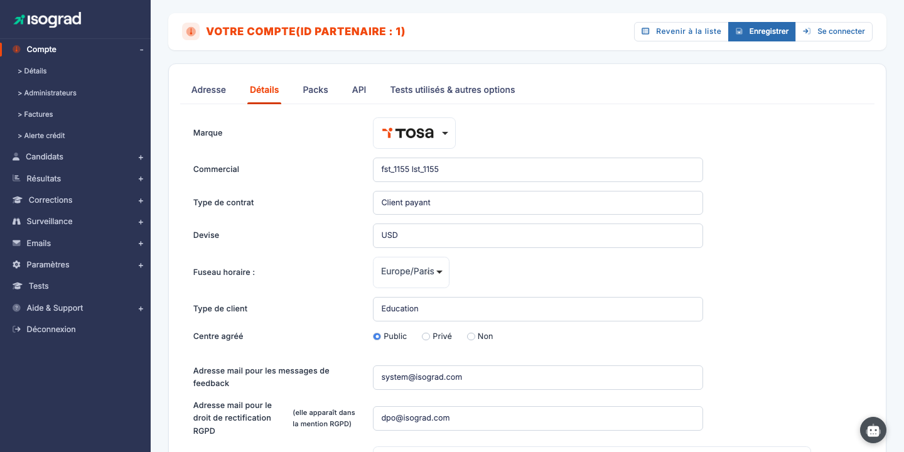
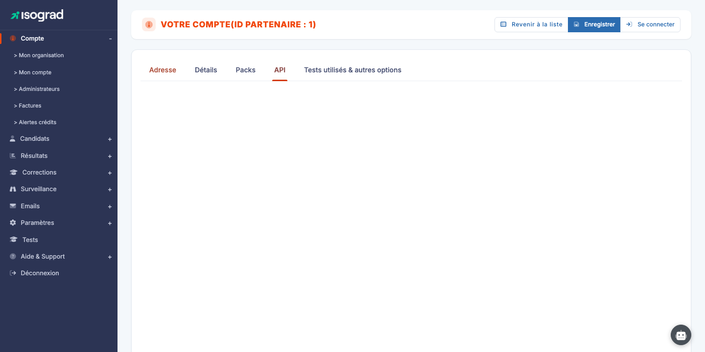
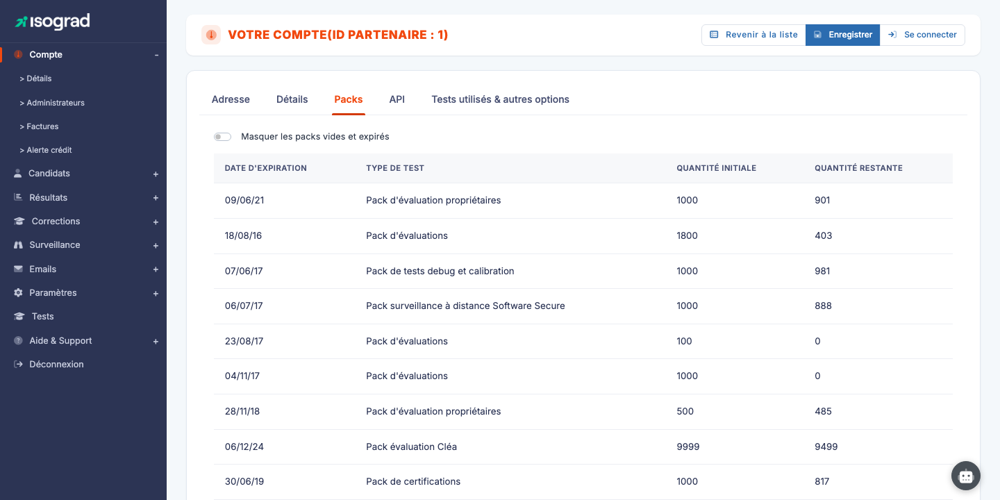
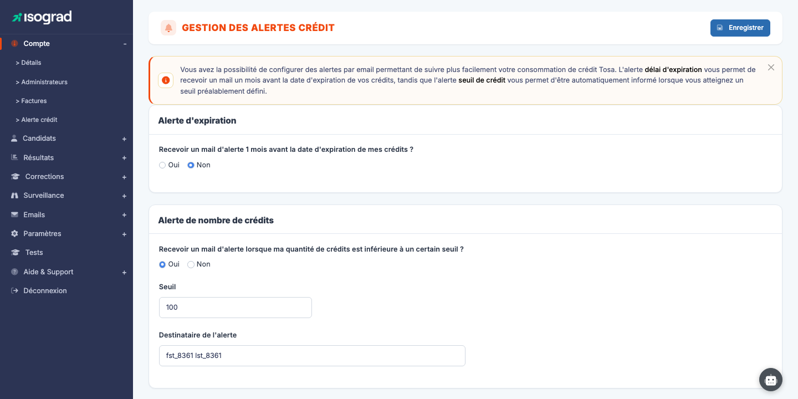

# Gestion de votre compte

Le menu **Compte** regroupe les pages relatives à votre **organisation** (raison sociale, adresse, logo), à la **gestion de vos crédits Tosa** (consultation des packs, alertes d'expiration et de seuil), et à votre **profil administrateur** (mot de passe, identifiants, langue).

Ce chapitre couvre les pages **Mon organisation**, **Mon compte** et **Alertes crédit**. La gestion des administrateurs est traitée dans son propre chapitre — voir [Gestion des administrateurs](/ai/fr/admins/).

## Mon organisation {#details-du-compte}

Accédez à cette page via **Compte → Mon organisation** depuis le menu de navigation.

La page **Votre compte** est organisée en plusieurs **onglets** :

- **Adresse** — coordonnées postales et fiscales de votre organisation (raison sociale, adresse, téléphone, numéro de TVA).
- **Détails** — paramètres complémentaires : **logo** affiché sur les rapports, adresses RGPD et feedback, langues, options de sécurité, et selon votre profil, marque, commercial, devise et type de client. Cet onglet est réservé aux administrateurs autorisés à modifier le compte.
- **Packs** — liste des packs de crédits en cours, leur quantité et leur date d'expiration.
- **API** — accès à l'API de la plateforme : paramètres d'authentification, identifiants de vos tests et documentation technique. Cet onglet n'apparaît que sur **votre propre compte**.
- **Supprimer votre compte** — pour l'administrateur principal, lorsque le compte compte plusieurs administrateurs.

Vos informations personnelles d'administrateur (nom, adresse mail, langue, mot de passe) ne se trouvent pas sur cette page : elles se gèrent dans [Mon compte](#mon-compte).

> 💡 **Onglets visibles selon votre profil** — Certains onglets ou champs n'apparaissent que selon le type de compte (par exemple, un onglet **CPF** apparaît pour les centres de formation français inscrits sur Mon Compte Formation). Ne vous inquiétez pas si vous n'avez pas exactement les mêmes onglets que dans la capture ci-dessus.

### Modifier les coordonnées du compte

1. Ouvrez l'onglet **Adresse** (sélectionné par défaut).

    

2. Modifiez les champs souhaités :

    - **Raison sociale** — nom légal de votre organisation.
    - **Adresse**, **Code postal**, **Ville**, **Pays** — adresse postale principale.
    - **Téléphone** — numéro de téléphone de contact. Le champ est précédé d'un sélecteur de pays (drapeau et indicatif), présélectionné d'après le pays du compte ; le numéro est contrôlé selon le pays choisi et enregistré au format international.
    - **Numéro de TVA intracommunautaire** — utilisé pour la facturation des comptes européens. Il n'est affiché que s'il est renseigné sur votre compte, et n'est pas modifiable : contactez votre interlocuteur Isograd pour le corriger.

3. Cliquez sur **Enregistrer** en haut à droite. Les modifications sont enregistrées immédiatement.

### Modifier le logo et les paramètres de notification

L'onglet **Détails** permet de personnaliser plusieurs éléments visibles dans vos communications avec les candidats.

- **Logo** — image (JPG ou PNG) qui apparaîtra sur les **rapports de test** envoyés aux candidats. Faites défiler la page jusqu'au bouton **Téléchargement logo (jpg ou png)**, cliquez pour ouvrir la fenêtre d'envoi, sélectionnez votre fichier et validez.
- **Adresse mail pour les messages de feedback** — adresse de contact lorsque le candidat utilise le formulaire de feedback dans la plateforme.
- **Adresse mail pour le droit de rectification RGPD** — adresse à laquelle vos candidats peuvent demander la rectification ou la suppression de leurs données personnelles. Apparaît dans la mention légale RGPD au pied de vos emails.

Le même onglet regroupe plusieurs réglages du compte :

- **Langages du compte** — les langues utilisées sur votre compte (sélection multiple).
- **Utiliser un identifiant externe** — active l'identifiant externe des candidats, qui apparaît alors dans l'en-tête des résultats et dans l'export Excel des résultats.
- **Activer l'authentification à deux facteurs** — active la double authentification pour les administrateurs du compte.
- **Forcer la mise à jour du mot de passe des administrateurs tous les 6 mois**.
- **Proposer de notifier le candidat par email en cas d'annulation du test**.
- **Durée de rétention des données (en années)** — la durée de conservation des données de votre compte, à choisir dans la liste.
- **Token Compilatio (facultatif)** — à renseigner si vous disposez d'un abonnement Compilatio pour la détection de plagiat.

> 💡 **Champs distributeurs** — Si vous voyez sur cet onglet des champs comme **Marque**, **Commercial**, **Devise**, **Type de contrat**, **Type de client** ou **Centre agréé**, ou un onglet supplémentaire **Tests utilisés & autres options**, cela signifie que votre compte est de type distributeur ou centre agréé. Ces champs ne sont **pas modifiables par vous** ; ils sont gérés par votre interlocuteur Isograd.

> 💡 **Le logo n'apparaît pas dans les emails** — Le logo configuré ici est utilisé **uniquement dans les rapports PDF** envoyés aux candidats. Pour personnaliser l'en-tête de vos emails, utilisez la **bannière** dédiée — voir [Ajouter une bannière personnalisée](/ai/fr/mail-templates/#ajouter-une-banniere-personnalisee).

### Paramètres de l'API

L'onglet **API** regroupe ce qu'il faut pour connecter votre système d'information (LMS, SIRH, outil de recrutement) à la plateforme :

- **Afficher les paramètres d'authentification** — ouvre la fenêtre **Paramètres de l'API** avec votre **Client ID** et votre **Client Secret**, à copier dans votre intégration. Le secret est masqué par défaut ; l'icône œil l'affiche et l'icône copier le place dans le presse-papiers. Les identifiants sont générés à la première ouverture. Ce bouton est réservé aux administrateurs autorisés à modifier le compte.
- **Afficher les identifiants de tests pour l'API** — ouvre la liste des tests de votre compte avec l'identifiant à utiliser dans les appels d'inscription.
- **Voir la documentation technique de l'API** — ouvre la documentation développeur dans un nouvel onglet.

> ⚠️ **Client Secret** — Le secret donne accès à vos données candidats : ne le communiquez qu'à l'équipe technique qui réalise l'intégration et ne l'insérez jamais dans un document partagé.

> 💡 **API non incluse** — Si votre abonnement n'inclut pas l'accès à l'API, l'onglet affiche uniquement un message l'indiquant ; contactez votre interlocuteur Isograd pour l'activer.

> 💡 **Token d'accès personnel** — Un administrateur disposant du privilège *Générer un token personnel d'accès à l'API* peut aussi appeler l'API avec ses propres droits (privilèges et groupes), sans utiliser les identifiants du compte — voir [Générer un token d'accès à l'API](#token-api).

## Mon compte {#mon-compte}

La page **Mon compte** (menu **Compte → Mon compte**) regroupe ce qui vous concerne personnellement en tant qu'administrateur : vos coordonnées, votre langue d'interface, votre mot de passe et, si vous y êtes autorisé, vos tokens d'accès à l'API. Elle est accessible à tous les administrateurs et ne porte que sur **votre propre** compte ; les autres administrateurs se gèrent depuis [Gestion des administrateurs](/ai/fr/admins/).

### Modifier vos informations

1. Modifiez les champs souhaités :

    - **Civilité**, **Nom**, **Prénom**.
    - **Adresse mail** — sert à la fois d'identifiant de connexion et d'adresse de notification. Elle doit être unique sur la plateforme.
    - **Langue** — langue de l'interface. Les emails système (réinitialisation de mot de passe, etc.) vous sont aussi envoyés dans cette langue.
    - **Commentaire** — note libre, facultative.

2. Cliquez sur **Enregistrer** en haut à droite. La page se recharge avec vos modifications.

> 💡 **Changement de langue immédiat** — Si vous avez choisi une autre langue, l'interface bascule dans cette langue dès l'enregistrement : il n'est pas nécessaire de vous reconnecter.

> 💡 **Formulaire en lecture seule** — Si vous n'êtes pas autorisé à modifier votre fiche d'administrateur, les champs sont grisés et le bouton **Enregistrer** n'apparaît pas. Le changement de mot de passe reste disponible.

### Changer votre mot de passe {#changer-mot-de-passe}

1. Cliquez sur **Changer le mot de passe** en haut à droite de la page. Une fenêtre s'ouvre.
2. Saisissez le nouveau mot de passe dans **Mot de passe**, puis à nouveau dans **Confirmer le mot de passe**. Le lien **Générer un mot de passe** propose un mot de passe aléatoire, et l'icône œil affiche la saisie en clair.
3. Cliquez sur **Enregistrer**. Le mot de passe est modifié immédiatement et vous restez connecté.

Le mot de passe doit comporter au moins 6 caractères. Si votre compte impose des mots de passe renforcés, il doit comporter au moins 8 caractères avec un chiffre, une majuscule, une minuscule et un caractère spécial, et ne peut pas être identique au précédent. La fenêtre signale toute saisie non conforme, ainsi qu'une confirmation différente du mot de passe.

### Générer un token d'accès à l'API {#token-api}

Un administrateur disposant du privilège *Générer un token personnel d'accès à l'API* peut créer lui-même un **token personnel** pour appeler l'API de la plateforme avec ses propres droits (privilèges et groupes). Chaque administrateur gère uniquement ses propres tokens. Sans ce privilège, la section n'apparaît pas sur la page.

1. Sous le formulaire de la page **Mon compte**, la section **Token d'accès à l'API** indique le nombre de **Tokens actifs** et, s'il y en a, la date de **Prochaine expiration**.
2. Cliquez sur **Générer un token**. Le token s'affiche dans un champ en lecture seule, avec sa date d'expiration ; le bouton **Copier** le place dans le presse-papiers. Il n'est pas nécessaire d'enregistrer le formulaire : le token est actif dès sa génération.

> ⚠️ **Affiché une seule fois** — Copiez le token immédiatement : il n'est stocké nulle part et ne pourra plus être réaffiché. S'il est perdu, générez-en un nouveau.

Un token est valable **un an**. Il est vérifié à chaque appel et refusé si vous perdez le privilège, si votre compte est désactivé ou si vous révoquez vos tokens. Vous pouvez générer plusieurs tokens ; ils restent tous actifs jusqu'à leur expiration ou leur révocation.

Pour invalider vos tokens, cliquez sur **Révoquer tous mes tokens** puis confirmez : tous vos tokens sont immédiatement refusés. Le bouton est grisé tant que vous n'avez aucun token actif.

## Packs et crédits {#packs-et-credits}

L'onglet **Packs** liste tous vos **packs de crédits Tosa** en cours, leur quantité initiale, leur quantité restante, et leur date d'expiration.

Le tableau présente, dans l'ordre, les colonnes suivantes :

| Colonne | Contenu |
|---|---|
| **Date d'expiration** | Date au-delà de laquelle les crédits seront perdus. |
| **Type de test** | Nature du pack (Pack d'évaluations, Pack de certifications, Pack surveillance à distance, etc.). |
| **Quantité initiale** | Nombre de crédits achetés à l'origine. |
| **Quantité restante** | Crédits encore disponibles à ce jour. |

Le commutateur **Masquer les packs vides et expirés** en haut du tableau permet de filtrer la vue pour ne voir que les packs encore utilisables — pratique lorsque l'historique de votre compte commence à devenir long.

### Acheter des crédits supplémentaires

Pour commander de nouveaux crédits, utilisez le bouton **Acheter des crédits de test** sous le tableau (visible selon votre type de contrat ; il s'intitule **S'abonner** pour les comptes sur abonnement) ou contactez directement votre interlocuteur Isograd. Les packs achetés apparaissent automatiquement dans le tableau dès qu'ils sont mis en place sur votre compte.

> 💡 **Compte sans pack** — Si vous n'avez encore aucun pack, la plateforme affiche simplement *« Pas de pack valide. »*

### Consulter le détail de la consommation

Au-delà de la liste des packs, la page **Compte → Consommation de crédits** présente la consommation détaillée par **groupe** et par **administrateur**, sur une période choisie. Cette vue est utile pour les bilans périodiques (« combien la promotion A a-t-elle consommé sur le dernier trimestre ? ») et peut être exportée vers Excel.

## Alertes crédit {#alertes-credit}

La page **Alertes crédit** (menu **Compte → Alerte crédit**) permet de configurer **trois alertes par email** indépendantes pour suivre votre consommation de crédits sans avoir à venir vérifier le compte manuellement.

Les trois alertes sont :

- **Alerte d'expiration** — un email **un mois avant** la date d'expiration de vos crédits.
- **Alerte de nombre de crédits** — un email lorsque votre quantité de crédits passe **sous un seuil** que vous définissez.
- **Alerte de consommation mensuelle** — un email **chaque mois** récapitulant votre consommation du mois écoulé.

Chaque alerte est activable indépendamment via son **commutateur** dédié. Pour chacune, vous précisez le **destinataire** de l'alerte (qui n'est pas forcément vous — par exemple, le destinataire des alertes financières peut être votre responsable comptable).

### Configurer une alerte

1. Pour l'alerte qui vous intéresse, **activez le commutateur** *« Recevoir un mail d'alerte… »*. Les champs de configuration deviennent éditables.

2. Renseignez :

    - Le **destinataire** (adresse email) qui recevra l'alerte.
    - Pour l'**Alerte de nombre de crédits** uniquement : le **seuil** en nombre de crédits. Vous recevrez l'alerte dès que votre stock passe sous cette valeur.

3. Cliquez sur **Enregistrer**. La configuration est mise en place ; aucune action complémentaire n'est requise — la plateforme déclenchera l'envoi automatiquement quand les conditions seront remplies.

> 💡 **Recommandé** — Activez **au moins l'alerte d'expiration** et **l'alerte de seuil** pour éviter les mauvaises surprises (crédits expirés non utilisés, ou impossibilité d'inscrire un nouveau candidat parce que le compteur est tombé à zéro). L'alerte mensuelle est utile pour les comptes à fort volume.

> ⚠️ **Une seule alerte d'expiration par mois** — L'alerte d'expiration est déclenchée **une fois** par pack arrivant à échéance. Vous ne recevrez pas de relance quotidienne ; pensez à archiver l'email pour ne pas l'oublier.
