# Gestion des candidats

Ce chapitre couvre l'ensemble du cycle de vie d'un candidat sur la plateforme Tosa : ajouter des candidats individuellement ou par lot, les inscrire à des tests, leur envoyer des invitations et organiser votre population en groupes.

La page **Gestion des candidats** se présente sous la forme d'un tableau listant l'ensemble de vos candidats. Les filtres en haut de page permettent de restreindre l'affichage (recherche libre, appartenance à un groupe ou sous-groupe, candidats ayant un test à passer, affichage du statut de connexion, inclusion des archivés). Les actions principales — ajouter un candidat, importer un fichier, appliquer une action de groupe, exporter vers Excel — se trouvent dans la barre d'actions en haut du tableau.

## Ajouter un candidat {#ajouter-un-candidat}

Cette procédure permet de créer un candidat individuellement. Pour ajouter plusieurs candidats en une seule opération, reportez-vous à la section [Importer des candidats](#importer-des-candidats).

### Procédure

1. Depuis la page **Gestion des candidats**, repérez le bouton **Ajouter un candidat** dans la barre d'actions en haut du tableau.

    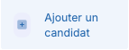

2. Cliquez sur **Ajouter un candidat**. Le formulaire de saisie s'ouvre.

    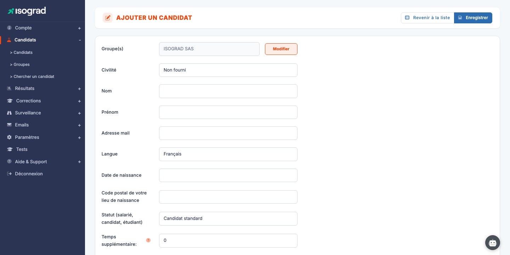

3. Remplissez les champs :

    - **Groupe(s)** — le candidat doit appartenir à au moins un groupe ; le bouton **Modifier** ouvre la sélection des groupes.
    - **Civilité**.
    - **Nom** et **Prénom** — tels qu'ils apparaîtront sur les attestations.
    - **Adresse mail** — adresse à laquelle le candidat recevra ses invitations et accédera à son espace.
    - **Langue** — langue du candidat, présélectionnée ensuite lors de ses inscriptions aux tests.

    Selon les options de votre compte, le formulaire propose aussi d'autres champs, par exemple **Temps supplémentaire** ou **Identifiant externe**.

4. Cliquez sur **Enregistrer**. Le candidat est créé et vous êtes automatiquement redirigé vers sa fiche d'inscription aux tests.

    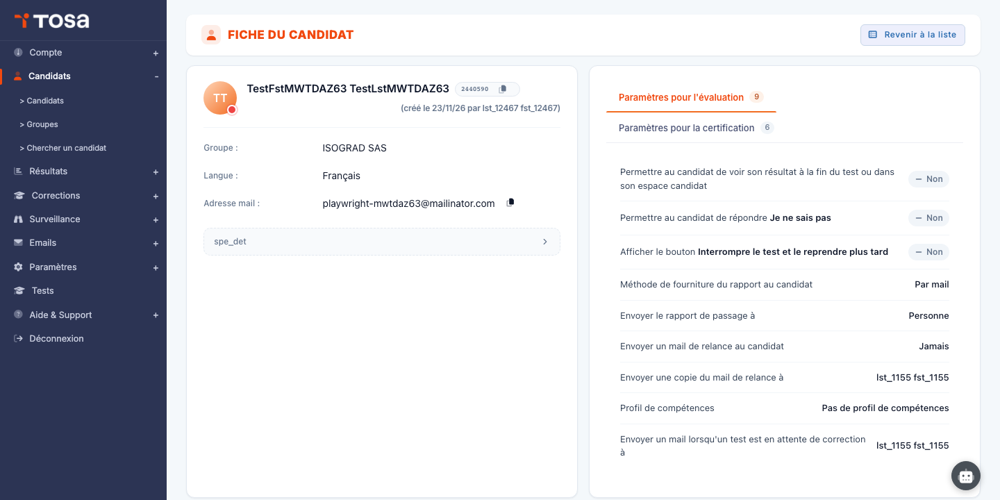

À partir de cette fiche, vous pouvez immédiatement [inscrire le candidat à un test](#inscrire-un-candidat-a-un-test) ou [lui envoyer une invitation](#envoyer-les-invitations).

> 💡 **Modification ultérieure** — Pour modifier les coordonnées d'un candidat existant, retournez sur la liste des candidats, cliquez sur l'icône **Editer** au bout de la ligne, puis sur le bouton **Modifier les détails du candidat** de sa fiche.

## Importer des candidats {#importer-des-candidats}

L'import de candidats vous permet de créer plusieurs candidats — voire de les pré-inscrire à des tests — en une seule opération, à partir d'un fichier Excel. Il se déroule en **deux temps** : la plateforme affiche d'abord un **aperçu** du fichier, sans rien enregistrer, puis importe les lignes valides une fois que vous avez confirmé.

### Procédure

1. Depuis la page **Gestion des candidats**, repérez le bouton **Importer un fichier de candidats** dans la barre d'actions.

    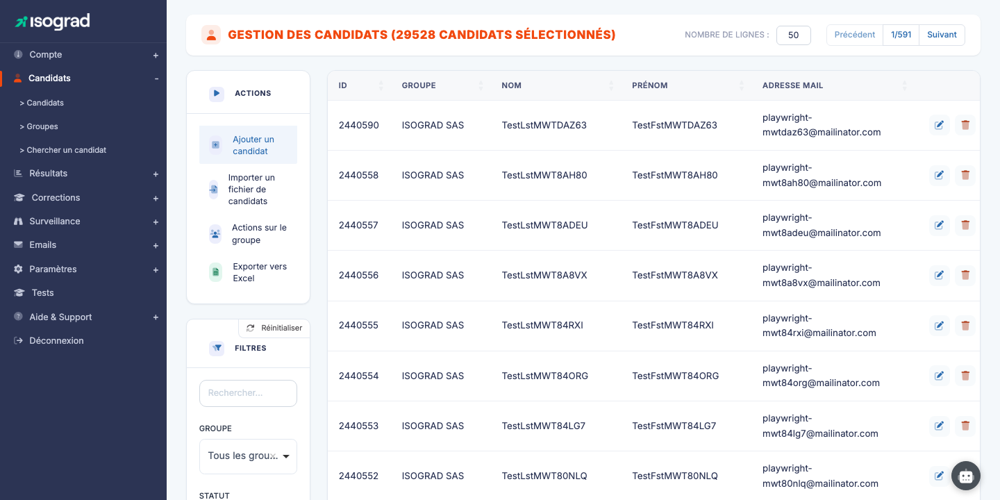

2. Cliquez sur **Importer un fichier de candidats**. Une fenêtre s'ouvre.

    

    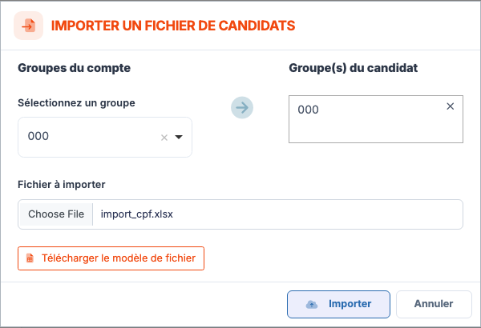

3. Dans cette fenêtre, cliquez sur **Télécharger le modèle de fichier** si vous n'avez pas encore de fichier, puis remplissez le modèle avec vos candidats. Les colonnes du modèle :

    | Colonne | Obligatoire | Description |
    |---|---|---|
    | Identifiant (optionnel) | Non | Identifiant externe du candidat. |
    | Nom | Oui | Nom du candidat. |
    | Prénom | Oui | Prénom du candidat. |
    | Civilité | Oui | À choisir dans la liste déroulante. |
    | Langue | Oui | À choisir dans la liste déroulante. |
    | Adresse email | Oui | Une adresse email valide, présente une seule fois dans le fichier. |
    | Mot de passe (optionnel) | Non | S'il est laissé vide, un mot de passe est généré automatiquement. |
    | Personne en situation de handicap (optionnel) | Non | Oui ou Non. |
    | Temps suppl. en % (optionnel) | Non | Temps supplémentaire accordé au candidat. |

    Sur les comptes qui gèrent les dossiers CPF, le modèle comporte trois colonnes de plus : **Identifiant du test** (pour inscrire le candidat à un test dès l'import), **Avec e-surveillance** et **Numéro de dossier CPF** (chiffres uniquement, 13 au maximum ; il exige un identifiant de test).

4. Toujours dans la fenêtre, sélectionnez le ou les **groupes** auxquels rattacher les candidats (au moins un groupe est obligatoire), choisissez votre fichier dans **Fichier à importer**, puis cliquez sur **Importer**.

5. La page **Aperçu de l'import de candidats** s'affiche. Rien n'est encore enregistré à ce stade. Elle indique le nombre de lignes lues, rappelle les groupes auxquels les candidats seront ajoutés, puis liste chaque ligne du fichier (ligne, adresse mail, nom, prénom) avec son statut :

    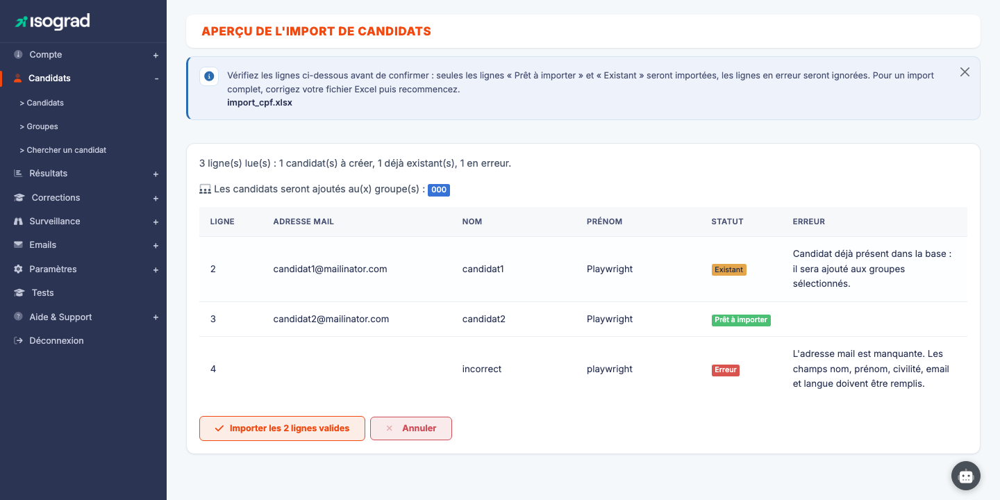

    - **Prêt à importer** — le candidat sera créé.
    - **Existant** — un candidat possède déjà cette adresse mail : il ne sera pas recréé, mais ajouté aux groupes sélectionnés.
    - **Erreur** — la ligne sera ignorée ; la colonne **Erreur** en donne le motif (adresse mail manquante, invalide ou en double dans le fichier, champ obligatoire vide, test inconnu, erreur de formule Excel…).

6. Cliquez sur **Importer les N lignes valides** pour confirmer, ou sur **Annuler** pour revenir à la liste des candidats sans rien importer. Si aucune ligne n'est importable, le bouton de confirmation est désactivé : corrigez votre fichier puis recommencez.

7. Après confirmation, la page de résultat indique le nombre de candidats importés et, le cas échéant, le nombre de candidats existants ajoutés aux groupes. Si certaines lignes n'ont pas pu être enregistrées, elles sont listées avec leur motif. Le bouton **Revenir à la liste des candidats** vous ramène au tableau.

> ⚠️ **Doublons d'email** — Si un candidat existe déjà avec la même adresse email, il n'est **pas recréé** et ses informations ne sont pas modifiées : il est seulement ajouté aux groupes sélectionnés (et inscrit au test indiqué sur sa ligne, le cas échéant).

> 💡 **Fichier incomplet ou trop long** — Seules les lignes **Prêt à importer** et **Existant** sont importées ; pour un import complet, corrigez votre fichier Excel et recommencez. Un fichier est limité à 1000 candidats : au-delà, seules les 1000 premières lignes sont lues. Si la plateforme indique à la confirmation que l'aperçu a expiré, recommencez l'import depuis la liste des candidats.

> 💡 **Import et invitations** — L'import ne déclenche **pas** automatiquement l'envoi d'invitations. Pour envoyer les emails de connexion après import, reportez-vous à la section [Envoyer les invitations](#envoyer-les-invitations).

## Candidats anonymes {#candidats-anonymes}

Lorsque des copies d'examen sont corrigées de façon **anonyme**, chaque copie ne porte qu'un **identifiant** (numéro d'anonymat, numéro de candidat…) et non le nom de son auteur. Le menu **Candidats anonymes** de la page **Gestion des candidats** permet de préparer puis de lever cet anonymat à l'aide de deux fichiers Excel :

- **Importer un fichier d'identifiants** — avant l'import des copies, crée un candidat anonyme pour chaque identifiant attendu ;
- **Associer les candidats avec leurs identifiants** — une fois les copies corrigées, attribue à chaque candidat anonyme son nom, son prénom et, si vous le souhaitez, son adresse mail.

Comme pour l'import de candidats, chaque import se déroule en **deux temps** : un **aperçu** qui n'enregistre rien, puis la confirmation.

> 💡 **Disponibilité** — Le menu **Candidats anonymes** n'apparaît que sur les plateformes qui disposent du module de correction de copies scannées. Les copies elles-mêmes s'importent depuis ce module — voir [Scanner des copies papier](/ai/fr/grading/#scanner-des-copies).

### Importer un fichier d'identifiants {#importer-des-identifiants}

Cet import déclare à l'avance les identifiants attendus dans un ou plusieurs groupes. Lors de l'import des copies, la plateforme peut ainsi repérer les **copies manquantes** et les copies dont l'identifiant ne correspond à **aucun identifiant attendu**.

1. Dans le menu **Candidats anonymes**, cliquez sur **Importer un fichier d'identifiants**. Une fenêtre s'ouvre.

    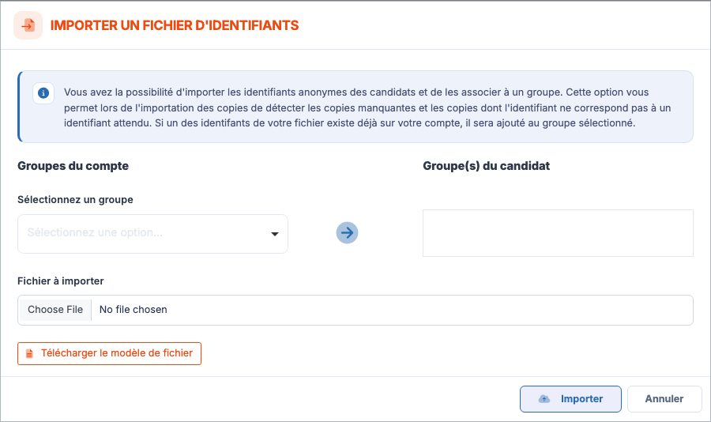

2. Cliquez sur **Télécharger le modèle de fichier** et renseignez un identifiant par ligne dans la colonne `ext_id`. La colonne est au format texte pour conserver les zéros en tête des identifiants. Un identifiant ne peut pas dépasser 40 caractères.

3. Sélectionnez le ou les **groupes** auxquels rattacher les candidats anonymes (au moins un groupe est obligatoire), choisissez votre fichier dans **Fichier à importer** (Excel ou CSV), puis cliquez sur **Importer**.

4. La page d'aperçu s'affiche. Rien n'est encore enregistré à ce stade. Elle indique le nombre de lignes lues, rappelle les groupes sélectionnés, puis liste chaque ligne avec son statut :

    - **Prêt à importer** — aucun candidat de votre compte ne porte cet identifiant : un candidat anonyme sera créé.
    - **Existant** — un candidat porte déjà cet identifiant : il ne sera pas recréé, mais ajouté aux groupes sélectionnés.
    - **Erreur** — la ligne sera ignorée ; la colonne **Commentaire** en donne le motif (identifiant manquant, trop long, en double dans le fichier, ou porté par plusieurs candidats de votre compte).

5. Cliquez sur **Importer les N lignes valides** pour confirmer, ou sur **Annuler** pour revenir à la liste des candidats sans rien importer.

6. La page de résultat indique le nombre de candidats anonymes créés et, le cas échéant, le nombre de candidats existants ajoutés aux groupes. Le bouton **Revenir à la liste des candidats** vous ramène au tableau.

Dans le tableau des candidats, un candidat anonyme se reconnaît à son nom et à son prénom, tous deux « anonymous », et à son identifiant.

### Associer les candidats avec leurs identifiants {#associer-les-identifiants}

Une fois les copies corrigées, cet import remplace l'identité anonyme des candidats par leur identité réelle. Les résultats et les copies déjà rattachés à chaque candidat sont conservés.

1. Dans le menu **Candidats anonymes**, cliquez sur **Associer les candidats avec leurs identifiants**. Une fenêtre s'ouvre.

    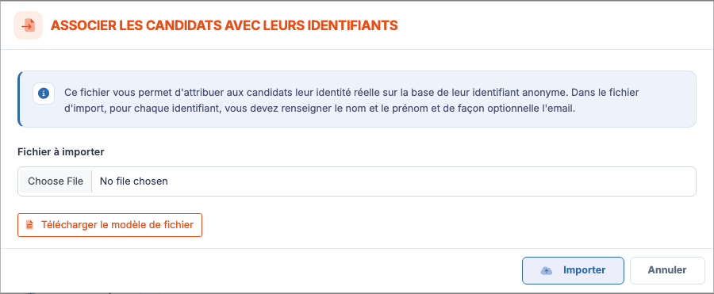

2. Cliquez sur **Télécharger le modèle de fichier** et renseignez, pour chaque identifiant (`ext_id`), le prénom (`fst_nam`) et le nom (`lst_nam`), tous deux obligatoires. La colonne `ema` (adresse mail) est facultative.

3. Choisissez votre fichier dans **Fichier à importer**, puis cliquez sur **Importer**. Aucun groupe n'est demandé : les candidats restent dans leurs groupes.

4. La page d'aperçu liste chaque ligne (identifiant, nom, prénom, et adresse mail si le fichier la contient) avec son statut :

    - **À renseigner** — l'identifiant est celui d'un candidat anonyme : il recevra le nom, le prénom et, si elle est fournie, l'adresse mail du fichier.
    - **Déjà nommé** — le candidat portant cet identifiant a déjà un nom et un prénom : il ne sera pas modifié.
    - **Erreur** — la ligne sera ignorée ; la colonne **Commentaire** en donne le motif (aucun candidat ne porte cet identifiant, nom ou prénom vide, adresse mail invalide, en double dans le fichier ou déjà utilisée par un autre candidat de votre compte…).

5. Cliquez sur **Importer les N lignes valides** pour confirmer, ou sur **Annuler**. La page de résultat indique le nombre de candidats renseignés.

> 💡 **Fichiers et limites** — Les deux imports lisent la feuille nommée **Import** du fichier (celle du modèle) ou, à défaut, sa première feuille, jusqu'à la première ligne vide. Un fichier est limité à 1000 lignes : au-delà, seules les 1000 premières sont lues. Si aucune ligne n'est importable, le bouton de confirmation est désactivé : corrigez votre fichier puis recommencez.

> ⚠️ **Identifiants en double** — Un même identifiant ne doit être porté que par un seul candidat de votre compte : dans le cas contraire, la ligne est en erreur dans les deux imports.

## Inscrire un candidat à un test {#inscrire-un-candidat-a-un-test}

Une fois le candidat créé, vous devez l'inscrire à un ou plusieurs tests pour qu'il puisse les passer. Tout se fait depuis la **fiche du candidat**, qui rassemble ses inscriptions et les actions qui le concernent.

### La fiche du candidat

Depuis la liste des candidats, cliquez sur l'icône **Editer** de la ligne correspondante. Vous y êtes aussi redirigé automatiquement après l'enregistrement d'un nouveau candidat.

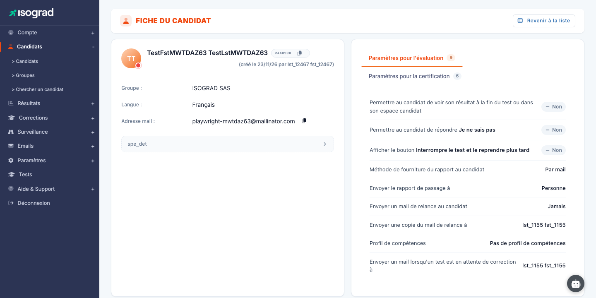

La barre de boutons en haut de la fiche regroupe les actions disponibles pour ce candidat. Certains boutons n'apparaissent que selon vos privilèges et les options de votre compte :

- **Inscrire à un test** — ouvre la fenêtre d'inscription décrite ci-dessous.
- **Modifier les détails du candidat** — renvoie au formulaire de coordonnées (identité, email, langue, groupes).
- **Paramètres des tests** — options propres à ce candidat : **Paramètres pour l'évaluation**, **Paramètres pour la certification** (affichage des résultats, envoi des rapports et des certificats, destinataires, fréquence des relances et administrateur recevant une copie du mail de relance) et, le cas échéant, **Paramètres pour le test configuration**. Ces valeurs remplacent, pour ce candidat seulement, les [options par défaut](../default-options/) du compte.
- **Envoyer les tests au candidat** — envoie l'email d'invitation (voir [Envoyer les invitations](#envoyer-les-invitations)).
- **Attribuer un mot de passe temporaire** — le candidat devra le changer à sa prochaine connexion.
- **Anonymiser** — remplace définitivement les données personnelles du candidat.
- **Transférer** — déplace le candidat vers un autre compte de votre organisation, lorsque cette option est activée.

> 💡 **Tests par métier** — Sur les comptes Isograd Testing Services, le bouton **Tests par métier** propose, à partir d'un intitulé ou d'une description de poste, une sélection de tests recommandés avec le lien vers la description de chacun.

Sous la barre de boutons, le **tableau des tests planifiés** liste toutes les inscriptions du candidat (voir [plus bas](#le-tableau-des-tests-planifies)).

### Inscrire un candidat depuis sa fiche

1. Cliquez sur **Inscrire à un test**.

    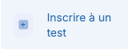

2. La fenêtre **Inscrire le candidat à un test** s'ouvre.

    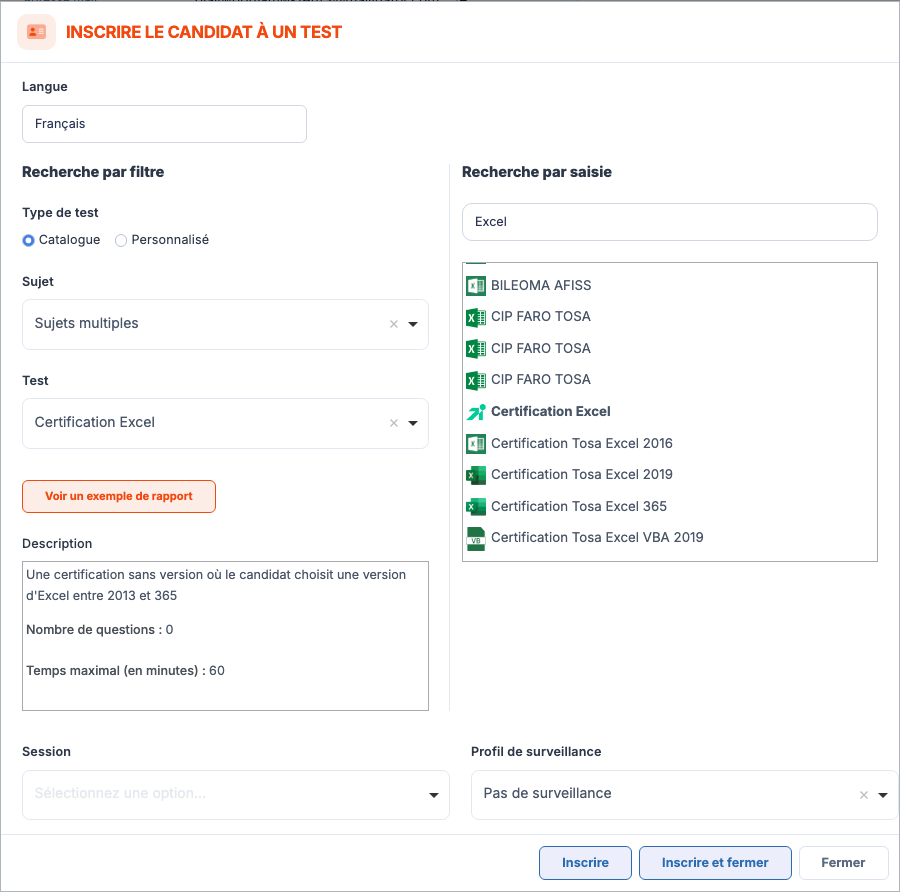

    Choisissez d'abord la **Langue** du test : elle est présélectionnée sur la langue du candidat, et la liste des sujets se met à jour à chaque changement. Sélectionnez ensuite le test de l'une des deux manières suivantes :

    - **Recherche par filtre** (colonne de gauche) — si votre compte dispose de tests personnalisés, le **Type de test** permet de basculer entre **Catalogue** et **Personnalisé** ; choisissez ensuite le **Sujet**, puis le **Test**.
    - **Recherche par saisie** (colonne de droite) — saisissez au moins trois caractères du nom du test et cliquez sur le résultat voulu ; les sélecteurs de gauche se positionnent automatiquement.

    Une fois le test choisi, sa **Description** s'affiche avec le nombre de questions et, si le test est limité dans le temps, sa durée maximale en minutes, accompagnée le cas échéant du nombre de crédits consommés, et le bouton **Voir un exemple de rapport** propose un rapport type au format PDF lorsqu'il en existe un pour ce test.

3. Complétez, selon les options de votre compte :

    - **Session** — rattache l'inscription à une session de passage existante (**Pas de session associée** par défaut). L'entrée **Créer une session...** vous emmène directement sur la création d'une session ; sur certains comptes, la session est obligatoire.
    - **Profil de surveillance** — **Pas de surveillance** ou l'un de vos [profils de surveillance](../proctoring/) (plein écran, surveillance à distance…). Pour une **certification**, le profil par défaut de votre compte est présélectionné ; si la surveillance à distance est obligatoire sur votre compte, elle est appliquée automatiquement et un message l'indique. Si la session choisie est **surveillée en direct**, le profil de surveillance est **imposé par la session** : le sélecteur est verrouillé et le message *« Profil de surveillance imposé par la session surveillée en direct »* s'affiche.

4. Cliquez sur **Inscrire** pour enchaîner une autre inscription dans la même fenêtre, ou sur **Inscrire et fermer**. Le test apparaît immédiatement dans le tableau des tests planifiés.

> 💡 **Type de crédit** — Si votre compte possède plusieurs packs valables pour ce test (par exemple un pack « un test par crédit » et un pack « plusieurs tests par crédit »), une fenêtre **Type de crédit** vous demande lequel utiliser avant l'inscription.

> 💡 **Certification déjà passée** — Selon la configuration de votre compte, si le test choisi est une **certification** à laquelle le candidat a déjà été inscrit, une confirmation vous est demandée avant de le réinscrire. Les évaluations ne déclenchent pas cette confirmation.

### Le tableau des tests planifiés {#le-tableau-des-tests-planifies}

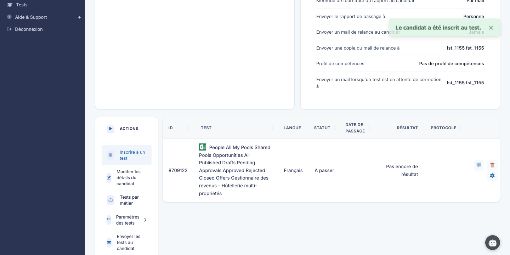

Chaque ligne correspond à une inscription : test, statut (en attente, démarré, terminé, en attente de notation), session et date de passage le cas échéant. Une icône **plein écran** ou **caméra** à côté du nom du test signale le profil de surveillance associé. Un badge rouge **Arrêté par un administrateur** dans la colonne du statut signale un test démarré que vous avez interrompu (voir ci-dessous).

Les boutons d'action apparaissent au survol de la ligne :

- **Supprimer** — retire l'inscription d'un test non commencé ; le crédit est restitué. Selon votre compte, la plateforme propose de notifier le candidat de l'annulation par email.
- **Paramètres** (test en attente) — modifie la **Session**, le **Profil de surveillance** et l'option **Désactiver la manipulation** sans supprimer l'inscription. Là aussi, une session surveillée en direct impose son profil de surveillance.

    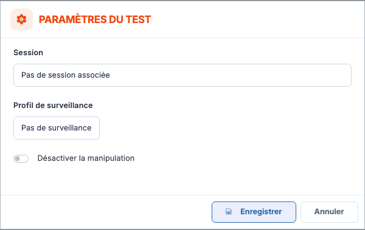

- **Commentaire de l'administrateur** — note interne attachée à cette inscription, invisible du candidat.
- **Modifier le test** (test démarré ou terminé) — selon vos privilèges : réajuster le temps, réinitialiser le test avec ou sans email au candidat, relancer ou désactiver la manipulation.
- **Arrêter le test** (test démarré) — interrompt immédiatement le passage : le candidat est renvoyé à sa liste de tests avec le message *« Votre test a été interrompu par un administrateur ou un surveillant »* et ne peut pas continuer tant que le test n'est pas repris. Le badge **Arrêté par un administrateur** apparaît sur la ligne et le bouton devient **Reprendre le test**.
- **Reprendre le test** (test arrêté) — lève l'interruption ; pour un test chronométré dont le temps ne s'arrête pas pendant une interruption, la durée de l'arrêt est **rendue au candidat**. Une réinitialisation du test lève également l'arrêt.
- **Détails** (test terminé) — ouvre l'analyse détaillée du passage (voir [Gestion des résultats](../results/)) ; **Noter** apparaît à la place pour un test en attente de notation.
- **Envoyer le certificat** (certification terminée) — envoie le certificat aux destinataires définis dans les paramètres pour la certification ; **Ajouter un test de confirmation** est proposé pour une évaluation terminée lorsque votre compte dispose de cette option.

### Inscrire plusieurs candidats à la fois

Pour inscrire plusieurs candidats au même test, utilisez une action de groupe depuis la page **Gestion des candidats** :

1. Filtrez le tableau sur un **groupe** (et, le cas échéant, un sous-groupe) et laissez le champ de recherche vide. Le bouton **Actions sur le groupe** devient alors un menu ; sans groupe sélectionné, il rappelle simplement qu'un groupe doit d'abord être choisi.
2. Si tous les candidats du groupe tiennent sur une seule page, une case à cocher apparaît en début de ligne, cochée par défaut : décochez les candidats à exclure (la case d'en-tête coche ou décoche tout). Si le groupe s'étend sur plusieurs pages, l'action s'applique à l'ensemble du groupe.
3. Dans le menu **Actions sur le groupe**, choisissez **Inscrire tous les candidats du groupe à un test**.
4. Renseignez les paramètres du test (sujet, langue, session, profil de surveillance) ; ils s'appliquent à l'ensemble de la sélection. Cliquez sur **Inscrire** pour enchaîner une autre inscription, ou sur **Inscrire et fermer**.

> 💡 **Candidats déjà inscrits** — Si certains candidats de la sélection sont déjà inscrits à ce test, la plateforme vous le signale et vous propose soit de les réinscrire tous, soit de n'inscrire que ceux qui ne le sont pas encore.

> 💡 **Crédits** — Chaque inscription consomme un crédit du pack correspondant (ou une fraction de crédit avec un pack « plusieurs tests par crédit »). Le solde de vos packs est consultable dans [Gestion de votre compte](../account/). Pour racheter des crédits, contactez votre interlocuteur Isograd.

## Envoyer les invitations {#envoyer-les-invitations}

L'envoi d'invitation par email transmet au candidat son lien de connexion personnalisé. C'est l'étape qui rend le test accessible côté candidat.

### Envoyer une invitation à un seul candidat

1. Ouvrez la fiche du candidat (depuis la liste, cliquez sur l'icône **Editer**).

    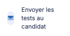

2. Cliquez sur **Envoyer les tests au candidat**. La fenêtre **Détails du message** s'ouvre.

    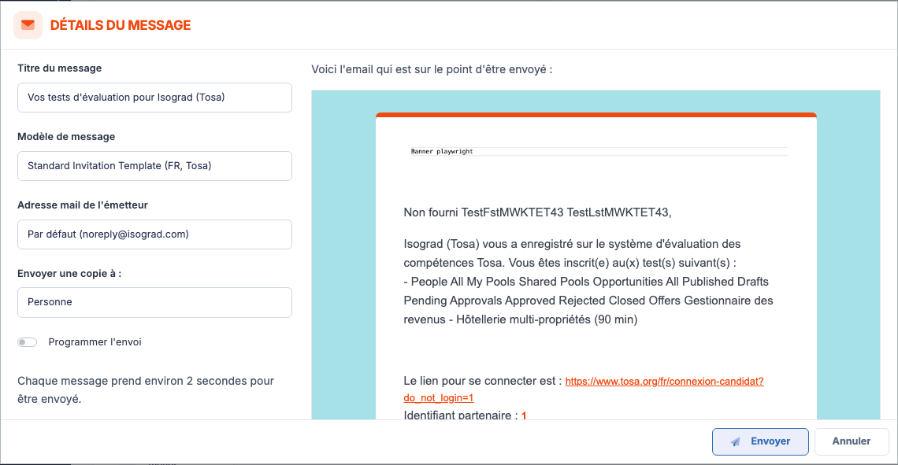

3. Renseignez la colonne de gauche :

    - **Modèle de message** — choisissez parmi les modèles d'inscription configurés pour votre compte dans la langue du candidat ; le titre et l'aperçu se mettent à jour à chaque changement.
    - **Titre du message** — l'objet de l'email, pré-rempli à partir du modèle et modifiable.
    - **Adresse mail de l'émetteur** — visible si des émetteurs vérifiés sont configurés (voir [Gestion des emails](../mail-templates/)) ; sinon l'adresse par défaut de la plateforme est utilisée.
    - **Envoyer une copie à** — un administrateur de votre compte reçoit une copie du message.
    - **Programmer l'envoi** — activez l'interrupteur et indiquez la **Date d'envoi** pour différer l'envoi.

    La colonne de droite affiche l'aperçu exact de l'email tel qu'il sera reçu. Le corps du message provient du modèle : pour le modifier, éditez le modèle dans **Gestion des emails**.

4. Cliquez sur **Envoyer**. Le candidat reçoit son email avec son lien de connexion personnel, et la fiche se recharge.

> ⚠️ **Tests déjà envoyés** — Si un test a déjà fait l'objet d'un email d'invitation, la fenêtre l'indique avec la date d'envoi. Vous pouvez tout de même renvoyer une invitation, par exemple après une correction d'adresse.

### Envoyer des invitations en masse

Depuis la page **Gestion des candidats** :

1. Filtrez le tableau sur le groupe voulu et, si les cases à cocher sont affichées, ne laissez cochés que les candidats à inviter (voir [Inscrire plusieurs candidats à la fois](#inscrire-un-candidat-a-un-test)).
2. Dans le menu **Actions sur le groupe**, choisissez **Envoyer les emails d'inscription à tous les candidats du groupe**.
3. Choisissez le modèle d'email, vérifiez l'objet et l'aperçu du message, puis cliquez sur **Envoyer**. Une confirmation rappelle le nombre d'emails qui vont partir et le groupe concerné.

Chaque candidat reçoit l'invitation avec son lien personnel. Lorsque l'action porte sur le groupe entier, seuls les candidats ayant encore un test à passer sont destinataires.

> ⚠️ **Adresses invalides** — Si l'adresse email d'un candidat est invalide ou refusée par le serveur de destination, vous le verrez dans le rapport d'envoi. Corrigez l'adresse sur la fiche du candidat puis relancez l'envoi.

> 💡 **Personnaliser les modèles d'email** — Les modèles d'email sont gérés dans le chapitre [Gestion des emails](../mail-templates/). Vous pouvez y créer des variantes par langue, par marque, ou par type de test.

## Gérer les groupes {#gerer-les-groupes}

Les groupes vous permettent d'organiser votre population de candidats (par promotion, service, client, formation…) pour faciliter les actions en masse : inscriptions, invitations, suivi des résultats.

### Accéder aux groupes

Depuis le menu de navigation, cliquez sur **Groupes**.

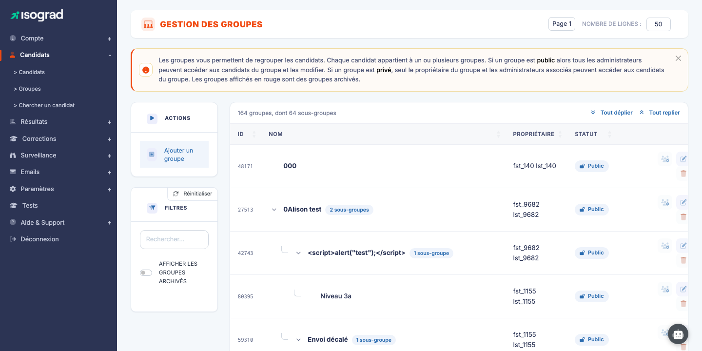

La page **Gestion des groupes** affiche l'ensemble de vos groupes sous forme hiérarchique. Un groupe peut contenir des sous-groupes — utile par exemple pour structurer "Promotion 2026 → Section A → Cours du soir".

### Créer un groupe

1. Cliquez sur **Ajouter un groupe** dans la barre d'actions.

    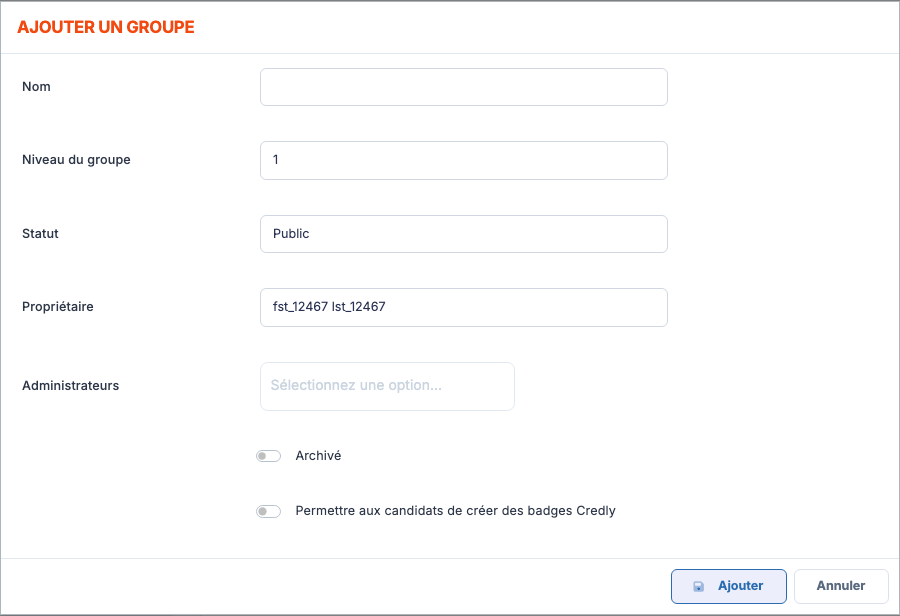
2. Renseignez :

    - **Nom** du groupe.
    - **Niveau du groupe** — pour un groupe de niveau 2 ou 3, choisissez aussi le groupe auquel il est rattaché, ce qui crée la hiérarchie.
    - **Statut** — un groupe public est accessible à tous les administrateurs ; un groupe privé ne l'est qu'à son propriétaire et aux administrateurs associés.
    - **Propriétaire** et **Administrateurs** du groupe.
    - **Autoriser le repassage des certifications échouées (retake)** — cet interrupteur n'apparaît que sur les comptes où le repassage est activé. Les candidats qui rejoignent ensuite le groupe en héritent, sauf s'ils ont déjà un réglage qui leur est propre.

3. Cliquez sur **Ajouter**.

### Ajouter un candidat à un groupe

Deux méthodes :

- **Depuis la fiche du candidat** : cliquez sur **Modifier les détails du candidat**, puis sur le bouton **Modifier** du champ **Groupe(s)**, et ajoutez le candidat aux groupes voulus.
- **Action de groupe** sur la liste des candidats : filtrez sur le groupe d'origine, sélectionnez les candidats, puis **Ajouter un groupe aux candidats du groupe**. Les candidats rejoignent le ou les groupes choisis sans quitter leur groupe actuel.

### Actions de groupe

Une fois vos candidats organisés en groupes, le filtre **Groupe** de la page **Gestion des candidats** vous permet d'isoler une population et de lui appliquer une action en masse via le menu **Actions sur le groupe** (le fonctionnement de la sélection est décrit dans [Inscrire plusieurs candidats à la fois](#inscrire-un-candidat-a-un-test)) :

- **Attribuer un mot de passe temporaire** — le même mot de passe pour toute la sélection ; chaque candidat devra le changer à sa prochaine connexion.
- **Inscrire à un test**.
- **Envoyer les emails d'inscription**.
- **Supprimer les tests non commencés** — choisissez le test concerné parmi ceux encore en attente dans la sélection.
- **Supprimer les candidats**.
- **Ajouter un groupe aux candidats** — sans les retirer de leur groupe actuel.
- **Assigner une session ou un profil de surveillance à un test** — pour un test en attente, choisissez la session et, si besoin, le profil de surveillance. Une session surveillée en direct impose son propre profil à tous les tests qui lui sont rattachés.
- **Définir les options d'évaluation** et **Définir les options de certification** — affichage des résultats au candidat, livraison des rapports, envoi des diplômes et destinataires, appliqués à toute la sélection. Chaque entrée n'apparaît que si votre compte dispose du type de pack correspondant.
- **Refuser le repassage (no retake)** — proposé uniquement sur les comptes où le repassage des certifications échouées est activé. Les candidats cochés (ou tous les candidats du groupe si aucun n'est coché) ne pourront plus repasser leurs certifications échouées ; les autres candidats ne sont pas modifiés. Une confirmation vous est demandée avant que l'action ne soit appliquée.
- **Générer des badges** — émission des badges numériques Credly pour les certifications éligibles de la sélection.

> 💡 **Archivage vs suppression** — L'**archivage** d'un groupe se fait depuis la page **Gestion des groupes** et est non destructif : il masque le groupe et ses candidats des listes par défaut, mais préserve l'historique des tests passés. La **suppression** des candidats est définitive — utilisez-la uniquement pour les candidats créés par erreur.

