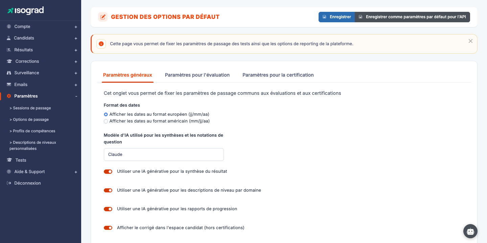
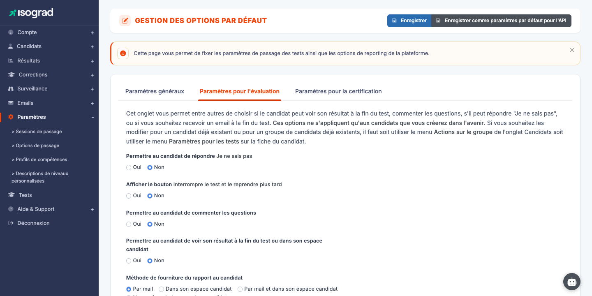
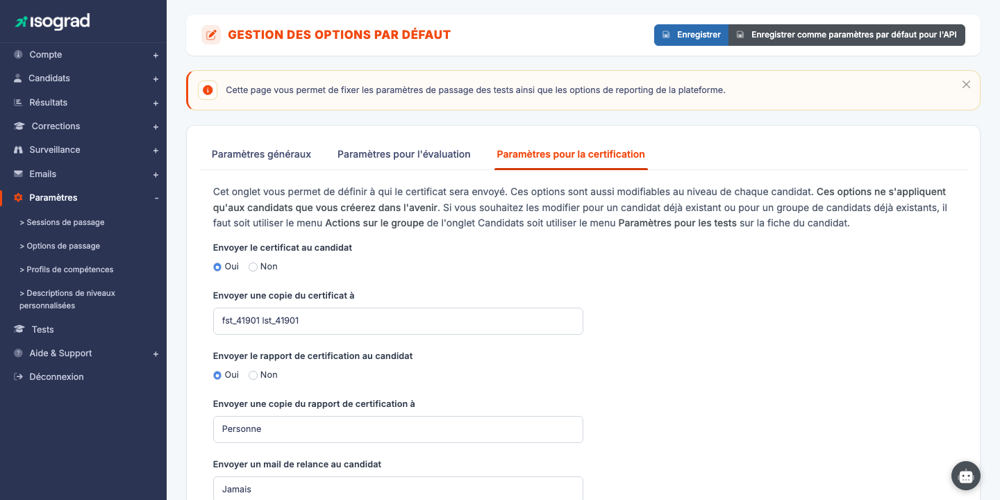

# Options par défaut

La page **Options par défaut** centralise les **paramètres de passage** appliqués à tous les tests inscrits sur votre compte. Les valeurs définies ici sont **pré-remplies** dans la fenêtre d'inscription d'un candidat à un test — vous pouvez toujours les modifier ponctuellement au cas par cas, mais les régler ici fait gagner du temps et garantit la cohérence sur l'ensemble de votre activité.

Accédez à cette page via le menu **Paramètres → Options de passage**.

La page est organisée en plusieurs **onglets** :

- **Paramètres généraux** — réglages communs aux évaluations **et** aux certifications.
- **Paramètres pour l'évaluation** — spécifique aux tests d'évaluation.
- **Paramètres pour la certification** — spécifique aux passages certifiants (uniquement si votre compte propose des certifications).

> ⚠️ **Enregistrer** — Le bouton **Enregistrer**, en haut à droite, enregistre **uniquement l'onglet affiché**. Si vous modifiez plusieurs onglets, cliquez sur **Enregistrer** dans chacun d'eux avant de passer au suivant.

> 💡 **Paramètres par défaut pour l'API** — Le bouton **Enregistrer comme paramètres par défaut pour l'API** enregistre les valeurs de l'onglet affiché comme valeurs par défaut des inscriptions créées par l'API, et non comme vos propres valeurs par défaut. Pour appliquer les mêmes réglages aux deux, cliquez sur les deux boutons.

## Paramètres généraux {#parametres-generaux}

Cet onglet regroupe les paramètres qui s'appliquent **quel que soit le type de test** :

### Format des dates

Choisissez entre :

- **Afficher les dates au format européen (jj/mm/aa)** — par défaut pour les comptes basés en Europe.
- **Afficher les dates au format américain (mm/jj/aa)** — par défaut pour les comptes basés aux États-Unis.

Le format choisi s'applique à toutes les dates affichées dans les rapports et l'interface candidat.

### Options IA générative

Ces réglages concernent l'usage d'une IA générative pour enrichir les rapports :

- **Modèle d'IA utilisé pour les synthèses et les notations de question** — liste déroulante de la famille de modèles utilisée (Claude, Mistral, Open AI ou Gemini).
- **Utiliser une IA générative pour la synthèse du résultat** — la plateforme génère un résumé du résultat en quelques phrases.
- **Utiliser une IA générative pour les descriptions de niveau par domaine** — explicite, par domaine de compétence, ce que le score signifie.
- **Utiliser une IA générative pour les rapports de progression** — pour les rapports comparatifs entre plusieurs sessions d'un même candidat.

### Corrigé pour les évaluations

- **Afficher le corrigé dans l'espace candidat (hors certifications)** — donne au candidat accès au corrigé de ses réponses dans son espace après une **évaluation**. Sur les comptes sans certification, l'option s'intitule simplement **Afficher le corrigé dans l'espace candidat**.

### Test de configuration

**Test de configuration obligatoire avant le premier test** impose au candidat de vérifier son poste avant de pouvoir lancer un test. Trois choix :

- **Oui** — le candidat doit réaliser le test de configuration une fois, avant son premier test. Ce réglage peut ensuite être ajusté candidat par candidat.
- **Non** — aucun test de configuration n'est imposé par défaut.
- **Toujours** — le test de configuration est imposé à tous les candidats qui ne l'ont pas encore réalisé, y compris ceux dont la fiche ne le demande pas.

### Temps additionnel

**Temps additionnel pour les candidats avec un handicap (en %)** — pourcentage de temps supplémentaire ajouté à la durée des tests pour les candidats bénéficiant d'un temps additionnel.

## Paramètres pour l'évaluation {#parametres-evaluation}

Cet onglet regroupe les **options de passage** des tests d'évaluation.

> ⚠️ **Périmètre d'application** — Comme l'indique le bandeau d'aide en haut de l'onglet, *« ces options ne s'appliquent qu'aux candidats que vous créerez dans l'avenir »*. Pour modifier les options d'un candidat ou d'un groupe **déjà existant**, utilisez le menu **Actions sur le groupe** de l'onglet Candidats, ou le menu **Paramètres pour les tests** sur la fiche du candidat.

### Options de passage

Pour chaque option ci-dessous, choisissez **Oui** ou **Non** :

- **Permettre au candidat de répondre « Je ne sais pas »** — ajoute un bouton dédié sur chaque question. La réponse est comptée comme incorrecte mais distinguée d'une réponse erronée dans le rapport — utile pour mesurer la confiance du candidat.
- **Afficher le bouton « Interrompre le test et le reprendre plus tard »** — autorise le candidat à mettre son test en pause. Choisissez **Non** pour forcer un passage en une seule session.
- **Permettre au candidat de commenter les questions** — affiche un champ commentaire sur chaque question. Les commentaires sont consultables a posteriori dans le rapport — utile pour collecter du feedback en phase de mise en place.
- **Permettre au candidat de voir son résultat à la fin du test ou dans son espace candidat** — choisissez **Non** si vous souhaitez **réserver l'accès aux résultats à l'administrateur** (par exemple pour un examen surveillé où le résultat doit être communiqué officiellement).

### Méthode de fourniture du rapport au candidat

Quatre choix mutuellement exclusifs :

- **Par mail** — le rapport est envoyé par email dès la fin du test.
- **Dans son espace candidat** — le rapport est uniquement accessible depuis l'espace candidat connecté.
- **Par mail et dans son espace candidat** — combinaison des deux : email + accès permanent dans l'espace.
- **Ne pas fournir de rapport au candidat** — le candidat ne reçoit aucun rapport.

### Relances et notifications

Quatre listes déroulantes complètent l'onglet :

- **Envoyer un mail de relance au candidat** — fréquence des relances automatiques envoyées aux candidats inscrits à une évaluation.
- **Envoyer une copie du mail de relance à** — administrateur qui reçoit une copie de chaque mail de relance (**Personne** pour ne pas envoyer de copie).
- **Envoyer le rapport de passage à** — administrateur qui reçoit le rapport à la fin du test.
- **Envoyer un mail lorsqu'un test est en attente de correction à** — administrateur prévenu lorsqu'un test attend une correction manuelle.

Les listes d'administrateurs proposent **Personne** ainsi que les administrateurs de votre compte autorisés à consulter les résultats.

## Paramètres pour la certification {#parametres-certification}

Cet onglet n'est visible que si votre compte propose des **certifications** (typiquement les comptes Tosa).

> ⚠️ **Périmètre d'application** — Comme pour l'onglet Évaluation, ces options *ne s'appliquent qu'aux candidats que vous créerez dans l'avenir*.

### Envoi du certificat

- **Envoyer le certificat au candidat** (Oui/Non) — active l'envoi automatique du diplôme PDF au candidat dès la validation de la certification.
- **Envoyer une copie du certificat à** — administrateur qui recevra une copie de chaque diplôme émis (**Personne** pour ne pas envoyer de copie).

> ⚠️ **Au moins un destinataire** — Le certificat doit avoir au moins un destinataire : si vous choisissez **Non** pour l'envoi au candidat et **Personne** pour la copie, l'enregistrement est refusé avec le message *« Le certificat doit obligatoirement avoir un destinataire au minimum »*.

### Envoi du rapport de certification

- **Envoyer le rapport de certification au candidat** (Oui/Non) — distinct du certificat : le rapport de certification est plus détaillé (compétences, comparaison aux niveaux attendus).
- **Envoyer une copie du rapport de certification à** — administrateur qui reçoit une copie du rapport.

### Relances automatiques

- **Envoyer un mail de relance au candidat** — liste déroulante de la fréquence des relances automatiques envoyées aux candidats inscrits à une certification.
- **Envoyer une copie du mail de relance à** — administrateur qui reçoit une copie de chaque mail de relance (**Personne** pour ne pas envoyer de copie). Ce destinataire est commun aux évaluations et aux certifications : la valeur choisie ici remplace celle de l'onglet **Paramètres pour l'évaluation**, et inversement.
