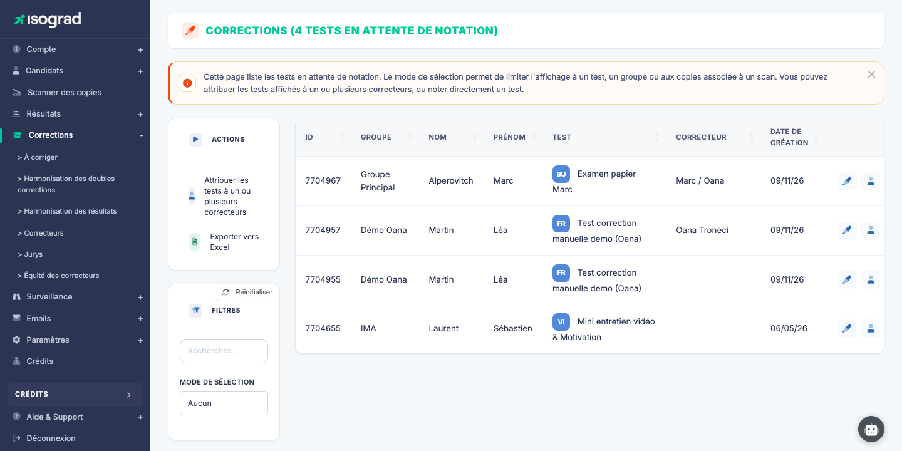
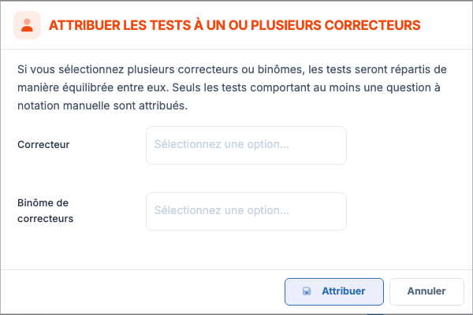
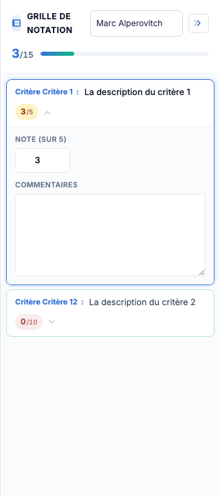
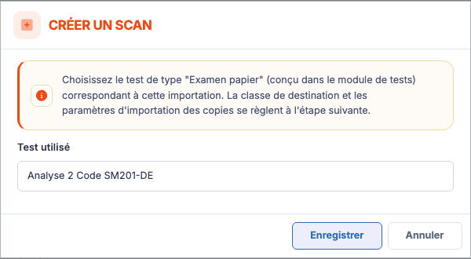

# Correction des copies

Les tests qui comportent des **questions à correction manuelle** — rédaction, document déposé, enregistrement, copie papier scannée — ne reçoivent pas de résultat à la fin du passage : ils restent **en attente de notation** jusqu'à ce qu'un correcteur ait noté chaque réponse. Ce chapitre décrit l'ensemble du circuit de correction : attribution des copies, notation avec la grille, **annotation des copies PDF**, double correction et harmonisation, **campagnes de correction**, jurys, péréquation des notes et import de copies papier scannées.

Ces pages sont regroupées dans le menu **Corrections**. Les entrées affichées dépendent de vos privilèges.

| Entrée du menu | Rôle | Pour qui |
|---|---|---|
| **Corrections** | Les copies à noter, notées ou à harmoniser : attribution aux correcteurs et accès à la notation. | Correcteurs et superviseurs |
| **Correcteurs** | Constituer les binômes de correcteurs. | Superviseurs |
| **Campagnes de correction** | Organiser la correction d'une épreuve : copies, répartition, échéances, harmonisation, jury, péréquation. | Gestionnaires de campagnes |
| **Jurys** | Composer les jurys d'une épreuve. | Administrateurs disposant d'un privilège sur les jurys |

Les pages **Harmonisation des doubles corrections**, **Équité des correcteurs** et **Péréquation** ne sont pas des entrées du menu : elles s'ouvrent depuis le [tableau de bord d'une campagne](#tableau-de-bord).

Le menu **Scanner des copies**, lorsqu'il est proposé sur votre plateforme, sert à importer les copies d'un examen papier (voir [Scanner des copies papier](#scanner-des-copies)). L'entrée **Jurys** n'est proposée que sur ces mêmes plateformes.

## Rôles {#roles}

Plusieurs niveaux de privilège interviennent tout au long du chapitre (voir [Gestion des administrateurs](/ai/fr/admins/) pour les attribuer) :

- Le **correcteur** dispose du droit de saisir des notes. Il ne voit que les copies qui lui sont attribuées et les note, seul ou au sein d'un binôme.
- Un administrateur disposant du droit de **consulter les notes des autres correcteurs** voit toutes les notations, sans pouvoir les modifier.
- Le **superviseur** dispose du droit de corriger les copies des autres correcteurs. Il attribue les copies, constitue les binômes, peut ouvrir n'importe quelle copie et arrête la note des doubles corrections en désaccord.
- Le **gestionnaire de campagnes** est un superviseur qui dispose en plus du droit de gérer les campagnes de correction : il les crée, répartit leurs copies, suit leur avancement, les fait changer de phase et les clôture.

## Copies à corriger {#a-corriger}

Accédez à cette page via le menu **Corrections → Corrections**. Son titre rappelle le nombre de tests correspondant au statut de notation choisi.

Le tableau liste les tests avec le **groupe**, le **nom** et le **prénom** du candidat, le **test**, le **correcteur** et la date. La colonne **Correcteur** affiche le nom du correcteur ou du binôme attribué ; elle indique **IA** lorsqu'une notation par l'IA est encore en cours sur le test.

### Campagnes de correction en cours

Au-dessus du tableau, le bandeau **Campagnes de correction en cours** rappelle les campagnes ouvertes qui vous concernent, avec leurs dates butoirs de saisie des notes et d'harmonisation :

- un **correcteur** y lit ce qu'il lui reste à faire dans chaque campagne — copies à noter, dont copies commencées — ou la mention que toutes ses copies sont notées ;
- un **superviseur** y lit le nombre de correcteurs qui n'ont pas terminé ;
- un **gestionnaire de campagnes** y trouve en plus le lien vers le **tableau de bord** de la campagne.

Une date butoir de saisie des notes dépassée alors qu'il reste des copies à noter est signalée par la mention **échéance dépassée**.

### Sélectionner les copies

Le panneau de filtres propose une **recherche** et trois filtres.

**Statut de notation** — ce que la page liste :

- **À noter** (par défaut) — les tests dont au moins une réponse reste à noter ;
- **Notée** — les tests ayant un correcteur et sur lesquels il ne reste rien à noter. Pour un correcteur, une copie est notée dès qu'il a enregistré sa propre notation ;
- **À harmoniser** — les copies en double correction dont les deux notations sont enregistrées et qui attendent leur note (voir [Harmoniser les doubles corrections](#harmonisation)) ;
- **Tous les statuts de notation**.

Un test noté par un superviseur sans avoir été attribué garde ce superviseur comme correcteur : il se retrouve ainsi parmi les tests notés.

**Correcteur** — réservé aux superviseurs : limite la liste aux copies d'un correcteur, qu'elles lui soient attribuées directement ou par l'intermédiaire d'un binôme.

**Mode de sélection** — restreint la liste :

- **Aucun** — toutes les copies du statut choisi.
- **Par scan** — les copies d'un import de copies papier ; choisissez-le dans le sélecteur **Scan**.
- **Par test** — les passages d'un test ; choisissez-le dans le sélecteur **Test**.
- **Par groupe** — les candidats d'un groupe ou d'un sous-groupe.
- **Par campagne** — les copies d'une [campagne de correction](#campagnes) ; un correcteur ne se voit proposer que les campagnes dont une copie lui est attribuée.

Les sélecteurs **Scan** et **Test** ne proposent que ceux qui ont au moins une copie du statut de notation choisi. Chaque changement recharge la liste, et vos filtres sont conservés lorsque vous revenez sur la page.

### Colonnes de notes

Avec un statut autre que **À noter**, le tableau affiche les notes :

- un **correcteur** voit **Ma note** (avec la mention *brouillon* tant qu'elle n'est pas enregistrée définitivement), la **Note de l'autre correcteur** de son binôme une fois leur lot terminé (voir [Noter en binôme](#noter-en-binome)), et la **Note finale** ;
- un **superviseur**, ou un administrateur autorisé à consulter les notes des autres, voit la **Note du 1er correcteur**, la **Note du 2e correcteur**, leur **Moyenne** et la **Note finale**.

Le bouton **Exporter vers Excel** exporte la liste filtrée avec ces mêmes colonnes, le nom de chaque correcteur dans une colonne distincte, et l'**identifiant externe** du candidat — le numéro d'anonymat pour une copie anonyme.

### Attribuer les copies aux correcteurs {#attribuer}

L'attribution est réservée aux superviseurs. Elle se fait avec le statut de notation **À noter**.

**Pour attribuer en masse**, filtrez d'abord la liste, puis :

1. Cliquez sur **Attribuer les copies à un ou plusieurs correcteurs** dans la barre d'actions.

    
2. Sélectionnez un ou plusieurs **correcteurs**, ou bien un ou plusieurs **binômes de correcteurs** — les deux listes sont exclusives l'une de l'autre.
3. Cliquez sur **Attribuer**.

> ⚠️ **Toutes les copies du filtre sont attribuées** — Il n'y a pas de cases à cocher : l'attribution porte sur **l'ensemble des copies correspondant aux filtres en cours**, et remplace toute attribution antérieure. Vérifiez votre sélection avant de valider.

Si vous sélectionnez plusieurs correcteurs ou binômes, les copies sont réparties de manière équilibrée entre eux. Seules les copies comportant au moins une question à notation manuelle sont attribuées, et une même opération ne peut pas porter sur plus de 1 000 copies.

**Pour attribuer une seule copie**, cliquez sur l'icône **Attribuer la copie à un correcteur** en bout de ligne et choisissez un correcteur ou un binôme. L'option **Aucun** retire l'attribution. L'icône reste proposée tant que le résultat du test n'est pas établi.

> 💡 **Copies d'une campagne** — Les copies d'une campagne de correction s'attribuent **depuis cette campagne**, par un gestionnaire de campagnes : ouvrez la page en mode **Par campagne** sur la campagne concernée (ou cliquez sur **Répartir et suivre les copies** dans son tableau de bord). C'est aussi le seul endroit où les **binômes** sont proposés : un binôme ne corrige que des copies appartenant à une campagne. Ailleurs, l'attribution en masse laisse de côté les copies des campagnes et vous indique combien n'ont pas été attribuées. L'attribution des copies d'une campagne close ne peut plus être modifiée.

### Ouvrir une copie

L'icône **Noter** en bout de ligne ouvre l'écran de notation sur la première question à corriger. Elle est proposée au correcteur attribué, aux membres du binôme attribué et aux superviseurs. En double correction, une fois toutes vos notations enregistrées, elle devient **Voir la notation** (icône en forme d'œil). Sur un test noté dont le résultat est établi, l'icône devient **Analyse** et ouvre le détail des réponses.

## Noter une copie {#noter}

L'écran de notation affiche la question et la **réponse du candidat** au centre, une **barre d'outils** en haut et la **grille de notation** dans un volet à droite.

### Barre d'outils

- **Revenir à la liste** — retour à la page d'où vous venez.
- **Question précédente / suivante** — passe d'une question à l'autre dans la copie.
- **Candidat précédent / suivant** — passe à la copie suivante de la liste **en restant sur la même question**, pour corriger une question en série. Le compteur indique votre position dans la liste.
- **Voir la copie du candidat** — pour un examen papier, ouvre la copie scannée dans un nouvel onglet.
- **Analyser** — demande à l'IA une proposition de notation (voir [Assistance de l'IA](#analyser)).
- **Anti-plagiat** — lance une recherche de similarité sur la réponse (voir [Anti-plagiat](#anti-plagiat)).
- **Enregistrer en brouillon** — conserve votre grille sans valider la note : la réponse reste à corriger et vous pourrez y revenir.
- **Enregistrer** — valide la notation de la question.

### Grille de notation

Le volet **Grille de notation** reprend les critères définis par l'auteur de la question (voir [Soumission manuelle](/ai/fr/question-module/question-editor/#manual-marking)). Pour chaque critère :

- saisissez la **note**, entre 0 et le maximum du critère ;
- ajoutez si besoin un **commentaire**.

Le total se met à jour au fil de la saisie. Une pastille colorée sur chaque critère donne un repère visuel du niveau atteint.

Lorsque l'auteur de la question a rendu **obligatoire la notation de tous les critères**, l'enregistrement est refusé tant qu'un critère n'est pas noté : le message cite les critères manquants. L'enregistrement en brouillon reste possible.

### Enregistrer la note

Chaque question est enregistrée **séparément** : il n'y a pas d'enregistrement global de la copie. Lorsque vous cliquez sur **Enregistrer**, la note de la question devient la somme des points de la grille. Dès que plus aucune réponse du test n'est en attente, le résultat est calculé et le test passe au statut **Terminé**.

Une question déjà notée affiche sa grille en lecture seule, avec le nom du correcteur et la note. Le bouton **Modifier la notation** permet de la corriger ; la nouvelle note remplace l'ancienne.

Les questions notées automatiquement ne comportent pas de grille : le volet l'indique.

### Assistance de l'IA {#analyser}

Le bouton **Analyser** soumet la réponse et la grille à l'IA, qui **pré-remplit** la note et le commentaire de chaque critère. Rien n'est enregistré tant que vous n'avez pas cliqué sur **Enregistrer** ou **Enregistrer en brouillon** : relisez et ajustez la proposition. Pour une copie déposée sous forme de document, l'analyse suppose un fichier PDF. Le bouton n'est pas proposé pour les réponses vidéo.

### Anti-plagiat {#anti-plagiat}

Le bouton **Anti-plagiat** est utilisable lorsque le service de détection de similarité est configuré sur votre compte. L'analyse prend jusqu'à deux minutes et affiche un **taux de similarité** et, le cas échéant, un **taux de texte généré par IA**. Une réponse saisie doit comporter au moins 80 caractères pour être analysée.

### Copies papier lues automatiquement

Pour un examen papier dont les réponses sont lues automatiquement, une question n'a pas de grille : le bouton **Modifier la notation** permet de corriger la note en saisissant la nouvelle valeur et un commentaire. L'historique des modifications (auteur, date, ancienne et nouvelle note) est conservé.

## Annoter une copie PDF {#annotation-pdf}

Lorsque le candidat a remis sa réponse sous la forme d'un **fichier PDF** — document déposé pendant le test ou copie papier scannée —, l'écran de notation affiche la copie dans une **visionneuse** à la place du lien de téléchargement. Le correcteur peut y porter ses annotations, comme sur une copie papier.

### Annoter

La barre d'outils de la visionneuse permet de :

- **surligner**, **souligner** ou **barrer** un passage ;
- **dessiner** à main levée et tracer des **formes** ;
- ajouter du **texte** et des **commentaires** ;
- **annuler** ou **rétablir** une action, et **rechercher** dans le document.

L'outil choisi reste actif d'une annotation à l'autre. Un bouton d'agrandissement étend la visionneuse à toute la largeur de la page, la grille de notation restant visible à droite.

### Enregistrer les annotations

Il n'y a pas de bouton d'enregistrement propre aux annotations : elles sont **enregistrées avec la notation**, lorsque vous cliquez sur **Enregistrer en brouillon** ou **Enregistrer**. Si l'enregistrement de la copie annotée échoue, la note n'est pas enregistrée non plus et un message vous en avertit.

> ⚠️ **Enregistrez avant de changer de copie** — Si vous quittez la page avec des annotations non enregistrées, le navigateur vous demande confirmation. En revanche, afficher la copie d'un autre correcteur abandonne vos annotations en cours sans avertissement.

### Ce qui est conservé

- Le **document d'origine** du candidat n'est jamais modifié : chaque correcteur dispose de sa propre copie annotée.
- Vous modifiez votre propre copie annotée. Un superviseur peut modifier celle d'un autre correcteur, sauf en double correction où une notation enregistrée verrouille la copie, et sauf dans une campagne close.
- Hors de l'écran de notation, la copie annotée s'affiche en lecture seule ; un sélecteur permet de passer d'un correcteur à l'autre lorsque plusieurs ont annoté.

### Ce que voit le candidat

Lorsque le candidat a accès au détail de ses réponses, la page de résultat de la question lui propose, en plus de son document d'origine, le téléchargement de la **copie annotée par le correcteur**.

### Rapport PDF d'une copie scannée

Pour un examen papier de type **copies scannées notées avec une grille**, le rapport PDF du test présente, après l'en-tête de résultat, la **grille de notation de chaque correcteur** (deux en double correction), puis la **copie telle que chaque correcteur l'a annotée**, page par page, suivie de ses commentaires. Une copie que personne n'a annotée y figure telle que le candidat l'a remise. Pour les autres tests, les copies annotées ne sont pas incluses dans les rapports PDF.

### Limites

L'annotation porte uniquement sur les **fichiers PDF** remis en réponse à une question à soumission manuelle. Elle n'est pas proposée pour les autres formats de fichier, ni pour les réponses saisies, audio ou vidéo. Demandez donc un PDF dans les questions dont vous souhaitez annoter les copies.

## Double correction {#double-correction}

Une copie est corrigée **deux fois** lorsqu'elle est attribuée à un **binôme de correcteurs** plutôt qu'à un correcteur seul. La double correction se conduit toujours dans le cadre d'une [campagne de correction](#campagnes) : c'est la campagne qui porte les copies du binôme et les écarts tolérés entre les deux notes.

### Constituer les binômes {#binomes}

Accédez à la page via le menu **Corrections → Correcteurs** (réservée aux superviseurs). Un binôme associe deux administrateurs disposant du droit de saisir des notes.

1. Cliquez sur **Ajouter un binôme**.
2. Saisissez le **nom du binôme** et choisissez le **premier** et le **second correcteur**.

    
3. Enregistrez.

Les deux correcteurs doivent être différents, et deux mêmes correcteurs ne peuvent former qu'un seul binôme, quel que soit leur ordre. Si votre compte compte moins de deux correcteurs, un message vous invite à en créer d'abord. Un binôme utilisé par un jury ne peut pas être supprimé. La recherche porte sur le nom du binôme et sur celui des correcteurs, et la liste est exportable vers Excel.

**Pour créer plusieurs binômes en une fois**, cliquez sur **Importer des binômes**. Le fichier Excel contient une ligne par binôme et deux colonnes, `fst_ema` et `sec_ema` : les adresses mail des deux correcteurs, qui doivent être des administrateurs de votre compte disposant du droit de saisir des notes. Un fichier modèle est téléchargeable depuis la fenêtre, et un **aperçu** vous est présenté avant tout enregistrement.

### Noter en binôme {#noter-en-binome}

Chaque membre du binôme note la copie avec sa propre grille, comme en correction simple, mais :

- sa notation, une fois **enregistrée**, est **verrouillée** : elle ne peut plus être modifiée, y compris par un superviseur ;
- la question ne reçoit pas encore de note : elle attend la seconde notation, puis la moyenne ou l'harmonisation.

**Ce qu'un correcteur voit de l'autre.** Les deux membres d'un binôme ne voient **rien** du travail de l'autre tant que leur **lot** n'est pas terminé, c'est-à-dire tant que toutes les copies de la campagne attribuées au binôme n'ont pas été notées par les deux. Une fois le lot terminé, ce qu'ils voient dépend du réglage **Ce que le correcteur voit de l'autre correcteur** du test (voir [Examens papier](/ai/fr/question-module/test-forms/#examens-papier)) :

- **Sa note uniquement** (par défaut) — le total de l'autre correcteur, sans le détail de sa grille ;
- **Sa note et sa correction complète** — sa grille, ses commentaires et sa copie annotée ;
- **Rien**.

Une campagne peut en outre ne laisser aux correcteurs que la **note finale** une fois celle-ci arrêtée (voir [Créer une campagne](#creer-une-campagne)) ; cette règle l'emporte sur le réglage du test. Un superviseur, comme un administrateur autorisé à consulter les notes des autres, voit toujours les deux notations.

Lorsque plusieurs correcteurs ont noté et que vous y avez accès, le sélecteur **Correcteur** du volet de notation permet d'afficher la grille de chacun.

### Harmoniser les doubles corrections {#harmonisation}

Une copie doublement notée reçoit sa note de l'une des trois manières suivantes.

**La moyenne** — lorsque les deux notations restent dans les écarts tolérés de la campagne, la note peut être la moyenne des deux notes (bouton **Calculer la note moyenne** de la page d'harmonisation, ci-dessous).

**L'accord du binôme** — lorsque les deux notations dépassent l'un des écarts tolérés, les deux correcteurs se mettent d'accord, une fois leur lot terminé. Ces copies se retrouvent avec le statut de notation **À harmoniser** de la page [Corrections](#a-corriger) :

1. L'un des deux correcteurs ouvre la copie, clique sur **Proposer la note harmonisée** et saisit la note convenue avec l'autre correcteur.
2. L'autre correcteur ouvre la copie : il coche **Je valide cette note harmonisée** et clique sur **Valider la note harmonisée** — la note proposée devient la note de la question — ou clique sur **Refuser la note proposée**, ce qui remet la copie en attente d'une nouvelle proposition.

Tant qu'une proposition est en attente de validation, seul son auteur peut la remplacer. Les deux grilles sont conservées.

**L'arbitrage du superviseur** — un superviseur peut à tout moment ouvrir la question, cliquer sur **Harmoniser**, saisir la **note globale de la question** et valider. Cette note s'impose, les grilles des deux correcteurs restant consultables.

L'écran de notation affiche l'**Historique des décisions** prises sur la note — moyenne des deux notes, note proposée, validée ou refusée, note arrêtée par le superviseur — avec leur auteur et leur date. Il est visible des superviseurs et, une fois leur lot terminé, des membres du binôme.

#### Page d'harmonisation

La page **Harmonisation des doubles corrections** est réservée aux superviseurs. Ouvrez-la depuis le tableau de bord d'une campagne, bouton **Harmoniser les doubles corrections** : elle s'affiche directement sur les copies de la campagne.

1. Le **mode de sélection** — par scan, par test ou par campagne — et le sélecteur correspondant désignent les copies comparées.
2. Les **écarts tolérés entre les deux correcteurs** s'affichent :
    - pour une campagne, ce sont **ceux de la campagne**, en lecture seule : ils se règlent en modifiant la campagne. L'écart par critère porte la mention **Non appliqué** lorsque la campagne n'en définit pas ;
    - pour un scan ou un test, vous les saisissez — **Écart maximal par note** (2 points par défaut) et **Écart maximal par critère** (1 point par défaut) — puis cliquez sur **Appliquer**.
3. Si les tests comportent plusieurs questions à correction manuelle, choisissez la **question** à examiner.

La page répartit alors les copies en quatre tableaux :

| Tableau | Contenu | Action |
|---|---|---|
| **Tests à harmoniser** | Les deux notations dépassent l'un des écarts tolérés. | **Ouvrir la question** pour arrêter la note. |
| **Tests doublement notés dans les seuils** | Les deux notations sont suffisamment proches. | **Calculer la note moyenne**. |
| **Tests harmonisés** | La note est arrêtée (correction simple ou harmonisation faite). | **Voir la copie**. |
| **Tests non notés ou partiellement notés** | Au moins une correction est en attente. | **Voir la copie**. |

Les deux premiers tableaux détaillent, pour chaque copie, le binôme, les deux notes de chaque question et les écarts constatés.

**Calculer la note moyenne** attribue, après confirmation, la moyenne des deux notes à toutes les questions des tests dans les seuils. Les deux notations sont conservées.

**Ouvrir la question** affiche l'écran de notation avec les deux grilles en lecture seule, les **notes des correcteurs** et leur **écart**, d'où le superviseur arrête la note avec **Harmoniser**.

Dans tous les cas, le test passe au statut **Terminé** dès que plus aucune réponse n'est en attente.

## Campagnes de correction {#campagnes}

Une **campagne de correction** organise la correction d'une épreuve : elle réunit les copies issues de scans, de sessions ou de groupes, puis sert à les répartir entre les correcteurs et les binômes, à suivre les échéances, à harmoniser les notes et à réunir le jury. Une copie qui n'appartient à aucune campagne se corrige simplement depuis la page [Corrections](#a-corriger), par un correcteur seul.

Accédez à la page via le menu **Corrections → Campagnes de correction** (réservée aux gestionnaires de campagnes). Le tableau indique, pour chaque campagne, son **nom**, son **épreuve**, le nombre de **copies**, le **jury**, les deux **dates butoirs** et la **phase**. Les icônes de fin de ligne ouvrent le **tableau de bord**, la modification et la suppression. La liste est exportable vers Excel.

### Créer une campagne {#creer-une-campagne}

Cliquez sur **Ajouter une campagne** et renseignez :

- **Nom de la campagne** — obligatoire.
- **Épreuve** — le test dont la campagne corrige les copies. La liste propose les tests ayant un scan de copies ou des passages en attente de notation ; si aucun ne s'y prête encore, un message vous invite à créer d'abord un scan ou à attendre qu'un test soit en attente de notation.
- **Sources** — les copies que la campagne prend en charge. Une fois l'épreuve choisie, sélectionnez des **scans de copies** pour les copies papier, des **sessions** ou des **groupes** pour les tests passés en ligne ; vous pouvez les combiner, et au moins une source est obligatoire.
- **Jury** — facultatif, parmi les [jurys](#jurys) de votre compte.
- **Date butoir de saisie des notes** et **Date butoir d'harmonisation** — facultatives ; le jour indiqué est compris, et l'harmonisation ne peut pas précéder la saisie des notes.
- **Écart maximal par note** et **Écart maximal par critère** — les écarts, en points, tolérés entre les deux corrections d'une copie notée par un binôme. Jusqu'à l'écart indiqué, valeur comprise, la note peut être la moyenne des deux notes ; au-delà, la copie doit être harmonisée. Laissez l'écart par critère vide pour ne retenir que l'écart sur la note.
- **Une fois la note arrêtée, ne montrer aux correcteurs que la note finale** — dès qu'une copie a sa note finale (moyenne, note harmonisée ou arbitrage), les correcteurs ne voient plus la note ni la correction de l'autre membre de leur binôme : il ne leur reste que leur propre notation et la note finale. Les superviseurs continuent de tout voir.

> ⚠️ **Épreuve et sources ne se défont pas** — L'épreuve ne peut plus être changée une fois la campagne créée, et une source ajoutée ne peut plus être retirée. Vous pouvez en revanche ajouter des sources par la suite.

Toutes les copies de l'épreuve issues des sources rejoignent la campagne, **y compris celles déposées ou inscrites par la suite** ; les sous-groupes d'un groupe sont compris. Un scan, une session ou un groupe n'alimente qu'**une seule campagne** pour une épreuve donnée, et une copie n'appartient qu'à une campagne.

Une campagne dont certaines copies sont déjà attribuées à un correcteur ou à un binôme ne peut plus être supprimée. Supprimer une campagne ne supprime pas ses copies.

### Tableau de bord {#tableau-de-bord}

L'icône **Tableau de bord** d'une ligne ouvre le tableau de bord de la campagne. La barre de navigation permet de revenir à la liste et de passer à la campagne précédente ou suivante.

- **Campagne** — l'épreuve, le jury, la phase, les sources (nombre de scans, de sessions et de groupes), les écarts tolérés et les dates butoirs. La date butoir de saisie des notes porte la mention **échéance dépassée** lorsque son jour est passé et qu'il reste des copies à noter.
- **Phase de la campagne** — voir [Phases et clôture](#phases).
- **Copies** — les chiffres clés : **copies de la campagne**, **non attribuées**, **non notées**, **partiellement notées**, **notées**.
- **Conduire la campagne** — les pages depuis lesquelles la campagne se conduit, ouvertes directement sur ses copies :
    - **Répartir et suivre les copies** — la page [Corrections](#a-corriger) en mode **Par campagne**, tous statuts de notation confondus ; c'est de là que vous [attribuez](#attribuer) les copies aux correcteurs et aux binômes ;
    - **Harmoniser les doubles corrections** — la [page d'harmonisation](#harmonisation) ;
    - **Équité des correcteurs** — voir [Équité des correcteurs](#equite) ;
    - **Péréquation** — voir [Péréquation](#perequation).

    Chaque bouton n'est proposé qu'aux administrateurs autorisés à ouvrir la page correspondante.
- **Avancement par correcteur** — pour chaque correcteur, le nombre de copies attribuées, **non commencées**, **commencées** (une grille en brouillon) et **notées**. Chaque membre d'un binôme a sa propre ligne : une copie est notée pour lui dès qu'il a enregistré sa notation, quoi qu'ait fait l'autre.

### Relances par courriel

Lorsqu'une date butoir de saisie des notes est fixée, les correcteurs qui n'ont pas terminé reçoivent une **relance par courriel** 3 jours avant la date butoir, la veille, puis le lendemain. Le courriel indique, pour chaque campagne, le nombre de copies à noter et de copies commencées. Une fois la date dépassée, les gestionnaires de campagnes reçoivent à leur tour un courriel listant les correcteurs en retard. Modifier la date butoir fait repartir les relances.

### Phases et clôture {#phases}

La **phase** indique où en est la campagne : **Correction** des copies, **Harmonisation** des doubles corrections, puis **Jury**. Vous la faites avancer vous-même depuis la carte **Phase de la campagne** du tableau de bord : choisissez la phase puis cliquez sur **Changer de phase**. Les trois phases peuvent être fixées dans n'importe quel ordre ; la phase **Jury** est celle pendant laquelle une [péréquation](#perequation) peut être appliquée.

Le bouton **Clôturer la campagne** rend, après confirmation, les notes **définitives** :

- plus aucune note ni attribution ne peut être modifiée, y compris par un superviseur ;
- les correcteurs n'ont plus accès aux copies de la campagne ;
- la campagne ne peut plus être modifiée.

> ⚠️ **La clôture est irréversible** — Une campagne close ne peut pas être rouverte. Le tableau de bord indique alors qui l'a close et à quelle date.

### Péréquation {#perequation}

La **péréquation** ajuste les notes finales des copies déjà notées d'un périmètre. Rien n'est ajusté automatiquement : chaque ajustement est d'abord **simulé**, puis appliqué sur votre décision. Ouvrez la page depuis le tableau de bord, bouton **Péréquation**.

La carte **Notes de la campagne** rappelle le nombre de copies notées, leur moyenne, leur écart type et le nombre de copies sans note finale.

**Pour préparer un ajustement**, dans la carte **Nouvel ajustement** :

1. Choisissez le **périmètre** : **Toute la campagne**, **Un ou plusieurs candidats**, **Un binôme** ou **Un correcteur**.
2. Choisissez l'**ajustement** :
    - **Ajouter ou retirer des points** — un nombre de points, positif ou négatif ;
    - **Appliquer un coefficient** — un coefficient positif ou nul ;
    - **Aligner la moyenne du périmètre sur celle de la campagne** — sans valeur à saisir ; il suppose un périmètre plus étroit que toute la campagne.
3. Cliquez sur **Simuler**.

La **simulation** compare la moyenne et l'écart type du périmètre et de la campagne avant et après, puis liste les copies avec leur **note avant** et **après**, leur **rang avant** et **après** et un éventuel **signalement** : *note plafonnée* (ramenée à 0 ou au maximum de la question), *copie déjà ajustée* par un ajustement précédent, ou copie laissée inchangée — écart entre les deux notes hors seuil, ou note harmonisée et non moyennée. Un récapitulatif indique le nombre de copies modifiées, plafonnées, déjà ajustées, inchangées et changeant de rang. Les copies sans note finale ne sont pas concernées.

**Pour appliquer l'ajustement**, cliquez sur **Appliquer l'ajustement** et confirmez. Ce bouton n'est proposé que pendant la phase **Jury** : vous pouvez simuler à tout moment, mais il faut passer la campagne en phase **Jury** depuis son tableau de bord pour appliquer un ajustement ou en annuler un.

Le **Journal des ajustements** conserve chaque ajustement appliqué avec sa date, son auteur, son périmètre, sa règle, le nombre de copies modifiées et son état. **Notes avant et après** en affiche le détail. Seul le **dernier ajustement appliqué** peut être annulé (**Annuler l'ajustement**) : les notes des copies concernées reviennent alors à leur valeur précédente.

> 💡 **Épreuves concernées** — La péréquation n'est disponible que pour les épreuves dont chaque copie porte une seule question notée à la main. Les notes d'une campagne close ne peuvent plus être ajustées.

## Jurys {#jurys}

Accédez à la page via le menu **Corrections → Jurys**, sur les plateformes qui proposent le scan de copies. Un jury réunit les correcteurs d'une épreuve : un **président**, des **arbitres** qui tranchent les désaccords, et des correcteurs travaillant seuls ou en binôme. Selon votre privilège, vous pouvez consulter les jurys ou également les créer, les modifier et les supprimer.

Pour créer un jury, cliquez sur **Ajouter un jury** et renseignez :

- **Nom du jury** — obligatoire.
- **Président** — obligatoire, choisi parmi les superviseurs.
- **Arbitres** — un ou plusieurs superviseurs. Le président ne peut pas être également arbitre.
- **Correcteurs individuels** — les correcteurs qui notent seuls.
- **Binômes de correcteurs** — les binômes rattachés au jury.

Le tableau rappelle, pour chaque jury, son président, ses arbitres et ses correcteurs. Il est exportable vers Excel.

Le jury se rattache à une [campagne de correction](#creer-une-campagne), qui porte les écarts tolérés entre les deux corrections d'une copie. Il sert aussi de filtre sur la page [Équité des correcteurs](#equite), où il fait apparaître le rôle de chacun.

## Équité des correcteurs {#equite}

La page **Équité des correcteurs** compare la manière de noter des correcteurs sur un même ensemble de copies, pour repérer un correcteur nettement plus sévère ou plus généreux que les autres. Ouvrez-la depuis le tableau de bord d'une campagne, bouton **Équité des correcteurs** ; elle est proposée aux administrateurs disposant d'un privilège sur les jurys et elle est en lecture seule.

Choisissez le **mode de sélection** (par scan, par test ou par campagne), le scan, le test ou la campagne, éventuellement un **jury** et, si les tests comportent plusieurs questions à correction manuelle, la **question** : les statistiques sont calculées question par question.

- **Chiffres clés** — copies de la sélection, réponses notées, nombre de correcteurs, moyenne de toutes les notations.
- **Statistiques par correcteur** — nombre de réponses notées, moyenne, écart-type, minimum et maximum, répartition des notes par quart du score maximal, **écart avec la moyenne de tous** et **écart moyen avec le co-correcteur** en double correction. Les écarts sont signés : une valeur positive signifie que le correcteur attribue plus de points que les autres. Avec un jury sélectionné, une colonne indique le rôle de chacun.
- **Moyennes par critère** — la moyenne de chaque critère, tous correcteurs confondus puis par correcteur, avec l'écart entre les deux.
- **Notes finales selon leur origine** — la note finale des réponses, selon qu'elle vient d'un **correcteur unique** ou d'une **double correction** (moyenne des deux notations ou note arbitrée) : nombre de notes, moyenne, écart-type, minimum, maximum, **écart avec la moyenne générale**, et nombre de notes arbitrées. La colonne **Écart significatif** indique si l'écart a peu de chances d'être dû au hasard ; elle n'est renseignée qu'à partir de 5 notes de chaque côté.

Seules les notations **enregistrées** sont prises en compte ; les brouillons sont ignorés. Ces comparaisons supposent que les copies ont été réparties au hasard entre les correcteurs.

## Scanner des copies papier {#scanner-des-copies}

Le menu **Scanner des copies**, lorsqu'il est proposé sur votre plateforme, permet d'importer les copies d'un **examen papier** pour les corriger en ligne. L'examen papier lui-même se prépare dans le module Questions (voir [Examens papier](/ai/fr/question-module/test-forms/#examens-papier)).

### Créer un scan

1. Sur la page **Gestion des scans**, cliquez sur **Créer un scan**.

    
2. Choisissez le **test utilisé** parmi vos examens papier. La page d'édition du scan s'ouvre.

    

### Régler l'association des copies aux candidats

Dans l'onglet **Détails** :

- **Mode d'attribution des copies** — comment chaque copie est rattachée à un candidat :
    - **Utiliser les noms et prénoms indiqués sur la copie** — le prénom et le nom sont lus automatiquement dans le document ;
    - **Utiliser l'identifiant affiché sur la copie** — l'identifiant inscrit sur la copie (numéro d'anonymat, numéro de candidat) est lu dans le document, et la copie est rattachée au candidat, anonyme ou non, qui porte cet identifiant ;
    - **Utiliser le nom du fichier en tant qu'identifiant** — le nom du fichier, hors extension, est l'identifiant du candidat.
- **Créer les candidats qui n'existent pas dans le groupe destination** — accepte les copies de candidats, ou d'identifiants, qui ne sont pas encore connus, en les créant. Si l'option est désactivée, ces copies sont placées dans les copies non attribuées de l'onglet **Réconciliation**.
- **Groupe de destination** — le groupe dans lequel les candidats sont recherchés et les tests créés.

Enregistrez : l'import n'est possible qu'une fois le groupe de destination enregistré, et l'onglet **Réconciliation** n'apparaît qu'à ce moment-là.

### Préparer des copies anonymes {#copies-anonymes}

Pour corriger des copies anonymes, déclarez à l'avance les identifiants attendus, puis levez l'anonymat une fois la correction terminée. Ces deux imports se font depuis le menu **Candidats anonymes** de la page **Gestion des candidats** — voir [Candidats anonymes](/ai/fr/candidates/#candidats-anonymes) :

1. **Importer un fichier d'identifiants**, avant l'import des copies : un candidat anonyme est créé pour chaque identifiant attendu. Lors de l'import des copies, cette liste permet de repérer les copies manquantes et celles dont l'identifiant n'est pas attendu.
2. **Associer les candidats avec leurs identifiants**, après la correction : chaque candidat anonyme reçoit son identité réelle.

Sur le scan, choisissez alors le mode d'attribution par **identifiant affiché sur la copie** ou par **nom du fichier**.

### Importer les copies

Dans l'onglet **Import**, glissez-déposez les copies dans la zone prévue. Les formats acceptés sont **PDF**, **PNG**, **JPG** et **ZIP** (pour un lot de copies). Un fichier portant le même nom qu'une copie déjà importée est refusé, de même que deux fichiers de même nom dans un même envoi ; un fichier dépassant la taille maximale autorisée est refusé avec un message.

Les copies sont traitées en arrière-plan : le bouton **Voir les copies en cours d'importation** en suit l'avancement. Une archive **ZIP** est extraite en arrière-plan elle aussi : elle apparaît d'abord comme « archive en cours d'extraction », puis ses copies rejoignent les copies en cours d'importation. Si une archive est refusée, ne peut pas être extraite ou contient des fichiers ignorés, l'encadré **Archives ZIP importées : points à vérifier** vous le signale.

Le tableau **Copies déjà importées** liste les copies rattachées à un candidat, avec une recherche, une pagination et un lien pour afficher chaque copie. Lorsque le scan attribue les copies par identifiant, la première colonne affiche l'identifiant lu sur la copie. Un message rappelle le nombre de copies qui n'ont pas pu être attribuées et vous renvoie vers l'onglet **Réconciliation**.

### Réconcilier copies et candidats {#reconciliation}

L'onglet **Réconciliation** réunit ce qui reste à traiter à la main après l'import.

- **Copies dont l'identité lue ne correspond à aucun candidat** — un nom ou un identifiant a été lu sur la copie (ou fourni par le nom du fichier), mais il n'a pas permis de l'attribuer. La colonne **Motif** indique pourquoi : **Aucun candidat correspondant** (et l'option de création des candidats manquants est désactivée) ou **Identifiant porté par plusieurs candidats**. L'identité lue sur la copie est rappelée.
- **Copies sans identité lisible** — aucun nom ni identifiant n'a pu être lu. Ces copies ne sont jamais attribuées automatiquement, même lorsque la création des candidats manquants est activée.
- **Candidats sans copie** — les candidats du groupe de destination auxquels aucune copie n'est attribuée. Cette liste est utile lorsque vous avez peuplé le groupe à l'avance, avec des candidats anonymes ou non.

Pour les deux premières listes, cliquez sur **Afficher la copie** pour la vérifier, puis sur **Attribuer** : recherchez le candidat — par identifiant ou par nom lorsque le scan attribue les copies par identifiant, par nom ou par adresse mail sinon — et validez.

### Après l'import

Pour chaque copie, un test est créé pour le candidat. Les questions à correction automatique sont notées d'emblée ; les questions à correction manuelle attendent un correcteur. Les tests concernés apparaissent sur la page [Corrections](#a-corriger) : utilisez le mode de sélection **Par scan** pour retrouver les copies d'un import, ou rattachez le scan à une [campagne de correction](#campagnes) pour répartir ses copies, y compris entre des binômes.

Pour un examen de type **copies scannées notées avec une grille**, la copie scannée devient le document remis par le candidat : le correcteur la note avec la grille et peut l'[annoter](#annotation-pdf) lorsqu'il s'agit d'un PDF.
