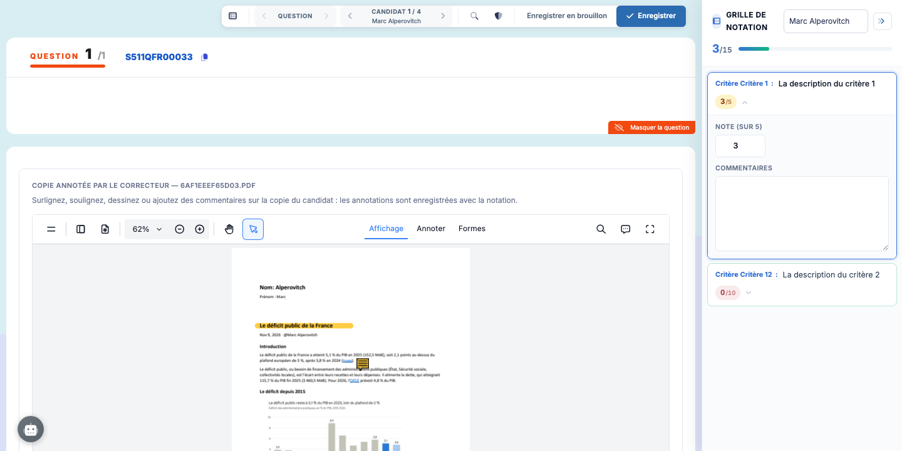
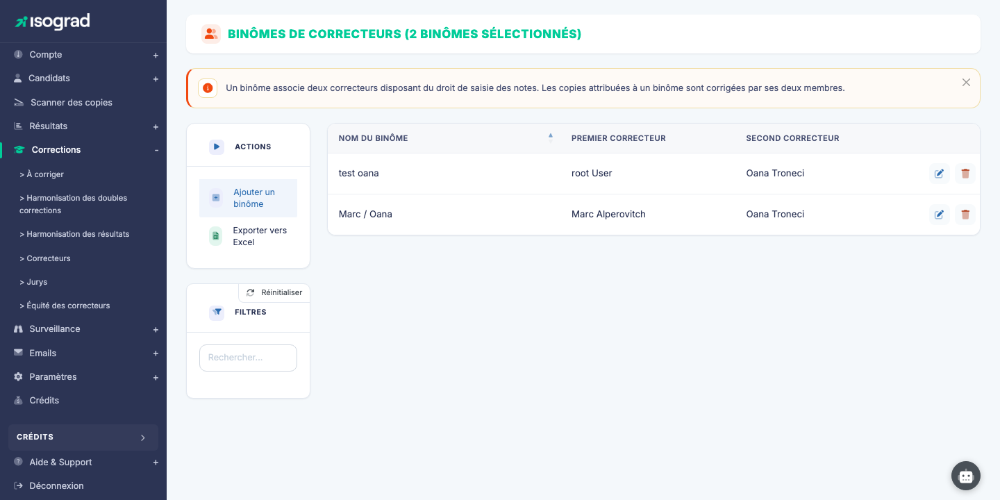
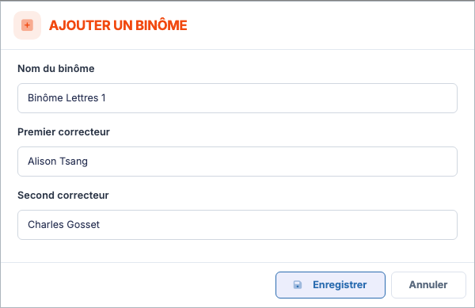
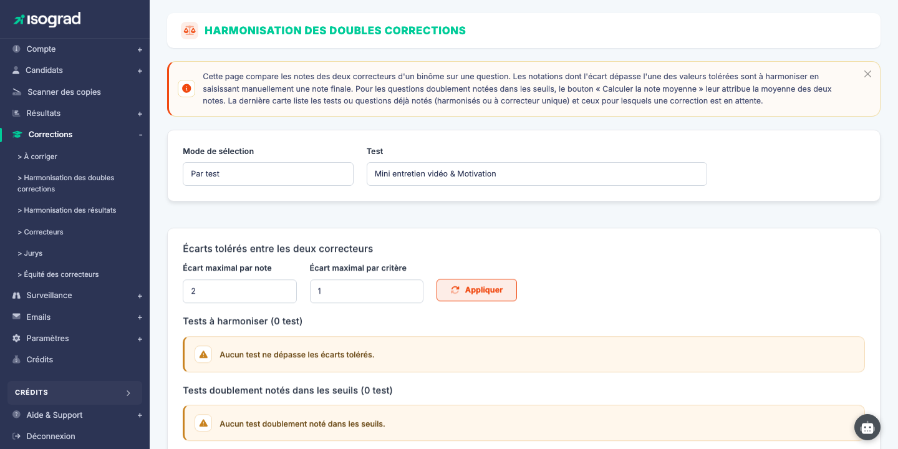
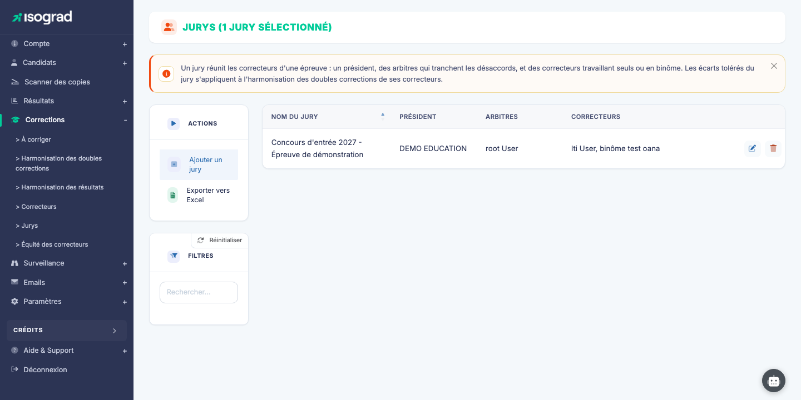
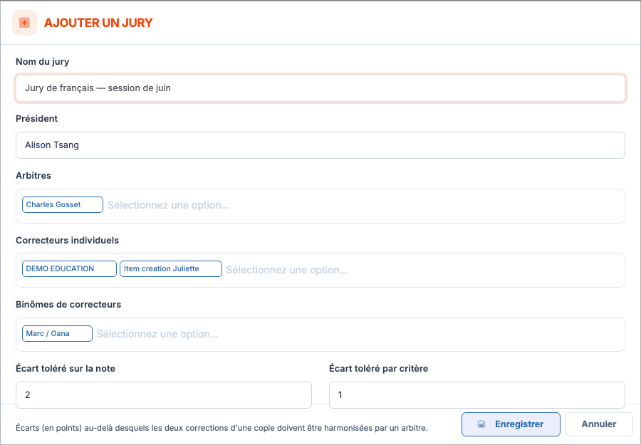
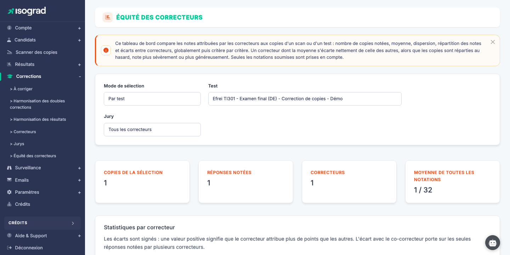
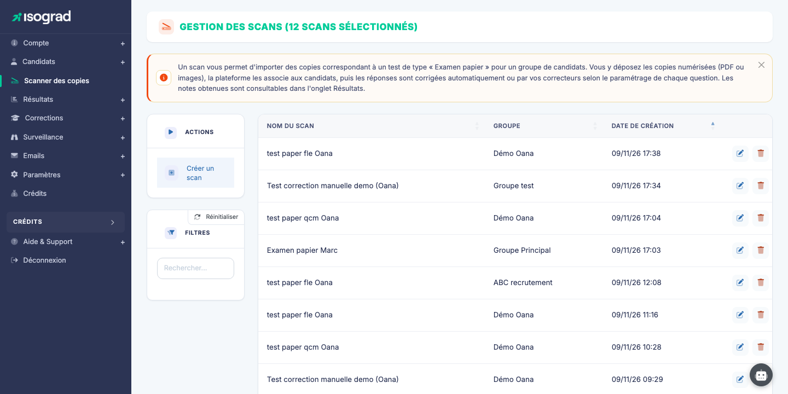
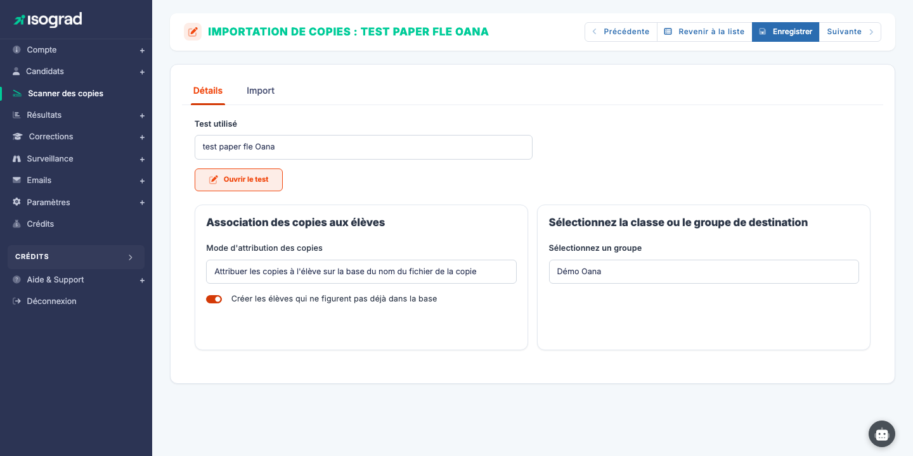
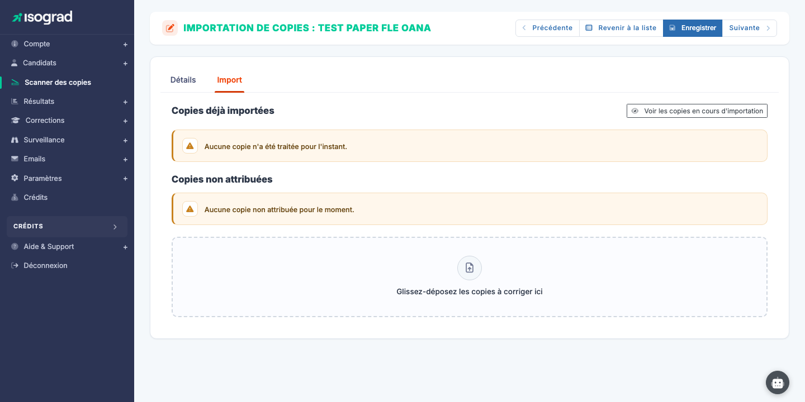

# Correction des copies

Les tests qui comportent des **questions à correction manuelle** — rédaction, document déposé, enregistrement, copie papier scannée — ne reçoivent pas de résultat à la fin du passage : ils restent **en attente de notation** jusqu'à ce qu'un correcteur ait noté chaque réponse. Ce chapitre décrit l'ensemble du circuit de correction : attribution des copies, notation avec la grille, **annotation des copies PDF**, double correction et harmonisation, jurys, suivi de l'équité des correcteurs et import de copies papier scannées.

Ces pages sont regroupées dans le menu **Corrections**. Les entrées affichées dépendent de vos privilèges.

| Entrée du menu | Rôle | Pour qui |
|---|---|---|
| **À corriger** | Les tests à noter et les tests déjà notés : attribution aux correcteurs et accès à la notation. | Correcteurs et superviseurs |
| **Harmonisation des doubles corrections** | Comparer les deux notations d'une même copie et arrêter la note. | Superviseurs |
| **Correcteurs** | Constituer les binômes de correcteurs. | Superviseurs |
| **Jurys** | Composer les jurys d'une épreuve. | Administrateurs disposant d'un privilège sur les jurys |
| **Équité des correcteurs** | Statistiques de notation par correcteur. | Administrateurs disposant d'un privilège sur les jurys |

Le menu **Scanner des copies**, lorsqu'il est proposé sur votre plateforme, sert à importer les copies d'un examen papier (voir [Scanner des copies papier](#scanner-des-copies)).

## Rôles {#roles}

Deux niveaux de privilège interviennent tout au long du chapitre (voir [Gestion des administrateurs](/ai/fr/admins/) pour les attribuer) :

- Le **correcteur** dispose du droit de saisir des notes. Il note les copies qui lui sont attribuées, seul ou au sein d'un binôme.
- Le **superviseur** dispose en plus du droit de corriger les copies des autres correcteurs. Il attribue les copies, constitue les binômes, peut ouvrir n'importe quelle copie et harmonise les doubles corrections.

## Copies à corriger {#a-corriger}

Accédez à cette page via le menu **Corrections → À corriger**. Elle s'ouvre sur les tests **à noter** ; le filtre **Statut de notation** permet d'afficher aussi les tests déjà notés. Son titre rappelle le nombre de tests du statut affiché.

Un correcteur n'y voit que les tests qui lui sont attribués, directement ou à travers son binôme ; un superviseur voit tous les tests du compte.

Le tableau liste par défaut les tests dont au moins une réponse reste à noter, avec le **groupe**, le **nom** et le **prénom** du candidat, le **test**, le **correcteur** et la date. La colonne **Correcteur** affiche le nom du correcteur ou du binôme attribué ; elle indique **IA** lorsqu'une notation par l'IA est encore en cours sur le test.

> 💡 **Double correction** — Un test dont toutes les réponses ont reçu leurs deux notations quitte la liste des tests à noter : il attend alors sur la page [Harmonisation des doubles corrections](#harmonisation), et figure parmi les tests notés.

### Statut de notation {#statut-de-notation}

Le filtre **Statut de notation** choisit les tests affichés :

- **À noter** (par défaut) — les tests dont au moins une réponse attend encore une notation.
- **Notée** — les tests qui ont un correcteur et sur lesquels il ne reste plus rien à noter : le résultat est établi, ou le test attend l'harmonisation de sa double correction.
- **Tous les statuts de notation** — les deux listes réunies.

Pour un correcteur, un test en double correction passe dans les tests **notés** dès qu'il a enregistré toutes ses notations, même si l'autre membre du binôme n'a pas terminé.

Un test noté par un superviseur sans avoir été attribué garde ce superviseur comme correcteur : il se retrouve ainsi parmi les tests notés.

Sur un test noté dont le résultat est établi, l'icône en bout de ligne devient **Analyse** et ouvre le détail des réponses.

### Sélectionner les copies

En plus du statut de notation, le panneau de filtres propose une **recherche**, un filtre **Correcteur** et un **Mode de sélection**.

Le filtre **Correcteur**, réservé aux superviseurs, limite la liste aux tests d'un correcteur, qu'ils lui soient attribués directement ou à travers un binôme. Associé au statut **Notée**, il montre ce qu'un correcteur a déjà noté ; associé à **À noter**, ce qu'il lui reste à faire.

Le **Mode de sélection** restreint la liste :

- **Aucun** — tous les tests du statut choisi.
- **Par scan** — les copies d'un import de copies papier ; choisissez-le dans le sélecteur **Scan**.
- **Par test** — les passages d'un test ; choisissez-le dans le sélecteur **Test**.
- **Par groupe** — les candidats d'un groupe ou d'un sous-groupe.

Les sélecteurs **Scan** et **Test** ne proposent que ceux qui ont au moins une copie du statut de notation choisi. Chaque changement recharge la liste, et vos filtres sont conservés lorsque vous revenez sur la page.

### Attribuer les copies aux correcteurs {#attribuer}

L'attribution est réservée aux superviseurs.

**Pour attribuer en masse**, placez le **Statut de notation** sur **À noter** — le bouton d'attribution n'est proposé que sur ce statut —, filtrez la liste, puis :

1. Cliquez sur **Attribuer les tests à un ou plusieurs correcteurs** dans la barre d'actions.

    
2. Sélectionnez un ou plusieurs **correcteurs**, ou bien un ou plusieurs **binômes de correcteurs** — les deux listes sont exclusives l'une de l'autre.
3. Cliquez sur **Attribuer**.

> ⚠️ **Tous les tests du filtre sont attribués** — Il n'y a pas de cases à cocher : l'attribution porte sur **l'ensemble des tests correspondant aux filtres en cours**, et remplace toute attribution antérieure. Vérifiez votre sélection avant de valider.

Si vous sélectionnez plusieurs correcteurs ou binômes, les tests sont répartis de manière équilibrée entre eux. Seuls les tests comportant au moins une question à notation manuelle sont attribués, et une même opération ne peut pas porter sur plus de 1 000 tests.

**Pour attribuer une seule copie**, cliquez sur l'icône **Attribuer le test à un correcteur** en bout de ligne et choisissez un correcteur ou un binôme. L'option **Aucun** retire l'attribution. L'icône reste proposée tant que le résultat du test n'est pas établi.

### Ouvrir une copie

L'icône **Noter** en bout de ligne ouvre l'écran de notation sur la première question à corriger. Elle est proposée au correcteur attribué, aux membres du binôme attribué et aux superviseurs. En double correction, une fois toutes vos notations enregistrées, elle devient **Voir la notation** (icône en forme d'œil).

Le bouton **Exporter vers Excel** exporte la liste filtrée.

## Noter une copie {#noter}

L'écran de notation affiche la question et la **réponse du candidat** au centre, une **barre d'outils** en haut et la **grille de notation** dans un volet à droite.

### Barre d'outils

- **Revenir à la liste** — retour à la page d'où vous venez.
- **Question précédente / suivante** — passe d'une question à l'autre dans la copie.
- **Candidat précédent / suivant** — passe à la copie suivante de la liste **en restant sur la même question**, pour corriger une question en série. Le compteur indique votre position dans la liste.
- **Voir la copie du candidat** — pour un examen papier, ouvre la copie scannée dans un nouvel onglet.
- **Analyser** — demande à l'IA une proposition de notation (voir [Assistance de l'IA](#analyser)).
- **Anti-plagiat** — lance une recherche de similarité sur la réponse (voir [Anti-plagiat](#anti-plagiat)).
- **Enregistrer en brouillon** — conserve votre grille sans valider la note : la réponse reste à corriger et vous pourrez y revenir.
- **Enregistrer** — valide la notation de la question.

### Grille de notation

Le volet **Grille de notation** reprend les critères définis par l'auteur de la question (voir [Soumission manuelle](/ai/fr/question-module/question-editor/#manual-marking)). Pour chaque critère :

- saisissez la **note**, entre 0 et le maximum du critère ;
- ajoutez si besoin un **commentaire**.

Le total se met à jour au fil de la saisie. Une pastille colorée sur chaque critère donne un repère visuel du niveau atteint.

### Enregistrer la note

Chaque question est enregistrée **séparément** : il n'y a pas d'enregistrement global de la copie. Lorsque vous cliquez sur **Enregistrer**, la note de la question devient la somme des points de la grille. Dès que plus aucune réponse du test n'est en attente, le résultat est calculé et le test passe au statut **Terminé**.

Une question déjà notée affiche sa grille en lecture seule, avec le nom du correcteur et la note. Le bouton **Modifier la notation** permet de la corriger ; la nouvelle note remplace l'ancienne.

Les questions notées automatiquement ne comportent pas de grille : le volet l'indique.

### Assistance de l'IA {#analyser}

Le bouton **Analyser** soumet la réponse et la grille à l'IA, qui **pré-remplit** la note et le commentaire de chaque critère. Rien n'est enregistré tant que vous n'avez pas cliqué sur **Enregistrer** ou **Enregistrer en brouillon** : relisez et ajustez la proposition. Pour une copie déposée sous forme de document, l'analyse suppose un fichier PDF. Le bouton n'est pas proposé pour les réponses vidéo.

### Anti-plagiat {#anti-plagiat}

Le bouton **Anti-plagiat** est utilisable lorsque le service de détection de similarité est configuré sur votre compte. L'analyse prend jusqu'à deux minutes et affiche un **taux de similarité** et, le cas échéant, un **taux de texte généré par IA**. Une réponse saisie doit comporter au moins 80 caractères pour être analysée.

### Copies papier lues automatiquement

Pour un examen papier dont les réponses sont lues automatiquement, une question n'a pas de grille : le bouton **Modifier la notation** permet de corriger la note en saisissant la nouvelle valeur et un commentaire. L'historique des modifications (auteur, date, ancienne et nouvelle note) est conservé.

## Annoter une copie PDF {#annotation-pdf}

Lorsque le candidat a remis sa réponse sous la forme d'un **fichier PDF** — document déposé pendant le test ou copie papier scannée —, l'écran de notation affiche la copie dans une **visionneuse** à la place du lien de téléchargement. Le correcteur peut y porter ses annotations, comme sur une copie papier.

### Annoter

La barre d'outils de la visionneuse permet de :

- **surligner**, **souligner** ou **barrer** un passage ;
- **dessiner** à main levée et tracer des **formes** ;
- ajouter du **texte** et des **commentaires** ;
- **annuler** ou **rétablir** une action, et **rechercher** dans le document.

L'outil choisi reste actif d'une annotation à l'autre. Un bouton d'agrandissement étend la visionneuse à toute la largeur de la page, la grille de notation restant visible à droite.

### Enregistrer les annotations

Il n'y a pas de bouton d'enregistrement propre aux annotations : elles sont **enregistrées avec la notation**, lorsque vous cliquez sur **Enregistrer en brouillon** ou **Enregistrer**. Si l'enregistrement de la copie annotée échoue, la note n'est pas enregistrée non plus et un message vous en avertit.

> ⚠️ **Enregistrez avant de changer de copie** — Si vous quittez la page avec des annotations non enregistrées, le navigateur vous demande confirmation. En revanche, afficher la copie d'un autre correcteur abandonne vos annotations en cours sans avertissement.

### Ce qui est conservé

- Le **document d'origine** du candidat n'est jamais modifié : chaque correcteur dispose de sa propre copie annotée.
- Vous modifiez votre propre copie annotée. Un superviseur peut modifier celle d'un autre correcteur, sauf en double correction où une notation enregistrée verrouille la copie.
- Hors de l'écran de notation, la copie annotée s'affiche en lecture seule ; un sélecteur permet de passer d'un correcteur à l'autre lorsque plusieurs ont annoté.

### Ce que voit le candidat

Lorsque le candidat a accès au détail de ses réponses, la page de résultat de la question lui propose, en plus de son document d'origine, le téléchargement de la **copie annotée par le correcteur**. Les copies annotées ne sont pas incluses dans les rapports PDF.

### Limites

L'annotation porte uniquement sur les **fichiers PDF** remis en réponse à une question à soumission manuelle. Elle n'est pas proposée pour les autres formats de fichier, ni pour les réponses saisies, audio ou vidéo. Demandez donc un PDF dans les questions dont vous souhaitez annoter les copies.

## Double correction {#double-correction}

Une copie est corrigée **deux fois** lorsqu'elle est attribuée à un **binôme de correcteurs** plutôt qu'à un correcteur seul.

### Constituer les binômes {#binomes}

Accédez à la page via le menu **Corrections → Correcteurs** (réservée aux superviseurs). Un binôme associe deux administrateurs disposant du droit de saisir des notes.

1. Cliquez sur **Ajouter un binôme**.
2. Saisissez le **nom du binôme** et choisissez le **premier** et le **second correcteur**.

    
3. Enregistrez.

Les deux correcteurs doivent être différents, et deux mêmes correcteurs ne peuvent former qu'un seul binôme, quel que soit leur ordre. Si votre compte compte moins de deux correcteurs, un message vous invite à en créer d'abord. Un binôme utilisé par un jury ne peut pas être supprimé. La recherche porte sur le nom du binôme et sur celui des correcteurs, et la liste est exportable vers Excel.

### Noter en binôme

Chaque membre du binôme note la copie avec sa propre grille, comme en correction simple, mais :

- sa notation, une fois **enregistrée**, est **verrouillée** : elle ne peut plus être modifiée, y compris par un superviseur ;
- la question ne reçoit pas encore de note : elle attend la seconde notation, puis l'harmonisation ;
- par défaut, un correcteur ne voit pas la grille de l'autre tant que la question n'est pas notée. L'option **Autoriser le correcteur à voir la correction réalisée par l'autre correcteur** du test lève cette restriction (voir [Examens papier](/ai/fr/question-module/test-forms/#examens-papier)). Un superviseur voit toujours les deux grilles.

Lorsque plusieurs correcteurs ont noté, le sélecteur **Correcteur** du volet de notation permet d'afficher la grille de chacun.

### Harmoniser les doubles corrections {#harmonisation}

Accédez à la page via le menu **Corrections → Harmonisation des doubles corrections** (réservée aux superviseurs).

1. Choisissez le **mode de sélection** — par scan ou par test — puis le scan ou le test voulu.
2. Réglez les **écarts tolérés entre les deux correcteurs** et cliquez sur **Appliquer** :
    - **Écart maximal par note** — différence admise entre les deux notes totales (2 points par défaut) ;
    - **Écart maximal par critère** — plus grande différence admise sur un même critère (1 point par défaut).
3. Si les tests comportent plusieurs questions à correction manuelle, choisissez la **question** à examiner.

La page répartit alors les copies en quatre tableaux :

| Tableau | Contenu | Action |
|---|---|---|
| **Tests à harmoniser** | Les deux notations dépassent l'un des écarts tolérés. | **Ouvrir la question** pour arrêter la note. |
| **Tests doublement notés dans les seuils** | Les deux notations sont suffisamment proches. | **Calculer la note moyenne**. |
| **Tests harmonisés** | La note est arrêtée (correction simple ou harmonisation faite). | **Voir la copie**. |
| **Tests non notés ou partiellement notés** | Au moins une correction est en attente. | **Voir la copie**. |

Les deux premiers tableaux détaillent, pour chaque copie, le binôme, les deux notes de chaque question et les écarts constatés.

**Calculer la note moyenne** attribue, après confirmation, la moyenne des deux notes à toutes les questions des tests dans les seuils. Les deux notations sont conservées.

**Ouvrir la question** affiche l'écran de notation avec les deux grilles en lecture seule, les **notes des correcteurs** et leur **écart**. Cliquez sur **Harmoniser**, saisissez la **note globale de la question** et validez : cette note devient la note de la question, les grilles des deux correcteurs restant consultables.

Dans les deux cas, le test passe au statut **Terminé** dès que plus aucune réponse n'est en attente.

## Jurys {#jurys}

Accédez à la page via le menu **Corrections → Jurys**. Un jury réunit les correcteurs d'une épreuve : un **président**, des **arbitres** et des correcteurs travaillant seuls ou en binôme. Selon votre privilège, vous pouvez consulter les jurys ou également les créer, les modifier et les supprimer.

Pour créer un jury, cliquez sur **Ajouter un jury** et renseignez :

- **Nom du jury** — obligatoire.
- **Président** — obligatoire, choisi parmi les superviseurs.
- **Arbitres** — un ou plusieurs superviseurs. Le président ne peut pas être également arbitre.
- **Correcteurs individuels** — les correcteurs qui notent seuls.
- **Binômes de correcteurs** — les binômes rattachés au jury.
- **Écart toléré sur la note** et **Écart toléré par critère** — les écarts, en points, que le jury retient pour décider qu'une double correction doit être harmonisée (2 et 1 par défaut).

Le tableau rappelle, pour chaque jury, son président, ses arbitres et ses correcteurs. Il est exportable vers Excel.

Le jury sert de filtre sur la page [Équité des correcteurs](#equite), où il fait apparaître le rôle de chacun. Sur la page d'harmonisation, les écarts appliqués sont ceux que vous y saisissez.

## Équité des correcteurs {#equite}

Accédez à la page via le menu **Corrections → Équité des correcteurs**. Elle compare la manière de noter des correcteurs sur un même ensemble de copies, pour repérer un correcteur nettement plus sévère ou plus généreux que les autres. La page est en lecture seule.

Choisissez le **mode de sélection** (par scan ou par test), le scan ou le test, éventuellement un **jury** et, si les tests comportent plusieurs questions à correction manuelle, la **question** : les statistiques sont calculées question par question.

- **Chiffres clés** — copies de la sélection, réponses notées, nombre de correcteurs, moyenne de toutes les notations.
- **Statistiques par correcteur** — nombre de réponses notées, moyenne, écart-type, minimum et maximum, répartition des notes par quart du score maximal, **écart avec la moyenne de tous** et **écart moyen avec le co-correcteur** en double correction. Avec un jury sélectionné, une colonne indique le rôle de chacun.
- **Moyennes par critère** — la moyenne de chaque critère, tous correcteurs confondus puis par correcteur, avec l'écart entre les deux.

Seules les notations **enregistrées** sont prises en compte ; les brouillons sont ignorés.

## Scanner des copies papier {#scanner-des-copies}

Le menu **Scanner des copies**, lorsqu'il est proposé sur votre plateforme, permet d'importer les copies d'un **examen papier** pour les corriger en ligne. L'examen papier lui-même se prépare dans le module Questions (voir [Examens papier](/ai/fr/question-module/test-forms/#examens-papier)).

### Créer un scan

1. Sur la page **Gestion des scans**, cliquez sur **Créer un scan**.

    
2. Choisissez le **test utilisé** parmi vos examens papier. La page d'édition du scan s'ouvre.

    

### Régler l'association des copies aux élèves

Dans l'onglet **Détails** :

- **Mode d'attribution des copies** — comment chaque copie est rattachée à un élève :
    - d'après le **nom écrit sur la copie**, lu automatiquement ;
    - d'après le **nom du fichier**, de la forme `prenom_nom.pdf` ;
    - en créant des **élèves anonymes**, identifiés par le seul identifiant porté par la copie. Les identifiants attendus peuvent être déclarés à l'avance, puis associés aux noms des élèves après la correction — voir [Candidats anonymes](/ai/fr/candidates/#candidats-anonymes).
- **Créer les élèves qui ne figurent pas déjà dans la base** — crée automatiquement l'élève lorsqu'aucun ne correspond.
- **Classe ou groupe de destination** — le groupe dans lequel les élèves sont recherchés et les tests créés.

Enregistrez : l'import n'est possible qu'une fois le groupe de destination enregistré.

### Importer les copies

Dans l'onglet **Import**, glissez-déposez les copies dans la zone prévue. Les formats acceptés sont **PDF**, **PNG**, **JPG** et **ZIP** (pour un lot de copies). Un fichier portant le même nom qu'une copie déjà importée est refusé.

Les copies sont traitées en arrière-plan : le bouton **Voir les copies en cours d'importation** en suit l'avancement, et le tableau **Copies déjà importées** liste les copies rattachées à un élève, avec un lien pour les afficher.

Une copie qui n'a pu être rattachée à aucun élève apparaît dans la liste **Copies non attribuées** : cliquez sur **Attribuer** et recherchez l'élève pour la rattacher à la main.

### Après l'import

Pour chaque copie, un test est créé pour l'élève. Les questions à correction automatique sont notées d'emblée ; les questions à correction manuelle attendent un correcteur. Les tests concernés apparaissent sur la page [À corriger](#a-corriger) : utilisez le mode de sélection **Par scan** pour retrouver les copies d'un import.

Pour un examen de type **copies scannées notées avec une grille**, la copie scannée devient le document remis par l'élève : le correcteur la note avec la grille et peut l'[annoter](#annotation-pdf) lorsqu'il s'agit d'un PDF.
