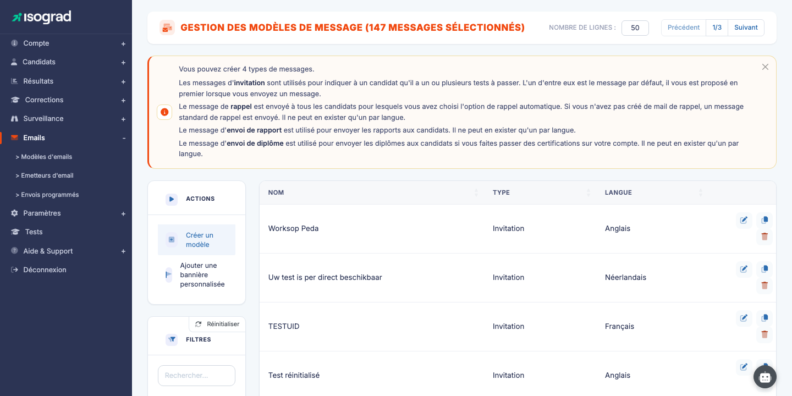
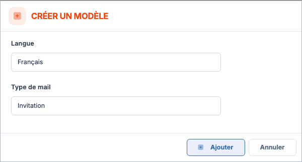
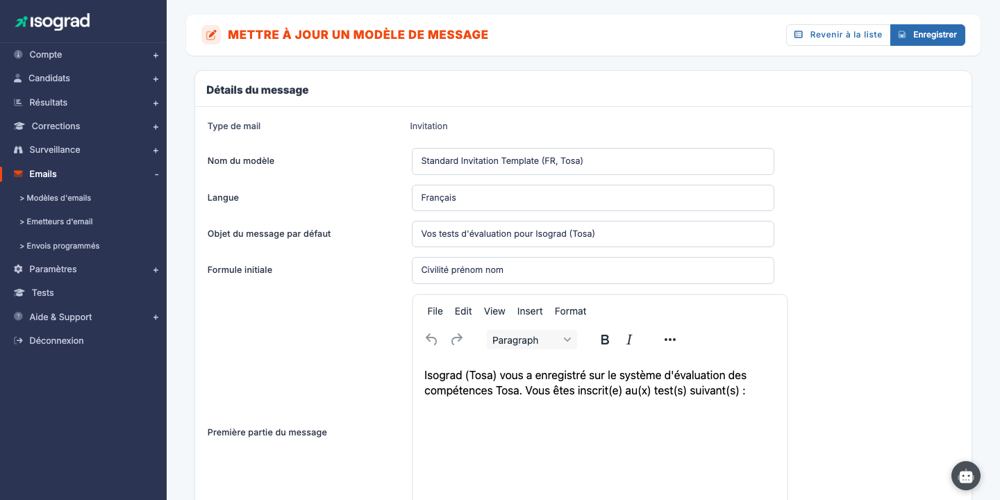
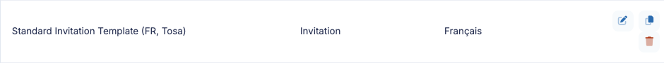
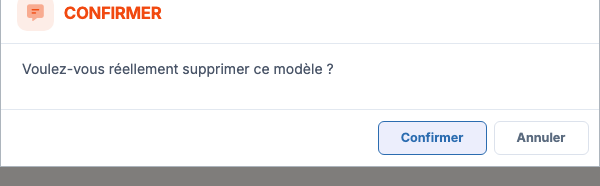
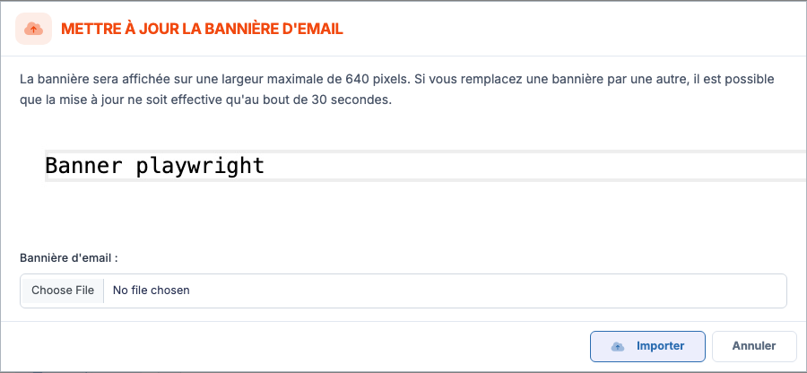
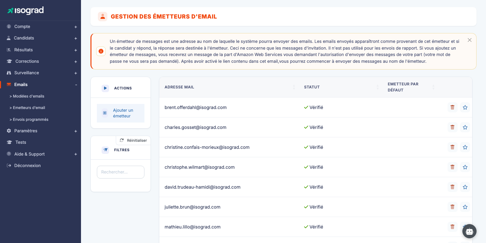
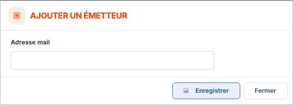
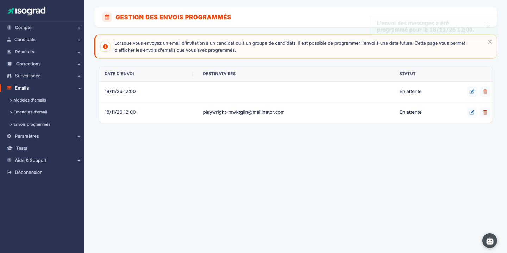
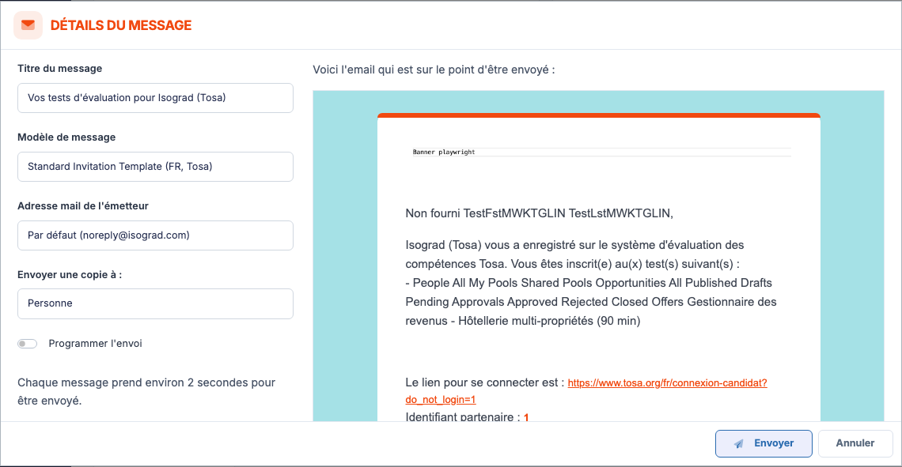

# Gestion des emails

Ce chapitre couvre tout ce qui concerne les emails envoyés depuis votre compte aux candidats : les **modèles de message** que vous personnalisez, les **émetteurs** (adresses d'expédition vérifiées), les **envois programmés** et la **bannière personnalisée** qui s'affiche en en-tête de vos emails.

Accédez à ces pages via le menu **Emails** : **Modèles d'emails**, **Emetteurs d'email** et **Envois programmés**. Les deux dernières entrées, ainsi que les boutons de création, dépendent de vos privilèges d'administrateur.

La page **Gestion des modèles de message** liste vos modèles d'email. Chaque ligne indique le **nom** du modèle, son **type** (Invitation, Relance, Envoi de rapport, Envoi de diplôme) et sa **langue** ; un clic sur l'en-tête d'une colonne trie la liste, et le champ de **recherche** du panneau de filtres retrouve un modèle par son nom ou par un mot de son contenu. Les boutons d'action principaux — **Créer un modèle** et **Ajouter une bannière personnalisée** — se trouvent en haut du tableau.

## Les quatre types de modèle {#les-quatre-types-de-modele}

La plateforme reconnaît quatre types de messages, chacun ayant un déclencheur différent :

- **Invitation** — envoyé lorsque vous (ou un import) inscrivez un candidat à un test. C'est le message qui transmet au candidat ses identifiants ou son lien de connexion. Vous pouvez créer **plusieurs modèles d'invitation par langue** (par marque, par campagne, par client). L'un d'entre eux est désigné comme **modèle par défaut** et est proposé en premier dans la fenêtre d'envoi.
- **Relance** — envoyé automatiquement aux candidats qui n'ont pas terminé leur test, si l'option de relance automatique est activée pour leur inscription. Un seul modèle de relance par langue.
- **Envoi de rapport** — utilisé pour transmettre les rapports de résultats aux candidats. Un seul modèle par langue.
- **Envoi de diplôme** — utilisé pour envoyer les diplômes aux candidats lorsque vous faites passer des certifications. Un seul modèle par langue.

> 💡 **Modèles standard** — Si vous n'avez créé aucun modèle pour un type donné, la plateforme envoie un message standard intégré. Vous n'êtes donc jamais bloqué : créer des modèles permet de **personnaliser** le contenu, pas de l'**autoriser**.

## Créer un modèle d'email {#creer-un-modele-d-email}

### Procédure

1. Depuis la page **Gestion des modèles de message**, cliquez sur **Créer un modèle** dans la barre d'actions.

    

2. Choisissez la **Langue** du modèle, puis son **Type de mail** dans la liste déroulante. Seuls les types **encore disponibles pour la langue choisie** sont proposés, et la liste se met à jour quand vous changez de langue : par exemple, si vous avez déjà créé un modèle de Relance en français, le type "Relance" n'apparaîtra plus pour le français.

3. Cliquez sur **Ajouter**. La plateforme crée le modèle, pré-rempli avec le contenu du message standard correspondant, et vous amène directement sur sa page d'édition.

    

### Champs du modèle

La page d'édition est organisée en deux cartes empilées : **Détails du message** (le formulaire, capture ci-dessus) puis **Visualisation du message** (aperçu du mail tel qu'il sera reçu) en dessous. Le bouton **Enregistrer** se trouve dans la barre en haut de la page, avec **Revenir à la liste** et, lorsque vous venez de la liste, les boutons **Précédente** et **Suivante** pour passer au modèle voisin.

Les champs principaux, communs à tous les types :

- **Type de mail** — rappel du type du modèle, non modifiable.
- **Nom du modèle** — libellé interne pour vous repérer dans la liste. N'apparaît pas dans l'email envoyé.
- **Langue** — langue d'envoi. Conditionne aussi la liste des modèles disponibles dans la fenêtre d'envoi (un modèle français n'est proposé qu'aux candidats français). La langue d'un modèle de Relance, d'Envoi de rapport ou d'Envoi de diplôme ne peut pas être changée : créez un nouveau modèle dans la langue voulue.
- **Objet du message par défaut** — sujet de l'email. Reste modifiable au moment de chaque envoi.
- **Formule initiale** — phrase d'introduction (par exemple *« Cher Monsieur Dupont »*) ajoutée automatiquement en tête de message. Le contenu disponible dépend de la langue.
- **Première partie du message** — corps principal du mail, édité dans un éditeur enrichi.

Les modèles d'**Invitation** et de **Relance** comportent trois commutateurs supplémentaires :

- **Inclure la liste des tests à passer** — si activé, la plateforme insère automatiquement la liste des tests inscrits dans l'email.
- **Inclure les détails de connexion** — si activé, l'email contient le login et le mot de passe du candidat.
- **Inclure un lien de connexion à durée limitée (48h par défaut, à la place des détails de connexion)** — si activé, remplace login/mot de passe par un **lien de connexion à durée limitée**. Ces deux dernières options s'excluent : activer l'une désactive l'autre.

Pour les modèles d'**Invitation** uniquement, deux champs s'ajoutent :

- **Seconde partie du message** — texte optionnel ajouté **après** les identifiants ou le lien de connexion.
- **Partager ce modèle avec les autres administrateurs** (Oui/Non) — voir [Modèles privés et publics](#modeles-prives-et-publics) ci-dessous.

> 💡 **Aperçu** — La carte **Visualisation du message** affiche l'email tel qu'il sera reçu, avec des données factices (un candidat fictif). L'aperçu n'est pas recalculé à chaque frappe : il est mis à jour lorsque vous cliquez sur **Enregistrer**, ou sur le bouton **Actualiser l'exemple** (icône de rafraîchissement dans l'en-tête de la carte), qui n'enregistre rien.

> ⚠️ **Modèle en lecture seule** — Si vous ouvrez un modèle que vous n'avez pas le droit de modifier, le formulaire est remplacé par le message *« Vous n'êtes pas le propriétaire de ce modèle. Vous pouvez uniquement le visualiser. »* ; seul l'aperçu reste affiché.

### Balises dynamiques

Pour le modèle **Envoi de diplôme**, des **balises** (« merge tags »), rappelées sur la page d'édition au-dessus du texte du message, sont disponibles pour insérer dynamiquement le nom du test, le sujet, la date, le score, ainsi qu'un bouton LinkedIn de partage :

| Balise | Valeur insérée |
|---|---|
| `[tst_des]` | Le nom du test |
| `[sbj_des]` | Le nom du sujet |
| `[com_dat]` | La date du test |
| `[hst_sco]` | Le score obtenu |
| `[linkedin]` | Bouton LinkedIn |
| `[social_url]` | Lien de partage sur les réseaux sociaux |

Dans les modèles d'Invitation et de Relance, la liste des tests, les identifiants et le lien de connexion sont insérés par les commutateurs correspondants — vous n'avez rien à insérer manuellement.

## Modèles privés et publics {#modeles-prives-et-publics}

Cette distinction concerne uniquement les modèles d'**Invitation**. Le réglage **Partager ce modèle avec les autres administrateurs** (Oui/Non) détermine qui peut voir et utiliser votre modèle :

- **Modèle privé** (Non) — seul vous et les administrateurs disposant du privilège *Lecture/écriture de tous les modèles* le voient dans la liste. Les autres administrateurs de votre compte ne peuvent ni le sélectionner dans la fenêtre d'envoi, ni le modifier.
- **Modèle public** (Oui) — visible et utilisable par tous les administrateurs de votre compte. Seul vous (ou un administrateur avec le privilège *Lecture/écriture de tous les modèles*) pouvez le **modifier**.

> 💡 **À quoi cela sert ?** — Cette distinction permet par exemple à un responsable formation de préparer son propre modèle d'invitation pour une campagne, sans le voir détourné ou modifié par d'autres administrateurs.

Les modèles de **Relance**, **Envoi de rapport** et **Envoi de diplôme** sont toujours partagés à l'échelle du compte — ils n'ont pas de réglage public/privé.

## Dupliquer un modèle {#dupliquer-un-modele}

La duplication est utile pour créer une variante d'un modèle existant (autre langue, autre ton, autre marque) sans repartir de zéro.

1. Sur la page **Gestion des modèles de message**, repérez le modèle à dupliquer dans le tableau. La duplication n'est disponible que pour les modèles d'**Invitation**.

    

2. Cliquez sur l'icône **Dupliquer** en bout de ligne.

3. La plateforme crée immédiatement une copie avec le **même nom, la même langue, le même objet, le même contenu et les mêmes options d'inclusion**, et vous amène sur sa page d'édition.

4. Modifiez le nom (et la langue si nécessaire) pour distinguer la copie de l'original, puis enregistrez.

Le modèle dupliqué appartient à l'administrateur qui a cliqué. Le réglage de partage n'est pas repris de l'original : vérifiez **Partager ce modèle avec les autres administrateurs** avant d'enregistrer.

## Supprimer un modèle {#supprimer-un-modele}

1. Dans la liste, cliquez sur l'icône **Supprimer** au bout de la ligne. Le modèle d'**Invitation par défaut** intégré à la plateforme n'a pas de bouton de suppression : il est protégé.

2. Une fenêtre de confirmation s'affiche (*« Voulez-vous réellement supprimer ce modèle ? »*).

    

3. Validez. Le modèle est supprimé. Vous ne pouvez supprimer que vos propres modèles, sauf si vous disposez du privilège *Lecture/écriture de tous les modèles* ; dans le cas contraire, la suppression est refusée avec le message *« Ce modèle de message ne vous appartient pas. »* Les emails déjà envoyés ne sont **pas** affectés ; seuls les futurs envois ne pourront plus utiliser ce modèle.

## Ajouter une bannière personnalisée {#ajouter-une-banniere-personnalisee}

La bannière est une image (logo, en-tête de marque) affichée **en haut de tous les emails** envoyés depuis votre compte, quel que soit le modèle.

### Procédure

1. Sur la page **Gestion des modèles de message**, cliquez sur **Ajouter une bannière personnalisée** dans la barre d'actions. Ce bouton n'est proposé qu'aux administrateurs autorisés à modifier les paramètres du compte.

    

2. La fenêtre **Mettre à jour la bannière d'email** affiche la bannière actuelle. Dans le champ **Bannière d'email**, sélectionnez un fichier image (JPG, PNG ou GIF). **Taille maximale : 2 Mo.**

3. Cliquez sur **Importer**. La bannière est mise en place pour tous les modèles du compte.

> ⚠️ **Fonctionnalité soumise à abonnement** — Si la bannière personnalisée n'est pas incluse dans votre abonnement, la fenêtre affiche à la place *« L'accès à cette fonctionnalité n'est pas inclus dans votre abonnement. Veuillez contacter votre gestionnaire de compte pour plus d'informations. »* Le même message apparaît dans la fenêtre d'ajout d'un émetteur lorsque cette fonctionnalité n'est pas incluse.

> ⚠️ **Délai de mise à jour** — Si vous remplacez une bannière existante par une autre, le changement peut mettre **jusqu'à 30 secondes** à devenir effectif (à cause du cache CDN).

> 💡 **Largeur d'affichage** — La bannière est affichée sur **640 pixels de largeur maximale**. Préparez votre fichier dans ce gabarit pour un rendu net.

La bannière s'applique à **tous les types** de messages (Invitation, Relance, Envoi de rapport, Envoi de diplôme) : elle ne se règle pas par modèle.

## Émetteurs d'email {#emetteurs-d-email}

Un **émetteur** est l'adresse email à partir de laquelle la plateforme envoie vos messages d'invitation. Vos candidats verront cette adresse comme expéditeur ; s'ils répondent au mail, leur réponse arrivera directement à cette adresse.

> 💡 **Périmètre** — Les émetteurs sont **uniquement** utilisés pour les **invitations**. Les envois de rapport et de diplôme partent d'une adresse système et ne sont pas affectés par ce réglage.

### Pourquoi vérifier un émetteur ?

Pour pouvoir envoyer des emails à des dizaines de candidats au nom de votre adresse, la plateforme s'appuie sur Amazon Web Services (AWS SES). AWS exige une **autorisation explicite du titulaire** de l'adresse — c'est un mécanisme anti-spam : on ne peut pas envoyer en se prétendant être quelqu'un d'autre.

### Ajouter un émetteur

1. Accédez à la page **Gestion des émetteurs d'email** via le menu **Emails → Emetteurs d'email**.

    

2. Cliquez sur **Ajouter un émetteur**.

3. Saisissez l'adresse email à utiliser comme expéditeur dans le champ **Adresse mail**, puis cliquez sur **Enregistrer**. Une adresse au format invalide, ou déjà enregistrée comme émetteur (sur votre compte ou sur un autre), est refusée.

    

4. **Vous (ou le propriétaire de cette adresse) recevrez un email d'AWS** demandant l'autorisation d'envoyer des messages au nom de cette adresse. **Aucun mot de passe ne sera demandé.**

5. Cliquez sur le lien d'activation contenu dans cet email. Vous disposez de **24 heures** pour le faire — au-delà, il faudra renouveler la demande.

6. Tant que le lien n'a pas été activé, l'émetteur apparaît dans la liste avec le statut **En attente**. Une fois la confirmation effectuée, il passe en statut **Vérifié** : il est alors prêt à être utilisé et peut être choisi dans la fenêtre d'envoi.

### Émetteur par défaut

Vous pouvez disposer de plusieurs émetteurs vérifiés (par exemple, un par marque ou par service). L'un d'entre eux peut être désigné comme **émetteur par défaut** — c'est lui qui est présélectionné dans la fenêtre d'envoi et utilisé quand aucun autre n'est précisé.

- Pour désigner un émetteur comme défaut, cliquez sur l'**étoile** au bout de la ligne, puis confirmez. L'étoile n'est proposée que pour les émetteurs vérifiés.
- L'étoile devient pleine et une coche apparaît dans la colonne **Emetteur par défaut**. Un seul émetteur peut être par défaut : en désigner un autre remplace le précédent.
- Pour qu'il n'y ait plus d'émetteur par défaut, cliquez sur l'étoile pleine de l'émetteur concerné (**Supprimer comme expéditeur par défaut**), puis confirmez.

### Supprimer un émetteur

1. Cliquez sur l'icône **Supprimer** au bout de la ligne de l'émetteur.
2. Confirmez. L'émetteur est retiré ; la plateforme n'enverra plus d'emails à partir de cette adresse.

> ⚠️ **Adresse déjà utilisée** — Une même adresse ne peut être émetteur que d'un seul compte : si elle est déjà enregistrée, l'ajout est refusé avec le message *« Cet email est utilisé comme expéditeur par un autre compte »*.

## Envois programmés {#envois-programmes}

Lorsque vous envoyez un email d'invitation à un candidat ou à un groupe, la fenêtre d'envoi vous offre l'option **Programmer l'envoi** à une date future. Tous ces envois différés s'accumulent dans la **file d'envois programmés**, où vous pouvez les consulter, en modifier la date ou les annuler avant qu'ils ne partent.

### Consulter la file

Accédez à la page **Gestion des envois programmés** via le menu **Emails → Envois programmés**. Elle présente les envois programmés par les administrateurs de votre compte, classés par date d'envoi, la plus lointaine en premier.

Chaque ligne indique :

- La **date d'envoi** prévue.
- Les **destinataires** — cinq adresses au plus sont affichées en clair, suivies d'un *« + X autre(s) »* si l'envoi concerne davantage de candidats.
- Le **statut** : **En attente** (l'envoi n'a pas encore eu lieu) ou **Envoyé** (l'envoi est parti).

### Modifier la date d'un envoi

Cliquez sur l'icône **crayon** en bout de ligne d'un envoi en attente. La fenêtre **Modifier la date d'envoi** permet de saisir une nouvelle date et heure. Cliquez sur **Enregistrer** : l'envoi reste programmé pour la nouvelle date.

### Annuler un envoi

Cliquez sur l'icône **Supprimer** en bout de ligne. L'envoi est retiré de la file et **ne partira pas**. Les emails déjà partis (statut **Envoyé**) ne peuvent pas être rappelés.

> ⚠️ **Pas de confirmation** — La suppression d'un envoi programmé est immédiate : aucune fenêtre de confirmation ne s'affiche.

> 💡 **Durée d'envoi** — Comptez environ **2 secondes par message**. Un envoi à un groupe de 500 candidats prend donc environ 17 minutes à se diffuser. C'est pourquoi la programmation est utile : vous pouvez par exemple programmer un envoi de masse en dehors des heures ouvrées.

## Envoyer un email à un candidat {#envoyer-un-email-a-un-candidat}

Une fois vos modèles configurés, l'envoi à un candidat se fait depuis la page de ses tests :

1. Ouvrez la page des tests du candidat depuis la liste **Gestion des candidats**.
2. Cliquez sur le bouton **Envoyer les tests au candidat**.
3. Dans la fenêtre **Détails du message** qui s'ouvre, les réglages sont à gauche et l'aperçu de l'email sur le point d'être envoyé à droite :

    

    - Choisissez le **Modèle de message** parmi ceux disponibles pour la langue du candidat ; l'aperçu se met à jour.
    - Le **Titre du message** (l'objet de l'email) se pré-remplit depuis le modèle ; vous pouvez le modifier ponctuellement pour cet envoi.
    - Si votre compte dispose d'au moins un émetteur vérifié, choisissez l'**Adresse mail de l'émetteur** : l'adresse par défaut de la plateforme ou l'un de vos [émetteurs](#emetteurs-d-email).
    - Optionnellement, choisissez dans **Envoyer une copie à** l'administrateur de votre compte qui recevra une copie.
    - Pour différer l'envoi, activez **Programmer l'envoi** et saisissez la **Date d'envoi** souhaitée. L'envoi rejoindra la [file des envois programmés](#envois-programmes).

    Si des tests ont déjà été envoyés par mail au candidat, la fenêtre les rappelle avec leur date d'envoi.

4. Cliquez sur **Envoyer**. Si l'envoi est immédiat, le candidat reçoit son email dans les secondes qui suivent.

Pour envoyer en masse, sélectionnez les candidats (ou un groupe) dans la liste **Gestion des candidats**, puis utilisez dans le menu des actions de groupe l'entrée **Envoyer les emails d'inscription à tous les candidats…** — la même fenêtre s'ouvre, avec en plus un choix de **Langue**, et une confirmation indiquant le nombre de messages vous est demandée avant l'envoi.

