# Éditeur de questions

L'**éditeur de questions** est l'outil le plus utilisé du module Questions — c'est ici qu'on écrit les énoncés, qu'on définit les options de réponse, qu'on ajoute les illustrations et aides visuelles, et qu'on tague chaque question dans la cartographie de compétences. Tout administrateur qui produit du contenu pour la plateforme passe la majorité de son temps sur cette page.

Accédez à l'éditeur via l'icône **Modifier** (crayon) sur la ligne d'une question dans la page **[Questions](/ai/fr/question-module/questions/)**, ou en cliquant sur **Ajouter une question** sur cette même page.

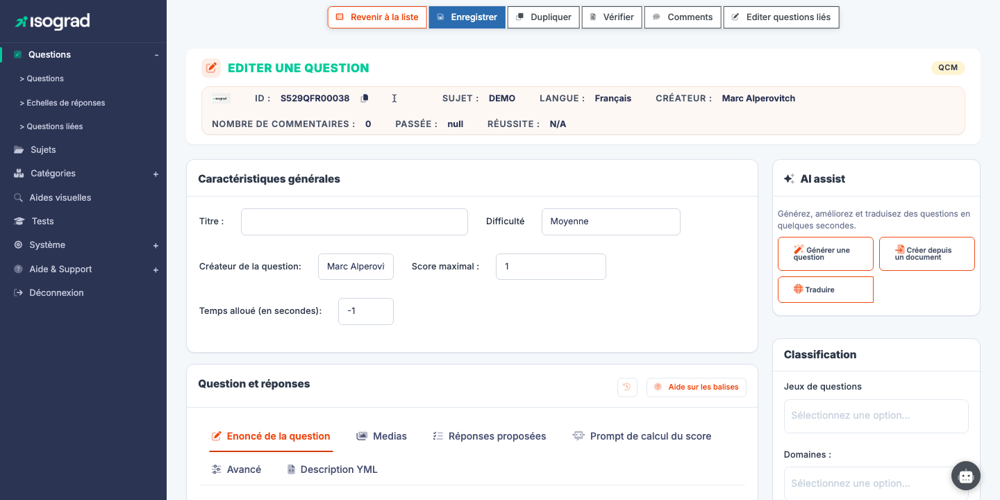

> 💡 **Type de réponse et interface** — L'éditeur **adapte son interface** au **type de réponse** de la question. Une question QCM affichera une zone de saisie de propositions ; une question glisser-déposer aura un éditeur d'items à glisser ; une question à soumission manuelle aura une grille d'évaluation. Ce chapitre couvre l'organisation commune **et** les spécificités par type.

## Vue d'ensemble {#vue-d-ensemble}

La page d'édition (titre **Éditer une question**) est organisée en plusieurs zones, avec un badge en haut indiquant le **type de réponse** de la question courante (QCM, Cliquer sur zone, etc.) :

1. **Barre d'outils** (au-dessus de l'en-tête) :
    - **Précédente** / **Suivante** — passe à la question précédente ou suivante de la liste courante sans repasser par celle-ci.
    - **Revenir à la liste** — retour à la page Questions, qui se réaffiche avec ses filtres, son tri et sa page conservés.
    - **Enregistrer** — sauvegarde toutes les modifications.
    - **Dupliquer** — crée une copie de la question.
    - **Vérifier** — lance le diagnostic éditorial sur cette question (titre vide, énoncé manquant, options non marquées correctes, etc.).
    - **Comments** — ouvre la liste des commentaires laissés par les candidats sur cette question pendant les tests ; l'icône **Supprimer** (corbeille) en fin de ligne retire un commentaire.
    - **Aperçu** — ouvre la question telle qu'un candidat la verra.
    - **Déverrouiller** — affiché sur une question au statut *Production* aux administrateurs disposant du privilège adéquat ; repasse la question *En rédaction* en un clic (voir [Enregistrer, prévisualiser, supprimer](#actions-finales)).

2. **Bandeau d'identité** :
    - Icône du sujet + **ID** (par exemple `S12Q0042`) avec un bouton **Copier**.
    - **Sujet**, **Langue**, **Créateur** (administrateur qui a créé la question).
    - **Nombre de commentaires**, **Passée** (nombre de passages), **Réussite** (taux de succès).

3. **Section « Caractéristiques générales »** :
    - **Titre**.
    - **Difficulté** — *Facile*, *Moyenne* ou *Difficile*, fixée par l'auteur. Affichée dans la liste des questions et utilisée à la composition des tests.
    - **Créateur de la question** (personne créditée pour la question, distincte du créateur affiché dans le bandeau).
    - **Score maximal** (par défaut 1).
    - **Temps alloué** (en secondes ; `-1` signifie « pas de limite »).

4. **Section « Question et réponses »** — c'est le cœur de l'édition, organisé en onglets (voir [Onglets de l'édition](#onglets-edition)).

5. **Section « Explications concernant la solution »** — le tutoriel et l'indication associés à la question (voir [Tutoriel et indication](#tutoriel)).

6. **Bloc « Informations de revue »** — le **Statut** de la question et la **Personne concernée**, plus un fichier et des commentaires pour les échanges de relecture entre auteurs. Les commentaires sont répartis en deux onglets : **Commentaires** (en cours) et **Anciens commentaires**.

7. **Volet « AI assist »** sur la droite, si les fonctionnalités d'IA sont activées sur votre compte — boutons de génération par IA (voir [Génération par IA](#generation-ia)).

8. **Volet « Classification »** sur la droite — jeux de questions et domaines de rattachement de la question.

> 💡 **Tout sur une seule page** — Contrairement à d'autres entités de la plateforme, l'éditeur ne navigue pas entre plusieurs pages. Toutes les modifications se font ici et sont enregistrées en un clic via le bouton **Enregistrer** en haut.

## Onglets de l'édition de la question {#onglets-edition}

La section **Question et réponses** est organisée en onglets propres au contenu de la question :

| Onglet | Contenu |
|---|---|
| **Énoncé de la question** | Le texte affiché au candidat (éditeur de texte enrichi). |
| **Medias** | Illustration, documents de référence, fichiers média et génération audio attachés à l'énoncé. Pour générer un fichier audio, saisissez le texte à lire et choisissez une **voix** parmi celles disponibles pour la langue de la question. |
| **Onglets propres au type** | Propositions de réponse ou paramètres propres au type — par exemple *Détails des soumissions* et *Grille d'évaluation* pour une soumission manuelle, *Zones de saisie* et *Zone de réponse* pour des zones de texte à correction automatique. Voir les sections par type. |
| **Prompt de calcul du score** | Pour les QCM, les questions psychométriques et les textes avec listes déroulantes uniquement : décrivez en langage naturel une règle de calcul du score particulière, et l'IA génère le calcul correspondant. |
| **Avancé** | Options avancées : **Réponse obligatoire dans les tests avec navigation** et, pour les questions où le candidat saisit du texte, **Verrouiller le copier/coller et la sélection**. |

Deux boutons d'aide en haut à droite de cette section :

- **Historique** (icône horloge) — historique des modifications de la question.
- **Aide sur les balises** — référence des balises de mise en forme disponibles dans l'éditeur.

> 💡 **Onglet Description YML** — Une vue YAML brute de la question existe pour quelques types de réponse (par exemple Trier). Pour les autres types elle n'est pas affichée : utilisez **Exporter en YML** sur la page Questions pour obtenir le YAML de vos questions.

## Champs communs à tous les types {#champs-communs}

### Métadonnées

- **Sujet** — sujet auquel la question est rattachée. Fixé à la création.
- **Domaines** — domaine(s) de compétence évalué(s), dans le volet **Classification**. Pour la cartographie du rapport candidat.
- **Jeux de questions** — les jeux auxquels la question appartient (voir [Jeux de questions](/ai/fr/question-module/question-sets/)), dans le volet **Classification**.
- **Statut** — *En rédaction*, *Production*, etc., dans le bloc de revue. Détermine si la question peut être posée aux candidats.
- **Personne concernée** — administrateur en charge de la question, dans le bloc de revue.
- **Langue** — fixée à la création, non modifiable. Une question = une langue.

### Titre

Le **Titre** est un libellé court qui apparaît dans la colonne *Titre* de la liste et dans les rapports de compétences : il représente la compétence testée dans la question. **Pas affiché au candidat.** Choisissez un titre **descriptif et unique** : *« Faire une somme »* est meilleur que *« Excel - question 17 »*.

### Texte de la question

Le **Texte** est l'énoncé affiché au candidat. Vous le saisissez dans un éditeur riche qui supporte :

- **Markdown** — gras, italique, listes, liens, blocs de code. Le rendu est immédiat dans la prévisualisation.
- **Formatage HTML** pour les cas avancés (tableaux, classes CSS spécifiques).
- **Insertion d'aides visuelles** via la zone de recherche dédiée (voir [Aides visuelles](#aides-visuelles)).
- **Insertion d'illustrations directes** (image à la question — voir [Illustration](#illustration)).

> 💡 **Format Markdown vs HTML** — Privilégiez Markdown pour l'écriture courante. Réservez le HTML aux cas où Markdown ne suffit pas (tableaux complexes, mise en forme spécifique).

### Illustration {#illustration}

Une **illustration** est un média attaché **directement à la question** (par opposition à une aide visuelle, qui peut être partagée entre plusieurs questions). C'est l'image, le son ou la vidéo qui accompagne l'énoncé.

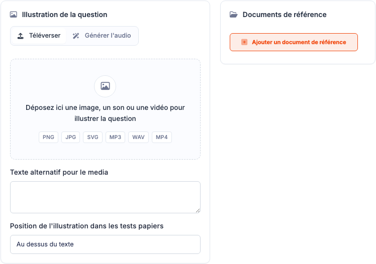

- Pour **ajouter** une illustration, déposez dans la zone prévue une image, un son ou une vidéo, ou cliquez sur le bouton d'upload pour choisir votre fichier.
- Pour **modifier** le texte alternatif (alt text), saisissez-le dans le champ dédié — important pour l'accessibilité et pour les lecteurs d'écran.
- **Ne jouer le media qu'une seule fois** — pour un son ou une vidéo, empêche le candidat de le rejouer.
- **Position de l'illustration dans les tests papiers** — *au-dessus*, *à droite* ou *en dessous* du texte. Proposé pour les types de question utilisables dans un [examen papier](/ai/fr/question-module/test-forms/#examens-papier).
- Pour **supprimer** l'illustration, cliquez sur le bouton **Supprimer le média**.

> 💡 **Quand illustration, quand aide visuelle ?** — Une **illustration** est propre à la question, idéale pour une image jamais réutilisée. Une **[aide visuelle](/ai/fr/question-module/visual-aids/)** est mutualisée entre plusieurs questions, idéale pour un tableau Excel ou un code source partagé sur 10 questions du même module.

### Tutoriel et indication {#tutoriel}

La section **Explications concernant la solution** comporte deux onglets :

- **Tutoriel** — l'explication affichée au candidat **après** sa réponse, en mode de révision. C'est le moment pédagogique : expliquer pourquoi la bonne réponse est la bonne, comment l'identifier, quelle erreur courante éviter.
- **Indication** — un indice affiché dans le cadre de la question, pour aider le candidat pendant qu'il répond.

Le format est identique à celui du texte de la question.

### Aides visuelles {#aides-visuelles}

Vous pouvez insérer une ou plusieurs **aides visuelles** dans l'énoncé ou dans les réponses. Voir le chapitre [Aides visuelles](/ai/fr/question-module/visual-aids/) pour la création et la gestion. Dans l'éditeur de question :

- Saisissez au moins trois caractères du nom de l'aide visuelle dans la zone de **recherche d'aides visuelles** à droite.
- Choisissez l'aide visuelle dans les résultats, filtrés par le sujet et la langue de la question.
- La balise de référence est insérée dans le texte. Le rendu à l'affichage candidat sera l'image ou le document complet.

Trois variantes existent :

- **Document de référence** — document directement intégré dans la question ou sous forme d'un lien (option à activer en cochant **Afficher le document de référence de type PDF sous forme de lien**).
- **Aide visuelle affichée par un clic** — image qui apparaît sous une loupe (dans l'énoncé ou dans les réponses).
- **Aide visuelle affichée dans le texte** — image présentée comme un encart, généralement plus petite, typiquement pour les questions de touches clavier ou d'interface.

## Génération par IA {#generation-ia}

L'éditeur propose un volet latéral **AI assist** à droite de la page, lorsque les fonctionnalités d'IA sont activées sur votre compte. Sur une question qui vient d'être créée, il comporte :

- **Générer une question** — propose un énoncé complet (texte, propositions de réponse, bonne réponse) à partir des métadonnées de la question (sujet, domaine, titre). Proposé pour les types de réponse qui supportent la génération. La génération renseigne aussi le champ **Difficulté** avec le niveau suggéré par l'IA ; vous pouvez le modifier avant d'enregistrer.
- **Créer depuis un document** — pour les types de question utilisables dans un examen papier. Collez ou choisissez une image ou un PDF (PNG, JPEG, WEBP, GIF ou PDF, 5 Mo au maximum) contenant **une seule question**, ajoutez éventuellement des consignes : l'IA en tire l'énoncé et les réponses.
- **Traduire** — traduit le contenu de la question vers une autre langue, utile pour décliner rapidement un sujet en plusieurs versions linguistiques.

Une fois la question enregistrée une première fois, d'autres boutons apparaissent :

- **Améliorer la question** — reformule et resserre l'énoncé et les propositions existants.
- **Générer un titre** — propose un titre à partir de l'énoncé.
- **Obsolescence** — évalue si le contenu de la question risque d'être dépassé.
- **Générer un tutoriel** — rédige l'explication affichée au candidat après sa réponse.

Pour les questions de [correction automatique de document](#upload-auto-grading) notées par un script, les boutons **Générer le code de vérification** et **Améliorer le code de vérification** rédigent ou retravaillent ce script à partir de l'énoncé.

> ⚠️ **L'IA propose, vous décidez** — Le contenu généré est un **point de départ**, pas un livrable final. Relisez systématiquement et corrigez avant d'enregistrer : la sortie de l'IA remplace les champs à l'écran mais n'est enregistrée qu'au clic sur **Enregistrer**. La qualité dépend du modèle d'IA choisi dans le menu **Système → Sélectionner une IA**.

## Types de réponse — vue d'ensemble {#types-de-reponse}

La plateforme propose une gamme de types de réponse, regroupables en familles. La liste exacte proposée à la création d'une question dépend de la configuration de votre plateforme.

| Famille | Types | Cas d'usage |
|---|---|---|
| **Choix multiple** | QCM texte, échelle de réponse | Évaluation classique des connaissances. |
| **Choix de réponse** | Texte à compléter avec listes déroulantes | Quand la saisie libre serait ambiguë à corriger. |
| **Questions interactives** | Glisser-déposer, Trier, Relier, Cliquer sur zone | Tests interactifs et engageants. |
| **Questions de saisie** | Zones de texte à correction automatique (réponse attendue ou IA), Dictée, Soumission manuelle | Évaluation de connaissances ou mises en situation. |
| **Correction automatique de document ou d'audio** | Soumission avec notation automatique | Soumission de fichiers évalués par IA. |
| **Spécifiques** | Page de transition | Cas particuliers (page entre deux parties d'un test). |

Les sections suivantes détaillent les types **les plus courants**.

## QCM — choix multiple texte {#qcm}

Le type **QCM texte** est le type le plus utilisé sur la plateforme. Le candidat voit une question et plusieurs propositions de réponse, parmi lesquelles **une ou plusieurs** sont correctes.

### Édition des propositions

L'éditeur QCM expose une liste de propositions, chacune avec :

- Un champ **texte de la proposition**.
- Une case à cocher **Correcte** indiquant si la proposition est une bonne réponse.
- Un bouton **Supprimer cette proposition**.

Un bouton **Ajouter une réponse** en bas de la liste permet d'étendre le nombre d'options (5 est le standard recommandé).

Le sélecteur **Type de QCM** fixe la règle de réponse : **choix unique** (le candidat ne peut sélectionner qu'une réponse), **choix multiples** (il peut en sélectionner plusieurs, et doit toutes les trouver pour avoir la question juste) ou **une parmi n** (plusieurs réponses sont correctes, mais il suffit que le candidat en choisisse une).

### Options d'affichage

Trois commutateurs en haut de l'onglet des réponses :

- **Ne pas mélanger les réponses** — par défaut, les propositions sont présentées au candidat dans un **ordre aléatoire** à chaque passage. Activez l'option pour forcer un ordre fixe (par exemple pour une question logique où l'ordre des choix porte du sens).
- **Afficher les réponses en matrice** — présente les propositions en grille plutôt qu'en liste.
- **Pas de notion de bonne réponse (formulaire, test de personnalité...)** — pour les questions sans bonne ni mauvaise réponse.

## Question d'échelle (Vrai/Faux, Likert) {#question-echelle}

Le type **Échelle** présente au candidat une question accompagnée d'une **échelle de réponse** réutilisable — par exemple une échelle Likert *« Pas du tout d'accord / Plutôt pas d'accord / Plutôt d'accord / Tout à fait d'accord »*, ou une simple échelle Vrai/Faux.

### Édition

- **Sélectionnez l'échelle** dans la liste déroulante (voir [Échelles de réponse](/ai/fr/question-module/answer-scales/) pour gérer les échelles disponibles).
- L'éditeur affiche les options de l'échelle sélectionnée et vous laisse cocher la **bonne réponse** (une seule case cochée). Pour ajouter une nouvelle échelle, allez dans le menu **Questions → Echelles de réponses**, puis **Ajouter une échelle de réponses**.

> 💡 Pour les questions où la notion de bonne ou de mauvaise réponse n'existe pas, cochez l'option **Pas de notion de bonne réponse (formulaire, test de personnalité...)**.

## Zones de texte à correction automatique {#texte-a-trous}

Ce type présente au candidat une ou plusieurs **zones de saisie** — insérées dans un texte à trous ou affichées seules — dont la réponse est **notée automatiquement**, soit par comparaison à une réponse attendue, soit par l'IA.

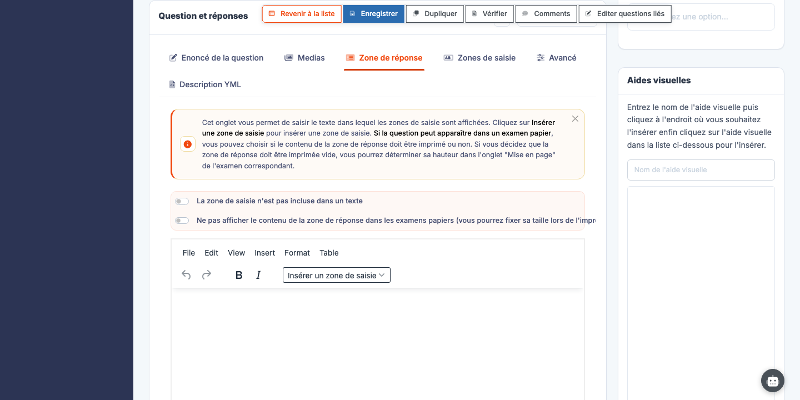

L'édition se fait en deux temps : vous créez les zones de saisie dans l'onglet **Zones de saisie**, puis vous les placez dans le texte de l'onglet **Zone de réponse**.

### Onglet « Zones de saisie »

- **Activer l'option points par zone de saisie** — par défaut, le candidat obtient le **score maximal** de la question si toutes les zones sont justes, et 0 sinon. Avec cette option, chaque zone rapporte ses propres points : le score de la question est la somme des points obtenus, et le **Score maximal** — qui n'est plus modifiable — devient la somme des points des zones.
- **Utiliser un éditeur de texte enrichi pour les zones de texte** — le candidat dispose d'une barre de mise en forme dans les zones de texte.
- **Liste des zones de saisie** — **Ajouter une zone de saisie** crée une zone. Son **nom** (lettres, chiffres, `_` et `-` uniquement, unique dans la question) sert à la placer dans le texte. L'icône **Modifier** ouvre le détail de la zone, l'icône corbeille la supprime.

### Détail d'une zone de saisie

La fenêtre **Détails de la zone de réponse** règle la manière dont la zone est présentée et notée.

**Méthode de notation** :

| Méthode | Notation |
|---|---|
| **Réponse(s) attendue(s)** | La réponse du candidat est comparée à la **Réponse attendue**. Si plusieurs réponses sont acceptées, séparez-les par `##`. |
| **Évaluée par l'IA** | L'IA note la réponse en suivant le **Prompt pour l'IA** que vous rédigez : ce qui est attendu, ce qui doit être accepté ou refusé. |
| **Langue étrangère évaluée par l'IA** | L'IA évalue un texte rédigé en langue étrangère par rapport au **niveau CEFR** attendu (A1 à C2). La zone est alors une zone de texte. |

**Type de champ** : **Champ de saisie** (une ligne), **Zone de texte** (plusieurs lignes) ou **Équation mathématique** — le candidat saisit une formule, affichée au fur et à mesure, qui est toujours notée par l'IA. Le **Type de bordure** (complète ou inférieure) règle l'aspect du champ.

Pour une **réponse attendue**, les **Options de notation** précisent la comparaison, qui par défaut ignore la casse, la ponctuation et les espaces :

- **Sensible à la casse** — les majuscules et minuscules doivent correspondre.
- **Sensible à la ponctuation** — la ponctuation doit correspondre ; l'option **Sensible aux espaces** apparaît alors.
- **Tolérance** — pour une valeur de type *Nombre*, l'écart accepté autour de la réponse attendue. La virgule et le point sont tous deux acceptés comme séparateur décimal.

Avec l'option **points par zone de saisie** :

- **Nombre de points maximum** — les points rapportés par la zone (1 par défaut).
- **Le nombre de points pour cette zone ne peut être que 0 ou le nombre de points maximum** — désactivez cette option sur une zone évaluée par l'IA pour autoriser une note intermédiaire. Une zone à réponse attendue est toujours notée tout ou rien.

Les **Contraintes de contenu** encadrent la saisie du candidat : **Type de valeur autorisée** (texte, nombre ou email), **Bulle d'aide**, **Texte d'exemple**, **Longueur maximale**, **Pattern** et, pour une zone de texte, **Nombre minimal** et **maximal de mots** — rappelés au candidat sous la zone. Une réponse vide, ou nettement plus courte que le minimum de mots, obtient 0 sans être soumise à l'IA.

### Onglet « Zone de réponse »

- L'éditeur de texte contient le texte dans lequel les zones apparaissent. Placez le curseur à l'endroit voulu et utilisez le menu d'insertion de zone de saisie de la barre d'outils pour y placer une zone par son nom.
- **La zone de saisie n'est pas incluse dans un texte** — lorsque la question ne comporte qu'une seule zone, affiche celle-ci directement sous l'énoncé, sans texte autour.
- **Ne pas afficher le contenu de la zone de réponse dans les examens papiers** — laisse un espace vierge à l'impression ; sa taille se règle dans l'[examen papier](/ai/fr/question-module/test-forms/#examens-papier).

Le bouton **Vérifier** signale une question sans zone de saisie, ou dont la zone de réponse est vide.

> 💡 **Notation par l'IA** — Lorsqu'une zone est évaluée par l'IA, le candidat voit une barre de progression pendant l'envoi de sa réponse. Rédigez un prompt précis (éléments attendus, tolérances) et testez la question via l'**Aperçu** avec des réponses justes et fausses avant de la passer en Production.

### Cadre d'utilisation : examen papier {#cadre-utilisation}

La carte **Cadre d'utilisation**, au-dessus des onglets, contient le commutateur **Cette question sera utilisée uniquement dans des examens papier**. Lorsqu'il est activé, précisez **comment le candidat répondra** :

- **Sur le sujet imprimé**, qui comporte les zones de réponse.
- **Sur une feuille séparée** du sujet — la zone de réponse est alors générée automatiquement, avec une ligne par zone de saisie.

### Texte à compléter avec listes déroulantes

Un autre type de réponse propose au candidat une **liste déroulante** plutôt qu'un champ de saisie libre. Pour chaque trou, vous définissez la liste des options et l'option correcte.

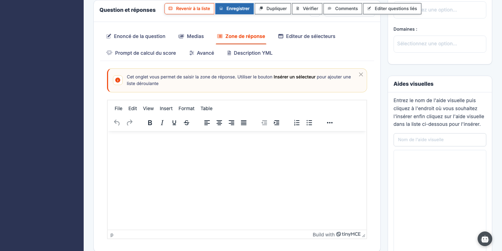

## Glisser-déposer {#drag-and-drop}

Le type **Glisser-déposer** présente au candidat des **items** à glisser-déposer dans des **zones cibles**.

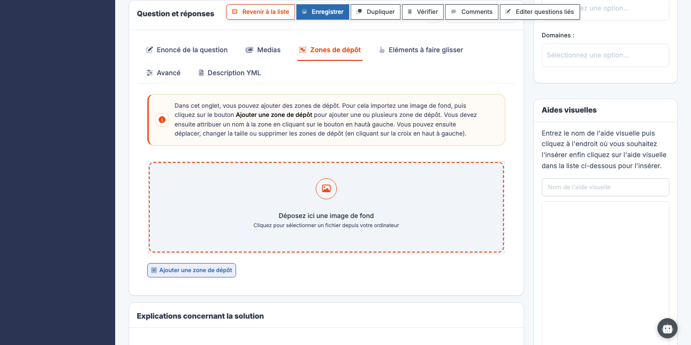

### Édition

- Définissez la liste des **items** (texte, image, ou les deux).
- Définissez les **zones cibles** dans l'illustration de fond (généralement une image avec des emplacements numérotés).
- Pour chaque item, précisez la **zone cible correcte**.

## Trier — ordonnancement {#sortable}

Le type **Trier** présente au candidat une liste d'items à **réordonner** pour les mettre dans l'ordre correct.

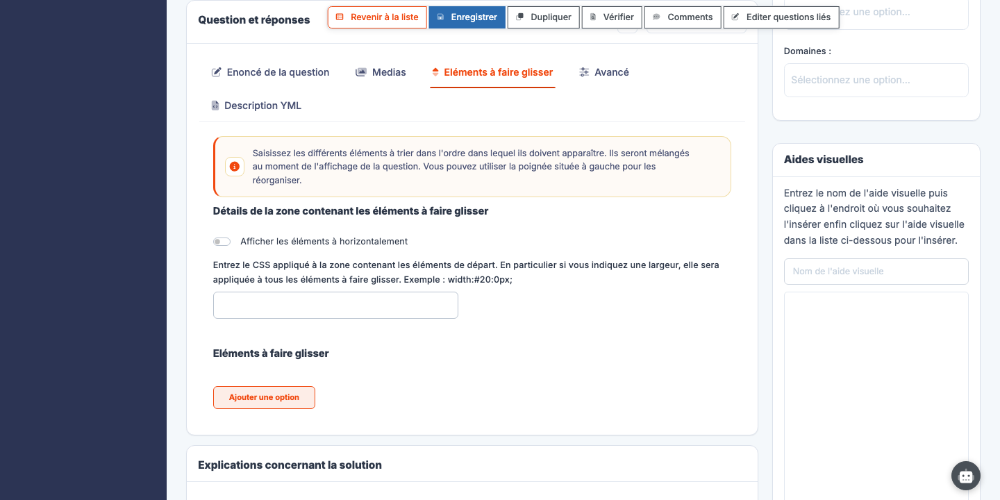

### Édition

- Définissez la liste des items dans l'ordre **correct**.
- À la présentation au candidat, ils seront automatiquement mélangés.
- Le candidat doit les remettre dans le bon ordre.

## Relier — appariement {#link}

Le type **Relier** propose au candidat deux colonnes d'items qu'il doit **apparier** par paires.

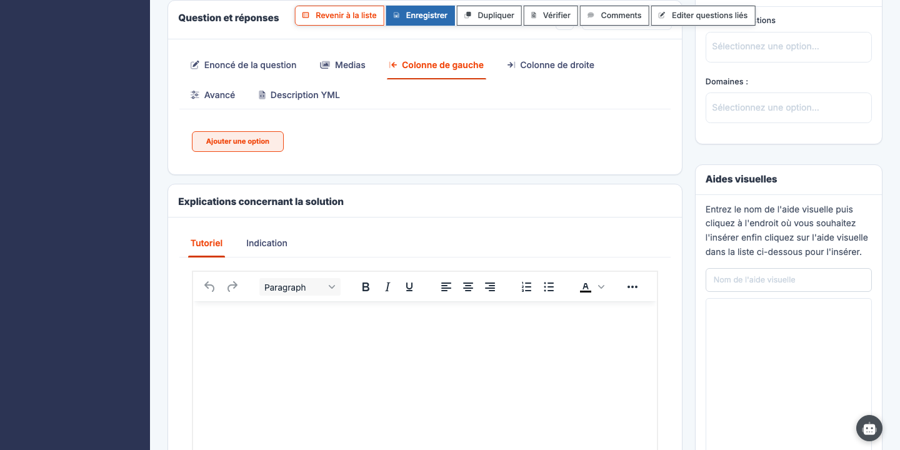

### Édition

- Définissez deux listes : la **colonne A** et la **colonne B**.
- Indiquez quelles paires sont les bonnes associations.
- Vous pouvez avoir des correspondances 1-vers-1 ou des correspondances 1-vers-plusieurs selon votre configuration.

## Cliquer sur zone {#click-in-area}

Le type **Cliquer sur zone** présente au candidat une **image** sur laquelle il doit cliquer à un endroit précis (un bouton dans une capture d'écran, une zone d'un schéma…).

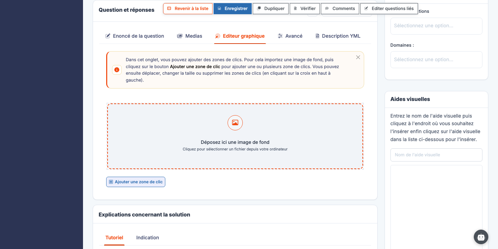

### Édition

- Téléversez l'image cible.
- Définissez la ou les **zones correctes** par coordonnées rectangulaires.
- Le candidat clique : le clic est considéré juste s'il tombe dans une zone correcte.

## Soumission manuelle {#manual-marking}

Le type **Soumission manuelle** présente au candidat une question à réponse **libre** (rédaction, document, enregistrement) qui sera **notée par un correcteur** après le test, à l'aide d'une **grille d'évaluation**.

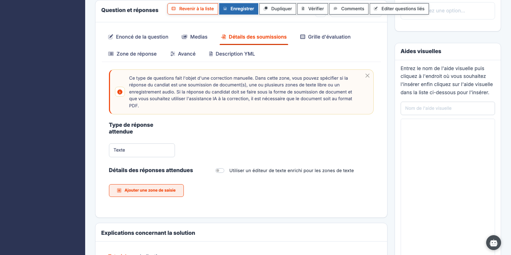

L'éditeur comporte, outre l'énoncé et les médias, les onglets **Détails des soumissions**, **Grille d'évaluation** et **Zone de réponse**.

### Onglet « Détails des soumissions »

Le sélecteur **Type de réponse attendue** fixe ce que le candidat remet :

| Type de réponse attendue | Ce que fait le candidat | Réglages |
|---|---|---|
| **Saisir un ou plusieurs textes** (par défaut) | Il répond dans une ou plusieurs zones de saisie. | **Ajouter une zone de saisie** crée une zone (nom, champ d'une ligne ou zone de texte, texte d'exemple). **Utiliser un éditeur de texte enrichi pour les zones de texte** donne au candidat une barre de mise en forme. |
| **Soumettre un ou plusieurs fichiers** | Il dépose un fichier par emplacement prévu. | **Ajouter un fichier à soumettre** crée un emplacement, avec une **description** (affichée au candidat s'il doit déposer plusieurs fichiers) et les **extensions autorisées**, séparées par des virgules. Les deux champs sont obligatoires. |
| **Enregistrer un audio** | Il s'enregistre depuis la page de la question. | — |
| **Enregistrer une vidéo** | Il se filme depuis la page de la question. | — |

> 💡 **Privilégiez le PDF** — Pour une soumission de fichier, demandez un **PDF** : le correcteur pourra annoter la copie et s'appuyer sur l'assistance de l'IA lors de la correction.

Lorsque plusieurs fichiers sont demandés, la réponse du candidat n'est complète qu'une fois tous les emplacements remplis.

### Onglet « Grille d'évaluation »

La grille liste les **critères** sur lesquels le correcteur note la réponse. **Ajouter un critère** crée une ligne avec :

- **Nom du critère** et **Description du critère** — ce que le correcteur doit évaluer.
- **Score maximal du critère** — les points attribuables.

Faites glisser les critères pour les réordonner. Le **Score maximal** de la question n'est plus modifiable : il est égal à la somme des scores des critères.

> ⚠️ **Au moins un critère** — Le bouton **Vérifier** signale une soumission manuelle sans critère d'évaluation : définissez la grille avant de passer la question en Production.

### Onglet « Zone de réponse »

Pour une réponse sous forme de **texte**, cet onglet contient le texte affiché autour des zones de saisie. Avec une seule zone, il est rempli automatiquement. Il n'est pas affiché pour les soumissions de fichier.

L'onglet **Avancé** propose, pour les réponses sous forme de texte, **Verrouiller le copier/coller et la sélection**.

### Cadre d'utilisation : examen papier

La carte **Cadre d'utilisation**, au-dessus des onglets, contient le commutateur **Cette question sera utilisée uniquement dans des examens papier**. Lorsqu'il est activé, la question attend le dépôt d'**un seul fichier PDF** — la copie scannée du candidat —, l'onglet *Détails des soumissions* disparaît et l'énoncé devient facultatif. C'est le réglage des grilles de notation créées depuis un [examen papier](/ai/fr/question-module/test-forms/#examens-papier).

### Notation

Aucun score n'est calculé pendant le test : le résultat reste en attente de correction. Le correcteur attribue ensuite des points et un commentaire à chaque critère de la grille. Voir le chapitre [Correction des copies](/ai/fr/grading/) du manuel administrateur pour le déroulement de la correction.

## Test de saisie {#typing}

Les types **Test de saisie** et **Test de saisie avec correction** évaluent la **vitesse et la précision de frappe** du candidat.

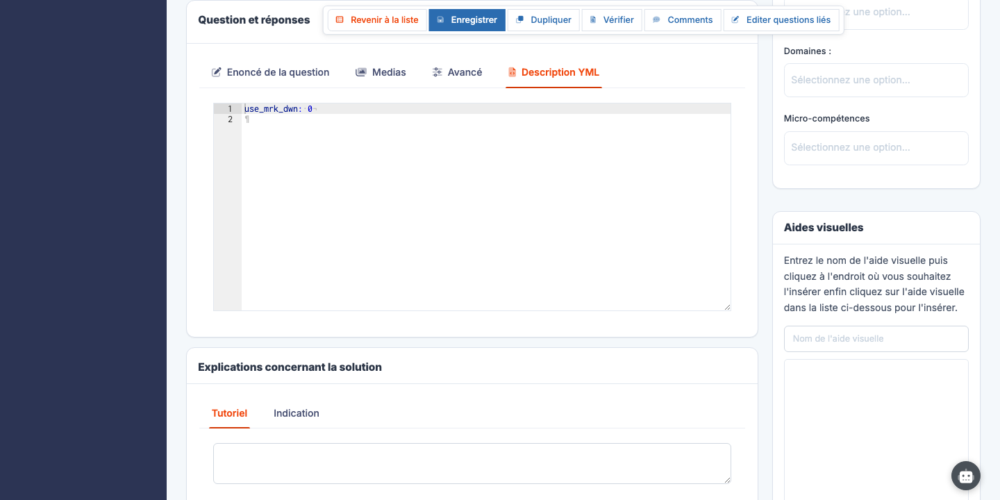

### Édition

- Saisissez le **texte de référence** que le candidat devra recopier.
- Configurez la **durée du test** (en secondes).
- Le score est calculé à partir du nombre de caractères corrects par minute, avec une pénalité pour les erreurs.

La variante **avec correction** permet au candidat de **revenir en arrière et corriger** ses erreurs ; sans correction, chaque frappe est définitive.

## Correction automatique de document ou d'audio {#upload-auto-grading}

Le type **Correction automatique de document ou d'audio** permet au candidat de **soumettre un fichier** (typiquement un document Word/Excel, une capture d'écran ou un enregistrement audio) qui est ensuite **analysé par IA** pour produire automatiquement une note.

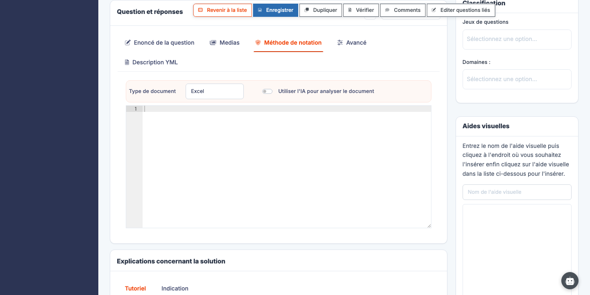

### Édition

- **Type de document** — le fichier attendu : Audio, Excel, Image, Illustrator, PDF, Photoshop, PowerBI ou Word.
- Dans l'onglet **Méthode de notation**, trois commutateurs, proposés selon le type de document :
    - **Utiliser l'IA pour analyser le document** — activé, vous rédigez en langage naturel ce que l'IA doit vérifier dans le document du candidat : *« Vérifier que le document contient un tableau avec au moins 5 lignes, que la première colonne s'appelle 'Nom', et que la mise en forme est cohérente »*. Désactivé, le document est vérifié par un **script** : les boutons **Générer le code de vérification** et **Améliorer le code de vérification** du volet AI assist le rédigent à partir de l'énoncé. Une image est toujours analysée par l'IA ; les documents Photoshop, Illustrator et PowerBI sont toujours vérifiés par un script.
    - **Utiliser une grille de notation** — remplace la consigne libre par une grille de critères, comme pour une [soumission manuelle](#manual-marking) ; le **Score maximal** devient la somme des scores des critères.
    - **Extraire le texte du document** — pour un PDF ou une image, lit le texte du document (manuscrit ou scanné) avant l'analyse.
- Pour un **audio**, un éditeur dédié remplace ces réglages : la consigne d'évaluation, la notation tout ou rien et, pour une épreuve de langue étrangère, le type d'épreuve et le niveau CEFR attendu.
- Dans l'onglet **Medias**, la carte **Document fourni au candidat** permet de joindre le fichier de départ sur lequel le candidat travaille.

> ⚠️ **Notation IA non-déterministe** — Les notes IA peuvent légèrement varier d'un passage à l'autre. Réservez ce type aux **évaluations formatives**, pas aux certifications à fort enjeu. Pour une notation rigoureuse, utilisez une **[Soumission manuelle](#manual-marking)** avec un correcteur humain.

## Sauvegarder, prévisualiser, supprimer {#actions-finales}

### Enregistrer

Le bouton **Enregistrer** en haut de l'éditeur sauvegarde l'ensemble des modifications. La sauvegarde se fait sans rechargement de page : une notification de succès apparaît en haut à droite.

> ⚠️ **Les questions en Production sont en lecture seule** — Dès que le **Statut** d'une question est passé à *Production* et enregistré, le contenu de l'éditeur devient en lecture seule : la question est posée aux candidats et doit rester stable. Seul le **bloc de revue** reste modifiable. Pour modifier la question, repassez-y son **Statut** à *En rédaction* et cliquez sur **Enregistrer** : la page se recharge déverrouillée, et la question cesse d'être posée jusqu'à son retour en *Production*. Les administrateurs disposant du privilège adéquat peuvent aussi cliquer sur **Déverrouiller** dans la barre d'outils, qui fait la même chose et leur attribue la question.

### Vérifier

Le bouton **Vérifier** lance le diagnostic éditorial de la question : titre ou énoncé vide, aucune proposition marquée correcte, média manquant, etc. Lancez-le avant de passer le statut à *Production*.

### Prévisualiser

Le bouton **Aperçu** ouvre la question telle qu'elle apparaîtra à un candidat (énoncé rendu, options affichées, illustrations chargées). C'est l'étape obligatoire avant toute mise en production : un énoncé qui semble clair en édition peut être ambigu une fois rendu côté candidat.

Sur la page d'aperçu, le **bloc de revue** s'affiche dans un volet ancré à droite, ouvert par défaut. Le bouton **Revue** de la barre d'outils le masque ou le réaffiche, et son état est mémorisé d'une prévisualisation à l'autre.

### Naviguer entre questions

Les boutons **Précédente** et **Suivante** en haut de la page permettent de passer aux questions voisines de la liste courante **sans repasser par la liste**. Pratique pour les revues éditoriales en masse.

### Supprimer

L'icône **Supprimer** sur la ligne de la question dans la liste supprime la question après confirmation. Si la suppression est refusée (par exemple parce que la question fait partie de la liste fixe de questions d'un **test**), une notification d'erreur s'affiche et vous restez sur la page ; sinon vous êtes ramené à la liste, avec ses filtres conservés, et un message de succès s'affiche.

> 💡 **Préférer le statut « À supprimer » à la suppression** — Pour retirer une question de la circulation sans perdre l'historique, **changez son statut** à *À supprimer* plutôt que de la supprimer. La question quitte la liste par défaut (un filtre permet de la réafficher), ses passages historiques restent analysables, et elle n'est plus posée aux nouveaux candidats.

## Bonnes pratiques de rédaction {#bonnes-pratiques}

- **Un énoncé court et net** — visez 3 phrases au plus pour la question. Si l'énoncé devient long, vérifiez si une **aide visuelle** ne serait pas plus claire.
- **Cinq propositions pour les QCM** — c'est le nombre qui maximise la difficulté discriminante sans surcharger cognitivement le candidat.
- **Éviter les pièges artificiels** — pas de doubles négations, pas de différences subtiles d'orthographe entre les options. Un candidat doit échouer parce qu'il ne connaît pas la réponse, pas parce qu'il a mal lu.
- **Documenter le tutoriel** — le tutoriel est la **valeur pédagogique** de la question. C'est ce qui distingue une simple évaluation d'un outil d'apprentissage.
- **Tester avant de publier** — passez la question à un collègue (ou à vous-même via l'aperçu) avant de la passer en statut *Production*. Les questions cassées en production dégradent la qualité perçue.
