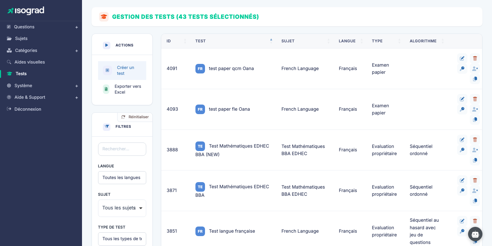
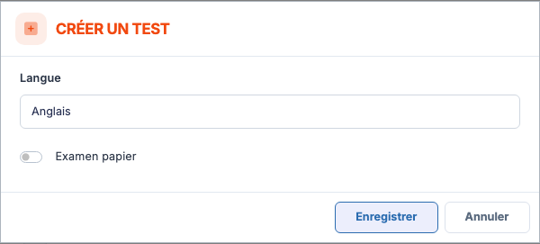
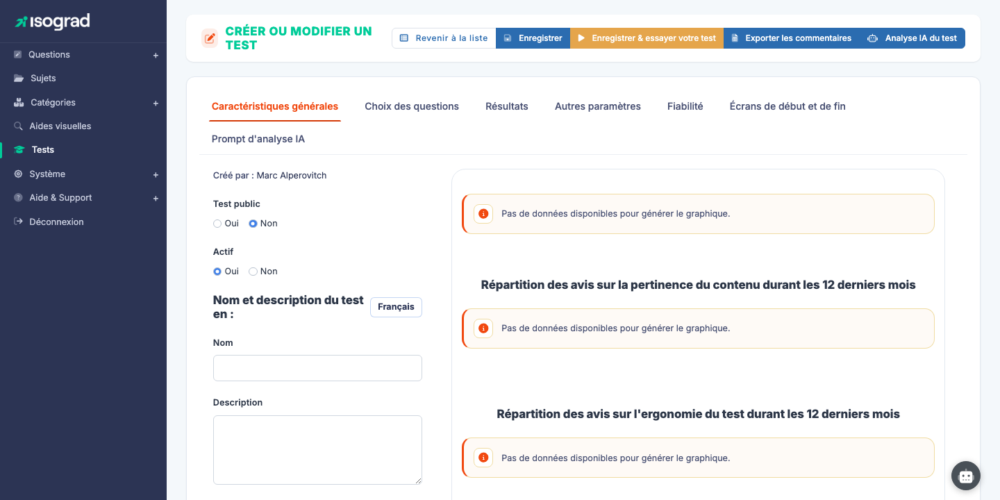

# Tests

Un **test** est l'assemblage final qui devient passable par un candidat. C'est le point de jonction où vous prenez une **sélection de questions** de votre base, choisissez l'**ordre des questions**, fixez des **paramètres** (durée, navigation, etc.), et obtenez un livrable que les administrateurs de votre compte peuvent inscrire à des candidats.

Chaque test inscrit à un candidat sur la plateforme est défini par l'un de ces tests.

Accédez à la page via le menu **Tests**. Il est affiché aux administrateurs disposant du privilège de lecture des tests.

Le tableau (titre **Gestion des tests**) liste tous les tests, avec leur **identifiant**, **nom**, **sujet**, **langue**, **type** et **algorithme**. Lorsqu'une période est renseignée dans les filtres, une colonne supplémentaire affiche le **nombre de passages** sur cette période.

Les administrateurs du **compte principal** voient l'ensemble des tests. Une ligne affichée en rouge signale un test qui ne sera pas proposé à l'inscription — voir [Tests non proposés à l'inscription](#tests-non-proposes). Les administrateurs d'un **sous-compte** (ou connectés en alias sur un compte) ne voient que les tests liés à leur propre compte — voir [Autoriser un test / Retirer l'accès](#autoriser-un-test).

## Concepts {#concepts}

### Ordre des questions

Un test fixe soit la liste exacte des questions, soit les tire au hasard au début de chaque session. C'est le paramètre **Ordre des questions** du test :

- **Ordonné** — vous choisissez les questions une à une ; chaque candidat reçoit les mêmes questions dans le même ordre.
- **Aléatoire** — vous sélectionnez une liste de questions et fixez le **nombre de questions** à poser ; chaque candidat reçoit ce nombre de questions, tirées au hasard dans la liste.

### Seules les questions en Production sont posées

Quel que soit l'ordre, un test ne peut poser que des questions au statut **Production** : le sélecteur de questions ne liste que celles-là, et le tirage aléatoire ignore les autres. Passez vos questions en Production avant de construire le test (voir l'[Éditeur de questions](/ai/fr/question-module/question-editor/#actions-finales)).

## Créer un test {#creer-un-formulaire}

La création passe par une fenêtre minimale, suivie de la page d'édition.

1. Depuis la page **Gestion des tests**, cliquez sur **Créer un test** dans la barre d'actions.

    

2. Choisissez la **langue** présentée au candidat.

3. Laissez le commutateur **Examen papier** désactivé pour un test passé à l'écran. Activez-le pour créer un examen destiné à être imprimé ou des copies scannées à corriger — voir [Examens papier](#examens-papier).

4. Cliquez sur **Enregistrer**. La plateforme crée le test et vous amène sur sa page d'édition.

## Onglets de la page d'édition {#onglets-mode-avance}

La page d'édition propose cinq onglets. Un message d'aide en haut rappelle que le test est construit à partir des questions de **votre** base.

| Onglet | Contenu |
|---|---|
| **Caractéristiques générales** | Tout ce qui définit le test : statut, nom et description, ordre des questions, sélection des questions, options côté candidat. |
| **Gestion du temps** | La durée allouée. |
| **Écrans de début et de fin** | Les textes d'introduction et de fin affichés au candidat. |
| **Prompt d'analyse IA** | Les consignes pour l'analyse IA du résultat d'un candidat. |
| **Statistiques** | Graphiques d'utilisation et d'avis des candidats, calcul de la fiabilité du test. |

### Onglet « Caractéristiques générales »

- **Créé par** — l'administrateur qui a créé le test.
- **Actif** (Oui / Non) — un test inactif ne peut plus être inscrit à de nouveaux candidats mais reste disponible pour les résultats déjà enregistrés. C'est ainsi qu'on retire un test.
- **Nom et description du test** — à renseigner au moins dans la langue du test. La description est affichée aux administrateurs lorsqu'ils inscrivent le test.
- **Ordre des questions** — *Ordonné* ou *Aléatoire* (voir [Concepts](#concepts)).
- **Nécessite une surveillance** — si le test doit être passé sous surveillance à distance.
- **A une accessibilité augmentée** — variante de l'interface destinée aux candidats malvoyants.
- **Sélection de questions** — la liste des questions du test, voir [Sélectionner les questions](#selection-des-questions).
- **Nombre de questions** — pour un test *aléatoire* uniquement : combien de questions chaque candidat reçoit, tirées au hasard dans la liste sélectionnée (1 000 au maximum).
- **Type de résultat** — obligatoire ; comment le score est calculé et présenté (par exemple nombre de bonnes réponses ou pourcentage).
- **Navigation entre les questions** — pour un test *ordonné* uniquement : permet au candidat d'aller et venir entre les questions au lieu d'y répondre dans l'ordre. Cette option est incompatible avec les questions de manipulation dans une application : elle ne peut pas être activée si le test en contient, et le sélecteur refuse d'en ajouter tant qu'elle est active.
- **Afficher la liste des questions** — pour un test *ordonné* uniquement : affiche au candidat le titre des questions après l'écran d'introduction.
- **Afficher le bouton « Abandonner la question »** — permet au candidat de passer une question. Activé par défaut.
- **Afficher le bouton permettant de lire la question** — synthèse vocale de l'énoncé. Activé par défaut.

### Sélectionner les questions {#selection-des-questions}

Dans le bloc **Sélection de questions**, le bouton d'ouverture du sélecteur affiche une fenêtre à deux colonnes :

- **Questions disponibles** (à gauche) — les questions en Production de votre base. Filtrez-les par **sujet**, puis par **domaine** (le filtre apparaît une fois le sujet choisi), **difficulté**, **jeu de questions** ou texte libre.
- **Questions sélectionnées** (à droite) — les questions du test.

Faites glisser une question de la colonne de gauche vers celle de droite pour l'ajouter au test. Dans la colonne de droite, faites glisser les questions pour fixer leur ordre ; sur chaque question, l'icône en forme d'œil affiche un aperçu et l'icône corbeille la retire du test. **Fermer** applique la sélection à la fiche, **Annuler** l'abandonne. Jusqu'à 1 000 questions peuvent être sélectionnées.

De retour sur la fiche, le tableau des questions récapitule la sélection ; l'icône en forme d'œil de chaque ligne ouvre l'aperçu de la question. La sélection n'est conservée qu'une fois la fiche **enregistrée**, et un test ordonné doit contenir au moins une question pour être enregistré.

### Onglet « Gestion du temps »

- **Durée du test** — en minutes. Laissez vide pour ne pas imposer de limite de temps.

### Onglet « Écrans de début et de fin »

- **Message de début** — message affiché avant la première question.
- **Message de fin** — message affiché à la fin du test. Un texte par défaut est proposé à la création du test.

### Onglet « Prompt d'analyse IA »

- **Consignes pour l'analyse IA du résultat global au test** — optionnel, consignes utilisées lorsqu'un administrateur demande une analyse IA du résultat d'un candidat.

### Onglet « Statistiques »

- **Nombre de tests passés par mois**, avec le total.
- Deux graphiques de **répartition des avis des candidats** sur les douze derniers mois : pertinence du contenu et ergonomie du test.
- **Fiabilité** — le bouton **Calculer la fiabilité** lance le calcul d'un coefficient de fiabilité à partir des tests terminés sur les douze derniers mois, avec une appréciation (*Excellente*, *Bonne*, *Acceptable*, *Faible*). Le test doit contenir au moins deux questions ; si aucun passage complet n'existe sur la période, un message l'indique.

### Boutons d'en-tête

- **Enregistrer** — sauvegarde l'ensemble de la fiche.
- **Enregistrer & essayer votre test** — enregistre, puis affiche une adresse à copier et à ouvrir dans une **fenêtre de navigation privée** : vous passez alors le test tel qu'un candidat le verrait, sans perdre votre session d'administrateur. Chaque nouvel essai remplace le précédent.
- **Exporter les commentaires** — télécharge les commentaires laissés par les candidats sur les questions de ce test.
- **Analyse IA du test** — si les fonctionnalités d'IA sont activées sur votre compte. Décrivez l'**objectif du test** (1 000 caractères au maximum) puis cliquez sur **Analyser** : l'IA donne un avis sur la pertinence du choix des questions et de leur nombre par rapport à cet objectif, en tenant compte du type et de la difficulté des questions, de l'ordre des questions et du mode de notation.
- **Exemple de rapport** — selon le type de résultat, un lien affiche un exemple du rapport remis au candidat.

## Examens papier {#examens-papier}

Un **examen papier** est un test créé avec le commutateur **Examen papier** activé (voir [Créer un test](#creer-un-formulaire)). Il sert soit à **imprimer un examen** composé de questions de votre base, soit à **noter des copies scannées** à l'aide d'une grille de notation. Son résultat est toujours une somme de points et ses questions sont toujours ordonnées.

Sa page d'édition diffère de celle d'un test à l'écran.

### Onglet « Caractéristiques générales »

- **Créé par**, **Nom et description du test** — comme pour un test à l'écran.
- **Score maximal** — obligatoire, nombre entier supérieur à 0.
- **Autoriser le correcteur à voir la correction réalisée par l'autre correcteur s'il y en a un** — désactivé par défaut : en double correction, chaque correcteur note sans voir le travail de l'autre.
- **Type d'examen** — deux tuiles :
    - **Créer un examen à partir d'une ou plusieurs questions de la base** (notées automatiquement ou manuellement) — choix par défaut.
    - **Utiliser uniquement une grille de notation sur des copies scannées**.

### Examen composé de questions de la base

La sélection des questions utilise le même sélecteur que pour un test à l'écran, limité aux types de question imprimables : QCM, correction manuelle, réponse texte, clic dans une zone, clic dans un texte, psychométrique et association.

Dans le tableau des questions, la colonne **Libellé imprimé** permet de modifier l'intitulé imprimé au-dessus de chaque question (« Question 1 », « Question 2 »… par défaut, 100 caractères au maximum).

L'onglet **Mise en page** règle l'espace de réponse :

- Si l'examen ne contient que des QCM, un commutateur permet de reporter les réponses sur une **feuille de réponses** séparée : les cases à cocher sont alors remplacées par des lettres dans l'énoncé.
- Sinon, les réponses sont imprimées automatiquement, sauf pour les questions à correction manuelle et à réponse texte. Pour chacune de celles-ci, cochez **Zone de réponse** pour laisser un espace sous la question, et indiquez éventuellement sa **Hauteur (cm)** (de 0 à 25 ; vide : taille naturelle).

L'onglet **Contenu additionnel à imprimer** contient :

- **Contenu à afficher au début du document** — pré-rempli avec un tableau d'identité du candidat (nom, prénom, classe ou groupe, date).
- **Contenu à afficher à la fin du document**.
- **Contenu au dessus de la grille de notation** — pour un examen composé uniquement de QCM : champs d'identité, consignes… Les formules LaTeX s'écrivent entre `$$`.

L'onglet **Prompt d'analyse IA** est identique à celui d'un test à l'écran.

Deux boutons d'en-tête remplacent ceux d'un test à l'écran :

- **Imprimer l'examen** — génère le document à imprimer.
- **Imprimer la grille de réponses** — proposé lorsque toutes les questions sont des QCM.

### Copies scannées notées avec une grille

Avec la tuile **grille de notation sur des copies scannées**, l'examen est lié à **une seule question à correction manuelle** de votre base, dont la grille sert à noter chaque copie. Les onglets *Mise en page* et *Contenu additionnel à imprimer* disparaissent, et le bloc **Grille utilisée pour l'examen** propose deux tuiles :

- **Utiliser la grille de notation d'un examen existant** — choisissez un sujet, puis cliquez sur la question à correction manuelle voulue. Seules les questions à correction manuelle sont proposées.
- **Créer une grille de notation** — choisissez le sujet, saisissez un **titre** (obligatoire), éventuellement l'**énoncé** imprimé en tête de copie, puis définissez les **critères de notation** (au moins un). Le score maximal affiché est la somme des poids des critères. **Créer la grille** crée dans votre base une question à correction manuelle (dépôt d'une copie PDF) et la lie à l'examen.

Une fois la question choisie, un résumé affiche son identifiant, son titre et son score maximal, avec un lien **Modifier la question** qui l'ouvre dans l'[éditeur de questions](/ai/fr/question-module/question-editor/). Le **Score maximal** de l'examen reprend alors celui de la question et n'est plus modifiable.

> ⚠️ **Enregistrez l'examen** — Le lien entre l'examen et sa grille n'est conservé qu'après avoir cliqué sur **Enregistrer**. L'enregistrement est refusé si l'examen n'est pas lié à exactement une question à correction manuelle avec dépôt d'un fichier unique.

## Modifier un test {#modifier-un-formulaire}

1. Sur la ligne du test, cliquez sur l'icône **Modifier** (crayon).
2. Naviguez entre les onglets et ajustez les valeurs souhaitées.
3. Cliquez sur **Enregistrer** en haut à droite.

> ⚠️ **Tests en cours d'utilisation** — Modifier un test **déjà inscrit** à des candidats peut affecter leur expérience. Pour des changements profonds (liste des questions, ordre), préférez créer un **nouveau test** ou **dupliquer** l'existant, et passez l'ancien en inactif.

## Dupliquer un test {#dupliquer-un-formulaire}

La duplication est l'outil le plus rapide pour créer une variante d'un test existant (autre langue, ajustement local, version courte).

1. Sur la ligne du test à dupliquer, cliquez sur l'icône **Dupliquer**.
2. La plateforme crée une copie et vous amène sur sa page d'édition.
3. **Renommez** la copie pour éviter la confusion : elle porte le même nom que l'original.

> 💡 **La duplication conserve** — la liste des questions, l'ordre des questions, les paramètres, les descriptions, les messages de début et de fin. Les questions elles-mêmes sont partagées, pas copiées.

## Autoriser un test / Retirer l'accès {#autoriser-un-test}

Les administrateurs du **compte principal** décident quels comptes peuvent utiliser chaque test : un administrateur de sous-compte ne voit et ne peut inscrire que les tests liés à son compte. Les deux icônes ci-dessous n'apparaissent que pour les administrateurs du compte principal.

Pour autoriser un test pour un ou plusieurs comptes :

1. Sur la ligne du test, cliquez sur l'icône **Autoriser pour un compte** (clé).
2. Dans la fenêtre **Autoriser ce test pour un compte**, recherchez le ou les comptes dans le champ **Identifiant du compte** : saisissez au moins trois caractères du nom du compte, de son identifiant ou de l'email de l'un de ses administrateurs, puis sélectionnez le compte. Vous pouvez en sélectionner plusieurs.
3. Cliquez sur **Enregistrer**. Un message confirme que le test a été ajouté aux comptes sélectionnés.

Pour retirer le test du compte sur lequel vous êtes connecté, cliquez sur l'icône **Retirer l'accès** sur la ligne du test. Le retrait est immédiat, sans demande de confirmation.

> 💡 **Qui peut utiliser ce test ?** — Survolez le nom d'un test non public : une infobulle liste les comptes autorisés à l'utiliser.

## Tests non proposés à l'inscription {#tests-non-proposes}

Une ligne affichée **en rouge**, avec une icône d'avertissement, signale un test qui **ne sera pas proposé** lors de l'inscription des candidats. Survolez l'icône pour en connaître la ou les raisons, par exemple :

- le test est inactif ;
- son type de test n'est pas activé sur le compte ;
- il n'est pas public et le compte n'est pas autorisé à l'utiliser ;
- son sujet est archivé.

Les examens papier ne sont pas concernés par ce signalement.

## Supprimer un test {#supprimer-un-formulaire}

1. Sur la ligne du test, cliquez sur l'icône **Supprimer**.
2. Confirmez sur la page qui s'ouvre.

> ⚠️ **Préférer la désactivation** — Supprimer un test retire définitivement sa définition. Pour un test déjà passé, passez plutôt **Actif** à *Non* dans l'onglet Caractéristiques générales : le test ne peut plus être inscrit mais les résultats historiques restent consultables.

## Filtres {#filtres}

Le panneau **Filtres** propose :

- **Rechercher** — texte libre sur le nom ou l'identifiant.
- **Type de test** — par type de test, pour isoler par exemple les examens papier.
- **Langue** — par langue du test.
- **Sujet** — par sujet associé.
- **Inclure les tests inactifs** — commutateur, désactivé par défaut.
- **Afficher le nombre de passages du / au** — une période ; lorsqu'elle est renseignée, le tableau affiche le nombre de passages de chaque test sur cette période.

Le tri par colonne est disponible en cliquant sur les en-têtes. Sur un sous-compte, les filtres s'appliquent aux seuls tests liés au compte.

## Exporter la liste {#exporter-la-liste}

Le bouton **Exporter vers Excel** de la barre d'actions génère un fichier `.xlsx` listant tous les tests actuellement filtrés. Précieux pour les revues périodiques du catalogue de tests.
