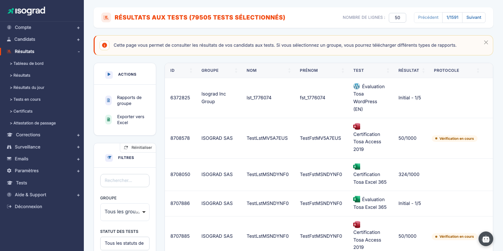
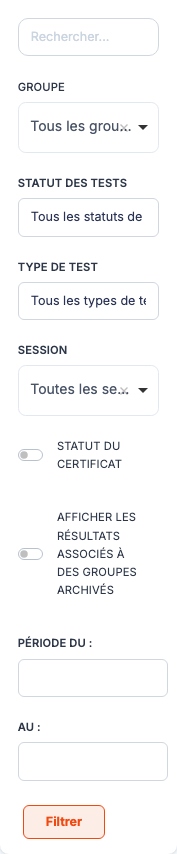
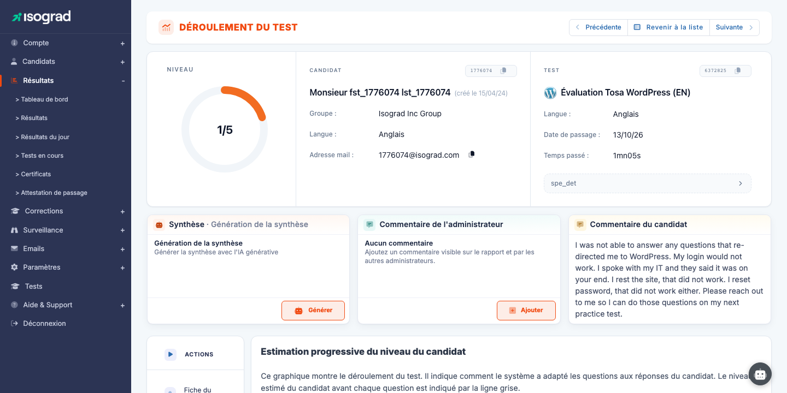
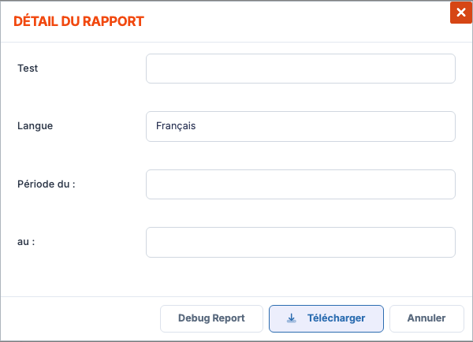

# Gestion des résultats

La page **Résultats aux tests** est le tableau de bord de l'activité de votre compte : tous les tests **passés**, **en cours** ou **à passer** par vos candidats y sont listés, avec leurs scores et l'accès aux rapports détaillés. C'est aussi depuis cette page que vous **téléchargez les rapports** et **certificats**, individuellement ou par lot, et que vous lancez l'envoi automatique aux candidats.

Accédez à cette page via le menu **Résultats**.

Chaque ligne du tableau représente **un test inscrit à un candidat**. Les colonnes par défaut :

| Colonne | Contenu |
|---|---|
| **Groupe** | Le groupe auquel appartient le candidat. |
| **Nom** / **Prénom** | Identité du candidat. |
| **Test** | Nom du sujet et type de test (évaluation, certification, positionnement). |
| **Résultat** | Score obtenu (selon le statut). Si le test n'est pas terminé, affiche *« Pas encore de résultat »*. Pour les tests à correction manuelle en attente, cette colonne devient **Correcteur**. |
| **Protocole** | Pour un test surveillé terminé ou en attente de notation, le statut de vérification du protocole de surveillance (en cours de vérification, validé, invalide). Vide pour un test non surveillé. |

Le tableau s'adapte au filtre **Statut des tests** : une colonne **Date de passage** s'ajoute pour les tests terminés, une colonne **Date de création** pour les tests à passer ou en cours. Le commutateur **Statut du certificat** ajoute la colonne du même nom.

Les **boutons d'action en bout de ligne** dépendent de l'état du test (voir [Actions sur une ligne](#actions-sur-une-ligne) ci-dessous).

> 💡 **Sous-pages liées** — Le menu **Résultats** dans la barre latérale propose aussi :
> - **[Tableau de bord](/ai/fr/dashboard/)** — métriques agrégées (nombre de tests terminés, temps moyen, répartition des scores) pour un groupe ou une session.
> - **Attestation de passage** — génération d'attestations officielles de passage de test. Cette entrée n'est proposée qu'aux centres agréés et aux comptes Éducation.

## Filtres et recherche {#filtres-et-recherche}

Le panneau **Filtres** à gauche du tableau permet de cibler une sous-population de tests :

- **Rechercher** — texte libre : nom, prénom, adresse email du candidat, nom du test, identifiant.
- **Groupe** — un seul groupe à la fois ; si le groupe a des sous-groupes, un sélecteur de **sous-groupe** apparaît pour affiner. Sélectionner un groupe **active les actions de rapport de groupe** (téléchargement de rapports en masse) — voir [Rapports de groupe](#rapports-de-groupe).
- **Statut des tests** — restreint l'affichage à un état précis (voir [Statuts de test](#statuts-de-test)).
- **Type de test** — évaluation, certification, gratuit, positionnement, etc.
- **Session** — restreint aux tests rattachés à une session de passage donnée. Ce filtre n'apparaît que si votre compte utilise les sessions.
- **Surveillé à distance** (commutateur, selon les options de votre compte) — ne garde que les tests passés sous surveillance à distance.
- **Statut du certificat** (commutateur, plateforme Tosa) — ajoute au tableau une colonne indiquant où en est le certificat de chaque certification.
- **Afficher les résultats associés à des groupes archivés** (commutateur) — par défaut, les résultats des groupes archivés sont masqués. Activez pour les voir.
- **Période du / au** — restreint l'affichage à un intervalle de dates ; renseignez les deux dates pour que le filtre s'applique.

Le bouton **Réinitialiser** en haut du panneau remet tous les filtres à leur valeur par défaut.

## Statuts de test {#statuts-de-test}

Le filtre **Statut des tests** propose plusieurs valeurs qui correspondent aux étapes de la vie d'un test :

- **À passer** — le candidat a été inscrit mais n'a pas encore démarré le test.
- **En cours** — le candidat a démarré le test et ne l'a pas terminé. Le test reste démarrable tant qu'il n'est pas marqué terminé. Un test interrompu par un administrateur reste *En cours* ici ; le badge **Arrêté par un administrateur** n'apparaît que sur la fiche du candidat (voir [Le tableau des tests planifiés](/ai/fr/candidates/#le-tableau-des-tests-planifies)).
- **Terminé** — le candidat a soumis ses réponses. Le score est calculé et le rapport disponible.
- **En attente de notation** — pour les tests comportant des questions à correction manuelle (rédaction, document déposé, copie scannée), le test est soumis mais nécessite l'intervention d'un correcteur.
- **Annulé** — l'inscription a été annulée avant que le candidat passe le test. Le crédit est restitué au compte.

> 💡 **« En attente de notation »** — Quand vous filtrez sur ce statut, la colonne **Score** est remplacée par **Correcteur** : c'est l'administrateur ou le binôme en charge de la correction (ou **IA** tant qu'une notation par l'IA est en cours). Voir [Noter un test](#noter-un-test) ci-dessous.

## Actions sur une ligne {#actions-sur-une-ligne}

Les boutons d'action visibles en bout de ligne dépendent du statut du test et des privilèges de votre compte :

- **Analyse** — sur un test terminé, ouvre la page de résultat du candidat (voir [Voir le détail d'un résultat](#voir-le-detail-d-un-resultat)).
- **Noter** (icône évaluation) — pour les tests en attente de notation, ouvre l'écran de notation (voir [Correction des copies](/ai/fr/grading/#noter)).
- **Voir la notation** (icône œil) — remplace **Noter** en double correction, une fois que vous avez soumis votre notation de toutes les questions en attente : le test ne s'ouvre plus qu'en lecture seule pour vous.
- **Attribuer le test à un correcteur** (icône silhouette) — pour les tests en attente de notation, affecte le test à un correcteur ou à un binôme de correcteurs de votre compte.
- **Télécharger le certificat bundle** (icône diplôme) — sur un bundle de certifications terminé, à la place du bouton **Analyse** : ouvre le certificat PDF du bundle.

## Rapports de groupe {#rapports-de-groupe}

Une fois un **groupe sélectionné** dans le filtre, plusieurs actions de masse deviennent disponibles dans le menu déroulant **Rapports de groupe** en haut du tableau :

- **Télécharger le rapport de groupe** — un seul PDF synthétisant les résultats de tous les candidats du groupe à un test donné (comparaison, classement, statistiques globales).
- **Télécharger le rapport de progression de groupe** — pour les groupes ayant passé **deux** tests sur le même sujet (test initial + test final), génère un rapport comparant l'évolution.
- **Télécharger tous les rapports individuels** — un ZIP contenant un PDF par candidat.
- **Télécharger tous les rapports de progression individuels** — un ZIP avec un rapport de progression par candidat.
- **Télécharger tous les certificats** — un ZIP avec un diplôme par candidat certifié du groupe.
- **Envoyer son rapport à chaque candidat** — déclenche l'envoi par email du rapport de chaque candidat à son adresse.
- **Envoyer le certificat à chaque candidat** — idem pour les certifications validées.
- **Télécharger le fichier de compétences** — un export Excel détaillé des niveaux de compétence par candidat (utile pour des analyses RH).

### Sélection du test et de la période

Quand vous cliquez sur l'une des actions ci-dessus, une fenêtre s'ouvre vous permettant de préciser :

- Le **test** concerné (si le groupe a passé plusieurs sujets différents).
- La **langue** du rapport.
- La **période** (date de début / fin) — restreint aux tests passés dans cet intervalle.

Validez, et le rapport est généré. Pour les opérations longues (rapports de masse), la plateforme affiche un message *« Votre demande a bien été prise en compte. Vous recevrez un email dans moins de 24h. »* et le fichier vous est expédié dès qu'il est prêt.

> ⚠️ **Groupe obligatoire** — Tant qu'aucun groupe n'est sélectionné, le bouton **Rapports de groupe** affiche un message d'alerte invitant à choisir un groupe et à vider le champ de recherche. Les rapports de masse ne peuvent pas être générés sur la totalité de votre compte d'un seul coup.

## Voir le détail d'un résultat {#voir-le-detail-d-un-resultat}

Le bouton **Analyse** sur la ligne d'un test terminé ouvre la **page de résultat** du candidat pour ce test.

### L'en-tête du résultat

Le haut de la page réunit jusqu'à trois blocs :

- **Le niveau** — une jauge circulaire affichant le résultat obtenu. Pour un test avec navigation entre les questions, elle est suivie du nombre de **questions répondues**, **abandonnées**, **non affichées** et **correctes**. Tant que le test attend sa notation, un message le signale à la place de la jauge. Ce bloc n'existe pas pour les formulaires ni pour les profils psychométriques.
- **Le candidat** — son nom (avec sa date de création), puis son ou ses groupes, sa langue, son adresse email (avec un bouton de copie), son profil et son identifiant externe lorsqu'ils sont renseignés. Ce bloc est réservé aux administrateurs autorisés à consulter les candidats.
- **Le test** — le nom du test, la **langue**, la **date de passage** et le **temps passé**. Pour un test surveillé s'ajoutent la **vérification du protocole** et, le cas échéant, le **commentaire du surveillant** ; pour une certification, la mention *certificat envoyé le…* ou *certificat non envoyé*.

Les numéros affichés en haut des blocs candidat et test sont leurs identifiants ; un bouton permet de les copier.

### Synthèse et commentaires

Sous l'en-tête, des panneaux placés côte à côte complètent le résultat :

- **Synthèse** — le texte de synthèse du résultat. Si la synthèse par IA générative est activée sur votre compte, le bouton **Générer** la fait rédiger par l'IA ; vous pouvez ensuite la retoucher avec **Editer** ou la régénérer. Ce panneau n'apparaît pas pour les formulaires ni pour les profils psychométriques.
- **Commentaire de l'administrateur** — un commentaire libre que vous ajoutez avec **Ajouter** puis modifiez avec **Editer**. Il est visible sur le rapport et par les autres administrateurs ; le nom de son auteur et la date sont rappelés.
- **Commentaire du candidat** — le commentaire laissé par le candidat sur son test, en lecture seule. Ce panneau n'apparaît que si le candidat en a saisi un.

### La barre d'actions

Les boutons proposés dépendent du type de test, de son statut et de vos privilèges :

- **Fiche du candidat** — ouvre la fiche du candidat et la liste de ses tests.
- **Détails du test** (test terminé) — un menu donnant accès aux différentes vues du résultat, selon le type de test : **Déroulement**, **Voir les réponses** (la liste des questions avec la réponse du candidat), **Compétences**, **Analyse des compétences**, **Classement**.
- **Rapports PDF** — intitulé **Rapports & Certificats** sur la plateforme Tosa (test terminé) — un menu contenant **Obtenir le rapport en PDF** (une fenêtre demande la langue du rapport lorsque plusieurs sont disponibles), **Rapport de progression** (comparaison avec un autre test du candidat sur le même sujet) et, pour une certification dont le certificat a été envoyé, **Télécharger le certificat** — ou **Télécharger l'attestation de passage** si le score minimal de certification n'est pas atteint.
- **Recommandations de formation Linkedin Learning** — pour les sujets concernés.
- **Effacer l'analyse IA** — présent dès qu'une analyse par IA est enregistrée sur le test.
- **Analyser la surveillance** (test surveillé à distance par la surveillance Isograd) et **Voir les sorties du test** (test passé en plein écran ou avec liste blanche) — si vous disposez du privilège de consultation de la surveillance (voir [Surveillance des tests](/ai/fr/proctoring/)).

Pour les tests adaptatifs (où la difficulté s'ajuste aux réponses), la vue **Déroulement** affiche deux graphiques : l'**estimation progressive du niveau du candidat**, question après question, et les **questions classées par difficulté**.

## Noter un test {#noter-un-test}

Les tests qui contiennent des **questions à correction manuelle** (rédaction, document déposé, copie scannée, etc.) arrivent dans le statut **En attente de notation** une fois soumis : un correcteur doit noter chaque réponse avant que le résultat final soit calculé.

Depuis la page des résultats, vous pouvez :

- **Noter** un test en attente — l'icône **Noter** en bout de ligne ouvre l'écran de notation. Elle est proposée au correcteur attribué au test, aux deux membres du binôme attribué au test et aux administrateurs habilités à corriger les copies des autres correcteurs.
- **Attribuer un test à un correcteur** — l'icône correspondante ouvre une fenêtre avec deux listes, **Correcteur** et **Binôme de correcteurs** : un test est confié à l'un ou à l'autre, choisir dans une liste vide l'autre. Le bouton **Attribuer** valide. Les listes sont alimentées lorsque le tableau est filtré sur le statut **En attente de notation** ; la liste des binômes n'apparaît que si votre compte en a défini. Cette icône est réservée aux administrateurs habilités à corriger les copies des autres correcteurs.

L'attribution en masse, la notation avec la grille, l'annotation des copies PDF, la double correction et son harmonisation se font depuis le menu **Corrections** : voir le chapitre [Correction des copies](/ai/fr/grading/).

## Exporter vers Excel {#exporter-vers-excel}

Le bouton **Exporter vers Excel** dans la barre d'actions génère un fichier `.xlsx` listant tous les résultats **actuellement filtrés** à l'écran. L'export inclut, en plus des colonnes visibles, des informations supplémentaires comme l'**identifiant externe** (si configuré), l'**adresse email** du candidat et les **commentaires d'administration**.

Pratique pour :

- Faire un bilan trimestriel à plat dans Excel.
- Croiser les résultats avec d'autres données RH ou de formation.
- Archiver les résultats hors plateforme.

> 💡 **Quantité de données** — Si votre filtre couvre plus de quelques centaines de lignes, l'export peut prendre plusieurs secondes à se générer. La plateforme déclenche le téléchargement dès que le fichier est prêt.

## Surveillance à distance {#surveillance-a-distance}

La colonne **Protocole** signale les tests passés **sous surveillance** et l'état de leur vérification. Pour consulter les enregistrements (captures, vidéo, pièce d'identité) et valider ou invalider chaque passage, reportez-vous au chapitre [Surveillance des tests](/ai/fr/proctoring/).
