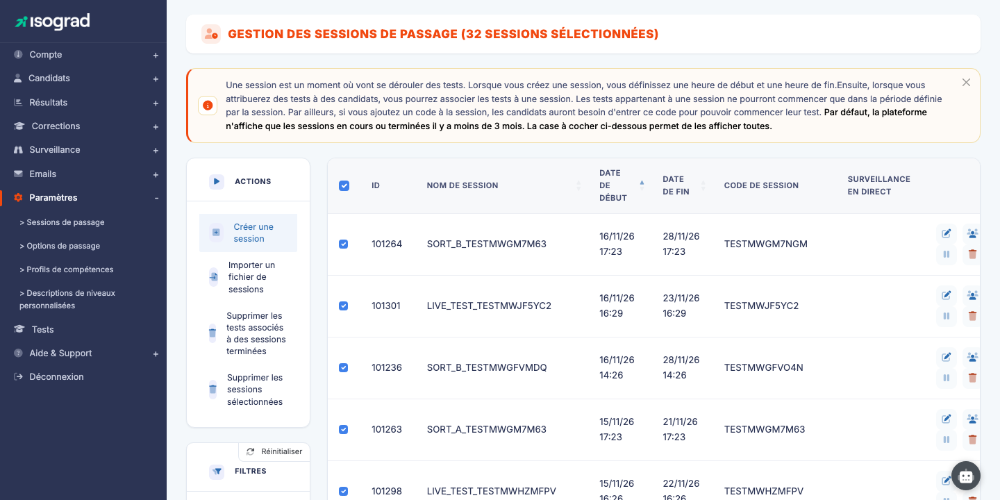
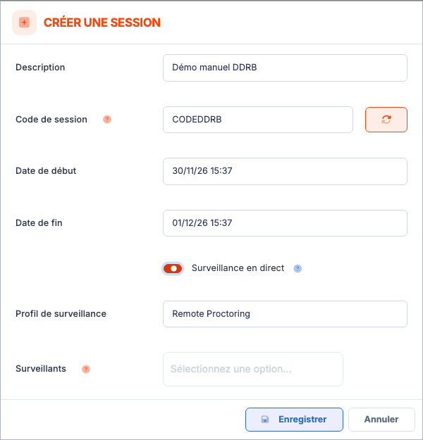
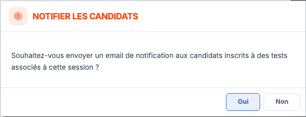
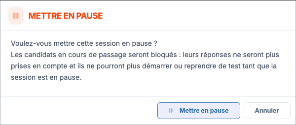
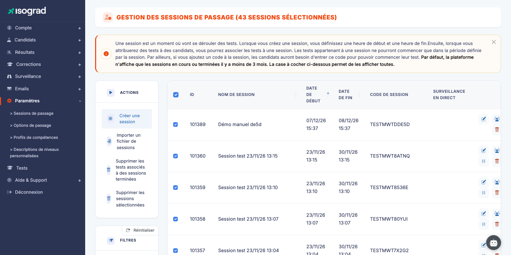
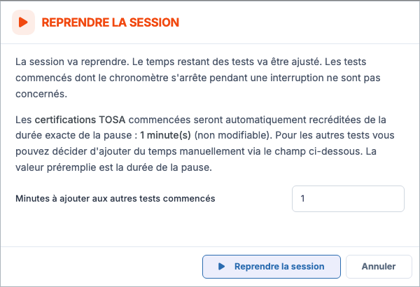
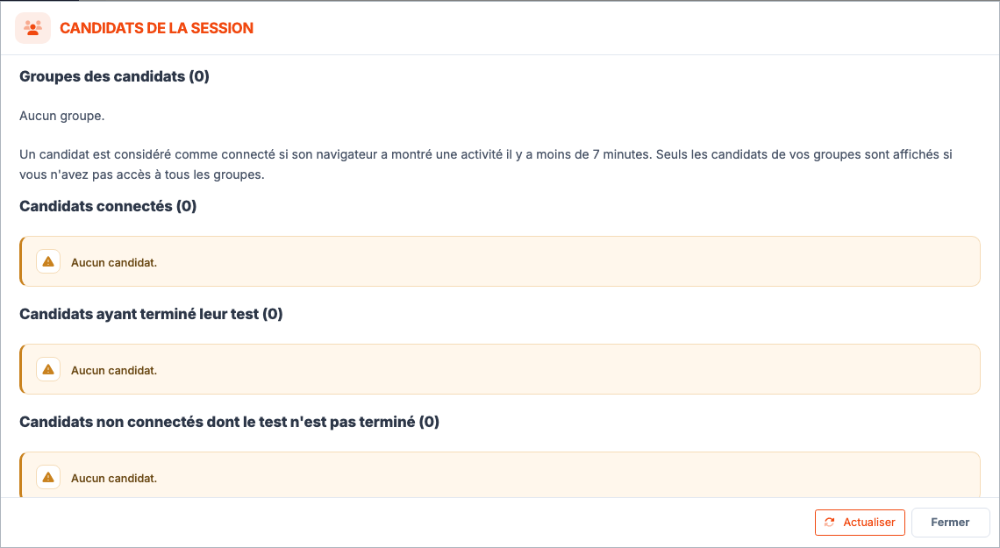
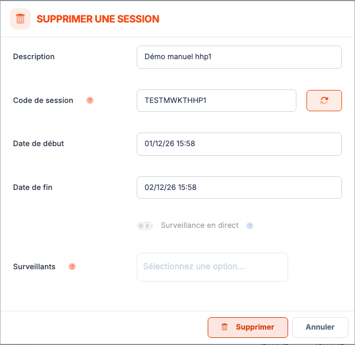
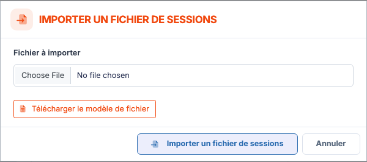

# Gestion des sessions de passage

Une **session de passage** est une fenêtre temporelle (date et heure de début, date et heure de fin) pendant laquelle vos candidats peuvent démarrer leur test. C'est l'outil principal pour **encadrer** un test : surveillé en présentiel, planifié sur un créneau précis, ou simplement protégé par un code partagé le jour J.

La page **Gestion des sessions de passage** liste toutes les sessions définies sur votre compte. Chaque ligne indique l'**identifiant**, le **nom**, la **date de début**, la **date de fin** et le **code de session** (s'il existe). Si la surveillance en direct est disponible sur votre compte, une colonne **Surveillance en direct** signale par une icône caméra les sessions surveillées en direct. Une pastille **En pause** à côté du nom indique une session [mise en pause](#mettre-en-pause-une-session). En bout de ligne, des boutons permettent de modifier la session, de [voir ses candidats](#candidats-de-la-session), de la mettre en pause, d'établir son [procès-verbal](#proces-verbal) et de la supprimer, selon l'état de la session et vos privilèges.

> 💡 **Affichage par défaut** — La plateforme affiche par défaut les sessions **en cours** et celles **terminées il y a moins de 3 mois**. Les sessions plus anciennes restent dans la base mais sont masquées de la liste. Les options d'affichage en bas du panneau de filtres permettent d'inclure les sessions plus anciennes ou de masquer les sessions passées.

## À quoi sert une session {#a-quoi-sert-une-session}

Quand vous inscrivez un candidat à un test, vous pouvez l'**associer à une session**. Les conséquences :

- Le candidat ne peut **démarrer** le test que dans la fenêtre temporelle de la session. Avant la date de début, le test apparaît mais reste verrouillé ; après la date de fin, il n'est plus accessible.
- Si la session a un **code**, le candidat doit le saisir pour démarrer son test — c'est l'examinateur qui le communique au moment voulu, ce qui ajoute une couche de sécurité contre les démarrages prématurés.

Vous pouvez aussi **affecter un groupe entier** à une session en une seule action depuis la page **Gestion des candidats** (voir [Actions de groupe](/ai/fr/candidates/#gerer-les-groupes)). C'est la façon habituelle d'organiser une journée d'examen pour une promotion ou une session de formation.

> 💡 **Sans session** — Une inscription **sans session** signifie que le candidat peut démarrer son test à tout moment dès qu'il a reçu son invitation. Les sessions ne sont donc utiles que si vous voulez **encadrer** le passage dans le temps.

## Créer une session {#creer-une-session}

### Procédure

1. Depuis la page **Gestion des sessions de passage**, cliquez sur **Créer une session** dans la barre d'actions.

    

2. Remplissez les champs :

    - **Description** — libellé qui apparaîtra dans la liste (colonne *Nom de session*) et dans le formulaire d'inscription d'un candidat. Choisissez un nom parlant (« Promotion 2026 — session du 14/03 »).
    - **Code de session** (facultatif) — mot de passe que les candidats devront saisir pour démarrer leur test. À communiquer **uniquement le jour de la session**. Le bouton de régénération à droite du champ propose un code aléatoire.
    - **Date de début** et **Date de fin** — fenêtre pendant laquelle les tests rattachés à cette session pourront être démarrés. Saisissez le format `JJ/MM/AA HH:MM`.
    - **Surveillance en direct** (commutateur, facultatif) — n'apparaît que si votre compte utilise la surveillance à distance Isograd. Activez-le pour que les surveillants puissent suivre **en temps réel** la caméra et l'écran des candidats de la session (voir [Surveillance en direct](/ai/fr/proctoring/#surveillance-en-direct)). Le champ **Profil de surveillance** (obligatoire) apparaît alors : choisissez un profil de surveillance à distance Isograd **avec enregistrement vidéo**. Ce profil est **imposé à tous les tests** inscrits sur la session.
    - **Surveillants** (facultatif) — les administrateurs du compte disposant du privilège *Surveiller en direct les sessions de passage* qui encadrent la session. Une fois la session terminée, ils en génèrent et signent le [procès-verbal](#proces-verbal) ; si la session est surveillée en direct, ils suivent aussi les candidats en temps réel. Ce champ est proposé pour toute session, surveillée en direct ou non.

3. Cliquez sur **Enregistrer**. La session apparaît immédiatement dans le tableau.

> 💡 **Profil de surveillance d'une session** — Hors surveillance en direct, une session n'impose pas de profil de surveillance : le profil se choisit **lors de l'inscription** du candidat au test (ou via l'action de groupe *Assigner une session ou un profil de surveillance*). Si le commutateur **Surveillance en direct** est grisé, un message dans le formulaire indique qu'aucun profil compatible n'existe encore : créez d'abord un profil de surveillance à distance Isograd avec enregistrement vidéo (menu **Surveillance → Profils de surveillance**).

> ⚠️ **Champs obligatoires et dates cohérentes** — La description et les deux dates sont obligatoires, et la date de début doit précéder la date de fin : sinon un message s'affiche et la session n'est pas créée.

> 💡 **Fuseau horaire** — Si le fuseau horaire de votre compte n'a pas encore été défini, la page vous demande de le choisir (fenêtre **Configurer votre fuseau horaire**) avant de créer votre première session : les dates des sessions sont exprimées dans ce fuseau.

## Modifier une session {#modifier-une-session}

1. Sur la ligne de la session, cliquez sur l'icône **Modifier** (crayon) en bout de ligne. La fenêtre de modification s'ouvre, pré-remplie avec les valeurs actuelles.

2. Ajustez les champs souhaités (nom, code, dates, surveillants, surveillance en direct). Désactiver la **Surveillance en direct** retire le profil imposé par la session ; les surveillants sont conservés.

3. Cliquez sur **Enregistrer**.

### Notification des candidats inscrits

Après chaque modification enregistrée, la plateforme propose d'envoyer un email de notification aux candidats de la session :

- **Oui** — envoie un email aux candidats dont un test rattaché à cette session **n'a pas encore été commencé**, les informant du créneau.
- **Non** — la session est modifiée silencieusement, sans email.

> 💡 **Quand notifier ?** — Répondez **Non** si vous n'avez changé ni les dates ni le code. Notifiez systématiquement si vous **avancez** la date ou si vous **raccourcissez** la fenêtre — les candidats doivent en être informés. Pour un simple **report** de quelques minutes ou un ajustement mineur, vous pouvez choisir de ne pas envoyer d'email pour éviter de saturer les boîtes.

## Mettre en pause et reprendre une session {#mettre-en-pause-une-session}

Un imprévu pendant un examen (coupure réseau, évacuation, incident dans la salle) peut vous obliger à **interrompre temporairement** tous les candidats d'une session. Plutôt que de modifier les dates ou de réinitialiser chaque test, vous pouvez **mettre la session en pause**, puis la **reprendre** en rendant aux candidats le temps perdu.

Le bouton **Mettre en pause** (icône pause) n'apparaît en bout de ligne que pour une session **en cours**, c'est-à-dire entre sa date de début et sa date de fin, et uniquement si vous disposez du privilège d'écriture sur les sessions.

### Mettre en pause

1. Sur la ligne de la session en cours, cliquez sur **Mettre en pause**.

    

2. Confirmez. Dès cet instant, les candidats en train de passer un test de cette session sont **bloqués** : leurs réponses ne sont plus prises en compte et ils voient un message *« Session en pause »*. Aucun candidat de la session ne peut démarrer ou reprendre de test tant que la pause dure.

    

La pastille **En pause** s'affiche à côté du nom de la session et le bouton devient **Reprendre la session** (icône lecture).

### Reprendre

1. Sur la ligne de la session en pause, cliquez sur **Reprendre la session**.

    

2. La fenêtre de reprise récapitule ce qui va se passer pour les tests **commencés** :

    - Sur un compte Tosa, les **certifications TOSA** commencées sont automatiquement **recréditées de la durée exacte de la pause** ; cette valeur n'est pas modifiable.
    - Pour les **autres tests commencés**, le champ **Minutes à ajouter aux autres tests commencés** est pré-rempli avec la durée de la pause ; ajustez-le si nécessaire (par exemple pour accorder quelques minutes de remise en route).
    - Les tests dont le chronomètre s'arrête de lui-même pendant une interruption ne sont pas concernés.

3. Confirmez. La session reprend, les candidats peuvent continuer et un message indique le nombre de tests commencés auxquels du temps a été ajouté.

> ⚠️ **Session expirée pendant la pause** — Si la date de fin de la session est dépassée pendant la pause, la reprise est refusée : **modifiez d'abord la date de fin** de la session, puis reprenez-la.

> 💡 **Pause ou arrêt d'un seul test ?** — La pause agit sur **tous** les candidats de la session. Pour interrompre un seul candidat, utilisez le bouton **Arrêter le test** sur sa fiche d'inscription (voir [Le tableau des tests planifiés](/ai/fr/candidates/#le-tableau-des-tests-planifies)).

## Suivre les candidats d'une session {#candidats-de-la-session}

Le bouton **Voir les candidats** en bout de ligne affiche, à tout moment, où en sont les candidats inscrits sur la session — pratique le jour de l'examen pour repérer d'un coup d'œil qui n'est pas encore connecté. Il est proposé aux administrateurs autorisés à consulter les candidats.

La fenêtre **Candidats de la session** présente :

- **Groupes des candidats** — une pastille par groupe, avec le nombre de candidats concernés.
- **Candidats connectés** — les candidats dont le test est commencé et qui sont connectés : nom, prénom, email, test et heure de début. Un candidat est considéré comme connecté si son navigateur a montré une activité il y a moins de 7 minutes.
- **Candidats ayant terminé leur test** — avec les heures de début et de fin.
- **Candidats non connectés dont le test n'est pas terminé** — avec leur statut : *Test non commencé*, *Test commencé* ou *Test commencé, dernière activité le…*.

Le bouton **Actualiser** recharge les listes sans fermer la fenêtre.

> 💡 **Vos groupes uniquement** — Si vous n'avez pas accès à tous les groupes du compte, seuls les candidats de vos groupes sont affichés.

## Procès-verbal de session {#proces-verbal}

Une fois la session **terminée** (date de fin dépassée), un surveillant peut en établir le **procès-verbal** (PV) : un document PDF qui récapitule le déroulement de la session et qu'il **signe électroniquement** à l'aide d'un code reçu par email.

Le bouton de PV apparaît en bout de ligne d'une session terminée pour les **surveillants de la session** (champ *Surveillants* du formulaire) et pour les administrateurs habilités à établir le PV de toutes les sessions. Son aspect indique l'état du PV :

- **Générer le PV de session** — aucun PV n'a encore été généré.
- **Visualiser le PV de session (à signer)** — le PV est généré, en attente de signature.
- **Visualiser le PV de session (signé)** — icône verte : le PV est signé et définitif.

### Générer le PV

1. Sur la ligne de la session terminée, cliquez sur **Générer le PV de session**.
2. Saisissez si besoin vos **observations** : déroulement de la session, incidents constatés.
3. Cliquez sur **Générer le PV**. Le PV est établi à partir des données de la session à cet instant, et un **code de signature à 6 chiffres** vous est envoyé par email ; un message rappelle l'adresse à laquelle il a été envoyé.

### Contenu du PV

- **Identification de la session** — compte, numéro et période de la session, surveillance en direct ou non, surveillants, épreuves, nombre d'inscrits, de présents et d'absents.
- **Feuille de présence** — pour chaque candidat : présence, heures de début et de fin, aménagements (temps majoré, interface d'accessibilité, chronomètre suspendu).
- **Déroulement de la session** — pauses de la session, arrêts d'épreuve, réajustements de temps.
- **Incidents constatés** — y compris les incidents signalés par les surveillants pendant une surveillance en direct.
- **Observations du surveillant** et **signature**.

### Signer le PV

1. Cliquez sur **Visualiser le PV de session (à signer)**. La fenêtre rappelle la date de génération et son auteur.
2. Saisissez le **code de signature** reçu par email et cliquez sur **Signer le PV**.

Tant que le PV n'est pas signé, la fenêtre propose aussi :

- **Télécharger le PDF** — le document porte alors la mention *Document provisoire, non signé*.
- **Recevoir un nouveau code** — envoie un nouveau code à l'administrateur connecté ; un autre surveillant de la session peut ainsi signer à la place de celui qui a généré le PV.
- **Modifier et régénérer** — rouvre la fenêtre de génération avec vos observations, pour établir de nouveau le PV à partir des données actuelles. Les codes déjà envoyés ne sont plus valables.

> ⚠️ **Un PV signé est définitif** — Une fois signé, le procès-verbal ne peut plus être modifié ni régénéré : seul le téléchargement du PDF reste proposé. La signature enregistre le nom et l'email du signataire, la date et une empreinte du document.

Le code de signature est valable **30 minutes**. Après cinq saisies erronées, il est bloqué : demandez-en un nouveau avec **Recevoir un nouveau code**. La signature n'est pas possible lorsque vous êtes connecté en alias sur le compte.

## Supprimer une session {#supprimer-une-session}

### Supprimer une seule session

1. Sur la ligne de la session, cliquez sur l'icône **Supprimer** (poubelle).

    

2. Confirmez. La session est supprimée immédiatement.

Les tests qui étaient associés à cette session restent inscrits aux candidats — ils deviennent simplement **sans session**, donc démarrables à tout moment. Si vous voulez aussi supprimer ces tests, voir [Supprimer les tests associés à des sessions terminées](#supprimer-tests-passes) ci-dessous.

### Supprimer plusieurs sessions à la fois

1. Cochez les cases en début de ligne pour sélectionner les sessions à supprimer.
2. Cliquez sur **Supprimer les sessions sélectionnées** dans la barre d'actions.
3. Confirmez. Toutes les sessions cochées sont supprimées en une opération.

> ⚠️ **Suppression définitive** — Comme partout sur la plateforme, la suppression est irréversible. Pour conserver l'historique d'une session passée sans la voir dans la liste, laissez-la simplement vieillir : au-delà de 3 mois après la date de fin, elle disparaît automatiquement de l'affichage par défaut.

## Importer plusieurs sessions {#importer-sessions}

L'import permet de créer plusieurs sessions en une seule opération à partir d'un fichier Excel — utile en début d'année pour saisir tout le calendrier des examens.

### Procédure

1. Depuis la barre d'actions, cliquez sur **Importer un fichier de sessions**.

    

2. Cliquez sur le lien **Télécharger le modèle de fichier** pour récupérer le fichier Excel attendu. Le modèle comporte une feuille `Import` avec les colonnes :

    | Colonne | Description |
    |---|---|
    | `des` | Nom de la session |
    | `psw` | Code de session (facultatif) |
    | `dat_sta_day`, `dat_sta_month`, `dat_sta_year`, `dat_sta_hour`, `dat_sta_min` | Date de début, décomposée en colonnes |
    | `dat_end_day`, `dat_end_month`, `dat_end_year`, `dat_end_hour`, `dat_end_min` | Date de fin, décomposée en colonnes |

3. Remplissez le modèle, une session par ligne. Le nom de la session et le jour, le mois et l'année des deux dates sont obligatoires ; l'heure et les minutes valent 0 si elles sont omises. Ne renommez ni la feuille `Import` ni les colonnes, et n'en ajoutez pas : un fichier comportant une colonne inconnue est rejeté en entier. Un fichier peut contenir jusqu'à 1 000 sessions.

4. Revenez sur la plateforme, sélectionnez votre Excel rempli dans le champ **Fichier à importer**, puis cliquez sur **Importer un fichier de sessions**.

5. La plateforme affiche le nombre de sessions importées et, le cas échéant, la liste des lignes rejetées avec leur motif.

> ⚠️ **L'import crée toujours de nouvelles sessions** — Ré-importer un fichier ne met pas à jour les sessions existantes : chaque ligne crée une nouvelle session, même si une session du même nom existe déjà. Après une erreur, corrigez les sessions concernées à l'écran ou supprimez-les avant de ré-importer.

> 💡 **Surveillants et surveillance en direct** — Ils ne peuvent pas être renseignés par l'import : modifiez ensuite les sessions concernées.

## Supprimer les tests associés à des sessions terminées {#supprimer-tests-passes}

Au fil du temps, votre compte peut accumuler des **tests non passés** rattachés à des sessions dont la date de fin est dépassée. La plateforme expose une action de masse pour les nettoyer en une fois.

1. Cliquez sur **Supprimer les tests associés à des sessions terminées** dans la barre d'actions.
2. Confirmez. Tous les tests **en attente** (jamais démarrés) dont la session est terminée sont désinscrits des candidats concernés.

> ⚠️ **Périmètre** — Cette action ne touche **pas** les tests **démarrés**, **terminés** ou **annulés**. Elle ne touche pas non plus les sessions elles-mêmes — seulement les inscriptions de tests en attente qui leur étaient rattachées. Les crédits consommés à l'inscription sont restitués au compte.

## Filtres et affichage {#filtres-et-affichage}

Le panneau **Filtres** à gauche de la liste propose plusieurs réglages pour cibler les sessions à afficher :

- **Rechercher** — texte libre. Filtre la liste sur le nom ou l'identifiant de la session.
- **Ne pas afficher les sessions passées** — masque toutes les sessions dont la date de fin est antérieure à maintenant. Utile en cours d'année pour ne voir que les sessions à venir.
- **Afficher les sessions terminées depuis plus de 3 mois** — par défaut désactivé. Activez-le pour faire apparaître l'historique ancien (par exemple pour retrouver une session d'il y a 6 mois).

Le tableau est **triable** sur le nom et les dates de début et de fin : cliquez sur l'en-tête de colonne pour basculer entre tri ascendant et descendant. Par défaut, les sessions sont triées par **date de début**.
